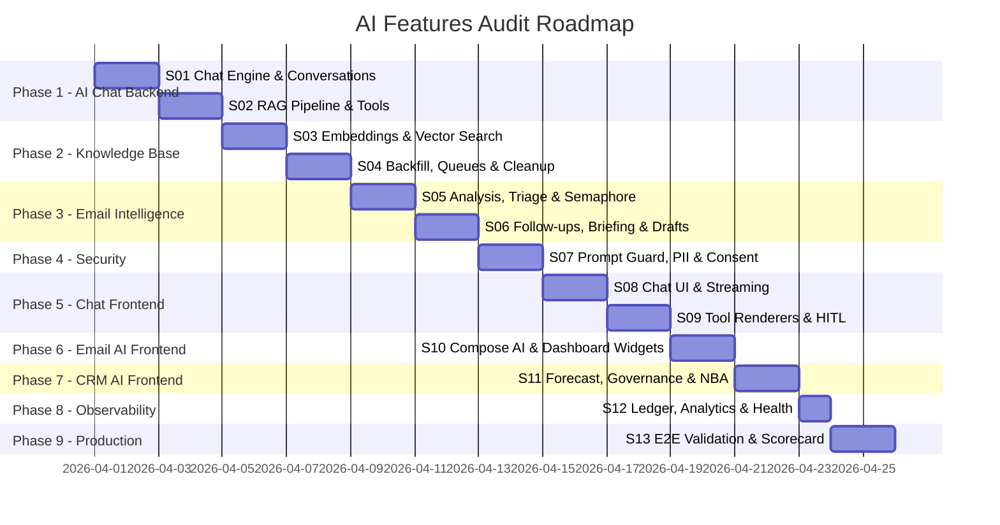

# AI Features Audit — Roadmap

## Timeline

## Sprint Breakdown

| Sprint | Title | Phase | SP | Addresses |
|--------|-------|-------|---:|-----------|
| S01 | Chat Engine & Conversation Management | 1 | 15 | CHAT-C1, CHAT-C2, CHAT-H1, CHAT-H2, CHAT-H3, CHAT-H4 |
| S02 | RAG Pipeline, Routing & Tools | 1 | 13 | CHAT-M1, CHAT-M2, CHAT-M3, CHAT-L1 |
| S03 | Embeddings & Vector Search | 2 | 14 | KB-C1, KB-H1, KB-H2, KB-H3 |
| S04 | Backfill, Queues & Orphan Cleanup | 2 | 12 | KB-M1, KB-M2, KB-M3, KB-L1 |
| S05 | Email Analysis, Triage & Semaphore | 3 | 15 | EI-C1, EI-H1, EI-H2, EI-H3 |
| S06 | Follow-ups, Briefing & Draft Generation | 3 | 12 | EI-M1, EI-M2, EI-M3, EI-M4, EI-L1 |
| S07 | Prompt Guard, PII Detection & Consent | 4 | 16 | SEC-C1, SEC-H1, SEC-H2, SEC-H3, SEC-M1, SEC-M2, SEC-L1 |
| S08 | Chat UI, Streaming & Accessibility | 5 | 14 | FE-C1, FE-H1, FE-H2, FE-H4 |
| S09 | Tool Renderers, HITL & Mobile | 5 | 12 | FE-H3, FE-M1, FE-M2, FE-M3, FE-L1 |
| S10 | Compose AI & Dashboard Widgets | 6 | 16 | EF-H1, EF-H2, EF-H3, EF-H4, EF-M1, EF-M2, EF-M3, EF-M4, EF-L1, EF-L2 |
| S11 | Forecast, Governance & NBA | 7 | 13 | CRM-H1, CRM-H2, CRM-M1, CRM-M2, CRM-M3, CRM-L1, CRM-L2 |
| S12 | Ledger, Analytics & Health Endpoints | 8 | 12 | OBS-H1, OBS-H2, OBS-M1, OBS-M2, OBS-M3, OBS-L1 |
| S13 | E2E Production Validation | 9 | 13 | All — production verification |
| **Total** | | | **177** | **66 findings** |

## Audit Scores (Pre-Fix Baseline)

| Component | Score | Critical | High | Medium | Low |
|-----------|------:|:--------:|:----:|:------:|:---:|
| AI Chat Backend | 6.5/10 | 2 | 4 | 3 | 1 |
| Knowledge Base & RAG | 6.0/10 | 1 | 3 | 3 | 1 |
| Email Intelligence | 6.5/10 | 1 | 3 | 4 | 1 |
| AI Security & Guards | 5.5/10 | 1 | 3 | 2 | 1 |
| AI Chat Frontend | 6.0/10 | 1 | 4 | 3 | 1 |
| Email AI Frontend | 7.0/10 | 0 | 4 | 4 | 2 |
| CRM AI Frontend | 7.5/10 | 0 | 2 | 3 | 2 |
| Observability & Cost | 7.0/10 | 0 | 2 | 3 | 1 |
| **Overall** | **6.5/10** | **6** | **25** | **25** | **10** |
