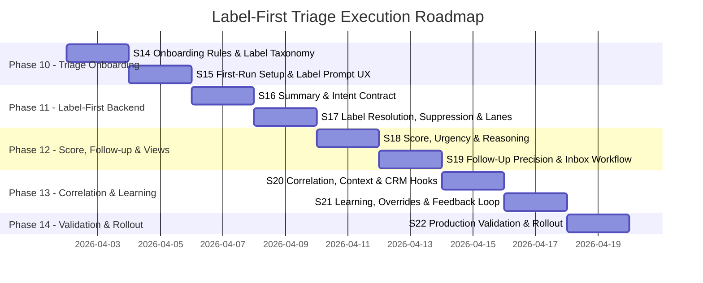

# Label-First Triage Execution Roadmap

## Goal

Turn the conceptual triage roadmap into an execution program with explicit phases and sprints, aligned with the existing `ai-features-audit` structure.

This program operationalizes the PMSync method:

1. summarize the email
2. identify intent and context
3. apply user-driven labels
4. compute score, urgency, and lane
5. create follow-up only when justified
6. correlate the result into the PMS operating model

## Workstream IDs

| ID | Gap | Target Outcome |
|----|-----|----------------|
| LFT-A1 | No first-run triage onboarding | Users define a few essential triage rules in minutes |
| LFT-A2 | Labels exist but are not taught as workflow rules | Label taxonomy becomes operational and user-driven |
| LFT-B1 | Summary -> label -> score contract not enforced | Backend triage follows one normalized pipeline |
| LFT-B2 | Passive updates and alerts can still surface too high | Suppression and contradiction handling become deterministic |
| LFT-C1 | Score and urgency are not explainable enough | Priority reasoning and lane assignment become visible |
| LFT-C2 | Follow-up precision is still inconsistent | `TODO` and `WAITING_FOR` become explicit and sparse |
| LFT-D1 | Correlation to contacts, tasks, reminders, CRM is weak | Triage outputs attach to the PMS operating model |
| LFT-D2 | No durable learning / override loop | User corrections improve future triage |
| LFT-E1 | Quality is not fully measured on real production mail | Scorecard and validation become repeatable and live |

## Timeline



## Phase Breakdown

| Phase | Title | Sprints | SP | Focus |
|-------|-------|---------|---:|-------|
| 10 | Triage Onboarding | S14-S15 | 15 | collect user rules, label taxonomy, onboarding UX |
| 11 | Label-First Backend | S16-S17 | 15 | normalize summary, intent, labels, suppression, lanes |
| 12 | Score, Follow-up & Views | S18-S19 | 15 | explainable urgency, precise follow-ups, inbox workflow |
| 13 | Correlation & Learning | S20-S21 | 12 | attach triage to PMS context and user overrides |
| 14 | Validation & Rollout | S22 | 6 | live scorecard, rollout, regression gates |
| **Total** | | **S14-S22** | **63** | |

## Sprint Breakdown

| Sprint | Title | Phase | SP | Addresses |
|--------|-------|-------|---:|-----------|
| S14 | Onboarding Rules & Label Taxonomy | 10 | 8 | LFT-A1, LFT-A2 |
| S15 | First-Run Setup & Label Prompt UX | 10 | 7 | LFT-A1, LFT-A2 |
| S16 | Summary & Intent Extraction Contract | 11 | 7 | LFT-B1 |
| S17 | Label Resolution, Suppression & Lanes | 11 | 8 | LFT-B2, LFT-C1 |
| S18 | Score, Urgency & Reasoning | 12 | 7 | LFT-C1 |
| S19 | Follow-Up Precision & Inbox Workflow | 12 | 8 | LFT-C2 |
| S20 | Correlation, Context & CRM Hooks | 13 | 6 | LFT-D1 |
| S21 | Learning, Overrides & Feedback Loop | 13 | 6 | LFT-D2 |
| S22 | Production Validation & Rollout | 14 | 6 | LFT-E1 |

## Delivery Rules

1. Every sprint must preserve the label-first contract.
2. Every behavioral change must be validated on real tenant data when feasible.
3. Every score or lane change must include visible reasoning.
4. No sprint should increase false-positive urgency for newsletters, passive updates, or routine alerts.
5. Follow-up creation must become more selective, not more expansive.

## Validation Gates

No phase is complete until these dimensions are green:

- `summary quality`
- `label fit`
- `priority / score fit`
- `follow-up precision`
- `lane consistency`
- `briefing relevance`
- `PII / placeholder safety`

Recommended live command set:

```bash
node scripts/validate-ai-features-production.mjs --dim=categorize,priority,follow-up-detection,triage,briefing
```

## Recommended Order of Execution

1. Finish onboarding and label teaching first.
2. Lock the backend contract second.
3. Only then tune score and follow-up behavior.
4. Add learning after the base pipeline is deterministic.
5. End with production validation and rollout notes.
