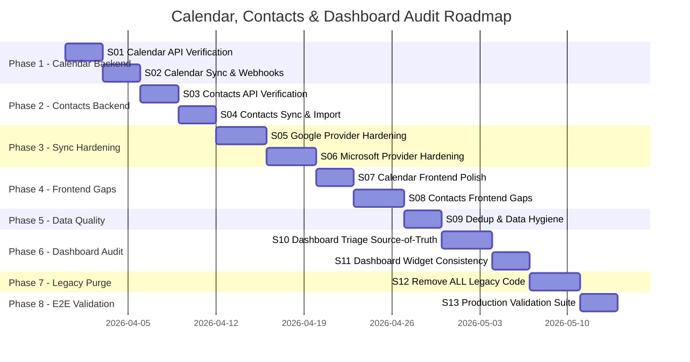

# Calendar, Contacts & Dashboard Audit — Roadmap

## Timeline

## Sprint Breakdown

| Sprint | Title | Phase | SP | Addresses |
|--------|-------|-------|-----|-----------|
| S01 | Calendar API Endpoint Verification | 1 | 13 | CAL-H1, CAL-H2, CAL-H4 |
| S02 | Calendar Sync, Webhooks & Token Management | 1 | 15 | CAL-C1, CAL-C2, CAL-C3, CAL-M3 |
| S03 | Contacts API Endpoint Verification | 2 | 12 | CON-H2, CON-M4, CON-M5, REM-M1 |
| S04 | Contacts Sync, Import & Encoding | 2 | 14 | CON-C1, CON-C2, CON-C3, CON-M1 |
| S05 | Google Calendar+Contacts Provider Hardening | 3 | 15 | CAL-C2, CON-C1, CON-C2, CON-C3, CON-M3 |
| S06 | Microsoft Calendar+Contacts Provider Hardening | 3 | 14 | CAL-C3, CON-H4, CAL-H3 |
| S07 | Calendar Frontend Polish & RSVP Wiring | 4 | 12 | CAL-H1, CAL-H3, CAL-M1, CAL-M2, CAL-L1 |
| S08 | Contacts Frontend — vCard UI, History, Dedup | 4 | 15 | CON-H1, CON-H3, CON-L1, CON-L2, CON-L3 |
| S09 | Data Quality, Dedup Engine & Hygiene | 5 | 12 | CON-H3, CON-L1, CON-L2, CON-M2 |
| S10 | Dashboard: Email Triage as Source of Truth | 6 | 15 | DASH-C1, DASH-C2, DASH-H3 |
| S11 | Dashboard: Widget Consolidation & Consistency | 6 | 12 | DASH-H1, DASH-H2, DASH-H4, DASH-M1, DASH-M3 |
| S12 | Remove ALL Legacy Code | 7 | 14 | LEG-C1, LEG-C2, LEG-H1-H6, LEG-M1-M3 |
| S13 | E2E Production Validation Suite | 8 | 13 | All — validation layer |
| **Total** | | | **176** | |

## Audit Scores (Pre-Fix Baseline)

| Component | Score | Critical | High | Medium | Low |
|-----------|-------|----------|------|--------|-----|
| Calendar Backend | 7.0/10 | 3 | 4 | 4 | 2 |
| Contacts Backend | 6.5/10 | 3 | 4 | 5 | 3 |
| Reminders | 8.0/10 | 0 | 2 | 2 | 0 |
| Dashboard Widgets | 6.0/10 | 2 | 4 | 3 | 0 |
| Legacy Code | 5.5/10 | 2 | 6 | 3 | 0 |
| **Overall** | **6.5/10** | **10** | **20** | **17** | **5** |

## Milestones

### M1: Calendar Backend Verified (after S02)
- [ ] All 20+ calendar endpoints return correct responses
- [ ] RSVP flow verified end-to-end (click → ICS → email)
- [ ] Webhook renewal cron implemented
- [ ] Sync token expiration triggers full-sync fallback
- [ ] Microsoft delta token 410 handled gracefully
- [ ] Focus-time and meeting-prep tested on production

### M2: Contacts Backend Verified (after S04)
- [ ] All 20+ contacts endpoints return correct responses
- [ ] Google sync token 7-day expiry handled (full resync fallback)
- [ ] Contact etag checked on provider updates
- [ ] Sequential write enforcement for same user
- [ ] vCard import handles UTF-8, Latin-1, quoted-printable
- [ ] Contact history endpoint returns real data (not stub)

### M3: Sync Providers Hardened (after S06)
- [ ] Google Calendar: sync token expiry → full sync
- [ ] Google Contacts: EXPIRED_SYNC_TOKEN → full sync
- [ ] Google: etag conflict detection on updates
- [ ] Microsoft Calendar: HTTP 410 → full resync
- [ ] Microsoft Contacts: webhook fallback polling
- [ ] Both: webhook subscription auto-renewal cron
- [ ] Both: rate limit handling with exponential backoff

### M4: Frontend Gaps Closed (after S08)
- [ ] vCard import UI accessible from contacts page
- [ ] Contact history shows real interaction data
- [ ] Duplicate detection shown during import
- [ ] RSVP buttons wired and working in browser
- [ ] Calendar DST edge cases handled in event forms
- [ ] Contact sidebar filters persisted (URL params)

### M5: Data Quality Assured (after S09)
- [ ] Duplicate detection engine operational
- [ ] Contact merge UI functional
- [ ] Relationship scores recalculated on email sync
- [ ] Extract-from-emails deduplicates against existing

### M6: Dashboard Single Source of Truth (after S11)
- [ ] Email triage is THE source of truth for email priority on dashboard
- [ ] PriorityInboxWidget removed or replaced by triage-based widget
- [ ] Dashboard email counts match sidebar email counts exactly
- [ ] BriefingWidget and InsightsWidget deduplicated (one removed)
- [ ] DeadlinesWidget uses only calendar events (not AI-guessed deadlines)
- [ ] StaleContactsWidget uses only CRM API (fallback removed)
- [ ] All widgets consent-gated consistently
- [ ] Dashboard stats query unified with folder count query

### M7: Zero Legacy Code (after S12)
- [ ] GraphExpansionService removed, EntityGraphService only
- [ ] ConversationMessage.content field removed (parts only)
- [ ] Deprecated health endpoints removed (/metrics is only path)
- [ ] Session.tenantId deprecated field cleaned
- [ ] Header theme toggle dead props removed
- [ ] multiAgentApi shim removed
- [ ] All @deprecated annotations resolved (removed or un-deprecated)
- [ ] CRM module properly wired to calendar/contacts services
- [ ] `npx madge --circular` clean
- [ ] Zero `@deprecated` in codebase

### M8: Production Validated (after S13)
- [ ] All endpoints verified on Railway deployment
- [ ] Browser E2E passes via Playwright CDP
- [ ] Dashboard shows consistent data across all widgets
- [ ] Data consistency script reports 0 issues
- [ ] Scorecard >= 9.0/10 across all components

## Go/No-Go Criteria Between Phases

### Phase 1→2: Calendar → Contacts
- [ ] Calendar endpoint verification complete
- [ ] Webhook renewal mechanism in place
- [ ] Backend tsc passing

### Phase 2→3: Contacts → Sync Hardening
- [ ] Contacts endpoint verification complete
- [ ] Import encoding issues documented
- [ ] Backend tsc passing

### Phase 3→4: Sync → Frontend
- [ ] All sync token expiry scenarios handled
- [ ] Webhook auto-renewal tested
- [ ] Backend tsc + existing tests passing

### Phase 4→5: Frontend → Data Quality
- [ ] vCard import UI functional
- [ ] Contact history populated
- [ ] Frontend tsc passing

### Phase 5→6: Data Quality → Dashboard
- [ ] Dedup engine operational
- [ ] Data hygiene scripts created
- [ ] All tests passing

### Phase 6→7: Dashboard → Legacy Purge
- [ ] Dashboard widget data consistent
- [ ] Email triage is single source of truth for priority
- [ ] All type checks passing

### Phase 7→8: Legacy → Production
- [ ] All legacy code removed
- [ ] Zero @deprecated annotations
- [ ] All type checks + tests passing
- [ ] No circular dependencies

## Dependencies

```mermaid
graph LR
    S01[S01: Calendar API] --> S02[S02: Cal Sync/Webhooks]
    S02 --> S03[S03: Contacts API]
    S03 --> S04[S04: Contacts Sync/Import]
    S04 --> S05[S05: Google Hardening]
    S05 --> S06[S06: Microsoft Hardening]
    S06 --> S07[S07: Calendar Frontend]
    S07 --> S08[S08: Contacts Frontend]
    S08 --> S09[S09: Dedup & Hygiene]
    S09 --> S10[S10: Dashboard Triage SoT]
    S10 --> S11[S11: Widget Consistency]
    S11 --> S12[S12: Legacy Purge]
    S12 --> S13[S13: Production Validation]

    style S02 fill:#ffebee
    style S04 fill:#ffebee
    style S05 fill:#fff3e0
    style S06 fill:#fff3e0
    style S10 fill:#e3f2fd
    style S11 fill:#e3f2fd
    style S12 fill:#fce4ec
    style S13 fill:#e8f5e9
```

> Red = sync critical path. Orange = provider-specific. Blue = dashboard. Pink = legacy purge. Green = validation.

## Velocity Assumptions

- Solo developer, 15-20 SP per sprint
- Sprint duration: 2-4 days (accelerated — verification/cleanup, not greenfield)
- Total: ~176 SP across 13 sprints (~6-7 weeks)
