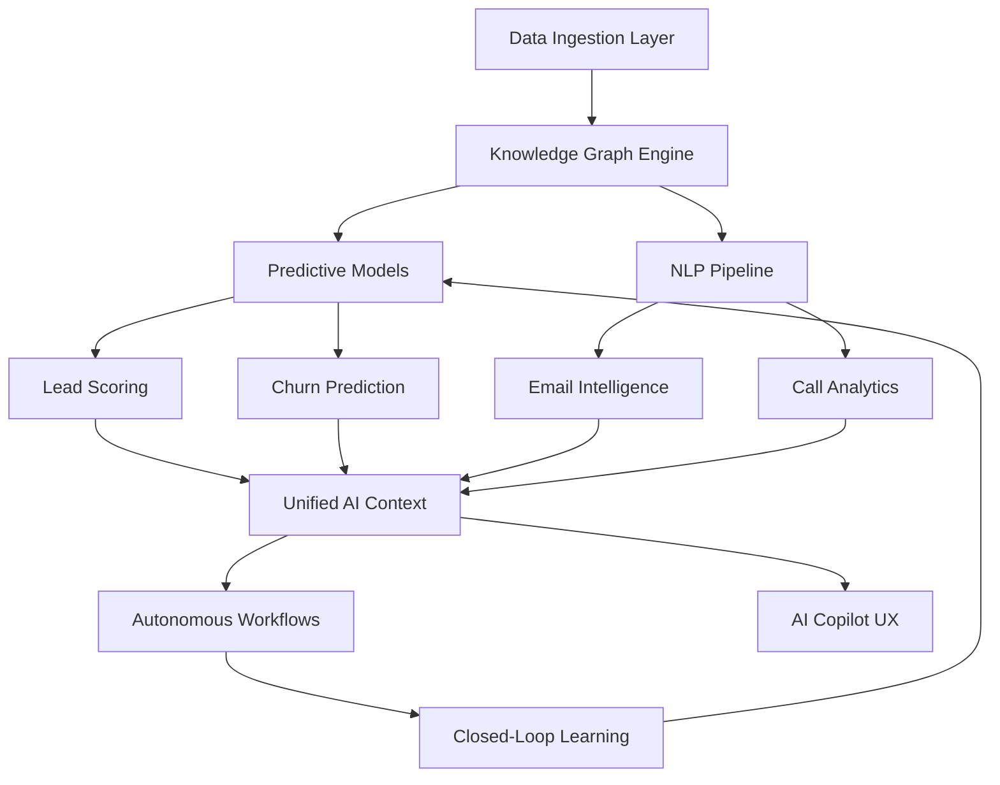
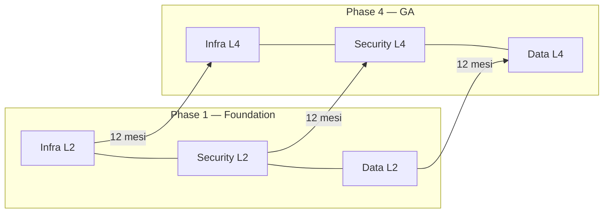
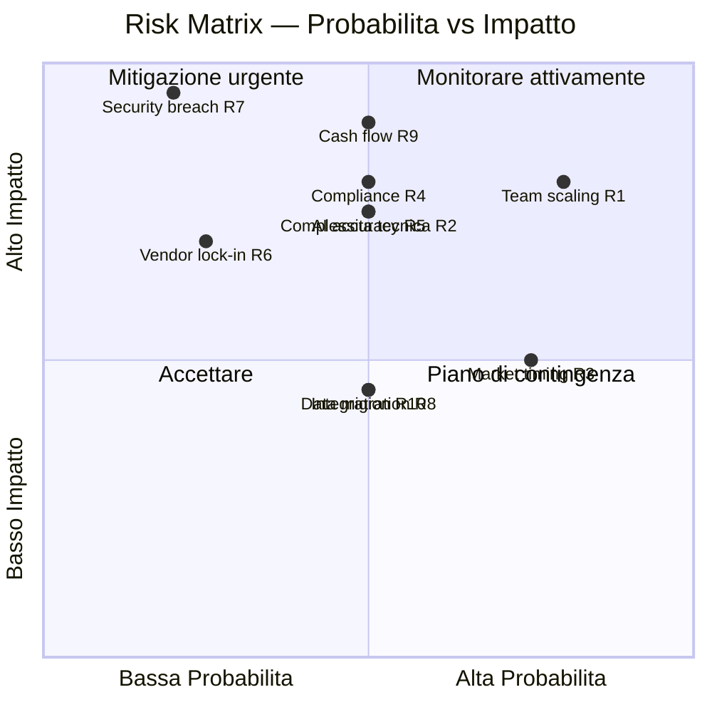
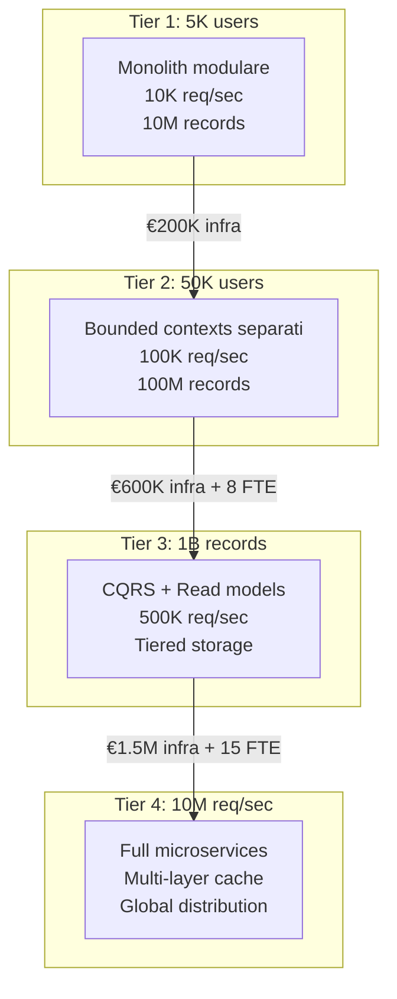
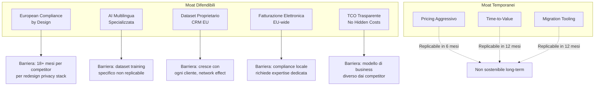

# CRM Pro 360 — Executive Assessment

> **Versione:** 1.0 | **Data:** 2026-03-24 | **Classificazione:** Confidenziale
> **Team:** 36 FTE | **Budget Anno 1:** €4.2M | **Target ARR 18 mesi:** €8M

---

## 1. Platform Vision & Strategic Positioning

### Perche CRM Pro 360

Il mercato CRM europeo da €15B e dominato da vendor americani che trattano la compliance GDPR come un'aggiunta tardiva, non come un principio architetturale. CRM Pro 360 nasce per colmare questa lacuna strutturale: un CRM enterprise AI-native, progettato *dall'inizio* per il contesto regolamentare e culturale europeo.

### Differenziazione competitiva

| Dimensione | Salesforce | HubSpot | Dynamics 365 | **CRM Pro 360** |
|---|---|---|---|---|
| Architettura AI | AI aggiunta (Einstein, bolt-on) | AI limitata a scoring/chatbot | Copilot (generico, non CRM-specifico) | **AI-native: ogni modulo ha intelligenza integrata** |
| Data residency | US-first, EU come opzione | US-only, EU in beta | Azure EU disponibile | **EU-only by default, multi-region EU** |
| GDPR | Compliance reattiva | Compliance base | Compliance enterprise | **Privacy by design, DPO integrato nel workflow** |
| Pricing per PMI | €150+/user/mo per feature comparabili | Freemium con lock-in aggressivo | €65-135/user/mo bundle-dipendente | **€49-89/user/mo, trasparente** |
| Time-to-value | 6-12 mesi implementazione | 2-4 settimane (limitato) | 3-6 mesi | **2-6 settimane con onboarding AI-guided** |

### Strategia European-First

La strategia non e semplicemente "hosting in EU". CRM Pro 360 integra:

- **Localizzazione profonda:** Fatturazione elettronica (SDI Italia, Factur-X Francia, XRechnung Germania), formati fiscali locali, calendari festivi per paese
- **Multi-lingua nativa:** Interfaccia, AI, ricerca semantica e reportistica in 12 lingue europee dal Day 1
- **Data sovereignty:** Dati mai trasferiti fuori dall'EU, crittografia at-rest con chiavi gestite dal cliente (BYOK), audit trail immutabile
- **Conformita normativa:** GDPR, ePrivacy, NIS2, AI Act (risk classification integrata)

### Vantaggio AI-Native

A differenza dei competitor che hanno "aggiunto AI" a prodotti legacy, CRM Pro 360 ha l'intelligenza artificiale come fondamento architetturale:

- **Predictive pipeline:** Scoring lead basato su pattern comportamentali, non regole statiche
- **Conversational intelligence:** Analisi automatica di call/email con estrazione action item e sentiment
- **Autonomous workflows:** Automazioni che si auto-ottimizzano basandosi sui risultati (closed-loop learning)
- **Knowledge graph:** Grafo relazionale che connette contatti, aziende, deal, interazioni e contesto di mercato



---

## 2. Architecture Maturity Target Assessment

Modello di maturita su 5 livelli, valutato per ogni dimensione architetturale. Il target e raggiungere Level 4 su tutte le dimensioni entro GA (Phase 4).

| Livello | Definizione |
|---|---|
| **Level 1 — Initial** | Processi ad-hoc, nessuna standardizzazione, funzionalita base |
| **Level 2 — Managed** | Processi definiti, tooling base, ripetibilita parziale |
| **Level 3 — Defined** | Standard documentati, automazione parziale, metriche raccolte |
| **Level 4 — Quantitative** | Metriche attive, SLA definiti, automazione completa, ottimizzazione continua |
| **Level 5 — Optimizing** | Self-healing, predictive scaling, innovazione continua |

### Maturity Matrix per Phase

| Dimensione | Phase 1 | Phase 2 | Phase 3 | Phase 4 (GA) | Phase 5 |
|---|---|---|---|---|---|
| **Infrastructure** | L2 — K8s base, single region | L3 — Multi-AZ, IaC completo | L4 — Auto-scaling, chaos testing | L4 — Multi-region EU, DR testato | L5 — Predictive scaling |
| **Security** | L2 — Auth, encryption base | L3 — RBAC, audit log, WAF | L4 — Zero-trust, SIEM, pen-test | L4 — SOC2 Type II, ISO 27001 | L5 — Threat intelligence automatica |
| **Data** | L2 — Schema Prisma, backup | L3 — Citus sharding, CDC | L3 — Event sourcing completo | L4 — Data lineage, quality gates | L5 — Self-optimizing queries |
| **AI/ML** | L1 — Modelli base, no feedback | L2 — Pipeline ML, A/B testing | L3 — Feature store, monitoring | L4 — AutoML, drift detection | L5 — Autonomous retraining |
| **UX** | L2 — Design system base | L3 — Component library, a11y AA | L3 — Performance budget, i18n | L4 — a11y AAA, user analytics | L5 — Adaptive UI personalization |
| **Integrations** | L1 — REST API base | L2 — Webhook, OAuth2, 5 connettori | L3 — Event-driven, 20 connettori | L4 — Marketplace, SDK pubblico | L5 — Self-configuring connectors |
| **Operations** | L1 — Logging base | L2 — APM, alerting | L3 — Runbook automatizzati | L4 — SRE maturo, error budget | L5 — AIOps, self-healing |



---

## 3. Enterprise Readiness Score Framework (0-100)

### Categorie e pesi

| Categoria | Peso | Descrizione |
|---|---|---|
| **Security** | 20% | Autenticazione, autorizzazione, crittografia, vulnerability management |
| **Compliance** | 15% | GDPR, ePrivacy, AI Act, audit trail, data retention |
| **Scalability** | 15% | Capacita di scaling orizzontale, performance sotto carico |
| **Reliability** | 15% | Uptime, disaster recovery, data durability, failover |
| **AI Maturity** | 10% | Accuratezza modelli, explainability, bias detection, feedback loop |
| **UX** | 10% | Usabilita, accessibility, performance percepita, onboarding |
| **Integrations** | 10% | Numero connettori, API coverage, webhook reliability |
| **Documentation** | 5% | API docs, guide utente, runbook operativi, changelog |

### Rubrica di scoring dettagliata

| Punteggio | Criterio |
|---|---|
| **0-20** | Funzionalita assente o prototipale, non utilizzabile in produzione |
| **21-40** | Implementazione base funzionante, lacune significative, uso interno only |
| **41-60** | Funzionalita solida, copertura parziale dei requisiti enterprise, beta-ready |
| **61-80** | Copertura completa requisiti core, certificazioni in corso, GA-ready |
| **81-100** | Best-in-class, certificazioni ottenute, differenziazione competitiva |

### Target per Phase

| Categoria | Peso | Phase 1 (35) | Phase 2 (55) | Phase 3 (75) | Phase 4 GA (85) | Phase 5 (95) |
|---|---|---|---|---|---|---|
| **Security** | 20% | 30 | 50 | 75 | 85 | 95 |
| **Compliance** | 15% | 25 | 45 | 70 | 85 | 95 |
| **Scalability** | 15% | 30 | 50 | 70 | 80 | 95 |
| **Reliability** | 15% | 25 | 55 | 75 | 90 | 98 |
| **AI Maturity** | 10% | 20 | 40 | 65 | 80 | 95 |
| **UX** | 10% | 45 | 65 | 80 | 85 | 92 |
| **Integrations** | 10% | 20 | 45 | 70 | 85 | 95 |
| **Documentation** | 5% | 30 | 55 | 75 | 85 | 90 |
| **Score Pesato** | 100% | **28.5** | **49.5** | **72.5** | **84.8** | **95.1** |

### Calcolo Score Pesato (formula)

```
Score = Σ (Categoria_Score × Categoria_Peso)
```

Ogni categoria viene valutata trimestralmente con checklist di 20 item binari (pass/fail). Il punteggio della categoria = (item passati / 20) × 100. Gate review obbligatoria prima di passare alla phase successiva: se lo score pesato e sotto il target, la transizione e bloccata.

---

## 4. Technical Debt Budget

### Allocazione per sprint

| Tipo di lavoro | % Sprint Capacity | Note |
|---|---|---|
| **Feature development** | 65% | Nuove funzionalita e miglioramenti richiesti |
| **Technical debt paydown** | 20% | Refactoring, upgrade dipendenze, code quality |
| **Bug fix & stabilization** | 10% | Difetti in produzione e regressioni |
| **Exploration & spikes** | 5% | Proof of concept, ricerca tecnica |

### Strategia di paydown

**Classificazione del debito:**

| Classe | Definizione | SLA di risoluzione | Esempio |
|---|---|---|---|
| **Critico** | Blocca scaling o causa data loss | Entro 1 sprint | Query N+1 su tabella >1M righe, mancanza encryption at-rest |
| **Alto** | Degrada performance o developer experience | Entro 3 sprint | Modulo monolitico da splittare, test coverage <50% |
| **Medio** | Aumenta costi o rallenta sviluppo | Entro 6 sprint | Dipendenza deprecated, duplicazione codice cross-module |
| **Basso** | Cosmetico o migliorativo | Backlog prioritizzato | Naming inconsistente, TODO comments |

**Processo di tracking:**

1. Ogni PR che introduce debito *consapevole* deve avere un ticket di paydown associato con deadline
2. Il Tech Lead mantiene un debt register aggiornato settimanalmente con valore stimato in story point
3. Se il rapporto debt-to-velocity supera il 30%, il budget debt sale automaticamente al 30% per 2 sprint
4. Metriche tracciate: cyclomatic complexity media, dependency freshness score, test coverage delta

### Misurazione

- **Leading indicator:** Rapporto debito/velocity (target: <25%)
- **Lagging indicator:** Tempo medio per implementare feature comparabili (target: trend stabile o in calo)
- **Quality gate:** Nessun merge con complessita ciclomatica >15 per funzione, coverage <70% per modulo nuovo

---

## 5. Risk Classification Matrix

| # | Rischio | Probabilita | Impatto | Livello | Mitigazione |
|---|---|---|---|---|---|
| R1 | **Team scaling** — Difficolta nel reclutare 36 FTE specializzati (NestJS + AI + GDPR) in tempo | Alta | Alto | **Critico** | Pipeline recruiting attiva da M-3; contractor bridge per ruoli critici; formazione interna accelerata su NestJS/CQRS |
| R2 | **Complessita tecnica** — Event sourcing + CQRS + DDD aumentano curva di apprendimento e tempo di delivery | Media | Alto | **Alto** | Template e generatori di codice; architettura incrementale (CQRS solo dove necessario); pair programming obbligatorio primo mese |
| R3 | **Market timing** — Competitor lanciano feature AI prima di noi (Salesforce Agentforce, HubSpot Breeze) | Alta | Medio | **Alto** | Focus su nicchia EU compliance dove i competitor sono deboli; rilascio incrementale con valore dal Phase 1; design partner program con 10 aziende |
| R4 | **Compliance GDPR/AI Act** — Interpretazione normativa errata o cambio regolamentare | Media | Alto | **Alto** | DPO dedicato dal Day 1; legal counsel specializzato AI Act; privacy impact assessment per ogni feature AI; architettura data deletion by design |
| R5 | **Accuratezza AI** — Modelli con performance insufficiente su dati CRM europei multilingua | Media | Alto | **Alto** | Benchmark su dataset multilingua prima di ogni rilascio; fallback a regole deterministiche; human-in-the-loop per decisioni ad alto impatto; fine-tuning su dati europei |
| R6 | **Vendor lock-in** — Dipendenza eccessiva da cloud provider o servizio AI specifico | Bassa | Alto | **Medio** | Architettura cloud-agnostic (K8s + Terraform); abstraction layer per AI provider; nessun uso di servizi managed proprietari senza exit strategy documentata |
| R7 | **Security breach** — Data breach con esposizione dati clienti enterprise | Bassa | Critico | **Alto** | Pen-test trimestrale; bug bounty program dal Phase 3; encryption at-rest e in-transit; zero-trust network; incident response plan testato semestralmente |
| R8 | **Data migration** — Migrazione dati da CRM esistenti (Salesforce, HubSpot) fallisce o causa data loss | Media | Medio | **Medio** | Framework di migrazione con dry-run obbligatorio; rollback automatico; validazione checksum post-migrazione; migration specialist dedicato |
| R9 | **Cash flow** — Burn rate superiore alle previsioni con revenue ritardato | Media | Critico | **Critico** | Milestone-based funding; break-even analysis mensile; piano B con scope ridotto (solo 2 piani pricing); 6 mesi di runway minimo |
| R10 | **Integration reliability** — API di terze parti instabili o con breaking changes | Media | Medio | **Medio** | Circuit breaker pattern su tutte le integrazioni; versioning API; integration test suite automatizzata; contratti Pact per API critiche |



---

## 6. Scalability Ceiling Estimates

### Tier 1: Base (Launch) — 5.000 utenti concorrenti

| Componente | Configurazione | Limiti |
|---|---|---|
| **PostgreSQL 17 (Citus)** | 1 coordinator + 2 worker, 64GB RAM ciascuno | 10M record, 500 query/sec |
| **Redis** | Cluster 3 nodi, 16GB RAM | 50K operazioni/sec |
| **Kafka** | 3 broker, 6 partizioni per topic | 10K messaggi/sec |
| **Elasticsearch** | 3 nodi, 32GB RAM | 5M documenti indicizzati |
| **NestJS** | 4 pod, 2 vCPU / 4GB RAM ciascuno | 10K req/sec aggregato |
| **K8s** | 3 nodi worker, single region EU | HPA basato su CPU/memoria |

### Tier 2: 10x Scale — 50.000 utenti concorrenti

**Cambiamenti architetturali richiesti:**

| Componente | Evoluzione | Effort stimato |
|---|---|---|
| **Citus** | 1 coordinator + 8 worker, sharding per tenant_id, read replica per analytics | 3 sprint |
| **Redis** | Cluster 6 nodi + Redis Sentinel, separazione cache/session/queue | 1 sprint |
| **Kafka** | 6 broker, 24 partizioni, consumer group per dominio DDD | 2 sprint |
| **Elasticsearch** | 6 nodi data + 2 nodi ingest, index lifecycle management | 2 sprint |
| **NestJS** | 16 pod, routing per bounded context, gRPC inter-service | 4 sprint |
| **K8s** | Multi-AZ (3 zone), node affinity per workload type | 2 sprint |
| **CDN** | CloudFront/Bunny per asset statici e API caching edge | 1 sprint |

**Throughput atteso:** 100K req/sec, 100M record, latency p99 <200ms

### Tier 3: 100x Data — 1B record

**Cambiamenti architetturali richiesti:**

| Componente | Evoluzione | Effort stimato |
|---|---|---|
| **Citus** | 1 coordinator HA + 32 worker, table partitioning temporale + sharding tenant, columnar storage per analytics | 6 sprint |
| **CQRS** | Read model separato su ClickHouse per analytics pesanti, event store dedicato | 8 sprint |
| **Elasticsearch** | Cluster 20 nodi, cross-cluster search, indici time-based con rollover | 4 sprint |
| **Data pipeline** | Apache Flink per stream processing, data lake su S3-compatible per cold storage | 6 sprint |
| **Archival** | Tiered storage: hot (PostgreSQL) / warm (ClickHouse) / cold (object storage) | 4 sprint |

**Throughput atteso:** 500K req/sec su read model, 1B record con query p99 <500ms su dataset filtrato per tenant

### Tier 4: 1000x API — 10M req/sec

**Cambiamenti architetturali richiesti:**

| Componente | Evoluzione | Effort stimato |
|---|---|---|
| **API Gateway** | Envoy/Kong mesh con rate limiting distribuito, request coalescing | 4 sprint |
| **Compute** | Decomposizione in 12+ microservizi, WASM per funzioni hot-path | 12 sprint |
| **Caching** | Multi-layer: L1 in-process (LRU), L2 Redis cluster, L3 CDN edge | 3 sprint |
| **Database** | Vitess o CockroachDB per write scaling globale, PostgreSQL per OLTP locale | 10 sprint |
| **Event streaming** | Kafka con Tiered Storage, 100+ partizioni per topic critico | 3 sprint |
| **Observability** | Sampling distribuito (1% trace), metriche aggregate, log streaming a data lake | 2 sprint |

**Nota critica:** Il passaggio a 10M req/sec richiede una riscrittura architetturale significativa. Questo livello e previsto solo per Phase 5+ (Anno 3+) e richiede un team SRE dedicato di almeno 6 persone.



---

## 7. Strategic Bottlenecks

### Bottleneck 1: Maturita del team su Event Sourcing + CQRS

- **Identificazione:** La combinazione DDD + Event Sourcing + CQRS e uno dei pattern piu complessi da implementare correttamente. Con 36 FTE, la probabilita che meno di 5 abbiano esperienza produttiva su questi pattern e alta.
- **Impatto:** Rallentamento delivery del 30-50% nei primi 3 mesi, bug sottili di consistenza eventuale, over-engineering.
- **Mitigazione:** Bootcamp intensivo di 2 settimane su ES/CQRS prima del kick-off. Assunzione di 2 senior architect con esperienza specifica. Adozione incrementale: CQRS solo per domini ad alto throughput (pipeline, analytics), CRUD tradizionale per il resto.
- **Owner:** CTO
- **Timeline:** Risoluzione entro fine Phase 1 (Mese 3)

### Bottleneck 2: Qualita dei modelli AI su dati CRM multilingua

- **Identificazione:** I modelli NLP pre-trained performano significativamente peggio su lingue europee non-inglesi (italiano, tedesco, olandese), specialmente su jargon commerciale specifico per settore.
- **Impatto:** NPS negativo sulla feature AI, riduzione del valore percepito della piattaforma, perdita del differenziatore chiave.
- **Mitigazione:** Dataset di training curato con 50K esempi reali per lingua (partnership con design partner). Ensemble di modelli specializzati per lingua. Fallback deterministico con soglia di confidence configurabile. Metriche di qualita AI per lingua nel dashboard operativo.
- **Owner:** Head of AI/ML
- **Timeline:** Modelli v1 accettabili entro Phase 2 (Mese 6), v2 competitivi entro Phase 3 (Mese 9)

### Bottleneck 3: Certificazioni di sicurezza (SOC2, ISO 27001)

- **Identificazione:** Il processo di certificazione SOC2 Type II richiede 6-12 mesi di evidenze operative. ISO 27001 richiede un ISMS maturo. Senza queste certificazioni, gli enterprise buyer europei non firmeranno contratti.
- **Impatto:** Blocco vendite enterprise fino a ottenimento certificazioni. I competitor le hanno gia.
- **Mitigazione:** Avvio processo SOC2 dal Mese 1 con auditor pre-selezionato. Implementazione controlli ISO 27001 in parallelo allo sviluppo. Utilizzo di SOC2 Type I come certificazione bridge (ottenibile in 3 mesi).
- **Owner:** CISO
- **Timeline:** SOC2 Type I entro Mese 6, SOC2 Type II entro Mese 14, ISO 27001 entro Mese 18

### Bottleneck 4: Citus sharding strategy per multi-tenancy

- **Identificazione:** Citus richiede una strategia di distribution column definita upfront. Un errore nella scelta della distribution key (tenant_id vs entity_id) causa cross-shard query costose che degradano le performance in modo non-lineare.
- **Impatto:** Riscrittura dello schema e migrazione dati se la strategia e sbagliata, costo stimato 4-8 sprint.
- **Mitigazione:** PoC su Citus con dataset sintetico da 100M righe prima di finalizzare lo schema. Benchmark di tutte le query critiche con `EXPLAIN ANALYZE` su cluster multi-worker. Consulenza con Citus/Microsoft per validazione architetturale.
- **Owner:** Lead Database Engineer
- **Timeline:** PoC completato entro Mese 2, strategia finalizzata entro Mese 3

### Bottleneck 5: Ecosystem di integrazioni (connettori CRM-to-CRM)

- **Identificazione:** La migrazione da Salesforce/HubSpot/Dynamics e il primo ostacolo all'adozione. Senza connettori di migrazione robusti e bidirezionali, il costo di switching e troppo alto per i prospect.
- **Impatto:** Conversione prospect ridotta del 40-60% senza migration tooling maturo.
- **Mitigazione:** Sviluppo connettori in ordine di priorita di mercato: Salesforce (Mese 4), HubSpot (Mese 6), Dynamics 365 (Mese 8). Partnership con middleware specialist (Workato/n8n) per connettori secondari. Dry-run obbligatorio con report di discrepanze pre-migrazione.
- **Owner:** Head of Integrations
- **Timeline:** Salesforce connector GA entro Phase 2, HubSpot entro Phase 3

---

## 8. Competitive Moat Analysis

### Confronto dettagliato

| Categoria | Salesforce | HubSpot | Dynamics 365 | Pipedrive | **CRM Pro 360** |
|---|---|---|---|---|---|
| **Pricing (per user/mo)** | €150-300 (Enterprise) | €0-120 (lock-in su tier alti) | €65-135 | €15-99 | **€49-89** |
| **TCO annuo (50 utenti)** | €120K-200K + implementazione | €45K-85K + app marketplace | €50K-100K + licenze Azure | €12K-60K | **€35K-55K tutto incluso** |
| **AI — Lead scoring** | Einstein (richiede Data Cloud, +€50/user) | Predictive scoring (solo Enterprise+) | Copilot (generico) | AI-powered (base) | **Integrato in tutti i piani, multilingua** |
| **AI — Email intelligence** | Einstein Activity Capture (base) | Email tracking + AI summary | Copilot email draft | Smart email (limitato) | **Analisi semantica, action extraction, sentiment multilingua** |
| **AI — Forecasting** | Einstein Analytics (add-on €75/user) | Forecast tool (limitato) | Revenue intelligence | Nessuno | **Ensemble ML con confidence intervals, per-lingua** |
| **AI — Workflow automation** | Flow Builder (no-code, no AI optimization) | Workflow (rule-based) | Power Automate (separato) | Automation (base) | **Self-optimizing workflows con closed-loop learning** |
| **GDPR compliance** | Compliant (reactive, US-designed) | Compliant (base) | Compliant (Azure EU) | Compliant (base) | **Privacy by design, DPO workflow, data residency EU-only** |
| **AI Act readiness** | Non dichiarata | Non dichiarata | In valutazione | Non applicabile | **Risk classification integrata, explainability dashboard** |
| **European hosting** | Frankfurt, Parigi (opzionale) | Frankfurt (beta) | Azure EU (multiple) | EU (Amsterdam) | **EU-only, 4 regioni (Frankfurt, Amsterdam, Parigi, Milano)** |
| **Data sovereignty** | Trasferimenti US possibili | Trasferimenti US di default | Dipende da configurazione Azure | Trasferimenti US possibili | **Zero transfer extra-EU, BYOK encryption, audit immutabile** |
| **Customizzazione** | Apex + LWC (curva ripida) | Limited custom objects | Power Platform (complesso) | Limitata | **Low-code builder + API-first, DDD extensibility** |
| **Time-to-value** | 6-12 mesi (enterprise) | 2-4 settimane (limitato) | 3-6 mesi | 1-2 settimane (base) | **2-6 settimane con AI-guided onboarding** |
| **Migration tooling** | Nativo (import only) | Import CSV + API | Migration tools limitati | Import base | **Connettori bidirezionali Salesforce/HubSpot/Dynamics, dry-run** |
| **Multi-lingua UX** | 20+ lingue (traduzione) | 6 lingue | 40+ lingue (traduzione) | 16 lingue | **12 lingue EU con AI semantica per-lingua** |
| **Fatturazione EU** | Nessuna | Nessuna | Limitata | Nessuna | **SDI, Factur-X, XRechnung nativi** |
| **API rate limits** | 100K/giorno (Enterprise) | 500K/giorno (Enterprise) | Throttled | 200 req/min | **1M/giorno base, burst 10K/min, no surprise throttling** |

### Moat sostenibili



### Sintesi strategica

I moat *temporanei* (pricing, time-to-value, migration tooling) servono per acquisire i primi 150 clienti e costruire il dataset proprietario. I moat *difendibili* (compliance by design, AI multilingua, fatturazione EU) diventano la vera barriera competitiva dal Mese 12 in poi. L'obiettivo strategico e convertire il vantaggio temporale in vantaggio strutturale prima che i competitor americani possano reagire: la finestra di opportunita e stimata in 18-24 mesi.

---

## Appendice: Metriche di Successo

| Metrica | Target Y1 | Target 18M |
|---|---|---|
| Clienti enterprise | 150 | 250 |
| ARR | €4.5M | €8M |
| Retention rate | >92% | >95% |
| NPS | >45 | >55 |
| Uptime | 99.5% | 99.9% |
| MTTR | <4h | <1h |
| AI accuracy (lead scoring) | >70% | >82% |
| Enterprise Readiness Score | 35 (Phase 1 exit) | 85 (GA) |
