# 02 — Architettura CRM Pro 360

> Documento di architettura enterprise per CRM Pro 360 — piattaforma CRM AI-powered
> destinata a mid-enterprise europee. Copre l'analisi cross-layer e l'architettura target.

---

## Parte I — Cross-Layer Analysis

### 1. API Contract Management

Gestione centralizzata dei contratti API tramite OpenAPI 3.1 con pipeline di code generation automatizzata.

**Pipeline di generazione:**

1. I team backend definiscono gli endpoint in file `.yaml` OpenAPI 3.1 nella cartella `contracts/`.
2. Un job CI (`contract-codegen`) esegue la validazione dello schema e genera:
   - **Client TypeScript** per il frontend React (via `openapi-typescript-codegen`).
   - **DTO NestJS** per il backend Node (via template Handlebars custom).
   - **Pydantic models** per i servizi FastAPI (via `datamodel-code-generator`).
3. I pacchetti generati vengono pubblicati su un registry npm/PyPI privato.
4. Breaking change detection tramite `openapi-diff` in CI — qualsiasi modifica incompatibile blocca il merge.

**Versionamento:** ogni servizio espone la versione API nell'URL (`/api/v1/`, `/api/v2/`). Le versioni deprecate restano attive per 6 mesi con header `Sunset`.

**Struttura repository contratti:**

```
contracts/
├── crm-core/
│   ├── contacts.yaml
│   ├── deals.yaml
│   └── activities.yaml
├── ai-services/
│   ├── predictions.yaml
│   └── recommendations.yaml
├── billing/
│   └── subscriptions.yaml
└── shared/
    ├── error-model.yaml
    └── pagination.yaml
```

---

### 2. Error Model: Backend → API → Frontend

Modello di errore unificato che attraversa tutti i layer. Ogni errore è strutturato come:

```json
{
  "error": {
    "code": "CRM-4001",
    "message": "Il contatto non è stato trovato",
    "detail": "Contact with ID 'abc-123' does not exist in tenant 'acme-corp'",
    "requestId": "req_7f3a2b1c",
    "timestamp": "2026-03-24T10:30:00Z",
    "path": "/api/v1/contacts/abc-123",
    "meta": {}
  }
}
```

**Tabella codici di errore:**

| Codice | HTTP Status | Categoria | Descrizione (IT) | Origine |
|--------|-------------|-----------|-------------------|---------|
| `CRM-1001` | 500 | Internal | Errore interno del server | Backend |
| `CRM-1002` | 503 | Availability | Servizio temporaneamente non disponibile | Backend |
| `CRM-1003` | 504 | Timeout | Timeout nella comunicazione tra servizi | Gateway |
| `CRM-2001` | 401 | Auth | Token di autenticazione mancante o scaduto | Gateway |
| `CRM-2002` | 403 | Auth | Permessi insufficienti per questa operazione | Backend |
| `CRM-2003` | 401 | Auth | Refresh token invalido o revocato | Auth Service |
| `CRM-2004` | 403 | Tenant | Accesso negato al tenant richiesto | Middleware |
| `CRM-3001` | 400 | Validation | Dati di input non validi | Backend |
| `CRM-3002` | 409 | Conflict | Conflitto di concorrenza — risorsa modificata | Backend |
| `CRM-3003` | 422 | Business | Violazione regola di business | Backend |
| `CRM-3004` | 400 | Validation | Formato file non supportato | Backend |
| `CRM-4001` | 404 | NotFound | Risorsa non trovata | Backend |
| `CRM-4002` | 410 | Gone | Risorsa eliminata definitivamente | Backend |
| `CRM-5001` | 429 | RateLimit | Limite di richieste superato — tier base | Gateway |
| `CRM-5002` | 429 | RateLimit | Limite di richieste superato — tier AI | Gateway |
| `CRM-6001` | 402 | Billing | Crediti AI esauriti | Billing Service |
| `CRM-6002` | 402 | Billing | Piano non sufficiente per questa funzionalità | Billing Service |
| `CRM-7001` | 500 | AI | Modello AI non disponibile | AI Service |
| `CRM-7002` | 422 | AI | Input troppo lungo per il modello | AI Service |
| `CRM-7003` | 500 | AI | Risposta del modello non parsabile | AI Service |

**Mappatura frontend:** il client React intercetta gli errori nel layer API (`apiClient` interceptor) e li traduce in notifiche utente localizzate tramite un dizionario `error-codes → i18n key`.

---

### 3. Authentication Flow

Flusso completo di autenticazione: login, emissione token, refresh e revoca.

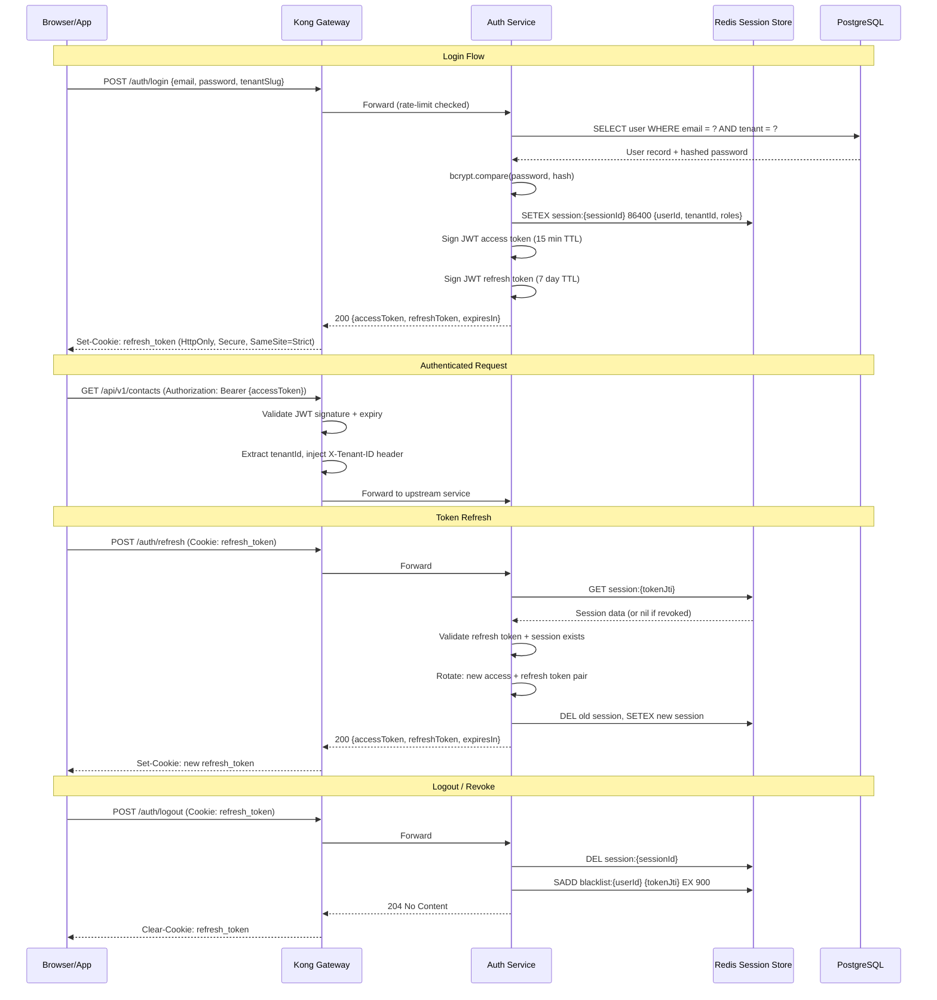

**Dettagli implementativi:**
- Access token: JWT RS256, TTL 15 minuti, contiene `sub`, `tenantId`, `roles[]`, `jti`.
- Refresh token: JWT RS256, TTL 7 giorni, ruotato ad ogni utilizzo (rotation strategy).
- Blacklist: gestita in Redis con TTL pari alla durata residua dell'access token.
- MFA: supportato via TOTP (Google Authenticator) come step aggiuntivo post-password.

---

### 4. Tenant Context Propagation

Propagazione del contesto tenant dal header HTTP fino all'interfaccia utente, garantendo isolamento totale dei dati.

```mermaid
flowchart LR
    A[Client Request] -->|Authorization: Bearer JWT| B[Kong Gateway]
    B -->|Decode JWT, extract tenantId| C{Token valido?}
    C -->|No| D[401 Unauthorized]
    C -->|Si| E[Inject X-Tenant-ID header]
    E --> F[NestJS TenantMiddleware]
    F -->|Validate tenantId exists in DB| G{Tenant attivo?}
    G -->|No| H[403 CRM-2004]
    G -->|Si| I[Set AsyncLocalStorage context]
    I --> J[Service Layer]
    J -->|tenantId from context| K[Prisma Middleware]
    K -->|Auto-inject WHERE tenantId = ?| L[(PostgreSQL + Citus)]
    L -->|Shard by tenantId| M[Tenant Shard Node]
    M -->|Response data| N[API Response]
    N -->|X-Tenant-ID in response header| O[Frontend]
    O -->|Store in Zustand tenantStore| P[UI Components]
    P -->|Render tenant-specific branding| Q[User Interface]
```

**Garanzie di isolamento:**
- Prisma middleware inietta automaticamente `tenantId` in ogni query (SELECT, INSERT, UPDATE, DELETE).
- Citus distribuisce i dati su shard dedicati per tenant, usando `tenantId` come distribution column.
- Row-Level Security (RLS) attivo su PostgreSQL come secondo livello di protezione.
- Il frontend mantiene il `tenantId` corrente in uno Zustand store e lo include in ogni richiesta API.

---

### 5. Observability: Correlation ID Propagation

Propagazione end-to-end dell'identificativo di correlazione per tracciabilità completa delle richieste.

**Strategia di propagazione:**

| Layer | Header/Campo | Generazione | Formato |
|-------|-------------|-------------|---------|
| Kong Gateway | `X-Request-ID` | Generato se assente | UUIDv4 |
| Kong Gateway | `X-Correlation-ID` | Propagato dal client o generato | UUIDv4 |
| NestJS Backend | `correlationId` (log field) | Estratto da header | UUIDv4 |
| FastAPI Services | `correlation_id` (log field) | Estratto da header | UUIDv4 |
| Kafka Messages | `headers.correlationId` | Copiato dal contesto | UUIDv4 |
| Frontend | `x-correlation-id` (request header) | Generato per sessione utente | UUIDv4 |
| Sentry | `tags.correlationId` | Estratto dal contesto | UUIDv4 |
| Jaeger | `traceId` (OpenTelemetry) | Auto-generato, linkato | Hex 32 chars |

**Implementazione NestJS:**

```typescript
// correlation.middleware.ts
@Injectable()
export class CorrelationMiddleware implements NestMiddleware {
  use(req: Request, res: Response, next: NextFunction) {
    const correlationId = req.headers['x-correlation-id'] || randomUUID();
    const store = { correlationId, tenantId: req.headers['x-tenant-id'] };
    asyncLocalStorage.run(store, () => {
      res.setHeader('X-Correlation-ID', correlationId);
      next();
    });
  }
}
```

**Logging strutturato:** tutti i servizi emettono log JSON con campi `correlationId`, `tenantId`, `service`, `traceId` — aggregati in Elasticsearch e queryabili da Grafana.

---

### 6. Cost/Token Accounting: AI Call → Billing → UI

Contabilizzazione dei costi AI dall'invocazione del modello fino alla visualizzazione in interfaccia.

**Pipeline di metering:**

1. **AI Service** — ogni chiamata LLM registra: `modelId`, `inputTokens`, `outputTokens`, `latencyMs`, `tenantId`, `userId`.
2. **Metering Event** — pubblicato su Kafka topic `ai.usage.metered` con schema Avro.
3. **Billing Consumer** — aggrega i token per tenant/periodo e calcola il costo in base al piano tariffario.
4. **Usage Store** — i dati aggregati sono scritti in PostgreSQL tabella `ai_usage_ledger`.
5. **API Endpoint** — `GET /api/v1/billing/ai-usage` restituisce consumo corrente, limiti e proiezioni.
6. **Frontend Widget** — il componente `<AiUsageMeter />` mostra barra di progresso, costo stimato e alert soglia.

**Tabella tariffaria per modello:**

| Modello | Input (€/1M tokens) | Output (€/1M tokens) | Uso tipico |
|---------|---------------------|----------------------|------------|
| GPT-4o | €2.50 | €10.00 | Analisi complesse, generazione report |
| Claude Sonnet | €3.00 | €15.00 | Ragionamento avanzato su deal |
| Mistral Large | €2.00 | €6.00 | Classificazione email, sentiment |
| Embedding (ada-002) | €0.10 | — | Ricerca semantica contatti/deal |

**Alert automatici:** al 75%, 90% e 100% del budget mensile AI, il sistema invia notifiche push + email all'admin del tenant.

---

### 7. Logging Correlation: Request ID Across All Layers

Formato unificato di logging che permette di ricostruire l'intero percorso di una richiesta attraverso tutti i microservizi.

**Formato log standard (JSON):**

```json
{
  "timestamp": "2026-03-24T10:30:00.123Z",
  "level": "info",
  "service": "crm-contacts",
  "correlationId": "req_7f3a2b1c",
  "traceId": "a1b2c3d4e5f6a7b8c9d0e1f2a3b4c5d6",
  "spanId": "1a2b3c4d5e6f7a8b",
  "tenantId": "tenant_acme",
  "userId": "usr_42",
  "method": "GET",
  "path": "/api/v1/contacts",
  "statusCode": 200,
  "duration": 45,
  "message": "Request completed"
}
```

**Stack di osservabilità:**
- **Raccolta:** ogni servizio scrive su stdout in JSON. Fluentd (DaemonSet K8s) raccoglie e invia a Elasticsearch.
- **Storage:** Elasticsearch 8 con index lifecycle management — hot (7 giorni), warm (30 giorni), cold (90 giorni), delete.
- **Visualizzazione:** Grafana dashboards con filtri per `correlationId`, `tenantId`, `service`.
- **Alerting:** Prometheus AlertManager per metriche (latenza p99 > 500ms, error rate > 1%).
- **Tracing distribuito:** Jaeger riceve span OpenTelemetry, linkati tramite `traceId`.
- **Error tracking:** Sentry cattura eccezioni con contesto `correlationId` e `tenantId`.

---

### 8. Event-Driven Architecture: Kafka → WebSocket → UI

Architettura event-driven per aggiornamenti in tempo reale dall'elaborazione backend fino all'interfaccia utente.

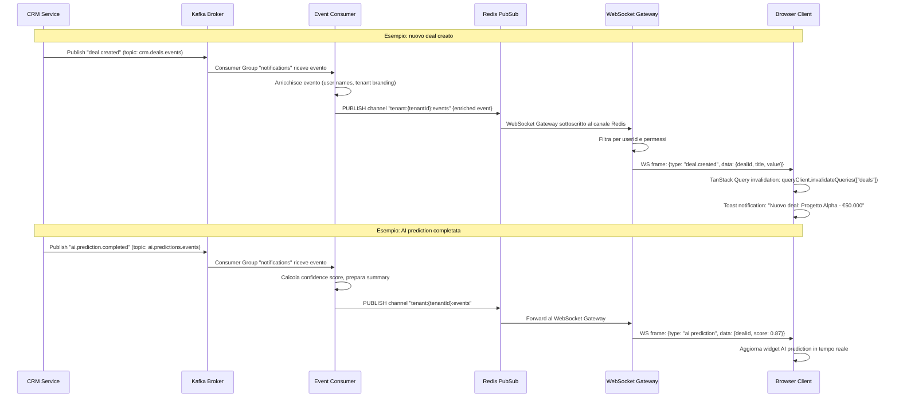

**Garanzie di delivery:**
- Kafka: `acks=all`, `min.insync.replicas=2`, retention 7 giorni.
- Consumer: at-least-once con idempotency check (dedup via `eventId` in Redis SET con TTL 24h).
- WebSocket: riconnessione automatica con exponential backoff (1s, 2s, 4s, max 30s). Buffer eventi persi durante disconnessione (max 50 eventi, 5 min window).

---

### 9. Contract Testing Strategy (Pact)

Strategia di contract testing per garantire compatibilità tra consumer e provider senza integration test pesanti.

**Architettura Pact:**

- **Consumer tests:** ogni frontend o servizio consumer genera un Pact file (JSON) descrivendo le interazioni attese.
- **Pact Broker:** server centrale (self-hosted) dove i Pact file vengono pubblicati e versionati.
- **Provider verification:** ogni servizio provider esegue la verifica dei Pact in CI, confermando che soddisfa i contratti.
- **Can-I-Deploy:** check pre-deploy che verifica compatibilità tra le versioni in procinto di andare in produzione.

**Coppie di contratto principali:**

| Consumer | Provider | Interazioni testate |
|----------|----------|---------------------|
| React Frontend | CRM Contacts API | CRUD contatti, ricerca, filtri |
| React Frontend | Deals API | Pipeline view, deal stages, forecast |
| React Frontend | AI Predictions API | Score request, prediction history |
| React Frontend | Auth Service | Login, refresh, logout |
| Notification Service | Contacts API | Lookup contatto per email enrichment |
| AI Service | CRM Core API | Fetch deal data per scoring |
| Billing Service | AI Metering API | Usage aggregation query |

**Pipeline CI:**

```
consumer-test → publish-pact → provider-verify → can-i-deploy → deploy
```

Ogni PR che modifica un contratto API triggera automaticamente la verifica su tutti i consumer registrati. Se un provider non è compatibile, il deploy è bloccato.

---

## Parte II — Target Enterprise Architecture

### 10. System Context Diagram (C4 Level 1)

Vista ad alto livello del sistema CRM Pro 360 e delle sue interazioni con attori e sistemi esterni.

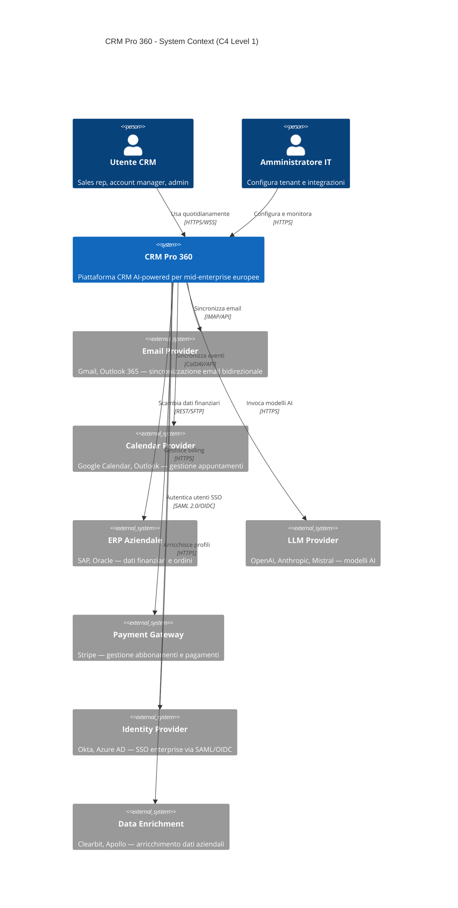

---

### 11. Container Diagram (C4 Level 2)

Dettaglio dei container applicativi che compongono CRM Pro 360.

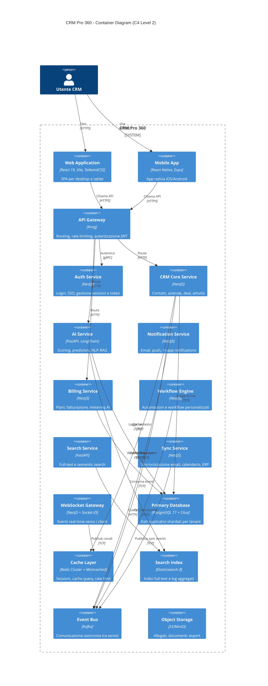

---

### 12. Microservices Map con Communication Patterns

Mappa dei microservizi con pattern di comunicazione sincrono e asincrono.

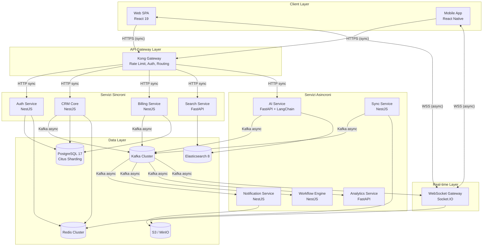

---

### 13. AI Orchestration Topology

Topologia dell'orchestrazione AI con routing intelligente, caching e fallback tra modelli.

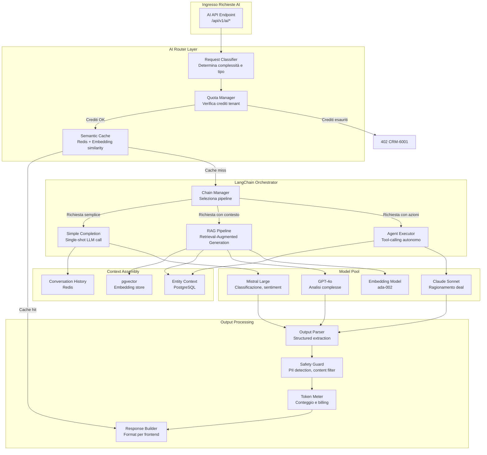

---

### 14. Event-Driven Architecture: Kafka Topic Map

Mappa completa dei topic Kafka con strategia di partizionamento e consumer group.

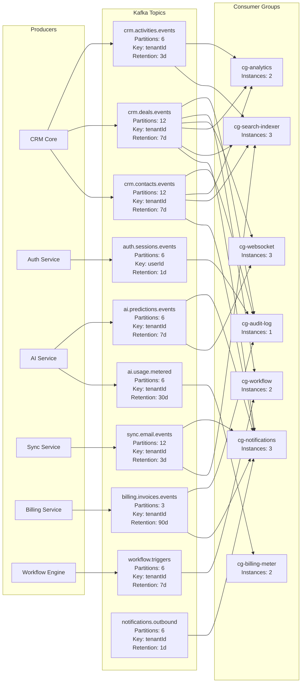

**Strategia di partizionamento:** tutti i topic business usano `tenantId` come partition key per garantire ordinamento degli eventi per tenant. Il topic `auth.sessions.events` usa `userId` per distribuire il carico uniformemente.

**Dead Letter Queue (DLQ):** ogni consumer group ha un DLQ dedicato (`*.dlq`) con retention 30 giorni. Dopo 3 tentativi falliti, l'evento viene spostato nel DLQ e un alert viene inviato su Slack.

---

### 15. Plugin/Module System Architecture

Architettura del sistema di plugin per estensibilità delle funzionalità CRM.

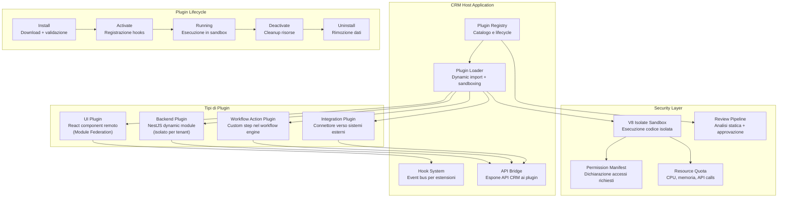

**Modello di estensione:**
- **UI Plugin:** caricati via Webpack Module Federation. Ogni plugin è un micro-frontend React isolato, montato in slot predefiniti dell'interfaccia (sidebar, detail panel, dashboard widget).
- **Backend Plugin:** moduli NestJS dinamici caricati a runtime. Ogni plugin dichiara un manifest con le API richieste e i permessi necessari.
- **Sicurezza:** esecuzione in V8 Isolates con limiti di CPU (100ms per invocazione), memoria (64MB) e API calls (1000/ora per plugin).

---

### 16. Workflow Engine Design

Motore di workflow basato su state machine per automazioni CRM personalizzabili.

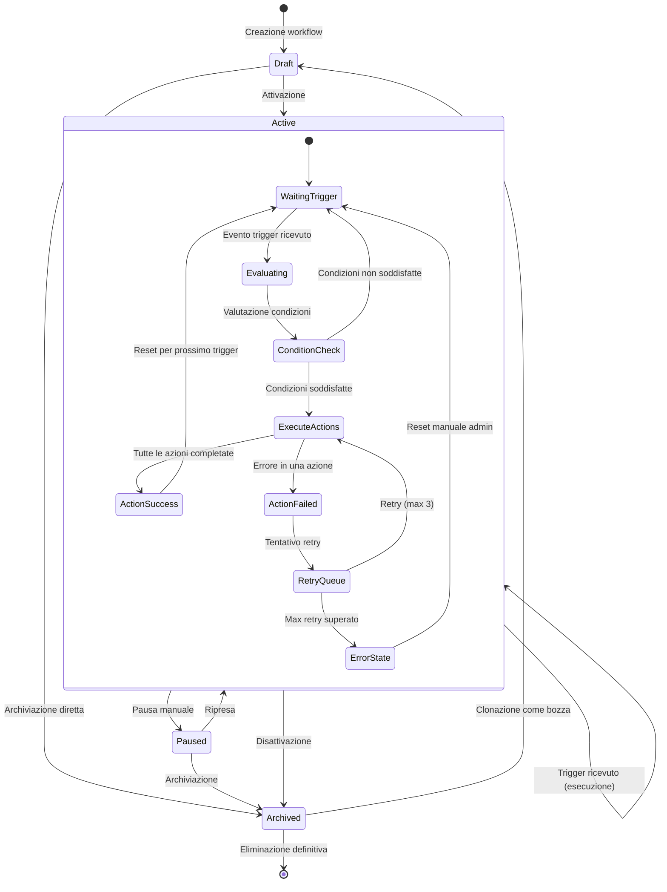

**Componenti del workflow engine:**

| Componente | Responsabilità | Tecnologia |
|------------|---------------|------------|
| Trigger Listener | Ascolta eventi Kafka e matching con workflow attivi | NestJS + Kafka consumer |
| Condition Evaluator | Valuta espressioni condizionali (JSONLogic) | Custom evaluator |
| Action Executor | Esegue azioni sequenziali o parallele | BullMQ job queue |
| State Manager | Persiste stato workflow e execution history | PostgreSQL + Redis |
| Template Store | Catalogo workflow preconfigurati | PostgreSQL |
| Scheduler | Trigger time-based (cron) | BullMQ scheduler |

**Tipi di trigger supportati:**
- **Event:** `deal.stage_changed`, `contact.created`, `email.received`, `task.overdue`
- **Schedule:** espressioni cron (`0 9 * * MON` = ogni lunedi alle 9:00)
- **Manual:** invocazione manuale da UI o API
- **Webhook:** ricezione HTTP POST da sistemi esterni

**Tipi di azione supportati:**
- Invia email/notifica, crea task, aggiorna campo, assegna owner, invoca AI prediction, chiama webhook esterno, attendi (delay), fork parallelo.

---

### 17. Marketplace Extensibility Model

Modello di estensibilità tramite marketplace per plugin e integrazioni di terze parti.

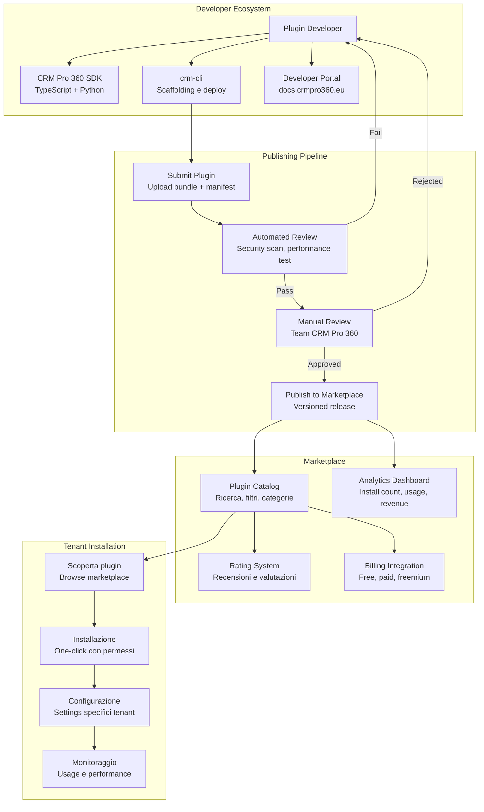

**Modello economico:**
- **Free tier:** plugin open-source, nessuna commissione.
- **Paid tier:** il developer imposta il prezzo. CRM Pro 360 trattiene il 20% come commissione piattaforma.
- **Revenue share:** pagamenti gestiti via Stripe Connect. Il developer riceve i fondi mensilmente.

**Categorie marketplace:** Integrazioni (ERP, email, calendar), AI Extensions (modelli custom, prompt library), UI Widgets (dashboard components, report templates), Workflow Actions (custom automation steps).

---

### 18. Multi-Region Deployment Topology (EU-Centric)

Topologia di deploy multi-regione centrata sull'Europa con tre regioni principali: Frankfurt, Dublin, Milan.

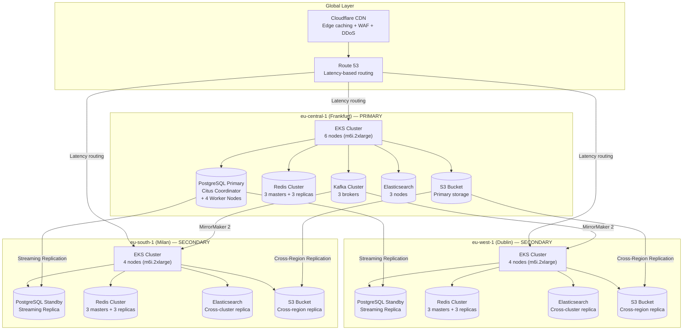

**Strategia di routing:**
- **Read traffic:** instradato alla regione più vicina tramite latency-based DNS routing.
- **Write traffic:** instradato sempre alla regione PRIMARY (Frankfurt) dove risiede il coordinator Citus e il Kafka cluster primario.
- **Data residency:** i tenant possono scegliere la regione di residenza dati per compliance GDPR. I dati non lasciano la regione selezionata.

**Infrastructure as Code:** tutto gestito con Terraform (moduli per EKS, RDS, ElastiCache, MSK) e ArgoCD per il deploy applicativo su tutti i cluster K8s.

---

### 19. Disaster Recovery Architecture

Architettura di disaster recovery con obiettivi di RPO e RTO definiti per ogni componente.

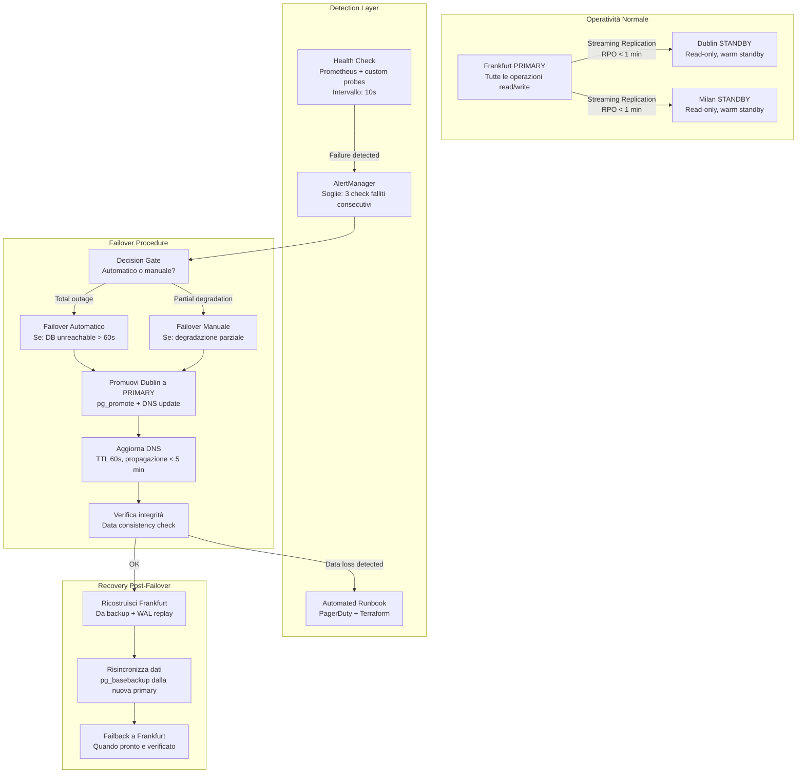

**Obiettivi RPO/RTO per componente:**

| Componente | RPO (Recovery Point Objective) | RTO (Recovery Time Objective) | Strategia |
|------------|-------------------------------|-------------------------------|-----------|
| PostgreSQL (dati core) | < 1 minuto | < 5 minuti | Streaming replication sincrona verso Dublin |
| PostgreSQL (dati analytics) | < 15 minuti | < 30 minuti | Streaming replication asincrona |
| Redis (sessioni) | 0 (ricostruibile) | < 2 minuti | Sessioni ri-autenticate dal client |
| Redis (cache) | 0 (ricostruibile) | < 1 minuto | Cache ricostruita on-demand |
| Elasticsearch (indici) | < 30 minuti | < 15 minuti | Cross-cluster replication + re-index da DB |
| Kafka (eventi) | < 1 minuto | < 10 minuti | MirrorMaker 2 cross-region |
| S3 (allegati) | < 1 minuto | < 1 minuto | Cross-region replication nativa AWS |
| DNS (routing) | N/A | < 5 minuti | TTL 60s, health check ogni 10s |

**Procedure di test DR:**
- **Chaos Engineering:** sessioni mensili con Litmus Chaos su EKS — simulazione failure nodi, network partition, disk full.
- **DR Drill:** test trimestrale di failover completo verso Dublin con rollback entro 4 ore.
- **Backup verification:** restore giornaliero automatico di un backup PostgreSQL su ambiente di test con data integrity check.

**Backup strategy:**
- PostgreSQL: WAL archiving continuo su S3 + snapshot giornaliero. Retention: 30 giorni snapshot, 7 giorni WAL.
- Elasticsearch: snapshot notturno su S3. Retention: 14 giorni.
- S3: versioning attivo + cross-region replication. Lifecycle policy: archive dopo 90 giorni su Glacier.

---

## Appendice — Riepilogo Decisioni Architetturali

| Decisione | Scelta | Motivazione |
|-----------|--------|-------------|
| API Gateway | Kong | Plugin ecosystem maturo, supporto rate limiting per tenant, compatibilità K8s |
| Database | PostgreSQL 17 + Citus | Sharding nativo per `tenantId`, SQL standard, estensioni (pgvector, PostGIS) |
| Event Bus | Kafka | Throughput elevato, ordering per partition key, ecosystem connectors |
| Cache | Redis Cluster + Memcached | Redis per sessioni/pubsub, Memcached per cache read-heavy ad alta concorrenza |
| Search | Elasticsearch 8 | Full-text multilingue, aggregazioni analitiche, log aggregation unificata |
| AI Framework | LangChain + FastAPI | Chain composability, tool-calling nativo, async Python per workload AI |
| ML Framework | PyTorch + scikit-learn | PyTorch per modelli custom, scikit-learn per scoring tabellare leggero |
| Container Orchestration | K8s (EKS/GKE) | Standard de facto, autoscaling HPA/VPA, service mesh ready |
| IaC | Terraform + ArgoCD | Terraform per infrastruttura, ArgoCD per GitOps applicativo su K8s |
| Observability | Prometheus + Grafana + Jaeger + Sentry | Stack open-source maturo, costi prevedibili, community ampia |
| Architettura | DDD + Event Sourcing + CQRS | Separazione read/write per scalabilità, audit trail nativo, bounded context chiari |
| Resilienza | Circuit Breaker (Hystrix/resilience4j pattern) | Protezione da cascade failure tra microservizi, fallback degradato |
