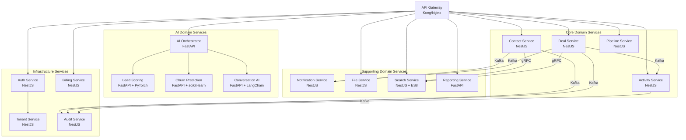
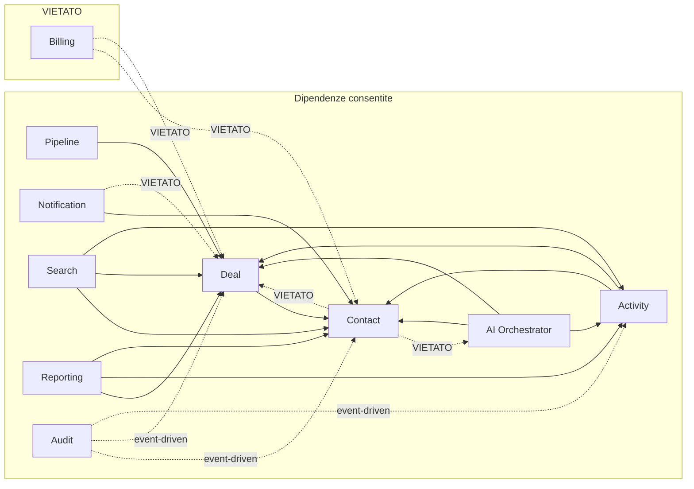
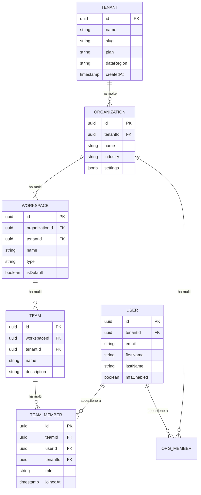
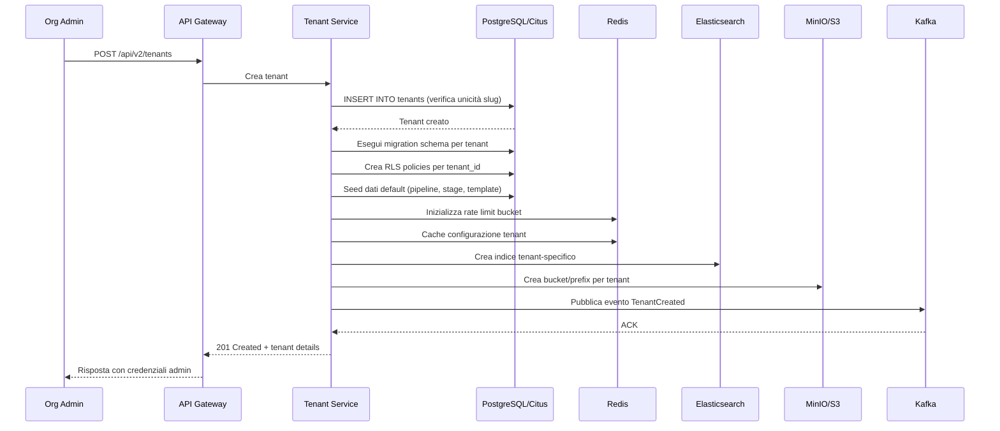
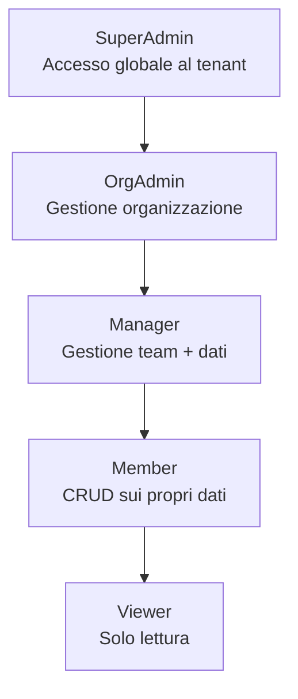
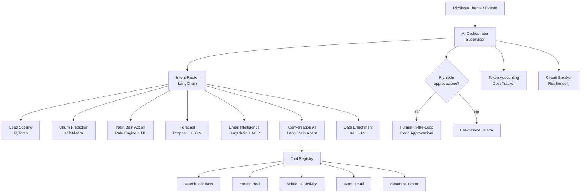
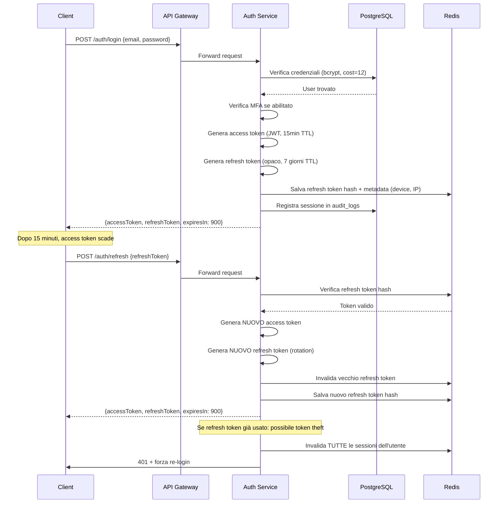

# 03 — Backend Design · CRM Pro 360

> Documento di progettazione backend per CRM Pro 360 — CRM enterprise AI-powered per medie imprese europee.
> Stack: NestJS + FastAPI | PostgreSQL 17 (Citus) | Redis Cluster + Memcached | Elasticsearch 8 | Kafka + Redis Streams | S3/MinIO | PyTorch, scikit-learn, LangChain | Kubernetes | DDD, Event Sourcing, CQRS, Circuit Breaker

---

## 1. Architecture & Layering

### 1.1 Microservices Boundary Map

Ogni servizio corrisponde a un bounded context DDD. La comunicazione inter-servizio è asincrona via Kafka salvo dove la latenza richiede chiamate sincrone (gRPC/REST).



### 1.2 Module Boundaries per DDD Bounded Context

Ogni bounded context è isolato con interfacce esplicite. I team sono responsabili end-to-end del proprio contesto.

| Bounded Context | Moduli | Team Owner |
|---|---|---|
| **Contact Management** | `contacts`, `companies`, `segments`, `tags`, `import-export` | Team Contatti |
| **Deal Management** | `deals`, `pipelines`, `stages`, `products`, `quotes` | Team Vendite |
| **Activity Tracking** | `activities`, `tasks`, `calendar`, `reminders`, `timeline` | Team Engagement |
| **Communication** | `emails`, `sms`, `calls`, `templates`, `sequences` | Team Comunicazione |
| **AI Intelligence** | `lead-scoring`, `churn-prediction`, `nba`, `forecast`, `enrichment` | Team AI/ML |
| **Conversation AI** | `chat-agents`, `tool-registry`, `rag-pipeline`, `prompt-mgmt` | Team AI/ML |
| **Search & Discovery** | `full-text-search`, `filters`, `saved-views`, `recent-items` | Team Platform |
| **Reporting** | `dashboards`, `widgets`, `exports`, `scheduled-reports` | Team Analytics |
| **Auth & Identity** | `authentication`, `authorization`, `sso`, `mfa`, `sessions` | Team Security |
| **Tenant & Billing** | `tenants`, `subscriptions`, `usage-metering`, `invoicing` | Team Platform |
| **Audit & Compliance** | `audit-log`, `gdpr`, `consent`, `data-retention` | Team Security |
| **Notification** | `in-app`, `email-dispatch`, `push`, `webhooks`, `preferences` | Team Platform |
| **File Management** | `upload`, `storage`, `thumbnails`, `virus-scan`, `presigned-urls` | Team Platform |

### 1.3 Dependency Graph — Allowed vs Forbidden

Le frecce rappresentano dipendenze consentite. Le dipendenze cicliche e quelle che violano i confini di dominio sono vietate esplicitamente.



**Regole di dipendenza:**
- I servizi Core possono dipendere solo da altri servizi Core di livello inferiore o da Infrastructure
- I servizi Support possono leggere dai servizi Core ma mai scrivere direttamente
- I servizi AI consumano dati dai Core via eventi Kafka, mai tramite query dirette al DB
- I servizi Infrastructure non dipendono mai dai servizi di dominio

### 1.4 Service Communication Patterns

| Comunicazione | Pattern | Protocollo | Motivazione |
|---|---|---|---|
| Gateway → Auth | Sincrono | gRPC | Validazione JWT a bassa latenza (<5ms) |
| Gateway → Contact/Deal | Sincrono | REST/gRPC | Risposta utente, latenza critica |
| Deal → Notification | Asincrono | Kafka | Fire-and-forget, non blocca la transazione |
| Contact → Search | Sincrono | gRPC | Indicizzazione near-realtime per UX |
| Deal/Contact → Audit | Asincrono | Kafka | Append-only, nessun feedback necessario |
| AI Orchestrator → Lead Scoring | Sincrono | gRPC | Risultato necessario nella risposta |
| Contact → AI (enrichment) | Asincrono | Kafka | Elaborazione batch, latenza non critica |
| Billing → Tenant | Sincrono | gRPC | Verifica quota prima di ogni operazione |
| Reporting → Core Services | Asincrono | Kafka (CDC) | Change Data Capture per data warehouse |

### 1.5 Shared Kernel vs Anti-Corruption Layer

**Shared Kernel** — Codice condiviso tra bounded context strettamente correlati:
- `@crm360/shared-types`: DTO di dominio (ContactDTO, DealDTO), enumerazioni condivise (DealStage, ActivityType)
- `@crm360/event-contracts`: Schema Avro per eventi Kafka, versionati con compatibilità backward
- `@crm360/auth-context`: Decoratori NestJS per tenant context e RBAC

**Anti-Corruption Layer (ACL)** — Isolamento da sistemi esterni e legacy:
- **ACL per servizi AI**: Il servizio Python espone gRPC con protobuf; il consumer NestJS traduce i messaggi nel proprio modello di dominio senza esporre strutture ML
- **ACL per integrazioni terze parti**: Ogni integrazione (Salesforce import, HubSpot sync, Mailchimp) ha un adapter dedicato che mappa i dati esterni ai domain objects interni
- **ACL per Elasticsearch**: Il Search Service mantiene un modello di lettura separato; le query ES non contaminano i modelli di dominio Core

---

## 2. API Design

### 2.1 RESTful API v2 Design Principles

**Convenzioni di naming:**
- Risorse al plurale: `/api/v2/contacts`, `/api/v2/deals`
- Sotto-risorse annidate max 2 livelli: `/api/v2/contacts/{id}/activities`
- Verbi solo per azioni non-CRUD: `/api/v2/deals/{id}/actions/close`
- kebab-case per URL, camelCase per body JSON
- Envelope di risposta standard con campo `_links` per HATEOAS

**HATEOAS — Esempio di risposta:**

```json
{
  "data": {
    "id": "cnt_8f3a2b1c",
    "type": "contact",
    "firstName": "Marco",
    "lastName": "Rossi",
    "email": "marco.rossi@example.it",
    "companyId": "cmp_4d9e7f2a",
    "createdAt": "2026-03-20T10:30:00Z"
  },
  "_links": {
    "self": { "href": "/api/v2/contacts/cnt_8f3a2b1c" },
    "company": { "href": "/api/v2/companies/cmp_4d9e7f2a" },
    "activities": { "href": "/api/v2/contacts/cnt_8f3a2b1c/activities" },
    "deals": { "href": "/api/v2/contacts/cnt_8f3a2b1c/deals" }
  }
}
```

### 2.2 GraphQL API — Schema Federation

Per query complesse su più entità (dashboard, reporting), si usa Apollo Federation v2 con subgraph per servizio.

```graphql
# Contact subgraph
type Contact @key(fields: "id") {
  id: ID!
  firstName: String!
  lastName: String!
  email: String!
  company: Company
  deals: [Deal!]!
  activities(first: Int, after: String): ActivityConnection!
  leadScore: Float @requires(fields: "id")
}

# Deal subgraph
type Deal @key(fields: "id") {
  id: ID!
  title: String!
  value: Decimal!
  stage: DealStage!
  contact: Contact!
  pipeline: Pipeline!
  probability: Float
  expectedCloseDate: Date
}

# Query entrypoint
type Query {
  contact(id: ID!): Contact
  contacts(filter: ContactFilter, pagination: CursorPagination): ContactConnection!
  deal(id: ID!): Deal
  dealsByPipeline(pipelineId: ID!, stages: [DealStage!]): [Deal!]!
}
```

### 2.3 Versioning Strategy

- **REST**: Versione nel path URL — `/api/v2/contacts`. La v1 resta attiva per 12 mesi dopo il rilascio della v2 con header `Sunset` e `Deprecation`
- **GraphQL**: Schema versioning tramite direttive `@deprecated(reason: "...")` sui campi. Nessun breaking change; i campi obsoleti vengono rimossi dopo 6 mesi di zero-usage

### 2.4 Error Normalization — RFC 7807

Tutte le risposte di errore seguono RFC 7807 `application/problem+json`:

```json
{
  "type": "https://api.crm360.eu/errors/validation-error",
  "title": "Errore di validazione",
  "status": 422,
  "detail": "Il campo 'email' non è un indirizzo email valido.",
  "instance": "/api/v2/contacts",
  "traceId": "trace-8a3f-4b2c-9d1e",
  "errors": [
    {
      "field": "email",
      "code": "INVALID_FORMAT",
      "message": "Formato email non valido: 'marco@@example'"
    },
    {
      "field": "phone",
      "code": "REQUIRED",
      "message": "Il campo telefono è obbligatorio per contatti di tipo 'lead'"
    }
  ]
}
```

### 2.5 Pagination — Cursor-Based

Si utilizza cursor opaco (base64 di `id + createdAt`) per garantire stabilità durante inserimenti concorrenti.

**Request:**
```
GET /api/v2/contacts?limit=20&cursor=eyJpZCI6ImNudF84ZjNhMmIxYyIsImNyZWF0ZWRBdCI6IjIwMjYtMDMtMjBUMTA6MzA6MDBaIn0=
```

**Response:**
```json
{
  "data": [
    { "id": "cnt_a1b2c3d4", "firstName": "Giulia", "lastName": "Bianchi" }
  ],
  "pagination": {
    "hasNextPage": true,
    "hasPreviousPage": true,
    "nextCursor": "eyJpZCI6ImNudF9hMWIyYzNkNCIsImNyZWF0ZWRBdCI6IjIwMjYtMDMtMjFUMDk6MTU6MDBaIn0=",
    "previousCursor": "eyJpZCI6ImNudF83ZTZmNWc0aCIsImNyZWF0ZWRBdCI6IjIwMjYtMDMtMTlUMTQ6NDU6MDBaIn0=",
    "totalCount": 15432
  }
}
```

### 2.6 Filtering — RSQL/FIQL Syntax

Sintassi espressiva per filtri complessi via query parameter `filter`.

```
GET /api/v2/contacts?filter=lastName==Rossi;createdAt=gt=2026-01-01&sort=-createdAt,firstName

GET /api/v2/deals?filter=stage=in=(qualification,proposal);value=gt=10000;contact.company.industry==technology&sort=-value
```

**Operatori supportati:**

| Operatore | Significato | Esempio |
|---|---|---|
| `==` | Uguale | `firstName==Marco` |
| `!=` | Diverso | `status!=archived` |
| `=gt=` | Maggiore di | `value=gt=5000` |
| `=lt=` | Minore di | `value=lt=100000` |
| `=ge=` | Maggiore o uguale | `createdAt=ge=2026-01-01` |
| `=le=` | Minore o uguale | `createdAt=le=2026-12-31` |
| `=in=` | In lista | `stage=in=(won,lost)` |
| `=out=` | Non in lista | `tag=out=(spam,test)` |
| `=like=` | Pattern match | `email=like=*@example.it` |

### 2.7 Rate Limiting Tiers

Implementato tramite Redis Cluster con sliding window algorithm.

| Tier | Requests/min | Burst (10s) | Concurrent Connections | Costo/mese |
|---|---|---|---|---|
| **Professional** | 100 | 30 | 10 | €49 |
| **Business** | 500 | 150 | 50 | €199 |
| **Enterprise** | 2000 | 600 | 200 | Custom |

Header di risposta per trasparenza:
```
X-RateLimit-Limit: 500
X-RateLimit-Remaining: 347
X-RateLimit-Reset: 1711290060
Retry-After: 12
```

### 2.8 Idempotency Key Strategy

Per tutte le operazioni mutanti (POST, PUT, PATCH), il client invia un header `Idempotency-Key`. Il backend salva la risposta in Redis con TTL 24h.

```typescript
// NestJS Interceptor per idempotenza
@Injectable()
export class IdempotencyInterceptor implements NestInterceptor {
  constructor(private readonly redis: RedisService) {}

  async intercept(context: ExecutionContext, next: CallHandler): Promise<Observable<any>> {
    const request = context.switchToHttp().getRequest();
    const key = request.headers['idempotency-key'];

    if (!key || ['GET', 'DELETE'].includes(request.method)) {
      return next.handle();
    }

    const cacheKey = `idempotency:${request.user.tenantId}:${key}`;
    const cached = await this.redis.get(cacheKey);

    if (cached) {
      const parsed = JSON.parse(cached);
      const response = context.switchToHttp().getResponse();
      response.status(parsed.statusCode);
      return of(parsed.body);
    }

    return next.handle().pipe(
      tap(async (body) => {
        const response = context.switchToHttp().getResponse();
        await this.redis.set(cacheKey, JSON.stringify({
          statusCode: response.statusCode,
          body,
        }), 'EX', 86400);
      }),
    );
  }
}
```

---

## 3. Multi-Tenancy Architecture

### 3.1 Schema-per-Tenant con Citus Sharding

Strategia ibrida: isolamento logico tramite `tenant_id` come distribution column di Citus su tutte le tabelle distribuite. I dati di ogni tenant sono co-locati sullo stesso shard per join locali efficienti.

```sql
-- Tutte le tabelle di dominio sono distribuite per tenant_id
SELECT create_distributed_table('contacts', 'tenant_id');
SELECT create_distributed_table('deals', 'tenant_id');
SELECT create_distributed_table('activities', 'tenant_id');
SELECT create_distributed_table('audit_logs', 'tenant_id');

-- Tabelle di riferimento replicate su tutti i nodi
SELECT create_reference_table('deal_stages');
SELECT create_reference_table('activity_types');
SELECT create_reference_table('countries');

-- Co-location esplicita per join efficienti
SELECT mark_tables_colocated('contacts', 'deals');
SELECT mark_tables_colocated('contacts', 'activities');
```

### 3.2 Tenant Context Propagation

Il tenant ID viene propagato dall'header HTTP fino alla query SQL tramite una catena di middleware/interceptor.

```
X-Tenant-ID header → NestJS TenantMiddleware → AsyncLocalStorage → Prisma Extension → WHERE tenant_id = ?
```

```typescript
// Middleware NestJS per estrazione tenant
@Injectable()
export class TenantMiddleware implements NestMiddleware {
  use(req: Request, _res: Response, next: NextFunction) {
    const tenantId = req.headers['x-tenant-id'] as string;

    if (!tenantId || !isValidUUID(tenantId)) {
      throw new UnauthorizedException('Header X-Tenant-ID mancante o non valido');
    }

    // Verifica che il tenant del JWT corrisponda all'header
    if (req.user && req.user.tenantId !== tenantId) {
      throw new ForbiddenException('Tenant ID nel token non corrisponde all\'header');
    }

    tenantContext.run({ tenantId }, () => next());
  }
}

// Prisma Extension per filtro automatico tenant
const prismaWithTenant = prisma.$extends({
  query: {
    $allModels: {
      async $allOperations({ args, query, model }) {
        const ctx = tenantContext.getStore();
        if (!ctx?.tenantId) {
          throw new Error(`Query su ${model} senza tenant context`);
        }
        args.where = { ...args.where, tenantId: ctx.tenantId };
        return query(args);
      },
    },
  },
});
```

### 3.3 Cross-Tenant Leakage Prevention Checklist

| # | Controllo | Implementazione | Frequenza Verifica |
|---|---|---|---|
| 1 | Filtro `tenant_id` su ogni query ORM | Prisma Extension automatico | CI: ogni commit |
| 2 | RLS PostgreSQL come secondo livello | `ALTER TABLE ... ENABLE ROW LEVEL SECURITY` | Deploy |
| 3 | Test di integrazione cross-tenant | Test che crea dati in tenant A, verifica assenza in tenant B | CI: ogni commit |
| 4 | Header `X-Tenant-ID` validato vs JWT claim | Middleware NestJS | Runtime |
| 5 | Indici Elasticsearch filtrati per `tenantId` | Filter obbligatorio nel Search Service | CI: ogni commit |
| 6 | Kafka consumer verifica `tenantId` nel payload | Deserializer con validazione | Runtime |
| 7 | Cache key prefissata con `tenant:{tenantId}:` | Redis key naming convention | Code review |
| 8 | File S3 in path `/{tenantId}/...` con IAM policy | Bucket policy + presigned URL con tenant check | Deploy |
| 9 | WebSocket room isolate per tenant | `socket.join(tenantId)` all'handshake | Runtime |
| 10 | Job BullMQ con `tenantId` nel payload | Validator nel processor | CI: ogni commit |
| 11 | GraphQL dataloader scoped per tenant | DataLoader istanziato per-request con tenant | Code review |
| 12 | Logs strutturati includono `tenantId` | ECS logger middleware | Runtime |

### 3.4 Workspace/Organization/Team Hierarchy



### 3.5 Tenant Provisioning Flow



### 3.6 Data Residency Routing per EU

Conformità GDPR con routing geografico per residenza dei dati. Ogni tenant ha un campo `dataRegion` che determina il cluster Citus e lo storage S3.

| Regione | Cluster DB | S3 Bucket | Elasticsearch | Kafka Cluster |
|---|---|---|---|---|
| `eu-west` (Irlanda) | `citus-eu-west` | `crm360-eu-west` | `es-eu-west` | `kafka-eu-west` |
| `eu-central` (Francoforte) | `citus-eu-central` | `crm360-eu-central` | `es-eu-central` | `kafka-eu-central` |
| `eu-south` (Milano) | `citus-eu-south` | `crm360-eu-south` | `es-eu-south` | `kafka-eu-south` |

Il routing avviene a livello di API Gateway tramite lookup della regione del tenant in Redis (cache TTL 5min).

---

## 4. RBAC & Governance

### 4.1 Role Hierarchy



Ogni ruolo eredita tutti i permessi dei ruoli inferiori. Il SuperAdmin è limitato a un massimo di 3 utenti per tenant per ragioni di sicurezza.

### 4.2 Permission Model — Resource x Action x Scope

| Risorsa | Azione | SuperAdmin | OrgAdmin | Manager | Member | Viewer |
|---|---|---|---|---|---|---|
| `contacts` | `create` | Tenant | Org | Team | Own | — |
| `contacts` | `read` | Tenant | Org | Team | Own | Team |
| `contacts` | `update` | Tenant | Org | Team | Own | — |
| `contacts` | `delete` | Tenant | Org | Team | — | — |
| `deals` | `create` | Tenant | Org | Team | Own | — |
| `deals` | `read` | Tenant | Org | Team | Own | Team |
| `deals` | `update` | Tenant | Org | Team | Own | — |
| `deals` | `delete` | Tenant | Org | — | — | — |
| `reports` | `read` | Tenant | Org | Team | Own | Team |
| `reports` | `export` | Tenant | Org | Team | — | — |
| `settings` | `manage` | Tenant | Org | — | — | — |
| `users` | `invite` | Tenant | Org | Team | — | — |
| `users` | `deactivate` | Tenant | Org | — | — | — |
| `ai-tools` | `execute` | Tenant | Org | Team | Own | — |
| `ai-tools` | `approve` | Tenant | Org | Team | — | — |
| `audit-logs` | `read` | Tenant | Org | — | — | — |
| `billing` | `manage` | Tenant | — | — | — | — |

**Scope legend:** Tenant = tutti i dati nel tenant; Org = dati dell'organizzazione; Team = dati dei team assegnati; Own = solo dati creati dall'utente.

### 4.3 Field-Level Security

Determinati campi sensibili sono visibili solo a ruoli specifici. Implementato tramite un decoratore NestJS che filtra i campi nella serializzazione della risposta.

```typescript
// Definizione field-level permissions
const FIELD_POLICIES: FieldPolicy[] = [
  { resource: 'contact', field: 'revenue', minRole: 'manager' },
  { resource: 'contact', field: 'internalNotes', minRole: 'manager' },
  { resource: 'deal', field: 'margin', minRole: 'orgAdmin' },
  { resource: 'deal', field: 'competitorInfo', minRole: 'manager' },
  { resource: 'user', field: 'salary', minRole: 'superAdmin' },
];

// Interceptor di serializzazione
@Injectable()
export class FieldSecurityInterceptor implements NestInterceptor {
  intercept(context: ExecutionContext, next: CallHandler): Observable<any> {
    return next.handle().pipe(
      map((data) => {
        const user = context.switchToHttp().getRequest().user;
        return stripForbiddenFields(data, user.role, FIELD_POLICIES);
      }),
    );
  }
}
```

### 4.4 Row-Level Security (RLS) PostgreSQL

Secondo livello di difesa dopo l'ORM. Se un bug nel codice applicativo bypassa il filtro Prisma, RLS blocca l'accesso.

```sql
-- Abilita RLS su tutte le tabelle di dominio
ALTER TABLE contacts ENABLE ROW LEVEL SECURITY;
ALTER TABLE deals ENABLE ROW LEVEL SECURITY;
ALTER TABLE activities ENABLE ROW LEVEL SECURITY;

-- Policy: l'app user vede solo i dati del proprio tenant
CREATE POLICY tenant_isolation_contacts ON contacts
    USING (tenant_id = current_setting('app.current_tenant_id')::uuid);

CREATE POLICY tenant_isolation_deals ON deals
    USING (tenant_id = current_setting('app.current_tenant_id')::uuid);

CREATE POLICY tenant_isolation_activities ON activities
    USING (tenant_id = current_setting('app.current_tenant_id')::uuid);

-- Il ruolo applicativo ha RLS forzato
ALTER ROLE crm360_app SET row_security = on;
ALTER ROLE crm360_app SET row_security_force = on;

-- Set del tenant nel connection pool prima di ogni query
-- Eseguito nel Prisma middleware
SET LOCAL app.current_tenant_id = 'tenant-uuid-here';
```

### 4.5 Audit Log Schema

Tabella immutable (append-only), distribuita per `tenant_id` su Citus. Retention di 7 anni con partizionamento mensile e cold storage su S3 dopo 12 mesi.

```sql
CREATE TABLE audit_logs (
    id              UUID DEFAULT gen_random_uuid() PRIMARY KEY,
    tenant_id       UUID NOT NULL,
    actor_id        UUID NOT NULL,
    actor_email     TEXT NOT NULL,
    actor_role      TEXT NOT NULL,
    actor_ip        INET NOT NULL,
    actor_user_agent TEXT,
    action          TEXT NOT NULL,  -- 'contact.create', 'deal.update', 'user.login'
    resource_type   TEXT NOT NULL,  -- 'contact', 'deal', 'user'
    resource_id     UUID,
    changes         JSONB,         -- { "field": { "old": "x", "new": "y" } }
    metadata        JSONB,         -- contesto aggiuntivo (request_id, idempotency_key)
    result          TEXT NOT NULL DEFAULT 'success',  -- 'success', 'failure', 'denied'
    failure_reason  TEXT,
    created_at      TIMESTAMPTZ NOT NULL DEFAULT NOW()
) PARTITION BY RANGE (created_at);

-- Partizioni mensili
CREATE TABLE audit_logs_2026_03 PARTITION OF audit_logs
    FOR VALUES FROM ('2026-03-01') TO ('2026-04-01');

-- Distribuzione Citus per tenant
SELECT create_distributed_table('audit_logs', 'tenant_id');

-- Indici per query comuni
CREATE INDEX idx_audit_tenant_created ON audit_logs (tenant_id, created_at DESC);
CREATE INDEX idx_audit_resource ON audit_logs (tenant_id, resource_type, resource_id);
CREATE INDEX idx_audit_actor ON audit_logs (tenant_id, actor_id, created_at DESC);

-- Nessun UPDATE o DELETE consentito sul ruolo applicativo
REVOKE UPDATE, DELETE ON audit_logs FROM crm360_app;
```

### 4.6 Consent Management GDPR

Modello granulare per tracciare il consenso per finalità specifiche, con storico immutabile di ogni modifica.

```sql
CREATE TABLE consent_records (
    id              UUID DEFAULT gen_random_uuid() PRIMARY KEY,
    tenant_id       UUID NOT NULL,
    contact_id      UUID NOT NULL,
    purpose         TEXT NOT NULL,  -- 'marketing_email', 'profiling', 'analytics', 'third_party_sharing'
    legal_basis     TEXT NOT NULL,  -- 'consent', 'legitimate_interest', 'contract', 'legal_obligation'
    granted         BOOLEAN NOT NULL,
    source          TEXT NOT NULL,  -- 'web_form', 'api', 'import', 'verbal', 'double_opt_in'
    ip_address      INET,
    proof_url       TEXT,          -- link al form o alla registrazione della chiamata
    granted_at      TIMESTAMPTZ NOT NULL DEFAULT NOW(),
    expires_at      TIMESTAMPTZ,   -- null = valido fino a revoca
    revoked_at      TIMESTAMPTZ,
    revoked_reason  TEXT
);

SELECT create_distributed_table('consent_records', 'tenant_id');
```

**Finalità di consenso tracciate:**

| Finalità | Legal Basis | Durata Default | Rinnovo |
|---|---|---|---|
| `marketing_email` | Consenso esplicito | 24 mesi | Re-consent automatico via email |
| `marketing_phone` | Consenso esplicito | 24 mesi | Re-consent automatico |
| `profiling` | Consenso esplicito | 12 mesi | Notifica + richiesta rinnovo |
| `analytics` | Interesse legittimo | Illimitato | Opt-out disponibile |
| `third_party_sharing` | Consenso esplicito | 12 mesi | Re-consent obbligatorio |
| `ai_processing` | Consenso esplicito | 12 mesi | Notifica trasparenza AI |
| `data_enrichment` | Interesse legittimo | Illimitato | Opt-out disponibile |

---

## 5. AI Orchestration Layer

### 5.1 Agent Coordination — Supervisor Pattern

L'AI Orchestrator (FastAPI) coordina tutti i moduli AI tramite un pattern supervisor. Ogni richiesta viene instradata al modulo appropriato, con fallback e circuit breaker.



### 5.2 Tool Invocation Registry

Ogni tool disponibile per l'AI è registrato con metadati per traceability, permessi e approvazione HITL.

| Tool Name | Modulo | Tipo Operazione | HITL Required | Permesso Minimo | Timeout |
|---|---|---|---|---|---|
| `search_contacts` | Contact Service | Read | No | Member | 5s |
| `get_contact_detail` | Contact Service | Read | No | Member | 3s |
| `create_contact` | Contact Service | Write | Sì | Member | 10s |
| `update_contact` | Contact Service | Write | Sì | Member | 10s |
| `create_deal` | Deal Service | Write | Sì | Member | 10s |
| `move_deal_stage` | Deal Service | Write | Sì (se value > €10k) | Member | 5s |
| `schedule_activity` | Activity Service | Write | No | Member | 5s |
| `send_email` | Communication | Write | Sì | Member | 30s |
| `generate_report` | Reporting | Read | No | Manager | 60s |
| `enrich_contact` | Data Enrichment | Write | No | Manager | 30s |
| `score_lead` | Lead Scoring | Read | No | Viewer | 10s |
| `predict_churn` | Churn Prediction | Read | No | Manager | 15s |

Ogni invocazione tool produce un record di audit:
```json
{
  "toolName": "create_deal",
  "invokedBy": "conversation_ai",
  "conversationId": "conv_abc123",
  "tenantId": "tnt_xyz789",
  "input": { "title": "Progetto Milano", "value": 50000 },
  "output": { "dealId": "deal_def456" },
  "tokensCost": 1250,
  "latencyMs": 340,
  "hitlApproved": true,
  "approvedBy": "usr_admin01",
  "timestamp": "2026-03-24T14:30:00Z"
}
```

### 5.3 Deterministic vs Probabilistic Behavior Classification

| Comportamento | Tipo | Modulo | Variabilità Ammessa | Guardrail |
|---|---|---|---|---|
| Lead score calculation | Probabilistico | Lead Scoring | ±5% tra esecuzioni | Soglia minima fiducia 0.7 |
| Churn risk assessment | Probabilistico | Churn Prediction | ±3% | Alert se cambio >20% in 24h |
| Next best action ranking | Ibrido | NBA | Ordine può variare | Top-3 devono essere coerenti |
| Email categorization | Probabilistico | Email Intelligence | Classe può variare | Fallback a "uncategorized" sotto 0.6 |
| Contact deduplication | Deterministico | Contact Service | Nessuna | Match esatto su email/telefono |
| Revenue forecast | Probabilistico | Forecast | Intervallo di confidenza 95% | Warning se deviazione >30% dal mese precedente |
| Tool parameter extraction | Probabilistico | Conversation AI | Parametri possono variare | Validazione schema JSON obbligatoria |
| Permission check | Deterministico | Auth Service | Nessuna | Matrice RBAC statica |
| Data enrichment merge | Deterministico | Data Enrichment | Nessuna | Regole di merge esplicite per campo |

### 5.4 Retry, Fallback & Circuit Breaker per AI Calls

```typescript
// Configurazione circuit breaker per moduli AI
const AI_RESILIENCE_CONFIG = {
  leadScoring: {
    circuitBreaker: { failureThreshold: 5, resetTimeout: 30_000 },
    retry: { maxAttempts: 3, backoff: 'exponential', initialDelay: 1000 },
    timeout: 10_000,
    fallback: () => ({ score: null, reason: 'servizio temporaneamente non disponibile' }),
  },
  churnPrediction: {
    circuitBreaker: { failureThreshold: 3, resetTimeout: 60_000 },
    retry: { maxAttempts: 2, backoff: 'exponential', initialDelay: 2000 },
    timeout: 15_000,
    fallback: () => ({ risk: 'unknown', reason: 'modello non raggiungibile' }),
  },
  conversationAI: {
    circuitBreaker: { failureThreshold: 10, resetTimeout: 15_000 },
    retry: { maxAttempts: 2, backoff: 'fixed', initialDelay: 500 },
    timeout: 30_000,
    fallback: () => ({ message: 'Mi scuso, il servizio AI è momentaneamente indisponibile. Riprova tra qualche istante.' }),
  },
  dataEnrichment: {
    circuitBreaker: { failureThreshold: 5, resetTimeout: 120_000 },
    retry: { maxAttempts: 3, backoff: 'exponential', initialDelay: 5000 },
    timeout: 30_000,
    fallback: () => ({ enriched: false, reason: 'provider esterno non raggiungibile' }),
  },
};
```

### 5.5 Token Accounting & Cost Allocation per Tenant

Ogni chiamata LLM viene tracciata con i token consumati e il costo allocato al tenant. Budget mensile per tier con alert automatici.

| Tier | Budget Token Mensile | Alert a | Hard Limit | Costo per 1K Token |
|---|---|---|---|---|
| Professional | 500K | 80% | 120% (buffer) | €0.003 |
| Business | 5M | 80% | 110% | €0.002 |
| Enterprise | Custom | 90% | Custom | €0.001 |

```sql
CREATE TABLE ai_token_usage (
    id          UUID DEFAULT gen_random_uuid() PRIMARY KEY,
    tenant_id   UUID NOT NULL,
    user_id     UUID NOT NULL,
    module      TEXT NOT NULL,    -- 'lead_scoring', 'conversation_ai', etc.
    model       TEXT NOT NULL,    -- 'mistral-large', 'gpt-4-turbo'
    input_tokens  INT NOT NULL,
    output_tokens INT NOT NULL,
    cost_eur    DECIMAL(10, 6) NOT NULL,
    conversation_id UUID,
    created_at  TIMESTAMPTZ NOT NULL DEFAULT NOW()
);

SELECT create_distributed_table('ai_token_usage', 'tenant_id');
```

### 5.6 Model Versioning & A/B Testing

Ogni modello AI è versionato con metadata di performance. Il sistema supporta A/B testing con traffic splitting controllato.

```yaml
# Configurazione model registry
models:
  lead_scoring:
    production:
      version: "v3.2.1"
      artifact: "s3://crm360-models/lead-scoring/v3.2.1/model.pt"
      metrics: { auc: 0.89, precision: 0.82, recall: 0.85 }
    canary:
      version: "v3.3.0-rc1"
      artifact: "s3://crm360-models/lead-scoring/v3.3.0-rc1/model.pt"
      trafficPercent: 10
      metrics: { auc: 0.91, precision: 0.84, recall: 0.87 }
    rollback:
      version: "v3.1.0"
      artifact: "s3://crm360-models/lead-scoring/v3.1.0/model.pt"

  churn_prediction:
    production:
      version: "v2.1.0"
      artifact: "s3://crm360-models/churn/v2.1.0/model.pkl"
      metrics: { auc: 0.87, f1: 0.83 }
```

### 5.7 Human-in-the-Loop Escalation Design

Le operazioni mutanti eseguite dall'AI richiedono approvazione umana. Il flusso è asincrono con timeout configurabile.

**Regole di escalation:**
1. **Sempre HITL**: `create_contact`, `send_email`, `delete_*`
2. **HITL condizionale**: `move_deal_stage` se `deal.value > €10.000`; `update_contact` se modifica `email` o `phone`
3. **Mai HITL**: operazioni di sola lettura, scoring, prediction

**Flusso approvazione:**
- L'AI propone l'azione con preview dei dati
- La richiesta finisce in una coda per-utente (Redis Streams)
- Notifica real-time via WebSocket + push notification
- Timeout: 15 minuti per azioni non urgenti, 5 minuti per azioni in conversazione live
- Dopo timeout: azione scartata con notifica all'utente

### 5.8 AI Modules — Dettaglio

**Lead Scoring**: Modello PyTorch (rete neurale feed-forward) addestrato su feature comportamentali (email open rate, visite sito, interazioni social) e demografiche (settore, dimensione azienda, ruolo). Score 0-100, aggiornato ogni 6 ore via batch Kafka consumer. Feature engineering con 47 variabili. Retraining settimanale su dati tenant-specifici.

**Churn Prediction**: Ensemble scikit-learn (Random Forest + Gradient Boosting). Feature: frequenza interazioni (30/60/90 giorni), ticket supporto aperti, NPS score, usage drop percentage, contratto in scadenza. Output: probabilità churn 0-1, top-3 fattori di rischio. Retraining bi-settimanale.

**Next Best Action (NBA)**: Sistema ibrido regole + ML. Regole deterministiche per workflow standard (follow-up dopo 3 giorni senza risposta). ML per ranking delle azioni proposte basato su storico conversioni del team. Output: lista ordinata di 3-5 azioni con expected impact score.

**Forecast**: Combinazione Prophet (stagionalità) + LSTM (trend non lineari) per previsione revenue pipeline. Input: deal value, stage probabilities, historical close rates. Output: previsione a 30/60/90 giorni con intervallo di confidenza 95%. Aggiornamento giornaliero.

**Email Intelligence**: Pipeline LangChain per analisi email: sentiment analysis, NER (estrazione entità), intent classification, auto-tagging, suggested reply draft. Processamento asincrono via Kafka al ricevimento di ogni email. Latenza target: <2s per email.

**Conversation AI**: Agente LangChain con accesso ai tool registrati. Context window gestito con RAG (pgvector per embedding contatti/deal). Supporta multi-turn conversation con memory. Guardrail: max 5 tool call per turno, nessuna azione distruttiva senza HITL.

**Data Enrichment**: Orchestrazione di API esterne (Clearbit, ZoomInfo, LinkedIn) con merge intelligente. Regole di priorità per campo: dato CRM > dato recente > dato con confidence score più alto. Rate limiting per provider, caching 30 giorni, fallback graceful.

---

## 6. Observability Design

### 6.1 Structured Logging — ECS Format

Tutti i servizi emettono log in formato Elastic Common Schema (ECS) JSON. Nessun log non strutturato in produzione.

```json
{
  "@timestamp": "2026-03-24T14:30:15.123Z",
  "log.level": "error",
  "message": "Impossibile aggiornare il contatto: violazione vincolo unique",
  "service.name": "contact-service",
  "service.version": "2.4.1",
  "service.environment": "production",
  "trace.id": "abc123def456",
  "span.id": "span789",
  "transaction.id": "txn012",
  "tenant.id": "tnt_xyz789",
  "user.id": "usr_admin01",
  "http.request.method": "PUT",
  "http.request.url.path": "/api/v2/contacts/cnt_8f3a2b1c",
  "http.response.status_code": 409,
  "error.type": "PrismaClientKnownRequestError",
  "error.code": "P2002",
  "error.message": "Unique constraint failed on the fields: (`email`, `tenant_id`)",
  "event.duration": 45000000,
  "labels": {
    "resource_type": "contact",
    "resource_id": "cnt_8f3a2b1c"
  }
}
```

### 6.2 Metrics Taxonomy — RED Method

| Servizio | Rate (req/s) | Error Rate Target | Duration P50 Target | Duration P99 Target |
|---|---|---|---|---|
| API Gateway | 2000 | < 0.1% | 15ms | 150ms |
| Contact Service | 800 | < 0.5% | 20ms | 200ms |
| Deal Service | 500 | < 0.5% | 25ms | 250ms |
| Activity Service | 600 | < 0.5% | 15ms | 180ms |
| Search Service | 400 | < 1% | 50ms | 500ms |
| AI Orchestrator | 100 | < 2% | 200ms | 3000ms |
| Lead Scoring | 50 | < 1% | 500ms | 2000ms |
| Conversation AI | 30 | < 3% | 1000ms | 5000ms |
| Auth Service | 300 | < 0.1% | 10ms | 80ms |
| Notification Service | 200 | < 1% | 30ms | 300ms |

**Metriche custom business:**
- `crm360_deals_created_total` — Counter per pipeline/stage
- `crm360_ai_tool_invocations_total` — Counter per tool name/result
- `crm360_ai_token_usage_total` — Counter per module/model
- `crm360_tenant_active_users_gauge` — Gauge per tenant
- `crm360_email_processed_total` — Counter per tipo analisi AI

### 6.3 Distributed Tracing — OpenTelemetry + Jaeger

```typescript
// Configurazione OpenTelemetry SDK nel bootstrap NestJS
import { NodeSDK } from '@opentelemetry/sdk-node';
import { JaegerExporter } from '@opentelemetry/exporter-jaeger';
import { HttpInstrumentation } from '@opentelemetry/instrumentation-http';
import { NestInstrumentation } from '@opentelemetry/instrumentation-nestjs-core';
import { PrismaInstrumentation } from '@prisma/instrumentation';
import { KafkaJsInstrumentation } from 'opentelemetry-instrumentation-kafkajs';

const sdk = new NodeSDK({
  serviceName: 'contact-service',
  traceExporter: new JaegerExporter({
    endpoint: 'http://jaeger-collector:14268/api/traces',
  }),
  instrumentations: [
    new HttpInstrumentation(),
    new NestInstrumentation(),
    new PrismaInstrumentation(),
    new KafkaJsInstrumentation(),
  ],
});

sdk.start();
```

**Propagazione contesto:** Il `traceId` viene propagato tramite header W3C `traceparent` su tutte le chiamate HTTP/gRPC e come header Kafka `traceparent` nei messaggi asincroni. Il `tenantId` viene aggiunto come span attribute su ogni trace.

### 6.4 Error Classification Hierarchy

| Livello | Codice | Descrizione | Azione |
|---|---|---|---|
| **Critical** | E1xxx | Dataloss, corruzione, breach | Page on-call + incident automatico |
| **High** | E2xxx | Servizio down, cascade failure | Page on-call |
| **Medium** | E3xxx | Degradazione performance, partial failure | Notifica Slack canale ops |
| **Low** | E4xxx | Errore utente (validazione, auth) | Solo log, nessun alert |
| **Info** | E5xxx | Rate limit hit, retry riuscito | Metrica, nessun log |

### 6.5 Alerting Rules & Escalation Matrix

| Alert | Condizione | Severità | Notifica | Escalation |
|---|---|---|---|---|
| `HighErrorRate` | Error rate > 5% per 5 min | Critical | PagerDuty + Slack #incidents | 15 min → Team Lead, 30 min → CTO |
| `HighLatency` | P99 > 5s per 3 min | High | PagerDuty + Slack #ops | 30 min → Team Lead |
| `ServiceDown` | Health check fallito 3x consecutive | Critical | PagerDuty + Slack #incidents | Immediato → Team Lead + CTO |
| `DiskUsage` | > 85% su qualsiasi nodo | Medium | Slack #ops | 2h → SRE Lead |
| `KafkaLag` | Consumer lag > 10.000 messaggi | High | Slack #ops + PagerDuty | 15 min → Team owner del consumer |
| `DBConnectionPool` | Pool exhausted > 30s | Critical | PagerDuty | Immediato → DBA |
| `AICircuitOpen` | Circuit breaker aperto su modulo AI | Medium | Slack #ai-ops | 1h → AI Team Lead |
| `TenantQuotaExceeded` | Tenant supera 110% quota API | Low | Email tenant admin | Nessuna escalation |
| `CertExpiring` | Certificato TLS scade in < 14 giorni | Medium | Slack #security | 7 giorni → SecOps |
| `MemoryPressure` | RSS > 80% pod limit per 10 min | High | Slack #ops | 30 min → SRE |

### 6.6 Operational Runbooks Template

Ogni alert ha un runbook associato nel wiki interno. Struttura standard:

```
## Runbook: [Nome Alert]

### Impatto
Descrizione dell'impatto utente e business.

### Diagnosi
1. Verificare dashboard Grafana: [link]
2. Controllare log in Kibana: [query predefinita]
3. Verificare trace in Jaeger: [link con filtro servizio]
4. Controllare stato infrastruttura: `kubectl get pods -n crm360`

### Mitigazione Immediata
1. [Passo 1 — es. restart pod]
2. [Passo 2 — es. switch traffic a replica]
3. [Passo 3 — es. scale up]

### Risoluzione
Procedura per risolvere la root cause.

### Post-Incident
- Aggiornare l'incident report
- Schedulare post-mortem entro 48h
- Creare ticket per miglioramenti preventivi
```

---

## 7. Performance & Scalability

### 7.1 Concurrency Model per Servizio

| Servizio | Runtime | Modello | Worker/Thread | Max Concurrent |
|---|---|---|---|---|
| Contact Service | Node.js (NestJS) | Event loop + cluster | 4 processi per pod | 1000 req/processo |
| Deal Service | Node.js (NestJS) | Event loop + cluster | 4 processi per pod | 1000 req/processo |
| AI Orchestrator | Python (FastAPI) | asyncio + uvicorn workers | 8 worker per pod | 200 req/worker |
| Lead Scoring | Python (FastAPI) | Process pool per inference | 4 GPU worker | 50 req/worker |
| Search Service | Node.js (NestJS) | Event loop | 2 processi per pod | 500 req/processo |
| Reporting Service | Python (FastAPI) | asyncio + thread pool per query pesanti | 4 worker + 16 thread | 100 concurrent |

### 7.2 Async I/O Strategy

- **NestJS**: Tutti i driver DB/Redis/Kafka sono async-native. Nessuna operazione bloccante nel thread principale. Operazioni CPU-intensive (hashing, crypto) delegate a `worker_threads`
- **FastAPI**: `async def` per tutti gli endpoint I/O-bound. `run_in_executor` per chiamate sync (alcune librerie ML). Inference PyTorch su thread pool separato con `concurrent.futures.ProcessPoolExecutor`
- **File upload**: Streaming diretto a S3/MinIO tramite `multipart/form-data` con pipe, senza buffer in memoria

### 7.3 Horizontal Scaling Triggers

| Metrica | Soglia Scale-Up | Soglia Scale-Down | Min Pods | Max Pods | Cooldown |
|---|---|---|---|---|---|
| CPU utilization | > 70% per 2 min | < 30% per 10 min | 2 | 20 | 3 min |
| Memory utilization | > 80% per 3 min | < 40% per 10 min | 2 | 20 | 5 min |
| Request queue depth | > 100 pending | < 10 pending | 2 | 20 | 2 min |
| Kafka consumer lag | > 5000 msg per 5 min | < 100 msg per 10 min | 1 | 10 | 5 min |
| GPU utilization (AI) | > 80% per 1 min | < 20% per 15 min | 1 | 4 | 10 min |

HPA (Horizontal Pod Autoscaler) configurato con KEDA per scalare sui custom metrics Kafka e Redis.

### 7.4 Kafka Topic Design & Partition Strategy

| Topic | Partizioni | Replication Factor | Key | Retention | Consumer Group |
|---|---|---|---|---|---|
| `crm360.contacts.events` | 12 | 3 | `tenantId` | 7 giorni | `search-indexer`, `ai-enrichment`, `audit-writer` |
| `crm360.deals.events` | 12 | 3 | `tenantId` | 7 giorni | `search-indexer`, `reporting-cdc`, `audit-writer` |
| `crm360.activities.events` | 8 | 3 | `tenantId` | 3 giorni | `notification-sender`, `audit-writer` |
| `crm360.emails.inbound` | 16 | 3 | `tenantId` | 3 giorni | `email-intelligence` |
| `crm360.ai.scoring-requests` | 4 | 3 | `tenantId` | 1 giorno | `lead-scoring-worker` |
| `crm360.ai.predictions` | 4 | 3 | `tenantId` | 3 giorni | `nba-engine`, `notification-sender` |
| `crm360.notifications` | 8 | 3 | `userId` | 1 giorno | `notification-dispatcher` |
| `crm360.audit` | 12 | 3 | `tenantId` | 30 giorni | `audit-archiver` |
| `crm360.billing.usage` | 4 | 3 | `tenantId` | 7 giorni | `billing-aggregator` |
| `crm360.dlq` | 4 | 3 | `originalTopic` | 30 giorni | `dlq-processor` |

**Strategia di partitioning:** Key = `tenantId` garantisce che tutti gli eventi di un tenant finiscano nella stessa partizione, preservando l'ordine per-tenant. Eccezione: `crm360.notifications` usa `userId` per bilanciamento più granulare.

### 7.5 Caching Strategy

| Layer | Tecnologia | Pattern | TTL | Invalidazione | Use Case |
|---|---|---|---|---|---|
| L1 — In-process | Node.js LRU cache | Cache-aside | 30s | Immediata via evento locale | Configurazione tenant, permessi |
| L2 — Distributed | Memcached | Cache-aside | 5 min | TTL-based | Risultati query frequenti, contatti hot |
| L3 — Session/Transient | Redis Cluster | Cache-aside | 15 min | Event-driven (Kafka) | Sessioni utente, rate limit counters |
| L4 — Computed | Redis Cluster | Write-through | 1 ora | Ricalcolo schedulato | Lead score, churn risk, dashboard widget |
| L5 — Search | Elasticsearch | Near-realtime index | N/A | Event-driven (CDC) | Full-text search, filtri complessi |

**Cache key naming convention:** `crm360:{tenant_id}:{service}:{entity}:{id}:{hash_params}`

Esempio: `crm360:tnt_xyz:contacts:cnt_8f3a:detail` oppure `crm360:tnt_xyz:deals:list:h_a3b4c5`

### 7.6 Connection Pooling Configuration

| Risorsa | Pool Library | Min Connections | Max Connections | Idle Timeout | Max Lifetime |
|---|---|---|---|---|---|
| PostgreSQL (NestJS) | Prisma connection pool | 5 | 20 per pod | 30s | 30 min |
| PostgreSQL (FastAPI) | asyncpg pool | 5 | 15 per worker | 60s | 30 min |
| Redis Cluster | ioredis cluster | 5 | 50 per pod | 30s | indefinito |
| Elasticsearch | @elastic/elasticsearch | 10 | 30 | 60s | indefinito |
| Kafka | kafkajs | 1 | 5 per consumer group | N/A | indefinito |

**Regola: max connessioni totali DB = (max_pods × max_connections_per_pod) < PostgreSQL max_connections (500).** Con 20 pod e 20 conn/pod = 400, sotto il limite.

### 7.7 Database Query Optimization Guidelines

1. **Indici obbligatori**: Ogni FK ha un indice. Ogni colonna in `WHERE` frequente ha un indice (parziale se cardinalità bassa)
2. **Query plan review**: Ogni nuova query con `EXPLAIN ANALYZE` prima del merge. Cost > 10.000 richiede ottimizzazione
3. **N+1 prevention**: DataLoader pattern obbligatorio per GraphQL. Prisma `include` con `select` esplicito per REST
4. **Paginazione**: Mai `OFFSET/LIMIT` per dataset > 1000 righe. Sempre cursor-based con indice su `(tenant_id, created_at, id)`
5. **Materialized views**: Per dashboard aggregate, refresh ogni 5 minuti via pg_cron
6. **Query timeout**: Statement timeout 30s per query interattive, 5 min per reporting batch
7. **Prepared statements**: Abilitati di default su Prisma e asyncpg per evitare overhead di parsing

---

## 8. Security & Compliance

### 8.1 Auth Flow — JWT + Refresh Token Rotation



**Dettagli JWT:**
- Algoritmo: RS256 (chiavi RSA 2048-bit, rotazione ogni 90 giorni)
- Claims: `sub`, `tenantId`, `role`, `orgId`, `iat`, `exp`, `jti`
- Blacklist: `jti` aggiunto a Redis set su logout esplicito (TTL = remaining exp time)

### 8.2 MFA — TOTP, WebAuthn, FIDO2

| Metodo | Implementazione | Obbligatorietà |
|---|---|---|
| **TOTP** | RFC 6238 via `otpauth` library. QR code con `otpauth://` URI. 6 cifre, step 30s, window ±1 | Opzionale per Member/Viewer |
| **WebAuthn/FIDO2** | `@simplewebauthn/server`. Supporto YubiKey, Windows Hello, Touch ID | Consigliato per Manager+ |
| **Recovery codes** | 10 codici monouso generati al setup MFA, hashati con argon2, mostrati una sola volta | Generati automaticamente |

Policy per tier:
- **Professional**: MFA opzionale per tutti
- **Business**: MFA obbligatorio per OrgAdmin+
- **Enterprise**: MFA obbligatorio per tutti, solo WebAuthn per SuperAdmin

### 8.3 SSO — SAML 2.0 + OpenID Connect

| Protocollo | Provider Supportati | Implementazione |
|---|---|---|
| **SAML 2.0** | Okta, Azure AD, OneLogin, ADFS | `passport-saml` con metadata XML auto-discovery |
| **OpenID Connect** | Google Workspace, Azure AD, Keycloak | `openid-client` con PKCE flow |

Configurazione per tenant: ogni tenant può configurare il proprio IdP tramite pannello admin. Il metadata viene validato e salvato criptato in DB. JIT (Just-in-Time) provisioning crea l'utente al primo login SSO se non esiste.

### 8.4 Secrets Management — HashiCorp Vault

- **Approccio**: Vault Agent sidecar su ogni pod K8s, auto-inject dei secret come file o env var
- **Secret engine**: KV v2 per credenziali statiche, Transit per encryption at rest, Database per credenziali PostgreSQL dinamiche (TTL 1h, rotazione automatica)
- **Path convention**: `crm360/{environment}/{service}/{secret_name}`
- **Audit**: Vault audit log abilitato, forwarded a SIEM
- **Rotazione**: Credenziali DB ogni 1h (automatica), API key terze parti ogni 90 giorni (alert)

### 8.5 Injection Prevention Checklist

| Vettore | Mitigazione |
|---|---|
| **SQL Injection** | Prisma/TypeORM parametrizzano automaticamente. Raw query vietate tranne `$queryRaw` con tagged template |
| **NoSQL Injection** | Non applicabile (solo PostgreSQL) |
| **XSS** | Output encoding automatico da React. Header `Content-Security-Policy` restrittivo. `DOMPurify` per HTML user-generated |
| **CSRF** | SameSite=Strict cookie + CSRF token per form (double-submit) |
| **Command Injection** | Nessuna shell execution. File processing in sandbox container isolato |
| **Path Traversal** | Validazione filename con allowlist regex. Presigned URL per download |
| **SSRF** | Allowlist di domini per webhook/integrations. Blocco IP privati in uscita |
| **Prototype Pollution** | `Object.freeze` su configurazioni. Validazione input con `zod` (no `Object.assign` da input utente) |
| **ReDoS** | Regex validate con `safe-regex2` al boot. Timeout 5s su ogni match |
| **Mass Assignment** | DTO espliciti con `class-validator`. Mai spread di `req.body` su entity |

### 8.6 GDPR Compliance

**Consenso**: Modello granulare descritto in sezione 4.6. Consenso separato per ogni finalità di trattamento.

**Diritto di cancellazione (Art. 17)**: Endpoint `DELETE /api/v2/gdpr/erasure-request`. Processo asincrono:
1. Anonimizzazione dati in PostgreSQL (replace PII con hash irreversibile)
2. Rimozione da Elasticsearch
3. Rimozione da cache Redis
4. Rimozione file da S3
5. Log di audit della cancellazione (mantenuto per compliance)
6. Notifica a sistemi integrati via webhook
7. Completamento entro 30 giorni (SLA: 72h)

**Diritto di portabilità (Art. 20)**: Endpoint `POST /api/v2/gdpr/export-request`. Export in formato JSON e CSV. Generazione asincrona, download via presigned URL con TTL 48h.

**DPIA (Data Protection Impact Assessment)**: Condotta per:
- Lead scoring automatizzato (profiling, Art. 22)
- Email intelligence (analisi contenuto comunicazioni)
- Data enrichment (arricchimento dati da fonti terze)
- Churn prediction (profilazione comportamentale)

Ogni DPIA documentata, rivista annualmente, approvata dal DPO.

### 8.7 AI Act Compliance

CRM Pro 360 utilizza sistemi AI classificati come **rischio limitato** (Art. 52) secondo l'AI Act europeo.

| Requisito AI Act | Implementazione |
|---|---|
| **Trasparenza** | L'utente è informato quando interagisce con AI (badge "AI" su risposte, score, previsioni) |
| **Documentazione tecnica** | Model card per ogni modello: training data, metriche, bias assessment, limitazioni |
| **Supervisione umana** | HITL per azioni mutanti. Override manuale su ogni decisione AI |
| **Registrazione** | Audit log di ogni invocazione AI con input/output, modello, versione |
| **Bias monitoring** | Dashboard per distribuzione score per genere, nazionalità, dimensione azienda. Alert se disparità > 10% |
| **Contestabilità** | Utente può richiedere spiegazione di ogni decisione AI (feature importance per lead score e churn) |

### 8.8 Pen Test Schedule

| Test | Frequenza | Fornitore | Scope |
|---|---|---|---|
| Penetration test esterno | Annuale | Fornitore certificato CREST | Infrastruttura pubblica, API, web app |
| Penetration test interno | Semestrale | Team red interno | Rete interna, escalation privilegi |
| DAST (Dynamic Application Security Testing) | Settimanale (CI) | OWASP ZAP automatizzato | Tutte le API endpoint |
| SAST (Static Application Security Testing) | Ogni commit (CI) | Semgrep + CodeQL | Codebase completo |
| Dependency scanning | Giornaliero | Snyk + npm audit | Dipendenze Node.js e Python |
| Container scanning | Ogni build | Trivy | Immagini Docker |
| Secret scanning | Ogni commit | Gitleaks + GitHub Secret Scanning | Repository Git |

### 8.9 Bug Bounty Program Design

| Severità | Descrizione | Reward |
|---|---|---|
| **Critical** | RCE, data breach cross-tenant, authentication bypass, SQL injection su dati produzione | €5.000 — €15.000 |
| **High** | Privilege escalation, SSRF con accesso a rete interna, bypass RBAC, token theft | €2.000 — €5.000 |
| **Medium** | Stored XSS, CSRF su azioni critiche, information disclosure (PII), IDOR | €500 — €2.000 |
| **Low** | Reflected XSS, open redirect, verbose error messages, minor info leak | €100 — €500 |

**Regole del programma:**
- Piattaforma: HackerOne (programma privato, invito per i primi 6 mesi, poi pubblico)
- Scope: `*.crm360.eu`, API (`api.crm360.eu`), app mobile
- Fuori scope: DoS/DDoS, social engineering, test su tenant di altri clienti
- SLA risposta: triage entro 48h, fix critical entro 7 giorni, fix high entro 30 giorni
- Safe harbor: nessuna azione legale per ricercatori che rispettano le regole del programma
