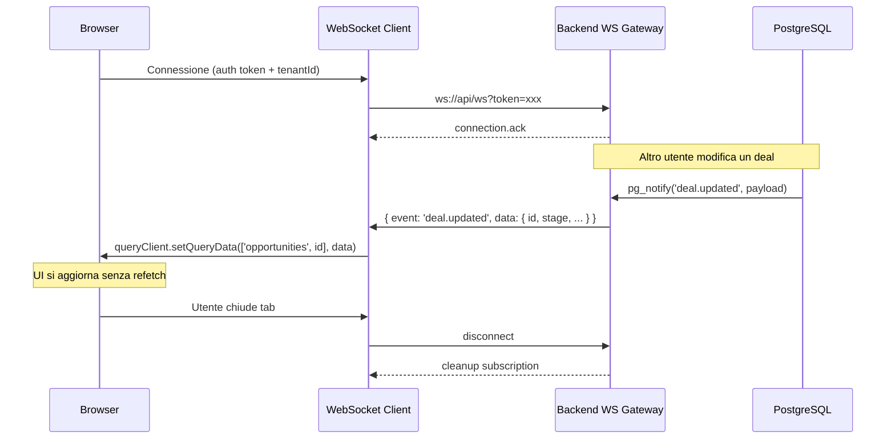
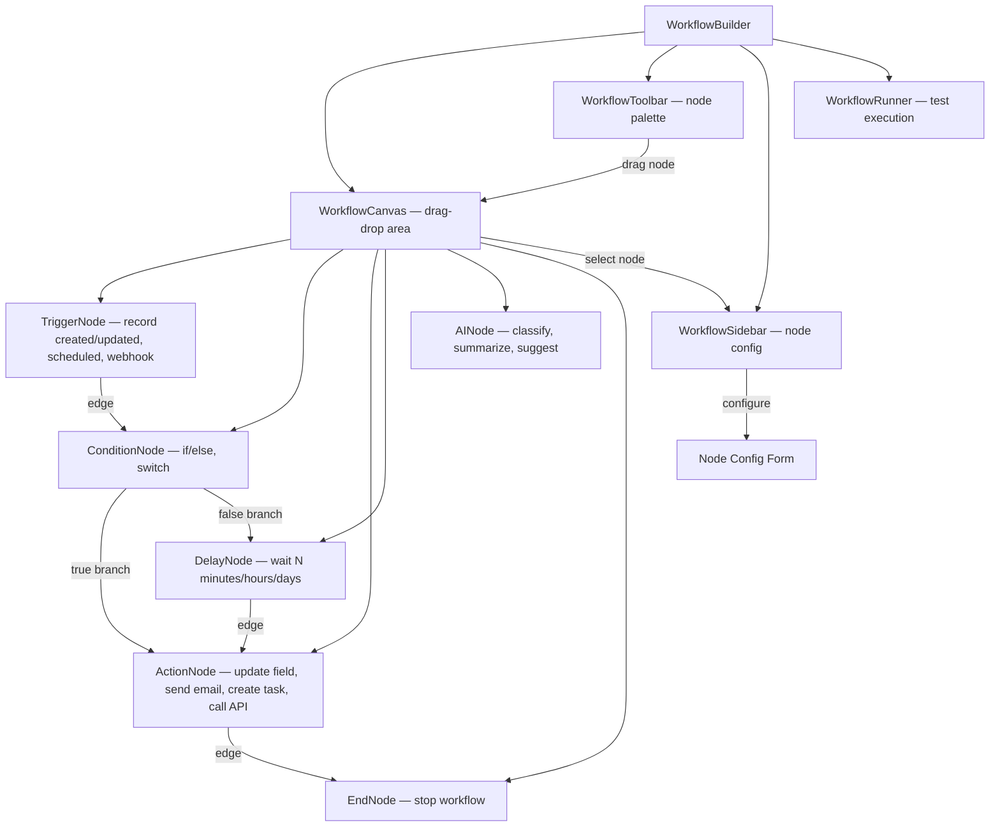
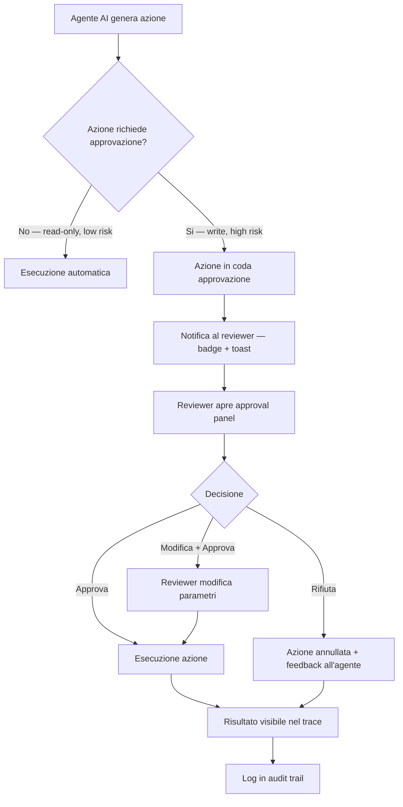

# 04 — Frontend Design

> CRM Pro 360 — AI-powered enterprise CRM per aziende europee mid-enterprise.

---

## 1. UI Architecture

### 1.1 Organizzazione modulare feature-based

L'applicazione è strutturata in moduli indipendenti, ciascuno proprietario delle proprie route, componenti, hook e state slice. L'accoppiamento tra moduli avviene esclusivamente tramite contratti condivisi (`@crm/shared-types`).

```mermaid
graph TD
    Shell[App Shell — Layout, Nav, Auth]

    Shell --> Contacts[contacts]
    Shell --> Pipeline[pipeline]
    Shell --> Marketing[marketing]
    Shell --> Ticketing[ticketing]
    Shell --> Analytics[analytics]
    Shell --> AI[ai]
    Shell --> Admin[admin]
    Shell --> Settings[settings]
    Shell --> Marketplace[marketplace]

    Contacts --> SharedTypes[@crm/shared-types]
    Pipeline --> SharedTypes
    Marketing --> SharedTypes
    Ticketing --> SharedTypes
    Analytics --> SharedTypes
    AI --> SharedTypes
    Admin --> SharedTypes
    Settings --> SharedTypes
    Marketplace --> SharedTypes

    SharedTypes --> APIClient[lib/api-client]
    SharedTypes --> UIKit[lib/ui-kit — Radix + Tailwind]
```

Struttura filesystem:

```
src/
├── modules/
│   ├── contacts/       # Account, Contact, Lead CRUD
│   ├── pipeline/       # Opportunity, Deal, Kanban
│   ├── marketing/      # Campaign, Automation, Email builder
│   ├── ticketing/      # Ticket, SLA, Knowledge base
│   ├── analytics/      # Dashboard, Report, Widget
│   ├── ai/             # Chat, Suggestions, Agent trace
│   ├── admin/          # Tenant config, Users, Roles, Billing
│   ├── settings/       # User preferences, Notifications
│   └── marketplace/    # App store, Plugin install, Webhooks
├── lib/
│   ├── api-client/     # Axios instance, interceptors, retry
│   ├── ui-kit/         # Radix primitives + Tailwind variants
│   ├── auth/           # Session, token refresh, guards
│   └── i18n/           # react-intl provider, message loaders
└── app/
    ├── router.tsx       # Route tree con lazy imports
    └── providers.tsx    # QueryClient, Zustand, IntlProvider
```

### 1.2 Routing architecture — lazy-loaded modules

Ogni modulo è caricato in modo lazy tramite `React.lazy()`. Il bundle iniziale contiene solo Shell, Auth e il modulo corrente.

| Route pattern | Modulo | Lazy | Guard |
|---|---|---|---|
| `/` | Shell redirect → `/pipeline` | No | `AuthGuard` |
| `/contacts/*` | `contacts` | Si | `AuthGuard` |
| `/contacts/:id` | `contacts/detail` | Si | `AuthGuard` |
| `/pipeline/*` | `pipeline` | Si | `AuthGuard` |
| `/pipeline/kanban` | `pipeline/kanban` | Si | `AuthGuard` |
| `/pipeline/deals/:id` | `pipeline/detail` | Si | `AuthGuard` |
| `/marketing/*` | `marketing` | Si | `AuthGuard`, `PlanGuard(pro)` |
| `/marketing/campaigns/:id` | `marketing/detail` | Si | `AuthGuard`, `PlanGuard(pro)` |
| `/ticketing/*` | `ticketing` | Si | `AuthGuard` |
| `/ticketing/:id` | `ticketing/detail` | Si | `AuthGuard` |
| `/analytics/*` | `analytics` | Si | `AuthGuard`, `RoleGuard(manager+)` |
| `/analytics/reports/:id` | `analytics/report` | Si | `AuthGuard`, `RoleGuard(manager+)` |
| `/ai/*` | `ai` | Si | `AuthGuard`, `FeatureGuard(ai)` |
| `/admin/*` | `admin` | Si | `AuthGuard`, `RoleGuard(admin)` |
| `/admin/roles` | `admin/roles` | Si | `AuthGuard`, `RoleGuard(admin)` |
| `/settings/*` | `settings` | Si | `AuthGuard` |
| `/marketplace/*` | `marketplace` | Si | `AuthGuard` |
| `/login` | `auth/login` | No | `GuestGuard` |
| `/sso/callback` | `auth/sso` | No | — |

### 1.3 Micro-frontend feasibility analysis

| Criterio | Monolith + lazy modules | Micro-frontend (Module Federation) |
|---|---|---|
| Complessita di setup | Bassa — Vite standard | Alta — Webpack 5 MF o Vite plugin sperimentale |
| Condivisione design system | Nativa, import diretto | Richiede pacchetto npm esterno o shared scope |
| Deploy indipendente | No — deploy unico | Si — deploy per modulo |
| Overhead runtime | Nessuno | Container runtime, version negotiation |
| DX (Developer Experience) | Eccellente — HMR istantaneo | Degradata — lentezza in dev, debug complesso |
| Team scalability (>15 dev) | Gestibile con code ownership | Necessario per >30 dev su moduli distinti |

**Conclusione:** Monolith con lazy modules per Phase 1-3 (team <20 dev). Rivalutare micro-frontend con Module Federation in Phase 5, quando il team supera i 30 sviluppatori e i cicli di release per modulo divergono significativamente.

### 1.4 Coupling risk matrix tra moduli

| Modulo A | Modulo B | Tipo di accoppiamento | Rischio | Mitigazione |
|---|---|---|---|---|
| contacts | pipeline | Shared entity (Account, Contact) | Alto | Shared types + event bus, no import diretto |
| pipeline | analytics | Pipeline legge metriche deal | Medio | API query, no state condiviso |
| marketing | contacts | Segmentazione contatti | Alto | Servizio di segmentazione nel backend, frontend consuma API |
| ticketing | contacts | Ticket collegato a Contact | Medio | FK via ID, resolve lato componente |
| ai | pipeline | Suggerimenti su deal | Medio | AI espone suggestion card, pipeline consuma via slot |
| ai | ticketing | Auto-classificazione ticket | Medio | Stessa strategia: suggestion card |
| admin | tutti | Configurazione permessi, feature flags | Alto | Context provider globale, moduli leggono solo |
| settings | tutti | Preferenze utente (lingua, tema) | Basso | Zustand store globale, read-only per moduli |
| marketplace | tutti | Plugin injection points | Alto | Plugin registry con contract versioning |
| analytics | tutti | Dati aggregati da ogni modulo | Medio | API backend dedicata, nessun accoppiamento frontend |

---

## 2. State Management

### 2.1 TanStack Query + Zustand — architettura data layer

La separazione e netta: TanStack Query gestisce lo **server state** (dati dal backend), Zustand gestisce il **client state** (UI locale, preferenze, selezioni temporanee).

```mermaid
graph LR
    subgraph Server State — TanStack Query
        API[Backend API]
        Cache[Query Cache]
        API -->|fetch/mutate| Cache
    end

    subgraph Client State — Zustand
        UIState[UI State]
        Prefs[User Preferences]
        Selections[Active Selections]
        Filters[Current Filters]
    end

    subgraph Components
        List[List View]
        Detail[Detail View]
        Kanban[Kanban Board]
    end

    Cache --> List
    Cache --> Detail
    Cache --> Kanban
    UIState --> List
    UIState --> Kanban
    Selections --> List
    Filters --> List
    Prefs --> List
    Prefs --> Detail
```

**Regola:** Se il dato viene dal server e ha un ciclo di vita request/response, va in TanStack Query. Se il dato e generato dal client (quale tab e aperta, filtri temporanei non salvati, selezione multipla), va in Zustand.

### 2.2 Cache invalidation strategy

| Entity | staleTime | gcTime | Invalidation trigger |
|---|---|---|---|
| Account | 5 min | 30 min | Mutazione CRUD, WebSocket `account.updated` |
| Contact | 5 min | 30 min | Mutazione CRUD, WebSocket `contact.updated` |
| Lead | 2 min | 15 min | Mutazione CRUD, WebSocket `lead.updated`, conversione a Opportunity |
| Opportunity | 2 min | 15 min | Mutazione CRUD, stage change, WebSocket `deal.updated` |
| Activity | 1 min | 10 min | Nuova attivita creata, WebSocket `activity.created` |
| Ticket | 1 min | 10 min | Mutazione CRUD, assignment change, WebSocket `ticket.updated` |
| Campaign | 10 min | 60 min | Mutazione CRUD, stato campagna cambiato |
| Analytics (aggregati) | 15 min | 60 min | Refresh manuale, cron giornaliero |
| User / Role | 30 min | 120 min | Admin modifica ruoli |
| Feature Flags | 60 min | 120 min | Polling ogni 60 min, WebSocket `flags.updated` |
| AI Suggestions | 0 (no cache) | 5 min | Ogni richiesta e fresh |
| Marketplace Apps | 30 min | 120 min | Install/uninstall app |

### 2.3 Optimistic update — esempio concreto

Aggiornamento ottimistico dello stage di un'Opportunity nel Kanban:

```typescript
// modules/pipeline/hooks/use-move-opportunity.ts
import { useMutation, useQueryClient } from '@tanstack/react-query';
import { pipelineApi } from '@/lib/api-client/pipeline';
import { opportunityKeys } from '../query-keys';
import type { Opportunity, PipelineStage } from '@crm/shared-types';

export function useMoveOpportunity() {
  const queryClient = useQueryClient();

  return useMutation({
    mutationFn: ({
      opportunityId,
      toStage,
    }: {
      opportunityId: string;
      toStage: PipelineStage;
    }) => pipelineApi.moveOpportunity(opportunityId, toStage),

    onMutate: async ({ opportunityId, toStage }) => {
      // 1. Cancella query in-flight per evitare sovrascrittura
      await queryClient.cancelQueries({ queryKey: opportunityKeys.lists() });

      // 2. Snapshot dello stato precedente per rollback
      const previousOpportunities = queryClient.getQueryData<Opportunity[]>(
        opportunityKeys.lists()
      );

      // 3. Aggiornamento ottimistico nella cache
      queryClient.setQueryData<Opportunity[]>(
        opportunityKeys.lists(),
        (old) =>
          old?.map((opp) =>
            opp.id === opportunityId ? { ...opp, stage: toStage } : opp
          ) ?? []
      );

      return { previousOpportunities };
    },

    onError: (_err, _vars, context) => {
      // Rollback al dato precedente in caso di errore
      if (context?.previousOpportunities) {
        queryClient.setQueryData(
          opportunityKeys.lists(),
          context.previousOpportunities
        );
      }
    },

    onSettled: () => {
      // Invalida la cache per sincronizzare con il server
      queryClient.invalidateQueries({ queryKey: opportunityKeys.lists() });
    },
  });
}
```

### 2.4 WebSocket real-time sync



Il client WebSocket e un singleton inizializzato in `app/providers.tsx`. Ogni modulo registra handler per i propri eventi tramite un hook `useRealtimeSubscription`:

```typescript
// lib/realtime/use-realtime.ts
export function useRealtimeSubscription<T>(
  event: string,
  handler: (data: T) => void
) {
  const ws = useWebSocket();
  useEffect(() => {
    ws.on(event, handler);
    return () => ws.off(event, handler);
  }, [ws, event, handler]);
}
```

### 2.5 Offline-first strategy (mobile — React Native)

Strategia per l'app mobile con Expo:

1. **Persistenza locale:** TanStack Query con `persistQueryClient` + MMKV storage (piu veloce di AsyncStorage).
2. **Mutation queue:** Le mutazioni offline vengono accodate in una coda persistente (`@tanstack/query-persist-client-experimental`). Al ritorno online, vengono eseguite in ordine FIFO.
3. **Conflict resolution — Last Write Wins con merge selettivo:**
   - Ogni entity ha un campo `updatedAt` (timestamp server).
   - Al sync, il client invia `{ data, clientUpdatedAt }`.
   - Il server confronta: se `serverUpdatedAt > clientUpdatedAt`, risponde con `409 Conflict` e il dato server.
   - Il client mostra un dialog di risoluzione: "Il record e stato modificato da {user} alle {time}. Vuoi sovrascrivere o mantenere la versione server?"
4. **Campi mergeable:** Per note e descrizioni, si usa un merge a livello di campo (non di entity). Campi strutturati (stage, owner, amount) sono last-write-wins senza merge.
5. **Sync indicator:** Badge nell'header che mostra il numero di mutazioni in coda e lo stato di connessione (online/offline/syncing).

---

## 3. Enterprise CRM UX Primitives

### 3.1 Object model UI

Ogni oggetto CRM ha tre viste standard:

| Object | Card View | List/Table View | Detail View |
|---|---|---|---|
| **Account** | Logo, nome, industry, revenue, owner avatar | Tabella sortabile con colonne configurabili | Header con KPI, tab: Contacts, Deals, Activities, Files |
| **Contact** | Avatar, nome, ruolo, azienda, email, telefono | Tabella con inline edit per campi frequenti | Header con info, tab: Timeline, Deals, Tickets, Emails |
| **Lead** | Score badge, nome, sorgente, stato, owner | Tabella con bulk convert action | Header con lead score, tab: Timeline, Qualification, Convert |
| **Opportunity** | Importo, stage pill, close date, probability | Kanban (default) o tabella | Header con deal amount, tab: Timeline, Contacts, Products, Quotes |
| **Activity** | Tipo icona, subject, due date, associated record | Timeline raggruppata per giorno | Modale con dettagli, note, partecipanti |
| **Ticket** | Priorita badge, subject, assignee, SLA timer | Tabella con filtri rapidi per stato/priorita | Header con SLA, tab: Conversation, Timeline, Related |

### 3.2 Timeline feed component

Il componente Timeline e condiviso tra tutti gli oggetti CRM. Architettura:

```
TimelineFeed
├── TimelineFilters          # Filtro per tipo (email, call, note, task, deal change)
├── TimelineComposer         # Input per aggiungere note/log call/task rapido
├── TimelineVirtualList      # Virtualizzato con @tanstack/virtual (~10k items)
│   ├── TimelineItem
│   │   ├── TimelineIcon     # Icona tipo attivita
│   │   ├── TimelineContent  # Contenuto variabile per tipo
│   │   ├── TimelineMetadata # Timestamp, autore, linked records
│   │   └── TimelineActions  # Pin, Edit, Delete (se proprietario)
│   └── TimelineDateSeparator
└── TimelineLoadMore         # Paginazione cursor-based
```

L'API restituisce eventi in ordine cronologico inverso, paginati con cursor. Il componente supporta pinning (eventi importanti restano in cima) e threading (risposte annidate a un evento).

### 3.3 Advanced filtering engine

Il motore di filtri supporta operatori dinamici basati sul tipo di campo:

| Tipo campo | Operatori disponibili |
|---|---|
| `string` | equals, not_equals, contains, not_contains, starts_with, ends_with, is_empty, is_not_empty |
| `number` | equals, not_equals, gt, gte, lt, lte, between, is_empty |
| `date` | equals, before, after, between, last_n_days, next_n_days, this_week, this_month, this_quarter |
| `enum` | in, not_in |
| `boolean` | is_true, is_false |
| `relation` | has_any, has_none, has_all |

**Saved Filters:** I filtri salvati vengono serializzati in un formato JSON persistito nel backend:

```typescript
interface SavedFilter {
  id: string;
  name: string;
  entity: CRMEntity;
  visibility: 'personal' | 'shared';
  owner: string;
  conditions: FilterCondition[];
  sort: { field: string; direction: 'asc' | 'desc' }[];
  columns: string[]; // colonne visibili nella tabella
}

interface FilterCondition {
  field: string;
  operator: FilterOperator;
  value: unknown;
  logic?: 'AND' | 'OR'; // default AND
}
```

**Generazione RSQL:** I filtri vengono convertiti in query string RSQL per il backend:

```typescript
// lib/filters/to-rsql.ts
function toRSQL(conditions: FilterCondition[]): string {
  return conditions
    .map((c) => {
      switch (c.operator) {
        case 'equals':     return `${c.field}==${c.value}`;
        case 'contains':   return `${c.field}=like="*${c.value}*"`;
        case 'gt':          return `${c.field}=gt=${c.value}`;
        case 'in':          return `${c.field}=in=(${(c.value as string[]).join(',')})`;
        case 'between':     return `${c.field}=ge=${c.value[0]};${c.field}=le=${c.value[1]}`;
        // ... altri operatori
        default:            return '';
      }
    })
    .filter(Boolean)
    .join(';');
}
```

### 3.4 Saved views system

Le viste salvate combinano filtri, ordinamento, colonne visibili e tipo di visualizzazione:

```typescript
interface SavedView {
  id: string;
  name: string;
  entity: CRMEntity;
  visibility: 'personal' | 'team' | 'global';
  owner: string;
  viewType: 'table' | 'kanban' | 'list' | 'calendar';
  filter: SavedFilter;
  groupBy?: string;         // campo per raggruppamento (es. stage in Kanban)
  calendarDateField?: string; // campo data per vista calendario
  columnWidths?: Record<string, number>;
  pinnedColumns?: string[];
  createdAt: string;
  updatedAt: string;
}
```

Serializzazione: il payload viene inviato al backend come JSON e persistito in tabella `saved_views`. L'utente vede un dropdown con le proprie viste personali + quelle condivise dal team. L'admin puo creare viste `global` visibili a tutti.

### 3.5 Bulk action framework

Flusso: Selezione → Azione → Conferma → Progresso → Risultato.

1. **Selezione:** Checkbox nella tabella, con "Select all" che seleziona tutti i risultati del filtro corrente (non solo la pagina). Counter visibile: "342 selezionati".
2. **Azione:** Toolbar contestuale con azioni disponibili (Assign, Change Stage, Tag, Delete, Export, Merge). Le azioni disponibili dipendono dai permessi dell'utente e dal tipo di entity.
3. **Conferma:** Dialog modale con riepilogo: "Stai per cambiare lo stage di 342 opportunity a 'Negotiation'. Confermi?". Per azioni distruttive (Delete), input di conferma testuale.
4. **Progresso:** Progress bar con contatore (es. "127 / 342 elaborati"). L'operazione e asincrona (BullMQ job nel backend). Il frontend fa polling sullo stato del job.
5. **Risultato:** Notifica con riepilogo: "342 record aggiornati, 3 errori". Link per scaricare il report errori in CSV.

### 3.6 Admin console module map

L'admin console e organizzata in sezioni:

| Sezione | Funzionalita |
|---|---|
| **Organization** | Nome azienda, logo, dominio, timezone, locale default |
| **Users** | Invita, disattiva, reset password, assegna ruolo |
| **Roles & Permissions** | Matrice ruolo × risorsa × azione (CRUD + custom) |
| **Teams** | Crea team, assegna utenti, territory assignment |
| **Billing** | Piano corrente, upgrade/downgrade, fatture, payment method |
| **Custom Fields** | Aggiungi campi custom a qualsiasi entity CRM |
| **Custom Objects** | Crea oggetti custom con relazioni |
| **Workflows** | Workflow builder visuale (automazioni) |
| **Integrations** | OAuth connections, API keys, webhook config |
| **Email Settings** | SMTP/IMAP config, firma email, template |
| **AI Configuration** | Modello AI, limiti token, approvazione HITL |
| **Audit Log** | Log di tutte le azioni admin con filtri per utente/azione/data |
| **Data Import/Export** | Import CSV/XLSX, export dati, data migration |
| **Branding** | Logo, colori, favicon per white-label |

### 3.7 Workflow builder — component architecture



Il canvas utilizza `@xyflow/react` (ex React Flow) per il rendering dei nodi e degli edge. Ogni tipo di nodo ha un form di configurazione dedicato nel sidebar. Il workflow viene serializzato in JSON e salvato nel backend come definizione eseguibile da BullMQ.

### 3.8 Form builder per custom objects

Il form builder consente agli admin di creare form per oggetti custom:

- **Campi supportati:** Text, Number, Currency, Date, DateTime, Email, Phone, URL, Textarea, Select, MultiSelect, Checkbox, Lookup (relazione), File upload.
- **Layout:** Drag-drop di campi su una griglia a 2 colonne. Supporto per sezioni collassabili e tab.
- **Validazione:** Required, min/max length, regex pattern, unique constraint. Configurabile per campo.
- **Conditional visibility:** Mostra/nascondi campi basandosi sul valore di altri campi (es. mostra "Reason" solo se Status = "Closed Lost").
- **Serializzazione:** Il form schema e salvato come JSON Schema Draft 2020-12, renderizzato runtime da un componente `DynamicForm`.

### 3.9 View system — data layer condiviso

Le quattro viste (Table, List, Kanban, Calendar) condividono lo stesso data layer:

```typescript
// modules/shared/hooks/use-entity-data.ts
export function useEntityData(entity: CRMEntity, view: SavedView) {
  const rsql = toRSQL(view.filter.conditions);

  return useQuery({
    queryKey: [entity, 'list', rsql, view.sort],
    queryFn: () => crmApi.list(entity, { filter: rsql, sort: view.sort }),
    staleTime: STALE_TIMES[entity],
  });
}
```

Ogni vista consuma lo stesso hook, ma renderizza in modo diverso:

- **Table:** `@tanstack/react-table` con colonne resizable, sortable, pinnable.
- **List:** Card compatte impilate verticalmente, raggruppabili per campo.
- **Kanban:** Colonne per `groupBy` field (es. stage), drag-drop tra colonne con `@dnd-kit/core`.
- **Calendar:** Vista mese/settimana/giorno con `@schedule-x/react`, record posizionati per campo data.

---

## 4. Multi-Tenancy & RBAC UI

### 4.1 Org/workspace context switching

Flusso UX per il cambio organizzazione/workspace:

1. L'utente clicca sul nome dell'organizzazione nel sidebar header.
2. Si apre un dropdown con le organizzazioni a cui l'utente appartiene + un link "Crea nuova organizzazione".
3. Selezionando un'organizzazione diversa:
   - Il frontend svuota l'intera query cache (`queryClient.clear()`).
   - Aggiorna il `tenantId` nel Zustand store globale.
   - Re-inizializza la connessione WebSocket con il nuovo `tenantId`.
   - Redirige a `/pipeline` (home del workspace).
4. All'interno di un'organizzazione, l'utente puo avere accesso a piu workspace (es. "Sales Italia", "Sales DACH"). Il workspace e selezionato con un secondo dropdown sotto il nome org. Il cambio workspace non svuota la cache ma invalida le query con prefix `[workspace]`.

### 4.2 Route-level permission guards

```typescript
// lib/auth/guards.tsx
import { Navigate, Outlet } from 'react-router-dom';
import { useAuthStore } from '@/lib/auth/store';

export function AuthGuard() {
  const { isAuthenticated, isLoading } = useAuthStore();
  if (isLoading) return <FullPageSpinner />;
  if (!isAuthenticated) return <Navigate to="/login" replace />;
  return <Outlet />;
}

export function RoleGuard({ minRole }: { minRole: Role }) {
  const { user } = useAuthStore();
  const roleHierarchy: Role[] = ['viewer', 'member', 'manager', 'admin', 'owner'];
  const userLevel = roleHierarchy.indexOf(user!.role);
  const requiredLevel = roleHierarchy.indexOf(minRole);
  if (userLevel < requiredLevel) return <Navigate to="/unauthorized" replace />;
  return <Outlet />;
}

export function PlanGuard({ requiredPlan }: { requiredPlan: Plan }) {
  const { tenant } = useAuthStore();
  const planHierarchy: Plan[] = ['free', 'starter', 'pro', 'enterprise'];
  const tenantLevel = planHierarchy.indexOf(tenant!.plan);
  const requiredLevel = planHierarchy.indexOf(requiredPlan);
  if (tenantLevel < requiredLevel) return <UpgradePrompt plan={requiredPlan} />;
  return <Outlet />;
}

export function FeatureGuard({ flag }: { flag: string }) {
  const { featureFlags } = useAuthStore();
  if (!featureFlags[flag]) return <Navigate to="/pipeline" replace />;
  return <Outlet />;
}
```

### 4.3 Component-level permission guards

```typescript
// lib/auth/use-permission.ts
import { useAuthStore } from './store';

type Action = 'create' | 'read' | 'update' | 'delete' | 'export' | 'bulk_delete';
type Resource = 'account' | 'contact' | 'lead' | 'opportunity' | 'ticket'
  | 'campaign' | 'report' | 'user' | 'role' | 'workflow' | 'custom_object';

export function usePermission(resource: Resource, action: Action): boolean {
  const { user, permissions } = useAuthStore();
  if (!user || !permissions) return false;

  // Owner ha tutti i permessi
  if (user.role === 'owner') return true;

  const key = `${resource}:${action}`;
  return permissions.includes(key);
}

// Utilizzo nei componenti:
function DeleteAccountButton({ accountId }: { accountId: string }) {
  const canDelete = usePermission('account', 'delete');
  if (!canDelete) return null;

  return (
    <Button variant="destructive" onClick={() => deleteAccount(accountId)}>
      Elimina Account
    </Button>
  );
}
```

### 4.4 Admin permission matrix UI

L'interfaccia admin presenta una matrice interattiva ruolo × risorsa × azione:

| | Account | Contact | Lead | Opportunity | Ticket | Campaign | Report | User | Role |
|---|---|---|---|---|---|---|---|---|---|
| **viewer** | R | R | R | R | R | — | R | — | — |
| **member** | CRU | CRU | CRUD | CRU | CRUD | R | R | — | — |
| **manager** | CRUD | CRUD | CRUD | CRUD | CRUD | CRU | CRUD | R | — |
| **admin** | CRUD | CRUD | CRUD | CRUD | CRUD | CRUD | CRUD | CRUD | CRU |
| **owner** | CRUD* | CRUD* | CRUD* | CRUD* | CRUD* | CRUD* | CRUD* | CRUD* | CRUD* |

`*` = include permessi speciali (bulk delete, export, merge, transfer ownership).

Il componente UI renderizza questa matrice con checkbox per ogni cella. Le modifiche vengono salvate in tempo reale con debounce (500ms). I ruoli custom possono essere creati dall'admin partendo da un ruolo base e modificando i permessi.

### 4.5 Feature flag integration

Integrazione con Unleash (self-hosted, conforme GDPR):

```typescript
// lib/feature-flags/provider.tsx
import { FlagProvider, useFlag } from '@unleash/proxy-client-react';

const unleashConfig = {
  url: import.meta.env.VITE_UNLEASH_PROXY_URL,
  clientKey: import.meta.env.VITE_UNLEASH_CLIENT_KEY,
  refreshInterval: 60,
  appName: 'crm-pro-360',
  context: {
    userId: authStore.getState().user?.id,
    properties: {
      tenantId: authStore.getState().tenant?.id,
      plan: authStore.getState().tenant?.plan,
    },
  },
};

// Utilizzo:
function AIFeature() {
  const aiEnabled = useFlag('ai-assistant');
  if (!aiEnabled) return null;
  return <AISuggestionPanel />;
}
```

I feature flag sono valutati per tenant e per piano. Esempi di flag:
- `ai-assistant` — abilitato per piano `pro` e `enterprise`
- `workflow-builder` — abilitato per piano `enterprise`
- `marketplace` — beta, abilitato per tenant specifici
- `advanced-analytics` — abilitato per piano `pro+` con ruolo `manager+`

---

## 5. AI Layer UX

### 5.1 AI suggestion cards con explainability

Ogni suggerimento AI viene presentato con un livello di trasparenza completo:

```
┌─────────────────────────────────────────────────────┐
│ 🟢 92% confidence                                    │
│                                                       │
│ Suggerimento: Sposta "Deal Acme Corp" a "Negotiation" │
│                                                       │
│ Ragionamento:                                         │
│ • Il prospect ha aperto 3 email negli ultimi 5 giorni │
│ • Ultima call di 45 min ha coperto pricing            │
│ • Pattern simile a 12 deal chiusi positivamente       │
│                                                       │
│ [Applica]  [Ignora]  [Feedback ↓]                    │
└─────────────────────────────────────────────────────┘
```

Il componente `AISuggestionCard` riceve:

```typescript
interface AISuggestion {
  id: string;
  type: 'move_stage' | 'assign_owner' | 'create_task' | 'send_followup' | 'classify_ticket';
  confidence: number; // 0-1
  title: string;
  reasoning: string[];
  action: { endpoint: string; method: string; payload: Record<string, unknown> };
  relatedEntityId: string;
  relatedEntityType: CRMEntity;
  createdAt: string;
}
```

### 5.2 Agent execution trace viewer

Il trace viewer mostra ogni step eseguito dall'agente AI in una timeline verticale:

```
Timeline dell'esecuzione agente:
──────────────────────────────
⏱ 0.0s  │ 🔵 Inizio — "Analizza deal e suggerisci next step"
⏱ 0.3s  │ 🔧 Tool: search_deals({ accountId: "abc123" })
⏱ 1.2s  │ 📄 Risultato: 3 deal trovati
⏱ 1.5s  │ 🔧 Tool: get_activities({ dealId: "deal-456", last: 10 })
⏱ 2.1s  │ 📄 Risultato: 10 attivita caricate
⏱ 2.4s  │ 🧠 Reasoning: "Il deal ha alta engagement..."
⏱ 3.0s  │ ✅ Suggerimento generato (confidence: 0.92)
⏱ 3.1s  │ 🏁 Fine — Durata totale: 3.1s, Token: 2,847
```

Ogni step e espandibile per mostrare input/output completo del tool call.

### 5.3 Human-in-the-loop approval workflow



Regole di approvazione configurabili per tenant:
- **Sempre automatico:** Query di lettura, ricerca, classificazione.
- **Approvazione richiesta:** Creazione record, invio email, cambio stage, assegnazione.
- **Doppia approvazione:** Cancellazione record, operazioni bulk, modifiche a workflow.

### 5.4 Undo/rollback per AI actions

Ogni azione eseguita dall'agente AI genera un record di rollback:

- Le azioni sono reversibili entro 5 minuti (configurabile per tenant).
- Il pulsante "Annulla" appare come toast persistente dopo l'esecuzione.
- Il rollback esegue l'operazione inversa (es. se l'AI ha spostato un deal da "Qualification" a "Negotiation", il rollback lo riporta a "Qualification").
- Le azioni non reversibili (es. email inviata) mostrano un avviso "Questa azione non puo essere annullata" prima dell'approvazione.

### 5.5 Token/cost transparency dashboard

Dashboard dedicata in `admin/ai-configuration`:

| Metrica | Visualizzazione |
|---|---|
| Token consumati oggi/settimana/mese | Grafico a barre con trend |
| Costo stimato (EUR) | Counter con confronto budget mensile |
| Token per utente | Tabella sortabile |
| Token per tipo di azione | Pie chart (classify, summarize, suggest, chat) |
| Budget rimanente | Progress bar con soglie di allarme |
| Previsione consumo fine mese | Linea tratteggiata sul grafico trend |

### 5.6 AI confidence indicators — traffic light system

| Livello | Range | Colore | Comportamento UI |
|---|---|---|---|
| Alto | >80% | Verde (`#22c55e`) | Suggerimento prominente, azione in un click |
| Medio | 50-80% | Giallo (`#eab308`) | Suggerimento visibile, richiede conferma esplicita |
| Basso | <50% | Rosso (`#ef4444`) | Suggerimento minimizzato, label "Bassa confidenza", richiede approvazione manuale |

Il colore viene applicato come badge nel `AISuggestionCard` e come indicatore nel trace viewer. L'admin puo configurare le soglie per tenant.

---

## 6. Observability UI

### 6.1 Agent run dashboard

| Colonna | Descrizione |
|---|---|
| Run ID | Identificativo univoco, link al trace detail |
| Trigger | Utente, workflow, scheduled, webhook |
| Status | `running` · `completed` · `failed` · `timeout` · `cancelled` |
| Duration | Tempo di esecuzione in secondi |
| Token used | Totale token input + output |
| Cost (EUR) | Costo stimato basato sul modello utilizzato |
| Tools called | Numero di tool invocations |
| Approval | `auto` · `approved` · `rejected` · `pending` |
| Timestamp | Data/ora di inizio |

Filtri rapidi per status, trigger type, date range. Grafici: run per giorno (bar chart), tasso di successo (donut), durata media (trend line).

### 6.2 Failure categorization & drill-down

Le failure sono categorizzate automaticamente:

| Categoria | Descrizione | Azione suggerita |
|---|---|---|
| `tool_error` | Tool call ha restituito errore (es. API 500) | Verificare lo stato del servizio esterno |
| `timeout` | Esecuzione ha superato il limite (default 30s) | Aumentare timeout o semplificare il prompt |
| `token_limit` | Contesto ha superato il limite del modello | Ridurre il contesto o usare modello con finestra piu ampia |
| `permission_denied` | L'agente ha tentato un'azione non autorizzata | Verificare configurazione RBAC dell'agente |
| `parse_error` | Output del modello non parsabile | Migliorare il prompt o aggiornare il parser |
| `rate_limited` | Rate limit del provider AI raggiunto | Implementare backoff o aumentare quota |

Drill-down: cliccando su una failure si apre il trace completo con evidenziato lo step che ha causato l'errore.

### 6.3 Latency heatmap

Visualizzazione heatmap delle latenze degli agent run:

- Asse X: ora del giorno (0-23).
- Asse Y: giorno della settimana (Lun-Dom).
- Colore cella: latenza media (verde <2s, giallo 2-5s, rosso >5s).
- Hover sulla cella: tooltip con latenza media, p95, p99, numero di run.

Utile per identificare pattern di degradazione prestazionale (es. rallentamenti nelle ore di punta).

### 6.4 Budget quota alerts & usage meters

- **Progress bar** nel sidebar admin: consumo corrente / budget mensile.
- **Soglie di allarme:** 70% (warning giallo), 90% (danger rosso), 100% (blocco con override admin).
- **Notifiche:** Email all'admin quando si raggiunge una soglia. Notifica in-app per tutti gli utenti quando il budget supera il 90%.
- **Auto-throttle:** Al superamento del 100%, le richieste AI vengono accodate con priorita ridotta. L'admin puo sbloccare con override temporaneo.

### 6.5 System health status page

Pagina pubblica (no auth richiesta) con stato dei servizi:

| Servizio | Indicatori |
|---|---|
| API Backend | Uptime %, latenza media, error rate |
| Database | Connection pool usage, query latency |
| Redis / BullMQ | Queue depth, processing rate, failed jobs |
| AI Provider | Disponibilita, latenza, rate limit remaining |
| WebSocket | Connessioni attive, messaggi/sec |
| Email Service | Delivery rate, bounce rate |
| File Storage | Disponibilita, upload latency |

Ogni servizio ha un indicatore: `operational` (verde), `degraded` (giallo), `outage` (rosso). Storico incidenti degli ultimi 90 giorni.

---

## 7. Design System

### 7.1 Component library architecture

L'architettura si basa su primitive Radix UI per accessibilita e behavior, con styling tramite Tailwind CSS e `class-variance-authority` per le varianti:

```
ui-kit/
├── primitives/          # Wrapper sottili su Radix
│   ├── Button.tsx       # Radix Slot + CVA variants
│   ├── Dialog.tsx       # Radix Dialog + animazioni
│   ├── DropdownMenu.tsx # Radix DropdownMenu
│   ├── Select.tsx       # Radix Select
│   ├── Tooltip.tsx      # Radix Tooltip
│   ├── Tabs.tsx         # Radix Tabs
│   ├── Popover.tsx      # Radix Popover
│   ├── Checkbox.tsx     # Radix Checkbox
│   ├── RadioGroup.tsx   # Radix RadioGroup
│   └── Toast.tsx        # Radix Toast con auto-dismiss
├── composites/          # Componenti composti
│   ├── DataTable.tsx    # TanStack Table + pagination + sorting
│   ├── CommandPalette.tsx # Radix Dialog + cmdk
│   ├── DatePicker.tsx   # Radix Popover + date-fns calendar
│   ├── FileUpload.tsx   # Drag-drop zone + progress
│   ├── RichTextEditor.tsx # Tiptap con toolbar
│   └── KanbanBoard.tsx  # @dnd-kit/core + colonne
├── layout/
│   ├── AppShell.tsx     # Sidebar + header + content area
│   ├── PageHeader.tsx   # Breadcrumb + title + actions
│   └── SplitPane.tsx    # Resizable panels
├── feedback/
│   ├── Skeleton.tsx     # Loading placeholders
│   ├── EmptyState.tsx   # Illustrazione + CTA
│   ├── ErrorAlert.tsx   # Errore con retry button
│   └── ConfirmDialog.tsx # Conferma distruttiva con input
└── index.ts             # Barrel export
```

### 7.2 Design token system

**Colori — Semantic:**

| Token | Valore (Light) | Valore (Dark) | Uso |
|---|---|---|---|
| `--color-primary` | `hsl(221, 83%, 53%)` | `hsl(221, 83%, 63%)` | Azioni primarie, link |
| `--color-primary-hover` | `hsl(221, 83%, 47%)` | `hsl(221, 83%, 70%)` | Hover su primario |
| `--color-secondary` | `hsl(250, 55%, 57%)` | `hsl(250, 55%, 67%)` | Azioni secondarie |
| `--color-success` | `hsl(142, 71%, 45%)` | `hsl(142, 71%, 55%)` | Conferme, stati positivi |
| `--color-warning` | `hsl(38, 92%, 50%)` | `hsl(38, 92%, 60%)` | Avvisi, attenzione |
| `--color-danger` | `hsl(0, 84%, 60%)` | `hsl(0, 84%, 65%)` | Errori, azioni distruttive |
| `--color-info` | `hsl(199, 89%, 48%)` | `hsl(199, 89%, 58%)` | Informazioni, tooltip |
| `--color-surface` | `hsl(0, 0%, 100%)` | `hsl(224, 20%, 12%)` | Background card |
| `--color-background` | `hsl(210, 20%, 98%)` | `hsl(224, 20%, 8%)` | Background pagina |
| `--color-text` | `hsl(224, 20%, 12%)` | `hsl(210, 20%, 95%)` | Testo primario |
| `--color-text-muted` | `hsl(220, 10%, 50%)` | `hsl(220, 10%, 60%)` | Testo secondario |
| `--color-border` | `hsl(220, 13%, 91%)` | `hsl(220, 13%, 22%)` | Bordi, separatori |

**Spacing — griglia 4px:**

| Token | Valore |
|---|---|
| `--space-1` | `4px` |
| `--space-2` | `8px` |
| `--space-3` | `12px` |
| `--space-4` | `16px` |
| `--space-5` | `20px` |
| `--space-6` | `24px` |
| `--space-8` | `32px` |
| `--space-10` | `40px` |
| `--space-12` | `48px` |
| `--space-16` | `64px` |

**Typography scale:**

| Token | Size | Line Height | Weight | Uso |
|---|---|---|---|---|
| `--text-xs` | 12px | 16px | 400 | Caption, badge |
| `--text-sm` | 14px | 20px | 400 | Body small, tabelle |
| `--text-base` | 16px | 24px | 400 | Body default |
| `--text-lg` | 18px | 28px | 500 | Subtitle |
| `--text-xl` | 20px | 28px | 600 | Section title |
| `--text-2xl` | 24px | 32px | 700 | Page title |
| `--text-3xl` | 30px | 36px | 700 | Hero |

Font stack: `'Inter Variable', 'Inter', system-ui, -apple-system, sans-serif`.

**Shadows:**

| Token | Valore |
|---|---|
| `--shadow-sm` | `0 1px 2px hsl(0 0% 0% / 0.05)` |
| `--shadow-md` | `0 4px 6px -1px hsl(0 0% 0% / 0.1)` |
| `--shadow-lg` | `0 10px 15px -3px hsl(0 0% 0% / 0.1)` |
| `--shadow-xl` | `0 20px 25px -5px hsl(0 0% 0% / 0.1)` |

**Border radii:**

| Token | Valore |
|---|---|
| `--radius-sm` | `4px` |
| `--radius-md` | `8px` |
| `--radius-lg` | `12px` |
| `--radius-xl` | `16px` |
| `--radius-full` | `9999px` |

### 7.3 Theming engine

Doppio tema (light/dark) implementato tramite CSS custom properties con switch basato su `data-theme` attribute sull'`<html>`:

```css
:root, [data-theme='light'] {
  --color-primary: hsl(221, 83%, 53%);
  --color-surface: hsl(0, 0%, 100%);
  --color-background: hsl(210, 20%, 98%);
  --color-text: hsl(224, 20%, 12%);
  /* ... tutti i token */
}

[data-theme='dark'] {
  --color-primary: hsl(221, 83%, 63%);
  --color-surface: hsl(224, 20%, 12%);
  --color-background: hsl(224, 20%, 8%);
  --color-text: hsl(210, 20%, 95%);
  /* ... tutti i token */
}
```

**Tenant-level branding:** Ogni tenant puo configurare colori, logo, favicon e font. I valori custom vengono iniettati come override CSS all'avvio dell'app:

```typescript
// lib/theming/apply-tenant-branding.ts
export function applyTenantBranding(branding: TenantBranding) {
  const root = document.documentElement;
  if (branding.primaryColor) root.style.setProperty('--color-primary', branding.primaryColor);
  if (branding.logo) document.querySelector<HTMLImageElement>('.app-logo')!.src = branding.logo;
  if (branding.favicon) {
    (document.querySelector('link[rel="icon"]') as HTMLLinkElement).href = branding.favicon;
  }
  if (branding.fontFamily) root.style.setProperty('--font-family', branding.fontFamily);
}
```

### 7.4 White-label capability

Configurazione completa per white-label:

| Elemento | Configurabile | Metodo |
|---|---|---|
| Logo (sidebar, login) | Si | Upload immagine, URL in tenant config |
| Favicon | Si | Upload `.ico` / `.png` |
| Colore primario | Si | Color picker nell'admin |
| Colore secondario | Si | Color picker nell'admin |
| Font family | Si | Selezione da lista (Inter, Roboto, Open Sans, custom) |
| Titolo pagina (`<title>`) | Si | Testo configurabile |
| Email template header/footer | Si | Editor HTML semplificato |
| Dominio custom | Si | CNAME + certificato SSL automatico (Let's Encrypt) |
| Login page background | Si | Upload immagine o colore |

### 7.5 Accessibility — WCAG 2.2 AA compliance checklist

| # | Criterio | Implementazione |
|---|---|---|
| 1 | Contrasto minimo 4.5:1 per testo normale | Token colore validati con axe-core in CI |
| 2 | Contrasto minimo 3:1 per testo grande e icone | Stessa validazione automatica |
| 3 | Focus ring visibile su tutti gli elementi interattivi | `focus-visible:ring-2 ring-offset-2` globale |
| 4 | Navigazione completa da tastiera | Radix primitives gestiscono focus trap e arrow keys |
| 5 | Skip navigation link | Primo elemento nel DOM, visibile on focus |
| 6 | Landmark roles (`main`, `nav`, `aside`, `header`) | Elementi semantici HTML5 nel layout |
| 7 | ARIA labels su tutti i controlli senza testo visibile | Audit con eslint-plugin-jsx-a11y |
| 8 | Alt text su tutte le immagini | Rule ESLint bloccante |
| 9 | Form labels associati ai campi | `htmlFor` + `id` su tutti i campi |
| 10 | Error messages collegati ai campi con `aria-describedby` | Pattern standard nei form components |
| 11 | Live regions per contenuto dinamico (`aria-live`) | Toast, notification counter, form errors |
| 12 | Riduzione animazioni con `prefers-reduced-motion` | Media query rispettata in tutti i motion token |
| 13 | Testo ridimensionabile fino a 200% senza perdita | Layout fluid con `rem`, no `px` per font |
| 14 | Touch target minimo 44x44px | Enforced nei primitives Button, Checkbox, etc. |
| 15 | Nessun contenuto che lampeggia piu di 3 volte/sec | Nessuna animazione flash nel design system |
| 16 | Ordine di lettura logico (DOM order = visual order) | CSS Flexbox/Grid con `order` evitato |
| 17 | Color non unico indicatore di stato | Icone + testo accompagnano sempre il colore |

### 7.6 i18n architecture

Stack: `react-intl` con ICU Message Format per gestire plurali, generi e date localizzate.

Lingue supportate: IT (default), EN, DE, FR, ES.

```
src/
└── i18n/
    ├── provider.tsx       # IntlProvider con lazy loading messaggi
    ├── use-locale.ts      # Hook per cambio lingua runtime
    └── messages/
        ├── it.json        # 100% completo (lingua base)
        ├── en.json        # 100% completo
        ├── de.json        # Traduzione professionale
        ├── fr.json        # Traduzione professionale
        └── es.json        # Traduzione professionale
```

Formato messaggi ICU:

```json
{
  "pipeline.deals.count": "{count, plural, =0 {Nessun deal} one {# deal} other {# deal}}",
  "pipeline.deals.value": "Valore totale: {amount, number, ::currency/EUR}",
  "activity.created": "{user} ha creato {type, select, call {una chiamata} email {un'email} note {una nota} task {un task} other {un'attivita}} {relativeTime}",
  "common.lastUpdated": "Ultimo aggiornamento: {date, date, medium} alle {date, time, short}"
}
```

I file di traduzione sono caricati in modo lazy (solo la lingua attiva viene caricata). Il cambio lingua e persistito in `localStorage` e applicato senza reload tramite React context re-render.

### 7.7 Motion system

| Token | Valore | Uso |
|---|---|---|
| `--duration-instant` | `50ms` | Feedback immediato (checkbox, toggle) |
| `--duration-fast` | `150ms` | Hover, focus, tooltip |
| `--duration-normal` | `250ms` | Apertura modal, slide panel |
| `--duration-slow` | `400ms` | Page transition, layout shift |
| `--easing-default` | `cubic-bezier(0.4, 0, 0.2, 1)` | Transizioni standard |
| `--easing-in` | `cubic-bezier(0.4, 0, 1, 1)` | Elementi che escono |
| `--easing-out` | `cubic-bezier(0, 0, 0.2, 1)` | Elementi che entrano |
| `--easing-bounce` | `cubic-bezier(0.34, 1.56, 0.64, 1)` | Feedback micro-interaction |

**Reduced motion support:**

```css
@media (prefers-reduced-motion: reduce) {
  *, *::before, *::after {
    animation-duration: 0.01ms !important;
    animation-iteration-count: 1 !important;
    transition-duration: 0.01ms !important;
    scroll-behavior: auto !important;
  }
}
```

---

## 8. Performance

### 8.1 Bundle budget

| Metrica | Target | Enforcement |
|---|---|---|
| Initial JS (gzipped) | < 200 KB | `vite-plugin-bundle-analyzer` + CI check |
| Total JS (tutte le route, gzipped) | < 500 KB | Monitoraggio in CI |
| Singolo chunk lazy | < 80 KB | Vite `manualChunks` config |
| CSS totale (gzipped) | < 50 KB | Tailwind purge + CI check |
| Font (woff2) | < 100 KB | Subset Inter con `unicode-range` |

### 8.2 Lazy loading strategy per route

| Route | Chunk name | Estimated size (gzip) | Priority |
|---|---|---|---|
| `/login` | `auth` | ~15 KB | Critica (preload) |
| `/pipeline/*` | `pipeline` | ~45 KB | Alta (default route) |
| `/contacts/*` | `contacts` | ~40 KB | Alta |
| `/ticketing/*` | `ticketing` | ~35 KB | Media |
| `/marketing/*` | `marketing` | ~55 KB | Media |
| `/analytics/*` | `analytics` | ~60 KB | Bassa (grafici pesanti) |
| `/ai/*` | `ai` | ~50 KB | Media |
| `/admin/*` | `admin` | ~45 KB | Bassa |
| `/settings/*` | `settings` | ~20 KB | Bassa |
| `/marketplace/*` | `marketplace` | ~30 KB | Bassa |

### 8.3 Code splitting boundaries

```typescript
// app/router.tsx
import { lazy } from 'react';

const PipelineModule = lazy(() => import('../modules/pipeline'));
const ContactsModule = lazy(() => import('../modules/contacts'));
const TicketingModule = lazy(() => import('../modules/ticketing'));
const MarketingModule = lazy(() => import('../modules/marketing'));
const AnalyticsModule = lazy(() => import('../modules/analytics'));
const AIModule = lazy(() => import('../modules/ai'));
const AdminModule = lazy(() => import('../modules/admin'));
const SettingsModule = lazy(() => import('../modules/settings'));
const MarketplaceModule = lazy(() => import('../modules/marketplace'));
```

Librerie pesanti isolate in chunk dedicati tramite `manualChunks`:

```typescript
// vite.config.ts
export default defineConfig({
  build: {
    rollupOptions: {
      output: {
        manualChunks: {
          'vendor-react': ['react', 'react-dom', 'react-router-dom'],
          'vendor-query': ['@tanstack/react-query'],
          'vendor-radix': ['@radix-ui/react-dialog', '@radix-ui/react-dropdown-menu', '@radix-ui/react-select', '@radix-ui/react-tooltip', '@radix-ui/react-popover', '@radix-ui/react-tabs'],
          'vendor-charts': ['recharts'],
          'vendor-table': ['@tanstack/react-table'],
          'vendor-dnd': ['@dnd-kit/core', '@dnd-kit/sortable'],
          'vendor-editor': ['@tiptap/react', '@tiptap/starter-kit'],
          'vendor-flow': ['@xyflow/react'],
          'vendor-intl': ['react-intl'],
        },
      },
    },
  },
});
```

### 8.4 Image optimization pipeline

Utilizzo di `vite-imagetools` per ottimizzazione a build time:

- **Formati:** WebP (default) + AVIF (per browser supportati) con fallback JPEG.
- **Responsive:** Generazione automatica di varianti `400w`, `800w`, `1200w` con `srcset`.
- **Lazy loading:** Attributo `loading="lazy"` su tutte le immagini below-the-fold.
- **Placeholder:** BlurHash generato a build time per LQIP (Low Quality Image Placeholder).
- **CDN:** Immagini statiche servite via CDN con cache `max-age=31536000, immutable`.
- **Avatar/Logo tenant:** Resize server-side a upload time (48px, 96px, 192px). Serviti come WebP.

### 8.5 Core Web Vitals targets

| Metrica | Target | Strategia |
|---|---|---|
| **LCP** | < 2.5s | Preload font + CSS critico inline. Route principale (`/pipeline`) nel bundle iniziale. Hero content renderizzato SSR-less ma con skeleton immediato. |
| **FID / INP** | < 100ms | Nessun JS bloccante nel main thread. Event handler leggeri. Operazioni pesanti in Web Worker (es. sorting grandi dataset). |
| **CLS** | < 0.1 | Dimensioni esplicite su immagini e skeleton. Nessun layout shift da font loading (font-display: swap + size-adjust). Nessun banner iniettato dopo il render. |

Monitoraggio: `web-vitals` library invia metriche a un endpoint analytics proprietario. Dashboard in `/analytics/performance`.

### 8.6 Error boundary hierarchy

Tre livelli di error boundary, dal piu ampio al piu specifico:

1. **App-level (`AppErrorBoundary`):** Cattura errori fatali (crash React). Mostra pagina di errore generica con opzione "Ricarica applicazione". Invia report a Sentry.
2. **Module-level (`ModuleErrorBoundary`):** Avvolge ogni modulo lazy-loaded. Se il modulo crasha, mostra un messaggio d'errore contestuale senza abbattere l'intera applicazione. L'utente puo navigare ad altri moduli.
3. **Component-level (`ComponentErrorBoundary`):** Avvolge widget non critici (grafici, suggerimenti AI, timeline). Se il widget crasha, mostra un placeholder "Impossibile caricare questo contenuto" con pulsante "Riprova".

```typescript
// lib/error-boundary/module-error-boundary.tsx
import { Component, type ErrorInfo, type ReactNode } from 'react';
import { ErrorAlert } from '@/lib/ui-kit';

interface Props { children: ReactNode; moduleName: string; }
interface State { hasError: boolean; error?: Error; }

export class ModuleErrorBoundary extends Component<Props, State> {
  state: State = { hasError: false };

  static getDerivedStateFromError(error: Error): State {
    return { hasError: true, error };
  }

  componentDidCatch(error: Error, info: ErrorInfo) {
    console.error(`[${this.props.moduleName}] Module crash:`, error, info);
    // Sentry.captureException(error, { extra: { moduleName, componentStack } });
  }

  render() {
    if (this.state.hasError) {
      return (
        <ErrorAlert
          title={`Errore nel modulo ${this.props.moduleName}`}
          message="Si e verificato un errore imprevisto. Prova a ricaricare la pagina."
          onRetry={() => this.setState({ hasError: false })}
        />
      );
    }
    return this.props.children;
  }
}
```

### 8.7 Service Worker caching strategy (Workbox)

```typescript
// service-worker/sw.ts (generato da vite-plugin-pwa + Workbox)
import { precacheAndRoute } from 'workbox-precaching';
import { registerRoute } from 'workbox-routing';
import { CacheFirst, StaleWhileRevalidate, NetworkFirst } from 'workbox-strategies';
import { ExpirationPlugin } from 'workbox-expiration';

// Precache degli asset statici (JS, CSS, font) generati dal build
precacheAndRoute(self.__WB_MANIFEST);

// Font — CacheFirst (non cambiano mai)
registerRoute(
  ({ request }) => request.destination === 'font',
  new CacheFirst({
    cacheName: 'fonts',
    plugins: [new ExpirationPlugin({ maxEntries: 10, maxAgeSeconds: 365 * 24 * 60 * 60 })],
  })
);

// Immagini — CacheFirst con expiration
registerRoute(
  ({ request }) => request.destination === 'image',
  new CacheFirst({
    cacheName: 'images',
    plugins: [new ExpirationPlugin({ maxEntries: 100, maxAgeSeconds: 30 * 24 * 60 * 60 })],
  })
);

// API GET — NetworkFirst con fallback cache (per offline)
registerRoute(
  ({ url }) => url.pathname.startsWith('/api/') && url.searchParams.get('_method') !== 'POST',
  new NetworkFirst({
    cacheName: 'api-responses',
    plugins: [new ExpirationPlugin({ maxEntries: 200, maxAgeSeconds: 24 * 60 * 60 })],
    networkTimeoutSeconds: 5,
  })
);

// Navigazione — StaleWhileRevalidate (SPA shell)
registerRoute(
  ({ request }) => request.mode === 'navigate',
  new StaleWhileRevalidate({ cacheName: 'navigation' })
);
```

Strategia per aggiornamenti del Service Worker:
- Al detect di un nuovo SW, mostra banner "Aggiornamento disponibile" con pulsante "Aggiorna ora".
- Nessun aggiornamento forzato automatico per evitare interruzioni durante operazioni critiche (es. salvataggio form).
- Il SW viene aggiornato al prossimo refresh della pagina se l'utente non clicca il banner entro 5 minuti.
