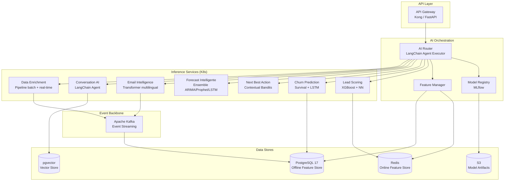
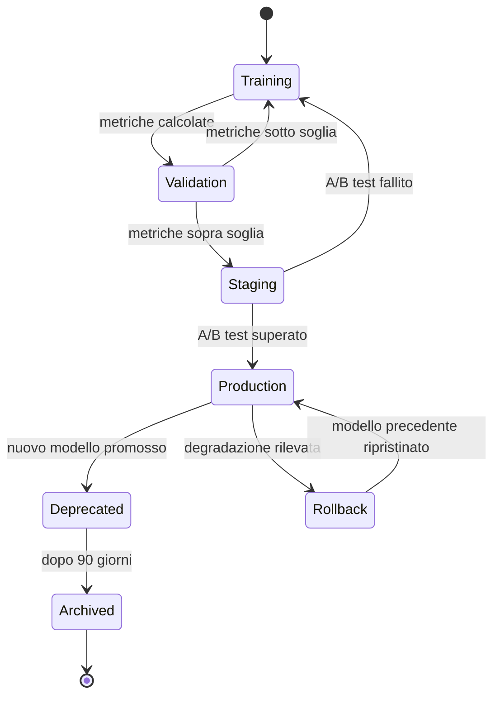
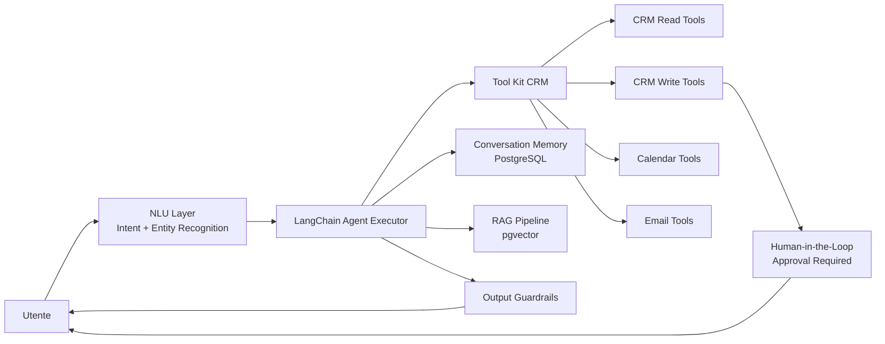
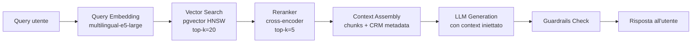
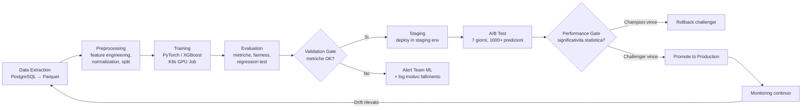

# 05 - AI Orchestration Layer

> CRM Pro 360 — Piattaforma CRM enterprise AI-powered per medie imprese europee.
> Questo documento descrive in dettaglio l'architettura AI/ML, i moduli predittivi, il feature store, il RAG, la governance e la pipeline MLOps.

---

## 1. AI Platform Architecture Overview

### 1.1 Diagramma architetturale



### 1.2 Principi di design

| Principio | Descrizione |
|-----------|-------------|
| **Modularita** | Ogni modulo AI e un microservizio indipendente, deployabile e scalabile separatamente su K8s. |
| **Tenant isolation** | Ogni richiesta porta `tenant_id`. I modelli possono essere fine-tuned per tenant. I dati non vengono mai mescolati tra tenant. |
| **Cost tracking** | Ogni inferenza viene tracciata con token count, tempo GPU, e costo stimato. Aggregazione per tenant e per modulo. |
| **Explainability** | Ogni predizione include le feature piu importanti (SHAP values per modelli tabellari, attention weights per transformer). |
| **Human-in-the-loop** | Le azioni mutative proposte dall'AI richiedono approvazione esplicita. Soglia di confidenza configurabile per tenant. |

### 1.3 Scelte tecnologiche — Razionale

**LangChain vs framework custom:**
LangChain fornisce agent executor, tool binding, memory management e output parsing pronti all'uso. Per un CRM con 7+ moduli AI che devono orchestrarsi, riscrivere tutto da zero sarebbe un costo ingiustificato. LangChain permette di definire tool specifici per CRM (lettura contatti, scrittura deal, invio email) e comporre agent con memoria conversazionale multi-turn.

**PyTorch vs TensorFlow:**
PyTorch domina la ricerca accademica e l'ecosistema open-source dei modelli multilinguali (Hugging Face Transformers). Il dynamic computation graph semplifica il debug dei modelli LSTM per churn prediction e dei transformer per email intelligence. TensorFlow Serving offre vantaggi in production serving, ma TorchServe + Kubernetes colma il gap.

**pgvector vs Pinecone:**
pgvector vive nello stesso PostgreSQL 17 gia usato per i dati applicativi. Vantaggi: nessun servizio esterno da gestire, tenant isolation nativa via `WHERE tenant_id = $1`, costi prevedibili (no pay-per-query), conformita GDPR semplificata (dati in EU, stesso DPA del database principale). Pinecone avrebbe senso sopra i 50M di vettori — CRM Pro 360 stima 5-10M vettori in 3 anni.

**XGBoost vs deep learning per lead scoring:**
I dati tabulari (50+ feature demografiche, firmografiche, comportamentali) sono il dominio naturale di gradient boosting. Le reti neurali aggiungono valore solo per catturare interazioni non-lineari complesse — per questo usiamo un ensemble.

---

## 2. Model Registry & Versioning

### 2.1 Ciclo di vita del modello



### 2.2 Schema metadata del modello

```json
{
  "model_id": "lead-scoring-v2.3.1",
  "name": "lead_scoring_ensemble",
  "version": "2.3.1",
  "module": "lead_scoring",
  "algorithm": "xgboost_nn_ensemble",
  "framework": "pytorch+xgboost",
  "metrics": {
    "precision": 0.87,
    "recall": 0.78,
    "f1": 0.82,
    "auc_roc": 0.91
  },
  "training_date": "2026-03-20T03:00:00Z",
  "training_duration_seconds": 4820,
  "dataset_hash": "sha256:a1b2c3d4e5f6...",
  "dataset_size": 245000,
  "feature_count": 53,
  "owner": "ml-team@crmpro360.eu",
  "tenant_scope": "global",
  "artifact_path": "s3://crmpro360-models/lead-scoring/v2.3.1/",
  "status": "staging",
  "parent_version": "2.2.0",
  "tags": ["weekly-retrain", "multi-tenant"]
}
```

### 2.3 Framework A/B testing

Il traffic splitting avviene a livello di AI Router:

| Parametro | Valore di default |
|-----------|-------------------|
| **Split ratio** | 90% champion / 10% challenger |
| **Durata minima test** | 7 giorni |
| **Campione minimo** | 1.000 predizioni per variante |
| **Test statistico** | Two-proportion z-test, alpha = 0.05 |
| **Metrica primaria** | Dipende dal modulo (precision, AUC-ROC, MAE) |
| **Guardrail** | Se il challenger degrada >5% sulla metrica primaria, test interrotto automaticamente |

Processo:
1. Il nuovo modello viene caricato in **staging** con feature flag `model_variant=challenger`
2. L'AI Router assegna il traffico secondo lo split ratio, con sticky assignment per `tenant_id` (un tenant vede sempre la stessa variante durante il test)
3. Le predizioni vengono loggate con `variant_id` in Kafka topic `ai.predictions`
4. Un job Kafka Streams calcola le metriche aggregate ogni ora
5. Raggiunta la significativita statistica, il sistema notifica il team ML
6. Promozione o rollback manuale (o automatico se configurato)

### 2.4 Strategia di rollback

- Ogni deployment mantiene le ultime 3 versioni del modello caricate in memoria (warm standby)
- Rollback istantaneo: cambio del puntatore `production` nel registry, nessun re-deploy necessario
- Feature flag `model_override` permette di forzare una versione specifica per tenant (utile per debug)
- Tempo di rollback target: <30 secondi dal trigger all'effettivo cambio di traffico

### 2.5 Storage degli artefatti

```
s3://crmpro360-models/
  ├── lead-scoring/
  │   ├── v2.3.1/
  │   │   ├── model.pt              # PyTorch weights
  │   │   ├── xgb_model.json        # XGBoost model
  │   │   ├── feature_config.json   # Feature names + preprocessing
  │   │   ├── metrics.json          # Metriche di validazione
  │   │   └── training_config.yaml  # Iperparametri
  │   └── v2.2.0/
  ├── churn-prediction/
  ├── forecast/
  └── email-intelligence/
```

Politica di retention: modelli `archived` eliminati dopo 1 anno. Bucket con versioning S3 abilitato e lifecycle rules.

---

## 3. AI Modules — Deep Dive

### 3.1 Lead Scoring Predittivo

**Obiettivo:** Assegnare un punteggio 0-100 a ogni lead per prioritizzare l'attivita commerciale.

**Input features (53 variabili):**

| Categoria | Features | Esempi |
|-----------|----------|--------|
| **Demografiche** (8) | Ruolo, seniority, dipartimento, sede | `job_title_encoded`, `seniority_level`, `department_match_score` |
| **Firmografiche** (12) | Settore, dimensione azienda, fatturato, tecnologie usate | `company_size_bucket`, `industry_icp_score`, `tech_stack_overlap` |
| **Comportamentali** (15) | Pagine visitate, tempo sul sito, download, form compilati | `page_views_7d`, `time_on_pricing_page`, `content_downloads_30d` |
| **Engagement email** (10) | Aperture, click, risposte, bounce | `email_open_rate_30d`, `click_through_rate`, `reply_rate` |
| **Social/intent** (5) | Interazioni LinkedIn, ricerche su G2/Capterra | `linkedin_engagement_score`, `intent_signal_count` |
| **Temporali** (3) | Giorno dalla creazione, velocita di engagement, stagionalita | `days_since_creation`, `engagement_velocity`, `quarter_seasonality` |

**Algoritmo:** Ensemble di XGBoost (gradient boosting) e rete neurale feed-forward (3 hidden layers, 128-64-32 neuroni, ReLU, dropout 0.3).
- XGBoost cattura le interazioni tabellari e produce SHAP values per explainability
- La rete neurale cattura pattern non-lineari complessi
- Combinazione: media pesata (60% XGBoost, 40% NN) calibrata con Platt scaling

**Output:**
```json
{
  "lead_id": "lead_abc123",
  "score": 82,
  "grade": "A",
  "top_factors": [
    {"feature": "time_on_pricing_page", "impact": "+12", "direction": "positive"},
    {"feature": "company_size_bucket", "impact": "+9", "direction": "positive"},
    {"feature": "email_open_rate_30d", "impact": "+8", "direction": "positive"},
    {"feature": "content_downloads_30d", "impact": "+7", "direction": "positive"},
    {"feature": "days_since_last_activity", "impact": "-4", "direction": "negative"}
  ],
  "confidence": 0.91,
  "model_version": "2.3.1"
}
```

**Target di accuratezza:** Precision >85%, Recall >75%, AUC-ROC >0.88

**Training schedule:** Retrain settimanale (domenica notte). Fine-tuning per tenant con >5.000 lead storici.

**Costo stimato:** ~0.002 EUR per predizione (CPU inference, batch). ~500 EUR/mese per un tenant con 250K lead.

---

### 3.2 Churn Prediction

**Obiettivo:** Identificare i clienti a rischio di abbandono con almeno 30 giorni di anticipo e suggerire azioni di retention.

**Input signals:**

| Categoria | Segnali | Peso relativo |
|-----------|---------|---------------|
| **Usage patterns** | Login frequency decay, feature adoption drop, API call volume | Alto |
| **Support tickets** | Frequenza ticket, severity, tempo di risoluzione, sentiment | Alto |
| **Payment history** | Ritardi pagamento, downgrade piano, dispute | Medio-alto |
| **Engagement decay** | Email open rate trend, NPS trend, meeting cancellations | Medio |
| **Contract signals** | Giorni al rinnovo, clausole di uscita attivate | Medio |

**Algoritmo:** Modello a due stadi:
1. **Survival analysis** (Cox Proportional Hazards) per stimare la curva di sopravvivenza e il tempo atteso al churn
2. **LSTM** (2 layer, 128 hidden units) per catturare pattern temporali nelle sequenze di interazione (finestre di 90 giorni, step settimanali)

L'output finale combina la probabilita del modello di sopravvivenza con la classificazione LSTM.

**Output:**
```json
{
  "account_id": "acc_xyz789",
  "churn_probability": 0.73,
  "risk_level": "high",
  "estimated_churn_window": "30-60 giorni",
  "confidence_interval": [0.65, 0.81],
  "key_risk_factors": [
    "Login frequency diminuita del 60% nelle ultime 4 settimane",
    "3 ticket di severity alta aperti nell'ultimo mese",
    "NPS score sceso da 8 a 4"
  ],
  "recommended_actions": [
    {"action": "executive_review_call", "expected_impact": "riduzione rischio 25%", "urgency": "alta"},
    {"action": "custom_training_session", "expected_impact": "riduzione rischio 15%", "urgency": "media"},
    {"action": "contract_incentive", "expected_impact": "riduzione rischio 20%", "urgency": "media"}
  ],
  "model_version": "1.8.0"
}
```

**Target:** AUC-ROC >0.85, warning con almeno 30 giorni di anticipo, false positive rate <20%

**Training schedule:** Retrain bisettimanale. Richiede almeno 12 mesi di dati storici per tenant.

**Costo stimato:** ~0.005 EUR per predizione (GPU inference per LSTM). Batch notturno su tutti gli account attivi.

---

### 3.3 Next Best Action (NBA)

**Obiettivo:** Suggerire l'azione commerciale ottimale per ogni deal/contatto, massimizzando la probabilita di conversione.

**Context:**
- Stage attuale del deal (pipeline, probabilita storica per stage)
- Engagement del contatto (ultimo touchpoint, canale preferito, orario migliore)
- Pattern storici di conversione (quali sequenze di azioni hanno portato a chiusura per deal simili)
- Calendario del sales rep (disponibilita per call/meeting)

**Algoritmo:** Contextual bandits (LinUCB) con rule engine fallback:
- Il modello di reinforcement learning esplora/sfrutta le azioni disponibili basandosi sul contesto
- Reward signal: azione accettata dal sales rep + outcome positivo entro 14 giorni
- Fallback: se il modello ha <100 osservazioni per un contesto, si attiva il rule engine con regole definite dal sales manager

**Output:**
```json
{
  "deal_id": "deal_456",
  "contact_id": "contact_789",
  "recommended_actions": [
    {
      "action": "send_case_study_email",
      "expected_impact_pct": 18,
      "reasoning": "Contatti in stage 'Evaluation' con profilo simile convertono 2.3x di piu dopo aver ricevuto un case study del loro settore",
      "template_id": "tmpl_cs_manufacturing"
    },
    {
      "action": "schedule_demo_call",
      "expected_impact_pct": 14,
      "reasoning": "Il contatto ha visitato la pagina pricing 3 volte questa settimana",
      "suggested_slot": "2026-03-26T10:00:00+01:00"
    },
    {
      "action": "offer_pilot_discount",
      "expected_impact_pct": 22,
      "reasoning": "Deal in stallo da >14 giorni, pattern storico suggerisce che un pilot gratuito sblocca il 35% dei deal simili",
      "discount_pct": 15,
      "requires_approval": true
    }
  ],
  "model_source": "contextual_bandit",
  "exploration_rate": 0.1
}
```

**Target:** Action acceptance rate >60% (il sales rep segue il suggerimento), win rate improvement >10% rispetto al baseline senza NBA.

**Training:** Aggiornamento online continuo (ogni azione accettata/rifiutata aggiorna il modello). Full retrain mensile.

**Costo stimato:** ~0.001 EUR per raccomandazione (CPU, modello leggero). Invocato ad ogni apertura di deal.

---

### 3.4 Forecast Intelligente

**Obiettivo:** Previsione del fatturato per quarter con bande di confidenza, integrando dati pipeline, stagionalita e segnali di mercato.

**Input:**
- Dati pipeline: deal in corso, valore, stage, probabilita, data chiusura prevista
- Close rate storici: per stage, per sales rep, per segmento, per trimestre
- Stagionalita: pattern ricorrenti (es. calo agosto, picco Q4)
- Segnali di mercato: indici PMI del settore, tassi di interesse BCE (integrati via API esterna)

**Algoritmo:** Ensemble di tre modelli con weighted averaging:

| Modello | Peso | Forza |
|---------|------|-------|
| **ARIMA** (p=2, d=1, q=1) | 25% | Trend e autocorrelazione a breve termine |
| **Prophet** (Facebook) | 35% | Stagionalita multipla, holidays, change points |
| **LSTM** (1 layer, 64 units) | 40% | Pattern non-lineari, sequenze lunghe |

Le bande di confidenza sono calcolate con quantile regression (percentili 10, 25, 50, 75, 90).

**Output:**
```json
{
  "forecast_date": "2026-03-24",
  "quarter": "Q2-2026",
  "tenant_id": "tenant_acme",
  "revenue_forecast": {
    "p80_optimistic": 1250000,
    "p50_expected": 980000,
    "p20_conservative": 720000
  },
  "confidence_bands": {
    "upper_90": 1400000,
    "upper_75": 1250000,
    "median": 980000,
    "lower_25": 780000,
    "lower_10": 650000
  },
  "key_drivers": [
    "Pipeline Q2 piu forte del 15% rispetto a Q2-2025",
    "Close rate in calo del 5% nell'ultimo mese",
    "3 deal enterprise in stage finale (valore totale 320K EUR)"
  ],
  "accuracy_historical": {
    "last_quarter_error_pct": 11.2,
    "last_4_quarters_avg_error_pct": 13.8
  },
  "model_version": "1.4.2"
}
```

**Target:** Errore medio <15% a inizio quarter, <8% a meta quarter, <3% a fine quarter.

**Training:** Retrain mensile. Richiede almeno 8 trimestri di dati storici.

**Costo stimato:** ~0.01 EUR per forecast (GPU per LSTM). Calcolo giornaliero per tenant.

---

### 3.5 Email Intelligence

**Obiettivo:** Analisi automatica di ogni email in ingresso: sentiment, entita, intent, priorita, suggerimento di risposta.

**Capabilities:**
- **Sentiment analysis:** Positivo / Neutro / Negativo / Urgente, con score continuo [-1, +1]
- **Entity extraction:** Persone, aziende, date, importi, prodotti menzionati
- **Intent classification:** Richiesta info, reclamo, ordine, meeting request, follow-up, out-of-office (14 classi)
- **Priority scoring:** P1 (critico) → P4 (informativo), basato su intent + sender importance + urgenza
- **Suggested response:** Draft di risposta generato in base al contesto CRM del contatto

**Modello:** Transformer multilingual fine-tuned:
- Base: `intfloat/multilingual-e5-large` (560M parametri)
- Fine-tuning: 200K email annotate in IT/EN/DE/FR/ES
- Heads specializzate: sentiment head, NER head, intent classification head
- Inference: quantizzazione INT8 per ridurre latenza e costo GPU

**Output:**
```json
{
  "email_id": "em_abc123",
  "analysis": {
    "sentiment": {"label": "negative", "score": -0.72},
    "entities": [
      {"type": "PERSON", "value": "Marco Rossi", "crm_match": "contact_456"},
      {"type": "COMPANY", "value": "Acme SpA", "crm_match": "account_789"},
      {"type": "AMOUNT", "value": "45.000 EUR", "normalized": 45000},
      {"type": "DATE", "value": "entro venerdi", "normalized": "2026-03-27"}
    ],
    "intent": {"primary": "reclamo", "confidence": 0.89, "secondary": "richiesta_sconto"},
    "priority": {"level": "P1", "reasoning": "Reclamo da account enterprise con rinnovo tra 30 giorni"},
    "suggested_response": "Gentile Marco, ho preso in carico la segnalazione e ho coinvolto il team tecnico..."
  },
  "processing_time_ms": 340,
  "model_version": "3.1.0"
}
```

**Processing pipeline:**
1. Email arriva → Kafka topic `emails.inbound`
2. Consumer preleva, preprocessa (pulizia HTML, deduplicazione thread)
3. Batch inference ogni 500ms o 10 email (whichever comes first)
4. Risultato scritto in `email_analysis` table + Kafka topic `emails.analyzed`
5. Frontend riceve aggiornamento via WebSocket

**Target:** Latenza p95 <2 secondi, intent accuracy >88%, sentiment accuracy >90%

**Training:** Fine-tuning trimestrale con nuove email annotate. Active learning: le email con bassa confidenza vengono proposte per annotazione manuale.

**Costo stimato:** ~0.003 EUR per email (GPU inference INT8). ~300 EUR/mese per un tenant con 100K email/mese.

---

### 3.6 Conversation AI

**Obiettivo:** Assistente conversazionale con accesso completo al CRM, capace di leggere dati, proporre azioni e (con approvazione) eseguire mutazioni.

**Architettura:**



**NLU:** Riconoscimento intent multilingual (IT, EN, DE, FR, ES):
- Modello: `multilingual-e5-large` fine-tuned su 50K query CRM annotate
- 45 intent classes (es. `search_contacts`, `update_deal_stage`, `schedule_meeting`, `generate_report`)
- Slot filling per parametri (es. "mostrami i deal di Acme" → intent: `search_deals`, slot: `company=Acme`)

**Tool Kit CRM:**

| Tool | Tipo | Richiede approvazione |
|------|------|----------------------|
| `search_contacts` | Read | No |
| `get_deal_details` | Read | No |
| `list_activities` | Read | No |
| `generate_report` | Read | No |
| `update_deal_stage` | Write | Si |
| `create_task` | Write | Si |
| `send_email` | Write | Si |
| `schedule_meeting` | Write | Si |
| `update_contact` | Write | Si |
| `create_deal` | Write | Si |

**Safety layer:**
- **Output guardrails:** Regex + classificatore per bloccare risposte con contenuto inappropriato, istruzioni di jailbreak, o dati PII non mascherati
- **PII filtering:** Prima di inviare contesto al modello, i dati PII vengono tokenizzati (es. "marco.rossi@acme.it" → "[EMAIL_1]") e ri-sostituiti nell'output
- **Hallucination detection:** Le affermazioni fattuali vengono verificate contro i dati CRM. Se il modello cita un deal inesistente, la risposta viene bloccata e riformulata
- **Rate limiting:** Max 50 messaggi/ora per utente, max 10 tool call per conversazione

**Human-in-the-loop:**
- Ogni azione mutativa genera una richiesta di approvazione con: azione proposta, parametri, reasoning, impatto stimato
- L'utente puo approvare, rifiutare, o modificare i parametri
- Timeout: 15 minuti, poi l'azione viene annullata
- Le azioni con confidenza >0.95 e impatto basso (es. creare un task) possono essere auto-approvate se il tenant lo configura

**Costo stimato:** ~0.02 EUR per messaggio (LLM inference + tool execution). ~200 EUR/mese per un tenant con 10K messaggi/mese.

---

### 3.7 Data Enrichment

**Obiettivo:** Arricchire automaticamente i profili contatto e azienda con dati da fonti esterne, mantenendo la conformita GDPR.

**Fonti dati:**

| Fonte | Tipo dati | Metodo | Costo |
|-------|-----------|--------|-------|
| **Clearbit** | Company firmographics, tech stack | API REST | ~0.10 EUR/lookup |
| **LinkedIn API** | Job title, seniority, connections | OAuth + API | ~0.05 EUR/lookup |
| **Registri camerali EU** | Ragione sociale, fatturato, soci | API PEPPOL/OpenData | Gratuito |
| **Web scraping** | Sito aziendale, blog, news | Scrapy + BeautifulSoup | ~0.01 EUR/lookup |

**Pipeline di arricchimento:**

- **Batch (notturno):** Ogni notte, tutti i contatti modificati nelle ultime 24 ore vengono ri-arricchiti. Job Kafka → Worker pool (10 worker) → Rate limiting per API esterna → Upsert in PostgreSQL
- **Real-time (on creation):** Quando un contatto viene creato, un evento Kafka triggera l'arricchimento immediato. Timeout: 5 secondi, poi il contatto viene accodato per batch

**Deduplicazione:**
- **Fuzzy matching:** Levenshtein distance <3 su nome normalizzato + Soundex/Metaphone per similarita fonetica (gestisce "Stefano" vs "Stefan", "Mueller" vs "Muller")
- **Email domain grouping:** Contatti con stesso dominio email vengono raggruppati sotto la stessa azienda
- **Confidence score:** Ogni match ha un punteggio 0-1. Sotto 0.7, il match viene proposto per review manuale
- **Merge strategy:** Il record piu completo viene mantenuto come master, gli altri diventano alias

**GDPR compliance:**
- **Consent check:** Prima di arricchire, il sistema verifica che il contatto abbia un consenso valido per data processing (campo `gdpr_consent_status` in `contacts` table)
- **Right to erasure:** Quando un contatto esercita il diritto all'oblio, il sistema propaga la cancellazione a tutte le fonti di arricchimento e rimuove i dati arricchiti entro 72 ore
- **Data minimization:** Solo i campi strettamente necessari vengono estratti e salvati. Niente dati sensibili (religione, orientamento politico, salute)
- **Audit trail:** Ogni operazione di arricchimento viene loggata con fonte, timestamp, campi arricchiti, base giuridica

**Costo stimato:** ~0.15 EUR per contatto arricchito (somma di tutte le fonti). Batch notturno: ~50 EUR/mese per 10K contatti attivi.

---

## 4. Feature Store Architecture

### 4.1 Online Features (Redis)

Feature a bassa latenza per inference real-time:

| Feature | TTL | Aggiornamento |
|---------|-----|---------------|
| `user:{id}:session_pages_viewed` | 30 min | Real-time (click stream) |
| `user:{id}:emails_opened_24h` | 1 ora | Event-driven (email open) |
| `deal:{id}:days_in_stage` | 1 ora | Calcolato da stage change event |
| `account:{id}:support_tickets_open` | 5 min | Event-driven (ticket create/close) |
| `contact:{id}:engagement_score_realtime` | 15 min | Aggregazione sliding window |

Struttura Redis: hash per entita, con namespace per tenant.
```
HSET tenant:{tid}:features:user:{uid} session_pages_viewed 12 emails_opened_24h 3
```

### 4.2 Offline Features (PostgreSQL)

Feature aggregate storiche, calcolate in batch:

```sql
CREATE TABLE feature_store.lead_features (
    tenant_id UUID NOT NULL,
    lead_id UUID NOT NULL,
    feature_version INT NOT NULL DEFAULT 1,
    computed_at TIMESTAMPTZ NOT NULL DEFAULT NOW(),
    -- Demographic
    job_title_encoded INT,
    seniority_level INT,
    department_match_score FLOAT,
    -- Firmographic
    company_size_bucket INT,
    industry_icp_score FLOAT,
    annual_revenue_bucket INT,
    tech_stack_overlap FLOAT,
    -- Behavioral (30d rolling)
    page_views_7d INT,
    page_views_30d INT,
    time_on_pricing_page_sec INT,
    content_downloads_30d INT,
    -- Engagement
    email_open_rate_30d FLOAT,
    click_through_rate_30d FLOAT,
    reply_rate_30d FLOAT,
    -- Computed
    engagement_velocity FLOAT,
    lead_score_previous FLOAT,
    PRIMARY KEY (tenant_id, lead_id, feature_version)
);

CREATE INDEX idx_lead_features_tenant ON feature_store.lead_features (tenant_id, computed_at DESC);
```

### 4.3 Feature computation pipeline

```
Kafka topics (events)
    │
    ├── user.page_viewed
    ├── email.opened
    ├── deal.stage_changed
    ├── ticket.created
    └── contact.updated
         │
         ▼
    Kafka Streams App
    (aggregazione, windowing, join)
         │
         ├──► Redis (online features, low latency)
         └──► PostgreSQL (offline features, batch)
```

- **Windowing:** Tumbling windows (1h, 24h, 7d, 30d) per le metriche aggregate
- **Late events:** Tolleranza di 5 minuti per eventi in ritardo, con watermark
- **Idempotenza:** Ogni feature computation ha un `idempotency_key` basato su `(entity_id, window_end, feature_name)`

### 4.4 Feature versioning e lineage

- Ogni modifica allo schema delle feature incrementa `feature_version`
- I modelli specificano la versione delle feature richiesta nel loro `feature_config.json`
- Lineage tracking: ogni feature ha un `lineage` record che specifica gli eventi sorgente e le trasformazioni applicate
- Breaking changes (rimozione feature, cambio tipo) richiedono una nuova versione del modello

---

## 5. Vector Store & RAG Architecture

### 5.1 Setup pgvector

```sql
CREATE EXTENSION IF NOT EXISTS vector;

CREATE TABLE embeddings.documents (
    id UUID PRIMARY KEY DEFAULT gen_random_uuid(),
    tenant_id UUID NOT NULL,
    source_type VARCHAR(50) NOT NULL,  -- 'email', 'note', 'ticket', 'document'
    source_id UUID NOT NULL,
    chunk_index INT NOT NULL DEFAULT 0,
    content TEXT NOT NULL,
    embedding vector(1024) NOT NULL,   -- multilingual-e5-large output dim
    metadata JSONB DEFAULT '{}',
    created_at TIMESTAMPTZ DEFAULT NOW(),
    UNIQUE (tenant_id, source_id, chunk_index)
);

-- HNSW index per ricerca approssimata
CREATE INDEX idx_embeddings_hnsw ON embeddings.documents
    USING hnsw (embedding vector_cosine_ops)
    WITH (m = 16, ef_construction = 200);

-- Partition per tenant isolation
CREATE INDEX idx_embeddings_tenant ON embeddings.documents (tenant_id);
```

**Modello di embedding:** `intfloat/multilingual-e5-large` (1024 dimensioni, supporto IT/EN/DE/FR/ES).
Scelto per il benchmark MTEB multilingual, dove supera `text-embedding-3-small` di OpenAI sulle lingue europee.

### 5.2 RAG pipeline per Conversation AI



**Dettagli del pipeline:**

1. **Query embedding:** La query dell'utente viene trasformata in vettore 1024-dim con prefix `query:` (come richiesto da e5)
2. **Vector search:** Ricerca HNSW con filtro `WHERE tenant_id = $1`, cosine similarity, top-k=20 candidati
3. **Reranking:** Cross-encoder (`cross-encoder/ms-marco-MiniLM-L-12-v2`) ri-ordina i 20 candidati, seleziona top-5
4. **Context assembly:** I 5 chunk selezionati vengono arricchiti con metadati CRM (nome contatto, deal associato, data) e assemblati in un context window di max 4.000 token
5. **Generation:** Il LLM genera la risposta con il contesto iniettato nel system prompt
6. **Guardrails:** Verifica PII, hallucination check, content safety

### 5.3 Document ingestion pipeline

```
Fonti dati
    ├── Email (IMAP sync) ──────┐
    ├── Note CRM ───────────────┤
    ├── Ticket supporto ────────┤
    └── Documenti allegati ─────┤
                                ▼
                        Preprocessing
                        (pulizia HTML, OCR per PDF,
                         language detection)
                                │
                                ▼
                        Chunking Strategy
                        (512 token chunks,
                         128 token overlap,
                         sentence boundary respect)
                                │
                                ▼
                        Batch Embedding
                        (multilingual-e5-large,
                         batch size 32)
                                │
                                ▼
                        Upsert in pgvector
                        (ON CONFLICT update embedding)
```

- **Chunking:** 512 token per chunk con overlap di 128 token. Split sui confini di frase per evitare di spezzare il contesto
- **Batch processing:** I nuovi documenti vengono processati in batch ogni 5 minuti via Kafka consumer
- **Incremental update:** Solo i documenti modificati vengono ri-embeddati (check su `updated_at` + content hash)
- **Volume stimato:** 5-10M vettori in 3 anni per l'intera piattaforma multi-tenant

### 5.4 Tenant isolation nel vector store

- Ogni query include `WHERE tenant_id = $1` — nessuna eccezione
- L'indice HNSW e globale (PostgreSQL non supporta indici HNSW partizionati), ma il filtro `tenant_id` viene applicato post-search
- Per tenant con >1M vettori, si valuta la creazione di tabelle separate (`embeddings.documents_{tenant_id}`) per performance
- Row-Level Security (RLS) come secondo livello di protezione:

```sql
ALTER TABLE embeddings.documents ENABLE ROW LEVEL SECURITY;
CREATE POLICY tenant_isolation ON embeddings.documents
    USING (tenant_id = current_setting('app.current_tenant')::uuid);
```

---

## 6. Cost Management & Token Accounting

### 6.1 Budget per tenant per piano

| Piano | Lead Scoring | Churn | NBA | Forecast | Email Intel | Conversation AI | Data Enrichment |
|-------|-------------|-------|-----|----------|-------------|-----------------|-----------------|
| **Starter** | 1.000 pred/mese | -- | -- | 1 forecast/giorno | 5.000 email/mese | 500 msg/mese | 100 contatti/mese |
| **Professional** | 10.000 pred/mese | 500 account | 5.000 azioni/mese | 4 forecast/giorno | 50.000 email/mese | 5.000 msg/mese | 1.000 contatti/mese |
| **Enterprise** | Illimitato | Illimitato | Illimitato | Real-time | Illimitato | 50.000 msg/mese | 10.000 contatti/mese |

### 6.2 Pipeline di cost tracking

```
API Call (con tenant_id + module)
    │
    ▼
Metering Middleware (FastAPI)
    │  Registra: timestamp, tenant_id, module, tokens_in, tokens_out, gpu_ms, cost_eur
    │
    ▼
Kafka topic: ai.usage
    │
    ▼
Kafka Streams Aggregator
    │  Aggrega per: tenant, module, giorno, settimana, mese
    │
    ▼
PostgreSQL: ai_usage_daily / ai_usage_monthly
    │
    ▼
Dashboard API + Alerting
```

### 6.3 Data model per usage tracking

```sql
CREATE TABLE billing.ai_usage_daily (
    tenant_id UUID NOT NULL,
    module VARCHAR(50) NOT NULL,
    usage_date DATE NOT NULL,
    request_count INT DEFAULT 0,
    tokens_input BIGINT DEFAULT 0,
    tokens_output BIGINT DEFAULT 0,
    gpu_seconds FLOAT DEFAULT 0,
    estimated_cost_eur DECIMAL(10,4) DEFAULT 0,
    PRIMARY KEY (tenant_id, module, usage_date)
);

CREATE TABLE billing.ai_budget (
    tenant_id UUID NOT NULL,
    module VARCHAR(50) NOT NULL,
    plan_tier VARCHAR(20) NOT NULL,
    monthly_limit INT NOT NULL,
    overage_policy VARCHAR(20) NOT NULL DEFAULT 'throttle',  -- 'throttle', 'notify', 'auto_upgrade'
    PRIMARY KEY (tenant_id, module)
);
```

### 6.4 Gestione overage

| Policy | Comportamento | Uso tipico |
|--------|---------------|------------|
| **throttle** | Le richieste oltre il limite vengono rifiutate con HTTP 429 e header `Retry-After` | Piano Starter |
| **notify** | Le richieste continuano, ma viene inviata notifica al billing admin e all'account manager | Piano Professional |
| **auto_upgrade** | Upgrade automatico al piano successivo a fine mese se l'overage supera il 20% | Enterprise con agreement |

### 6.5 Ottimizzazione costi

- **Query caching:** Le query identiche (stesso tenant, stessi parametri) entro 5 minuti restituiscono il risultato cached (Redis, TTL 5min). Riduzione stimata: 30% dei costi LLM per Conversation AI
- **Model distillation:** I modelli transformer vengono distillati in versioni piu piccole (da 560M a 120M parametri) per tenant Starter, con degradazione <3% nelle metriche
- **Batch inference:** Lead scoring e churn prediction girano in batch notturno, non on-demand, riducendo il costo GPU del 60% rispetto a inference singole
- **Spot instances:** I job di training usano K8s spot/preemptible nodes (risparmio 60-70% vs on-demand)
- **Quantizzazione INT8:** Tutti i modelli transformer in production usano quantizzazione INT8 (dimezza la memoria GPU, latenza -40%, accuratezza -1%)

---

## 7. AI Governance & Compliance

### 7.1 Classificazione EU AI Act

| Modulo | Categoria di rischio | Motivazione |
|--------|---------------------|-------------|
| **Lead Scoring** | Rischio limitato | Scoring automatico senza impatto su diritti fondamentali. Obbligo di trasparenza (informare che il punteggio e generato da AI). |
| **Churn Prediction** | Rischio limitato | Predizione interna, non impatta direttamente il cliente finale. Obbligo di trasparenza. |
| **Next Best Action** | Rischio limitato | Suggerimento al sales rep, non decisione automatica. Obbligo di trasparenza. |
| **Forecast Intelligente** | Rischio minimo | Strumento statistico interno, nessun obbligo specifico. |
| **Email Intelligence** | Rischio limitato | Analisi di comunicazioni con persone fisiche. Obbligo di trasparenza e consenso. DPIA necessaria. |
| **Conversation AI** | Rischio limitato | Interazione diretta con utenti. Obbligo di dichiarare la natura AI del sistema. Guardrails obbligatorie. |
| **Data Enrichment** | Rischio limitato | Trattamento dati personali da fonti esterne. Richiede DPIA, base giuridica chiara, informativa. |

### 7.2 Requisiti di explainability per livello di rischio

| Livello di rischio | Requisiti |
|-------------------|-----------|
| **Minimo** | Nessun obbligo specifico. Best practice: logging delle predizioni. |
| **Limitato** | Trasparenza: l'utente deve essere informato che interagisce con un sistema AI. Le predizioni devono includere i fattori principali (top-5 SHAP values o equivalente). Log di audit per 3 anni. |
| **Alto** | (Non applicabile ai moduli attuali) Valutazione di conformita pre-deployment, monitoraggio continuo, human oversight obbligatorio, documentazione tecnica completa. |

### 7.3 Bias detection e mitigation

**Framework:**
1. **Pre-training:** Analisi del dataset per bias demografici (distribuzione per paese, settore, dimensione azienda). Report automatico con metriche di disparita.
2. **Post-training:** Fairness metrics calcolate su gruppi protetti:
   - Demographic parity: differenza nel tasso di predizione positiva tra gruppi <5%
   - Equal opportunity: differenza nel true positive rate tra gruppi <5%
   - Calibration: il punteggio predetto deve riflettere la probabilita reale, indipendentemente dal gruppo
3. **In-production:** Monitoraggio continuo delle metriche di fairness. Alert se una metrica supera la soglia.
4. **Mitigazione:** Resampling del dataset, threshold adjustment per gruppo, o retraining con fairness constraint.

### 7.4 Model audit trail

```sql
CREATE TABLE audit.model_audit (
    id UUID PRIMARY KEY DEFAULT gen_random_uuid(),
    model_id VARCHAR(100) NOT NULL,
    event_type VARCHAR(50) NOT NULL,  -- 'trained', 'validated', 'promoted', 'deprecated', 'rollback'
    event_timestamp TIMESTAMPTZ NOT NULL DEFAULT NOW(),
    actor VARCHAR(100) NOT NULL,      -- chi ha eseguito l'azione
    dataset_hash VARCHAR(64),
    dataset_size INT,
    metrics JSONB,
    performance_delta JSONB,          -- confronto con versione precedente
    training_config JSONB,
    approval_status VARCHAR(20),      -- 'auto', 'manual', 'pending'
    approver VARCHAR(100),
    notes TEXT,
    retention_until DATE NOT NULL DEFAULT (NOW() + INTERVAL '3 years')
);
```

Retention: 3 anni come richiesto dal EU AI Act per sistemi a rischio limitato.

### 7.5 Data lineage per GDPR

Per ogni modello, il sistema traccia:
- **Quali tabelle** contengono dati personali usati per il training (es. `contacts.email`, `contacts.name`, `email_messages.body`)
- **Quali trasformazioni** sono state applicate (es. hashing, anonimizzazione, aggregazione)
- **Quali feature** derivano da dati personali (es. `email_open_rate_30d` deriva da `email_events` che contiene `contact_id`)
- **Base giuridica** per ogni trattamento (consenso, legittimo interesse, esecuzione contratto)

Quando un contatto esercita il diritto alla cancellazione:
1. I dati personali vengono eliminati dalle tabelle sorgente
2. Le feature derivate vengono ricalcolate (o azzerate se il contatto era l'unico contributore)
3. I modelli non vengono re-trainati immediatamente, ma il contatto viene escluso dal prossimo ciclo di training
4. L'embedding del contatto viene eliminato dal vector store

### 7.6 Right to explanation

Ogni utente finale puo richiedere una spiegazione per una decisione AI che lo riguarda. Il sistema genera:
- I fattori principali che hanno contribuito alla decisione (SHAP values per modelli tabellari, attention weights per transformer)
- I dati di input usati (con redaction dei dati di terzi)
- Il modello e la versione usati
- La data della predizione
- Un testo in linguaggio naturale generato dal Conversation AI che spiega la logica in termini comprensibili

Formato di risposta conforme all'Art. 22 GDPR e all'Art. 86 EU AI Act.

---

## 8. MLOps Pipeline

### 8.1 Training pipeline



### 8.2 CI/CD per modelli

```yaml
# .github/workflows/model-training.yml (semplificato)
name: Model Training Pipeline
on:
  schedule:
    - cron: '0 2 * * 0'  # Ogni domenica alle 02:00
  workflow_dispatch:
    inputs:
      model:
        description: 'Modulo da re-trainare'
        required: true
        type: choice
        options: [lead_scoring, churn_prediction, forecast, email_intelligence]

jobs:
  extract:
    runs-on: ubuntu-latest
    steps:
      - uses: actions/checkout@v4
      - name: Estrazione dati da PostgreSQL
        run: python scripts/extract_training_data.py --model ${{ inputs.model }}
      - uses: actions/upload-artifact@v4
        with:
          name: training-data
          path: data/

  train:
    needs: extract
    runs-on: [self-hosted, gpu]
    steps:
      - uses: actions/download-artifact@v4
      - name: Training
        run: python scripts/train.py --model ${{ inputs.model }} --config configs/${{ inputs.model }}.yaml
      - name: Evaluation
        run: python scripts/evaluate.py --model ${{ inputs.model }}
      - name: Validation gate
        run: python scripts/validate_metrics.py --model ${{ inputs.model }} --min-improvement 0.01

  deploy-staging:
    needs: train
    runs-on: ubuntu-latest
    steps:
      - name: Push model artifact to S3
        run: python scripts/push_model.py --model ${{ inputs.model }} --env staging
      - name: Deploy to K8s staging
        run: kubectl apply -f k8s/models/${{ inputs.model }}/staging.yaml
      - name: Smoke test
        run: python scripts/smoke_test.py --model ${{ inputs.model }} --env staging
```

### 8.3 Monitoring e alerting

**Data drift detection:**
- Population Stability Index (PSI) calcolato giornalmente confrontando la distribuzione delle feature in production vs training set
- Soglia di alert: PSI > 0.1 (drift moderato), PSI > 0.2 (drift significativo → trigger retraining)
- Kolmogorov-Smirnov test per feature numeriche, chi-squared test per feature categoriche

**Performance degradation:**
- Le metriche del modello (precision, recall, AUC-ROC) vengono calcolate su un validation set rolling (ultimi 30 giorni di predizioni con ground truth)
- Alert se la metrica primaria scende sotto la soglia target per 3 giorni consecutivi
- Dashboard Grafana con time series delle metriche per modulo

**Infrastructure monitoring:**
- Latenza inference: p50, p95, p99 per modulo (target: p95 <500ms per modelli tabellari, <2s per transformer)
- GPU utilization: target 60-80% (sotto = over-provisioned, sopra = risk di throttling)
- Queue depth: Kafka consumer lag per topic `ai.*` (alert se lag >1000 messaggi)
- Memory: OOM kill detection su pod K8s

### 8.4 Trigger di retraining

| Trigger | Condizione | Azione |
|---------|------------|--------|
| **Scheduled** | Cron settimanale (lead scoring), bisettimanale (churn), mensile (forecast) | Training pipeline completo |
| **Performance-based** | Metrica primaria sotto soglia per 3+ giorni | Alert + training pipeline automatico |
| **Data-volume-based** | >20% nuovi dati rispetto all'ultimo training set | Training pipeline con nuovo dataset |
| **Drift-based** | PSI >0.2 su >3 feature | Alert + analisi manuale + eventuale retraining |
| **Manuale** | Richiesta del team ML | `workflow_dispatch` su GitHub Actions |

---

## Appendice: Riepilogo costi stimati per tenant (piano Professional)

| Modulo | Volume mensile | Costo unitario | Totale mensile |
|--------|---------------|----------------|----------------|
| Lead Scoring | 10.000 predizioni | 0.002 EUR | 20 EUR |
| Churn Prediction | 500 account | 0.005 EUR | 2.50 EUR |
| Next Best Action | 5.000 azioni | 0.001 EUR | 5 EUR |
| Forecast | 120 forecast | 0.01 EUR | 1.20 EUR |
| Email Intelligence | 50.000 email | 0.003 EUR | 150 EUR |
| Conversation AI | 5.000 messaggi | 0.02 EUR | 100 EUR |
| Data Enrichment | 1.000 contatti | 0.15 EUR | 150 EUR |
| **Infrastruttura GPU** | -- | -- | **200 EUR** |
| **TOTALE** | -- | -- | **~630 EUR** |

> Nota: i costi infrastruttura GPU sono ammortizzati tra tutti i tenant. Il costo per tenant diminuisce significativamente con la crescita della base clienti.
