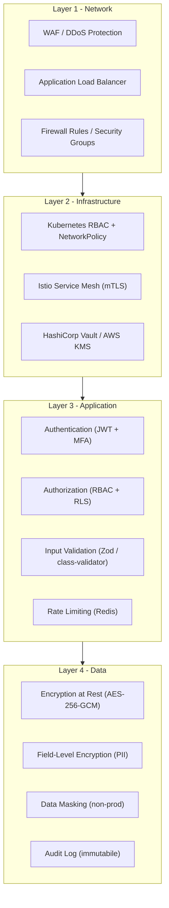
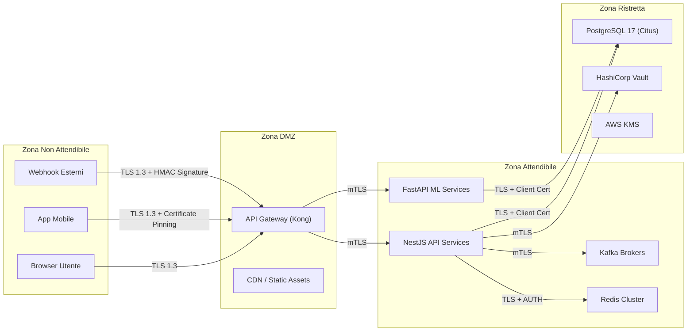
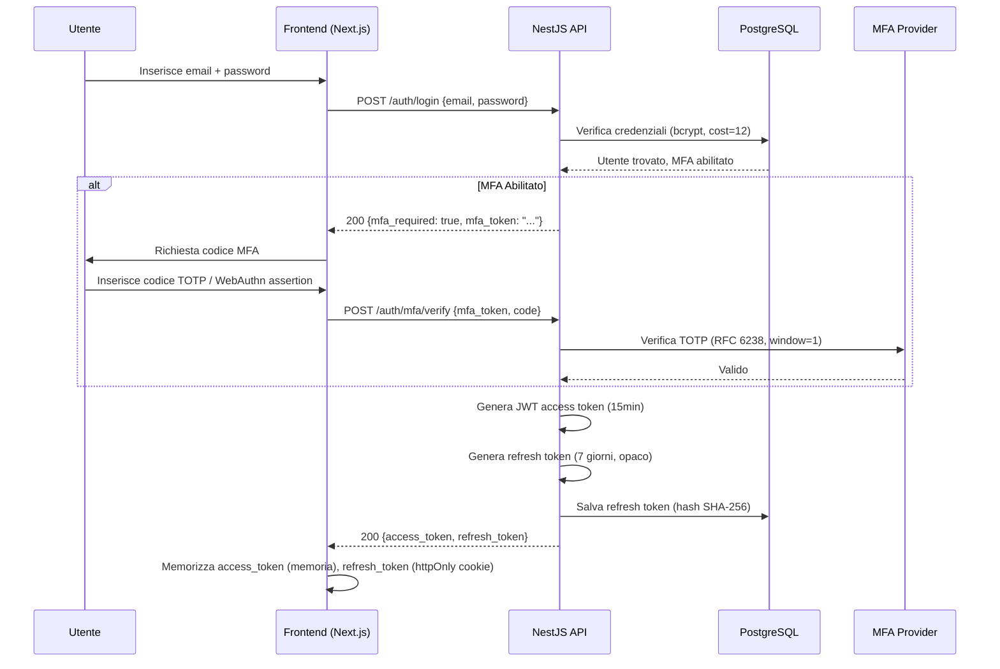
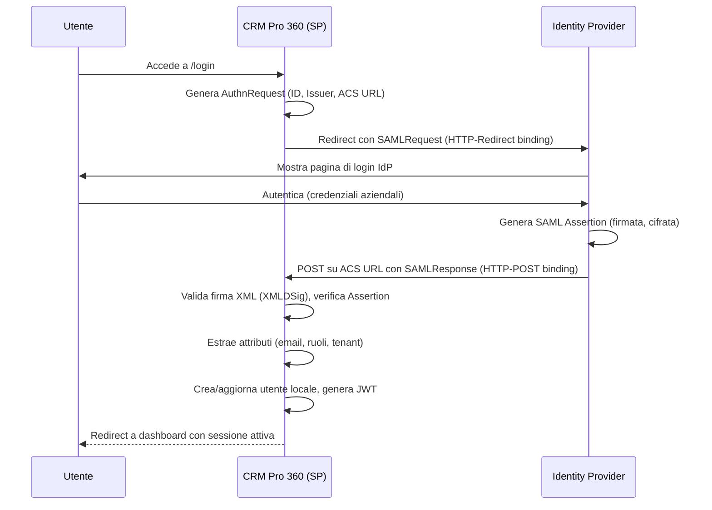
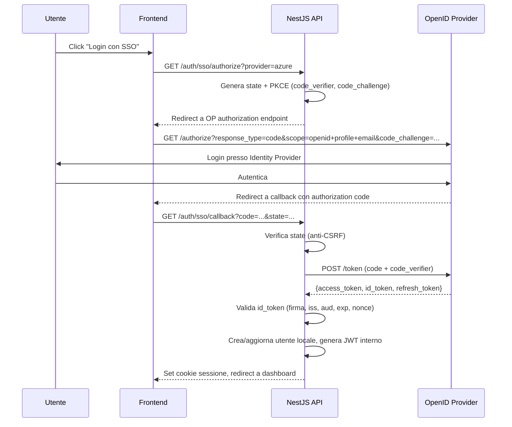
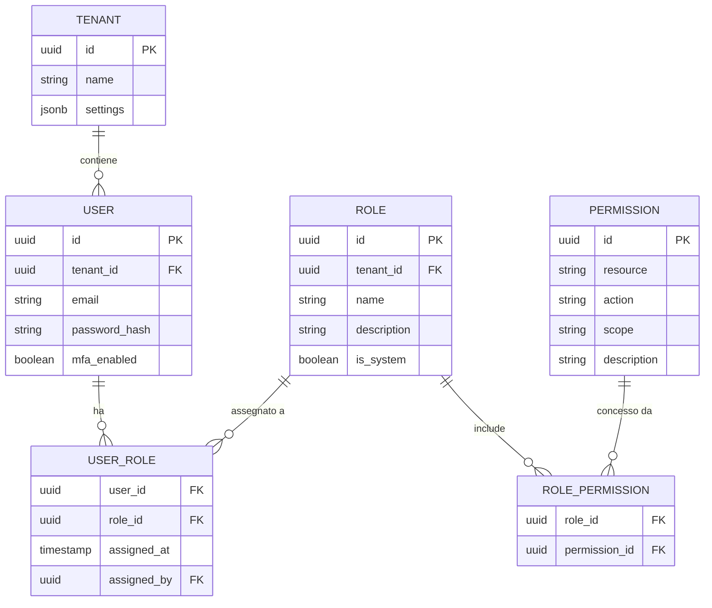
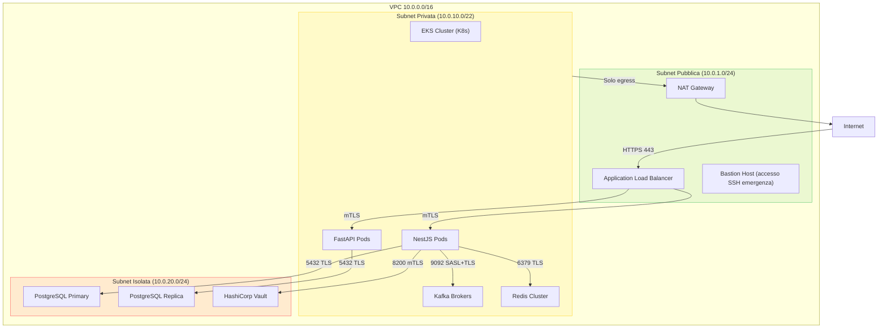
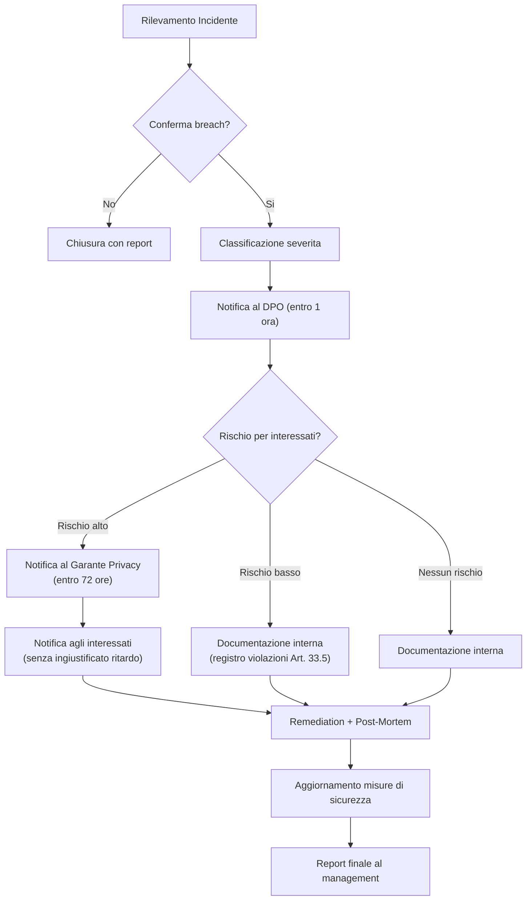
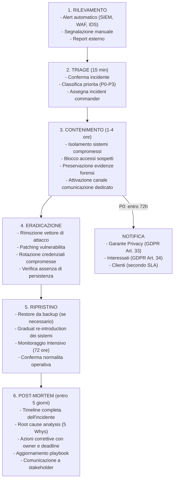

# 06 - Security & Compliance

> Architettura di sicurezza e framework di conformita normativa per CRM Pro 360.
> Documento tecnico destinato a security engineers, compliance officers e auditor esterni.

---

## Indice

1. [Security Architecture Overview](#1-security-architecture-overview)
2. [Authentication & Identity](#2-authentication--identity)
3. [Authorization & Access Control](#3-authorization--access-control)
4. [Data Security](#4-data-security)
5. [Network Security](#5-network-security)
6. [Application Security](#6-application-security)
7. [GDPR Compliance](#7-gdpr-compliance)
8. [AI Act Compliance](#8-ai-act-compliance)
9. [SOC 2 Type II & ISO 27001](#9-soc-2-type-ii--iso-27001)
10. [Incident Response](#10-incident-response)
11. [Security Testing Program](#11-security-testing-program)

---

## 1. Security Architecture Overview

### 1.1 Modello Defense-in-Depth

L'architettura di sicurezza segue un modello a strati concentrici. Ogni livello opera indipendentemente: la compromissione di uno strato non garantisce accesso ai successivi.



### 1.2 Zero-Trust Architecture

Principi fondamentali applicati a ogni componente del sistema:

- **Verifica esplicita**: ogni richiesta viene autenticata e autorizzata, indipendentemente dalla provenienza (rete interna o esterna)
- **Privilegio minimo**: ogni servizio riceve esclusivamente i permessi necessari alla propria funzione. Service account dedicati con scope limitato
- **Assunzione di compromissione**: il sistema e progettato assumendo che qualsiasi componente possa essere gia compromesso. Segmentazione rigorosa, logging pervasivo, rotazione automatica delle credenziali
- **Identita come perimetro**: l'identita del chiamante (utente o servizio) sostituisce il perimetro di rete come confine di fiducia primario

### 1.3 Security Boundaries e Trust Zones



Ogni transizione tra zone richiede autenticazione esplicita. Nessun traffico diretto dalla zona non attendibile alla zona ristretta.

---

## 2. Authentication & Identity

### 2.1 Flusso di Autenticazione



### 2.2 Struttura JWT

```
Header:
{
  "alg": "RS256",
  "typ": "JWT",
  "kid": "key-2026-03"           // Key ID per rotazione
}

Payload:
{
  "sub": "usr_a1b2c3d4",         // User ID
  "tenant_id": "tnt_x9y8z7",    // Tenant di appartenenza
  "org_id": "org_m5n6o7",        // Organizzazione
  "roles": ["sales_manager"],    // Ruoli assegnati
  "permissions": [               // Permessi risolti (flattened)
    "contact.read.team",
    "contact.write.own",
    "deal.read.team",
    "deal.write.own",
    "report.read.org"
  ],
  "iss": "crm-pro-360-auth",
  "aud": "crm-pro-360-api",
  "iat": 1711234567,
  "exp": 1711235467,             // 15 minuti
  "jti": "tok_unique_id"         // Token ID per revoca
}

Signature:
RS256(header + payload, privateKey)
```

### 2.3 Token Lifecycle

| Fase | Durata | Comportamento |
|------|--------|---------------|
| Access Token | 15 minuti | Utilizzato per ogni richiesta API. Non memorizzato lato server |
| Refresh Token | 7 giorni | Opaco, hash SHA-256 salvato nel database. Utilizzabile una sola volta |
| Rotazione | Ad ogni uso | Ogni utilizzo del refresh token genera una nuova coppia access+refresh. Il vecchio refresh viene invalidato |
| Revoca | Immediata | Logout invalida tutti i refresh token della sessione. Cambio password invalida tutti i token dell'utente |
| Token Family | Tracciata | Se un refresh token gia utilizzato viene ripresentato, l'intera famiglia viene revocata (rilevamento furto) |

### 2.4 Multi-Factor Authentication (MFA)

**TOTP (RFC 6238)** - Metodo primario:
- Algoritmo: HMAC-SHA1, periodo 30 secondi, 6 cifre
- Window di accettazione: 1 passo (30 secondi prima/dopo)
- Secret condiviso generato con 160 bit di entropia
- Codici di backup: 10 codici monouso generati alla registrazione, bcrypt-hashed

**WebAuthn / FIDO2 (Passkeys)** - Metodo raccomandato:
- Supporto per authenticator platform (biometria) e roaming (YubiKey)
- Challenge: 32 byte random, validita 5 minuti
- Attestation: none (privacy-preserving, non necessario per il caso d'uso)
- Resident keys supportati per login passwordless

**SMS** - Solo fallback:
- Codice 6 cifre, validita 5 minuti, massimo 3 tentativi
- Rate limit: 1 SMS ogni 60 secondi per numero
- Destinato esclusivamente a utenti che non possono utilizzare TOTP/WebAuthn
- Disclaimer esplicito sulla minore sicurezza rispetto ad altri metodi

### 2.5 Single Sign-On (SSO)

#### SAML 2.0



#### OpenID Connect



### 2.6 Session Management

- **Sessioni concorrenti**: massimo 5 per utente. La sesta sessione invalida la piu vecchia
- **Device tracking**: fingerprint (User-Agent + IP subnet) associato a ogni sessione. Notifica email su nuovo dispositivo
- **Forced logout**: amministratore puo terminare qualsiasi sessione di un utente del proprio tenant
- **Inattivita**: sessione invalidata dopo 30 minuti di inattivita (configurabile per tenant, range 15-60 min)
- **Absolute timeout**: sessione terminata dopo 12 ore indipendentemente dall'attivita

### 2.7 Password Policy (NIST 800-63B)

| Requisito | Valore | Motivazione |
|-----------|--------|-------------|
| Lunghezza minima | 12 caratteri | Conformita NIST, resistenza a brute force |
| Lunghezza massima | 128 caratteri | Prevenzione DoS su bcrypt |
| Regole di complessita | Nessuna | NIST 800-63B sconsiglia esplicitamente le regole di complessita |
| Controllo password compromesse | Si (HaveIBeenPwned k-anonymity API) | Blocca password presenti in data breach noti |
| Storico password | Ultime 5 | Impedisce riutilizzo immediato |
| Scadenza forzata | No | NIST raccomanda di non imporre scadenze periodiche |
| Indicatore di forza | Si (zxcvbn) | Feedback in tempo reale durante la scelta |

### 2.8 Account Lockout

| Evento | Azione |
|--------|--------|
| 3 tentativi falliti | CAPTCHA richiesto per i tentativi successivi |
| 5 tentativi falliti | Ritardo progressivo: 2^(n-5) secondi (max 60s) |
| 10 tentativi falliti | Account bloccato per 30 minuti. Email di notifica all'utente |
| 20 tentativi falliti (in 24h) | Blocco permanente fino a reset manuale. Alert al security team |

---

## 3. Authorization & Access Control

### 3.1 Modello RBAC



### 3.2 Granularita dei Permessi

Formato: `resource.action.scope`

| Resource | Actions | Scopes |
|----------|---------|--------|
| `contact` | `read`, `write`, `delete`, `import`, `export` | `own`, `team`, `org`, `all` |
| `deal` | `read`, `write`, `delete`, `reassign` | `own`, `team`, `org`, `all` |
| `activity` | `read`, `write`, `delete` | `own`, `team`, `org` |
| `report` | `read`, `create`, `schedule` | `team`, `org`, `all` |
| `settings` | `read`, `write` | `org`, `all` |
| `user` | `read`, `write`, `delete`, `invite` | `team`, `org`, `all` |
| `ai` | `use`, `configure`, `train` | `own`, `org` |
| `integration` | `read`, `configure`, `delete` | `org`, `all` |

Risoluzione dello scope: `own` → record dove `owner_id = current_user_id`; `team` → record dove `owner_id IN (team_member_ids)`; `org` → record dove `tenant_id = current_tenant_id`; `all` → cross-tenant (solo super-admin).

### 3.3 Field-Level Security

Campi sensibili visibili solo con permessi specifici:

| Campo | Ruoli con accesso | Comportamento per altri ruoli |
|-------|-------------------|-------------------------------|
| `deal.revenue` | `sales_manager`, `executive`, `admin` | Campo omesso dalla response |
| `contact.salary_range` | `hr_manager`, `executive` | Campo mascherato (`***`) |
| `contact.personal_email` | `owner`, `admin` | Campo omesso |
| `contact.phone_personal` | `owner`, `admin` | Campo omesso |
| `user.password_hash` | Nessuno (mai esposto via API) | Non presente nel DTO |
| `tenant.billing_details` | `billing_admin`, `admin` | Campo omesso |

### 3.4 Row-Level Security (PostgreSQL RLS)

```sql
-- Policy per isolamento tenant su tabella contacts
ALTER TABLE contacts ENABLE ROW LEVEL SECURITY;

CREATE POLICY tenant_isolation ON contacts
    USING (tenant_id = current_setting('app.current_tenant_id')::uuid);

-- Policy per scope "own"
CREATE POLICY own_records ON contacts
    FOR SELECT
    USING (
        owner_id = current_setting('app.current_user_id')::uuid
        OR current_setting('app.current_scope')::text IN ('team', 'org', 'all')
    );

-- Policy per scope "team"
CREATE POLICY team_records ON contacts
    FOR SELECT
    USING (
        owner_id IN (
            SELECT user_id FROM team_members
            WHERE team_id IN (
                SELECT team_id FROM team_members
                WHERE user_id = current_setting('app.current_user_id')::uuid
            )
        )
        OR current_setting('app.current_scope')::text IN ('org', 'all')
    );
```

Ogni query viene eseguita con `SET LOCAL app.current_tenant_id = '...'` all'interno della transazione. Questo garantisce isolamento anche in caso di errori nel codice applicativo.

### 3.5 API Endpoint Authorization Matrix

| Endpoint | `viewer` | `sales_rep` | `sales_manager` | `admin` | `super_admin` |
|----------|----------|-------------|-----------------|---------|---------------|
| `GET /contacts` | own | own | team | org | all |
| `POST /contacts` | - | own | team | org | all |
| `DELETE /contacts/:id` | - | own | team | org | all |
| `GET /deals` | own | own | team | org | all |
| `POST /deals` | - | own | team | org | all |
| `PUT /deals/:id/stage` | - | own | team | org | all |
| `GET /reports/revenue` | - | - | team | org | all |
| `POST /ai/chat` | - | own | own | org | all |
| `PUT /settings/tenant` | - | - | - | org | all |
| `POST /users/invite` | - | - | team | org | all |
| `DELETE /users/:id` | - | - | - | org | all |
| `GET /audit-log` | - | - | - | org | all |

### 3.6 UI Component Authorization

```typescript
// Hook usePermission - pattern utilizzato in tutto il frontend
function usePermission(resource: string, action: string, scope?: string): boolean {
  const { user } = useAuth();
  const requiredPermission = scope
    ? `${resource}.${action}.${scope}`
    : `${resource}.${action}`;

  return user.permissions.some(p =>
    p === requiredPermission || p.startsWith(`${resource}.${action}.all`)
  );
}

// Utilizzo nei componenti
function DealActions({ deal }: { deal: Deal }) {
  const canEdit = usePermission('deal', 'write', 'own');
  const canDelete = usePermission('deal', 'delete', 'team');
  const canReassign = usePermission('deal', 'reassign', 'team');

  return (
    <ButtonGroup>
      {canEdit && <Button onClick={handleEdit}>Modifica</Button>}
      {canReassign && <Button onClick={handleReassign}>Riassegna</Button>}
      {canDelete && <Button color="error" onClick={handleDelete}>Elimina</Button>}
    </ButtonGroup>
  );
}
```

---

## 4. Data Security

### 4.1 Encryption at Rest

| Componente | Metodo | Dettagli |
|------------|--------|----------|
| PostgreSQL 17 (Citus) | AES-256-GCM (TDE) | Transparent Data Encryption tramite `pgcrypto`. Chiavi gestite da AWS KMS |
| Redis Cluster | AUTH + TLS | Password complessa (64 caratteri), comunicazione cifrata. Dati in memoria non cifrati (by design) |
| Backup PostgreSQL | AES-256-GCM | Backup cifrati prima del trasferimento a S3. Chiave dedicata in KMS |
| Object Storage (S3) | SSE-KMS | Server-Side Encryption con chiave KMS dedicata per tenant |
| Kafka Topics | AES-256 | Encryption a livello di disco (EBS encryption). Messaggi PII cifrati a livello applicativo |

### 4.2 Encryption in Transit

- **Client → API Gateway**: TLS 1.3 obbligatorio. TLS 1.2 accettato con cipher suite ristretta. TLS 1.1 e precedenti rifiutati
- **API Gateway → Servizi**: mTLS tramite Istio service mesh. Certificati emessi da CA interna, rotazione ogni 24 ore
- **Servizi → Database**: TLS con certificato client. `sslmode=verify-full` su tutte le connessioni PostgreSQL
- **Servizi → Redis**: TLS 1.3, autenticazione tramite ACL user + password
- **Servizi → Kafka**: SASL/SCRAM-SHA-512 + TLS 1.3

### 4.3 Field-Level Encryption (PII)

Campi PII cifrati individualmente con chiavi per-tenant prima della persistenza:

| Campo | Algoritmo | Chiave | Note |
|-------|-----------|--------|------|
| `contact.email` | AES-256-GCM | Per-tenant (KMS) | Blind index SHA-256 per ricerca |
| `contact.phone` | AES-256-GCM | Per-tenant (KMS) | Blind index per ricerca |
| `contact.address` | AES-256-GCM | Per-tenant (KMS) | Non indicizzato |
| `user.personal_email` | AES-256-GCM | Per-tenant (KMS) | Blind index per ricerca |
| `deal.notes` (se contengono PII) | AES-256-GCM | Per-tenant (KMS) | Rilevamento PII automatico |

Implementazione: il servizio di cifratura utilizza envelope encryption. La data encryption key (DEK) e generata localmente, cifrata con la key encryption key (KEK) da KMS, e memorizzata insieme al ciphertext. Questo permette rotazione della KEK senza re-cifrare tutti i dati.

### 4.4 Key Management

| Aspetto | Implementazione |
|---------|-----------------|
| Provider primario | AWS KMS (CMK per ogni tenant) |
| Provider secondario | HashiCorp Vault (per secret applicativi, API key, credenziali servizi) |
| Rotazione KEK | Automatica ogni 90 giorni. Vecchie chiavi mantenute per decifratura, nuove usate per cifratura |
| Rotazione DEK | Ad ogni operazione di cifratura (nuova DEK per ogni record) |
| Accesso chiavi | IAM role-based. Solo i servizi autorizzati possono richiedere operazioni di cifratura/decifratura |
| Audit | Ogni accesso a KMS registrato in CloudTrail. Alert su pattern anomali |
| Disaster recovery | Backup delle chiavi in regione secondaria EU (Frankfurt ↔ Ireland) |

### 4.5 Classificazione dei Dati

| Livello | Etichetta | Esempi | Controlli |
|---------|-----------|--------|-----------|
| 1 | **Public** | Nome azienda, settore, sito web | Nessuna restrizione |
| 2 | **Internal** | Note deal, tag, attivita interne | Autenticazione richiesta, isolamento tenant |
| 3 | **Confidential** | Email, telefono, revenue deal, report finanziari | FLE, accesso role-based, audit log |
| 4 | **Restricted** | Password hash, chiavi API, token OAuth, dati sanitari | FLE + KMS, accesso minimo, alert su ogni accesso, retention limitata |

### 4.6 Data Masking (Non-Production)

Ambienti di staging e sviluppo ricevono dati mascherati:

- **Email**: `user@domain.com` → `u***@d***.com`
- **Telefono**: `+39 02 1234567` → `+39 02 ***4567`
- **Nome**: `Mario Rossi` → `M*** R***`
- **Revenue**: `€ 150.000` → `€ ***.*00` (ordine di grandezza preservato)
- **Note**: testo sostituito con lorem ipsum della stessa lunghezza

Pipeline automatica: `pg_dump` → script di masking (Python) → `pg_restore` su ambiente target.

### 4.7 Backup e Secure Deletion

- **Backup frequency**: ogni 6 ore (point-in-time recovery abilitato)
- **Retention**: 30 giorni per backup giornalieri, 90 giorni per backup settimanali
- **Cifratura backup**: AES-256-GCM con chiave KMS dedicata
- **Secure deletion**: overwrite a 3 passaggi conforme NIST 800-88 per dismissione storage fisico. Per cancellazione logica (GDPR erasure), i campi cifrati vengono sovrascritti con zero prima della cancellazione della chiave

---

## 5. Network Security

### 5.1 Architettura VPC



Regole di routing: la subnet isolata non ha route verso Internet. Tutto il traffico egress dalla subnet privata transita attraverso il NAT Gateway con logging abilitato.

### 5.2 WAF Rules

| Regola | Tipo | Azione |
|--------|------|--------|
| OWASP Core Rule Set (CRS 3.3) | Managed | Block con eccezioni per endpoint specifici |
| SQL Injection Detection | Managed + Custom | Block + alert |
| XSS Detection | Managed | Block |
| Rate Limiting - Global | Custom | 1000 req/min per IP, 429 oltre soglia |
| Rate Limiting - Auth | Custom | 20 req/min per IP su `/auth/*`, 429 oltre soglia |
| Rate Limiting - API | Custom | 300 req/min per utente autenticato |
| Geo-blocking | Custom | Block per paesi in lista (configurabile per tenant, default: nessun blocco) |
| Bot Detection | Managed | Challenge per bot sospetti, block per bot noti malevoli |
| Request Size Limit | Custom | Body massimo 10 MB, URL massimo 8 KB |

### 5.3 DDoS Protection

- **Layer 3/4**: AWS Shield Standard (incluso). Shield Advanced per attacchi volumetrici con SLA di risposta
- **Layer 7**: WAF rate limiting + Cloudflare in modalita proxy per CDN e protezione applicativa
- **Auto-scaling**: EKS Horizontal Pod Autoscaler reagisce a spike di traffico in 30 secondi
- **Circuit breaker**: Istio circuit breaker con soglia 50% errori 5xx in finestra di 10 secondi

### 5.4 Service Mesh (Istio)

- **mTLS automatico**: tutto il traffico pod-to-pod cifrato con certificati ruotati ogni 24 ore
- **Authorization Policy**: ogni servizio dichiara esplicitamente quali altri servizi possono comunicare con esso
- **Traffic Policy**: retry automatici (max 3), timeout per servizio, circuit breaker configurato
- **Observability**: metriche L7 (latenza, errori, throughput) per ogni coppia sorgente-destinazione

### 5.5 Kubernetes NetworkPolicy

```yaml
# Esempio: il pod NestJS accetta traffico solo dal API Gateway
apiVersion: networking.k8s.io/v1
kind: NetworkPolicy
metadata:
  name: nestjs-ingress
  namespace: crm-app
spec:
  podSelector:
    matchLabels:
      app: nestjs-api
  policyTypes: [Ingress, Egress]
  ingress:
    - from:
        - namespaceSelector:
            matchLabels:
              name: istio-system
        - podSelector:
            matchLabels:
              app: api-gateway
      ports:
        - port: 3000
          protocol: TCP
  egress:
    - to:
        - namespaceSelector:
            matchLabels:
              name: crm-data
      ports:
        - port: 5432    # PostgreSQL
        - port: 6379    # Redis
        - port: 9092    # Kafka
```

### 5.6 Egress Filtering

Tutto il traffico in uscita e filtrato tramite allowlist esplicita:

| Destinazione | Porta | Scopo |
|-------------|-------|-------|
| `smtp.sendgrid.net` | 443 | Invio email transazionali |
| `api.openai.com` | 443 | Modelli AI (fallback) |
| `api.mistral.ai` | 443 | Modelli AI (primario) |
| `login.microsoftonline.com` | 443 | SSO Azure AD |
| `accounts.google.com` | 443 | SSO Google Workspace |
| `api.stripe.com` | 443 | Pagamenti |
| `haveibeenpwned.com` | 443 | Controllo password compromesse |
| `*.amazonaws.com` | 443 | Servizi AWS (KMS, S3, CloudWatch) |

Qualsiasi tentativo di connessione a destinazioni non in lista viene bloccato e loggato come alert di sicurezza.

---

## 6. Application Security

### 6.1 OWASP Top 10 - Checklist Mitigazione

| # | Vulnerabilita | Mitigazione | Stato |
|---|--------------|-------------|-------|
| A01 | Broken Access Control | RBAC + RLS PostgreSQL + middleware `@RequirePermission()` su ogni endpoint | Implementato |
| A02 | Cryptographic Failures | TLS 1.3, AES-256-GCM, FLE per PII, nessun algoritmo deprecato | Implementato |
| A03 | Injection | Parameterized query (Prisma), validazione input (Zod/class-validator), no raw SQL | Implementato |
| A04 | Insecure Design | Threat modeling per ogni feature, security review obbligatoria per PR critiche | Implementato |
| A05 | Security Misconfiguration | IaC (Terraform) con policy di sicurezza, CIS benchmark su container e K8s | Implementato |
| A06 | Vulnerable Components | Snyk + Dependabot scan settimanali, auto-PR per vulnerabilita critiche, SBOM generato | Implementato |
| A07 | Auth Failures | MFA, rate limiting su auth, progressive lockout, session management rigoroso | Implementato |
| A08 | Software/Data Integrity | Signature verification su CI/CD, container image signing (cosign), SLSA Level 2 | In Progress |
| A09 | Logging/Monitoring Failures | Structured logging (JSON), audit trail immutabile, alert su eventi critici | Implementato |
| A10 | SSRF | URL allowlisting per chiamate esterne, blocco IP privati, validazione schema (solo https) | Implementato |

### 6.2 Input Validation

Ogni endpoint NestJS utilizza class-validator con whitelist abilitata. Ogni endpoint FastAPI utilizza Pydantic v2 con strict mode:

```typescript
// NestJS - Esempio DTO con validazione
class CreateContactDto {
  @IsString() @MinLength(1) @MaxLength(200)
  firstName: string;

  @IsString() @MinLength(1) @MaxLength(200)
  lastName: string;

  @IsEmail() @MaxLength(320)
  email: string;

  @IsOptional() @IsPhoneNumber()
  phone?: string;

  @IsOptional() @IsString() @MaxLength(5000)
  notes?: string;
}

// Configurazione globale: whitelist rimuove proprieta non dichiarate
app.useGlobalPipes(new ValidationPipe({
  whitelist: true,
  forbidNonWhitelisted: true,
  transform: true,
}));
```

### 6.3 SQL Injection Prevention

- **Zero raw SQL**: tutte le query transitano via Prisma ORM con parameterizzazione automatica
- **Eccezione controllata**: query analitiche complesse (report) utilizzano `$queryRaw` con tagged template literal, che parametrizza automaticamente
- **Linter personalizzato**: regola ESLint che blocca l'uso di `$queryRawUnsafe` e concatenazione di stringhe in query
- **PostgreSQL**: utente applicativo con privilegi `SELECT`, `INSERT`, `UPDATE`, `DELETE` solo sulle tabelle necessarie. Nessun privilegio `DDL`

### 6.4 XSS Prevention

```
Content-Security-Policy:
  default-src 'self';
  script-src 'self' 'nonce-{random}';
  style-src 'self' 'unsafe-inline';
  img-src 'self' data: https:;
  font-src 'self';
  connect-src 'self' wss://*.crm-pro-360.eu;
  frame-ancestors 'none';
  base-uri 'self';
  form-action 'self';

X-Content-Type-Options: nosniff
X-Frame-Options: DENY
Referrer-Policy: strict-origin-when-cross-origin
Permissions-Policy: camera=(), microphone=(), geolocation=()
```

Output encoding automatico tramite React (JSX escaping nativo). Sanitizzazione esplicita con DOMPurify per contenuto HTML proveniente da email o import.

### 6.5 CSRF Protection

- Cookie di sessione con `SameSite=Strict` per operazioni state-changing
- CSRF token (double submit cookie pattern) per form e richieste non-AJAX
- Header `Origin` verificato su tutte le richieste mutanti
- API token (Bearer) per integrazioni machine-to-machine (non soggette a CSRF)

### 6.6 SSRF Prevention

- URL allowlisting: solo domini nella lista di egress (sezione 5.6) possono essere contattati
- Blocco di indirizzi IP privati: `10.0.0.0/8`, `172.16.0.0/12`, `192.168.0.0/16`, `127.0.0.0/8`, `169.254.0.0/16`
- Schema validation: solo `https://` accettato (nessun `file://`, `ftp://`, `gopher://`)
- DNS rebinding protection: risoluzione DNS lato server con pinning dell'IP prima della connessione

### 6.7 Dependency Scanning

| Strumento | Frequenza | Target | Azione |
|-----------|-----------|--------|--------|
| Snyk | Ad ogni PR + settimanale | Dipendenze npm/pip | Block PR se severita Critical/High. Auto-PR per fix |
| Dependabot | Giornaliero | Dipendenze npm/pip | Auto-PR per aggiornamenti di sicurezza |
| Trivy | Ad ogni build | Container images | Block deploy se vulnerabilita Critical. Report su dashboard |
| SBOM (CycloneDX) | Ad ogni release | Intera applicazione | Generazione automatica per compliance e audit |

### 6.8 SAST / DAST

- **SonarQube**: integrato nella pipeline CI. Quality gate: zero vulnerabilita con severita > Medium. Coverage minimo 80%
- **OWASP ZAP**: scan automatico in ambiente staging dopo ogni deploy. Report archiviati per audit. Scan full (spider + active scan) settimanale
- **Semgrep**: regole custom per pattern specifici del progetto (uso non sicuro di `eval`, query raw non parametrizzate, log di dati sensibili)

### 6.9 Container Security

| Misura | Implementazione |
|--------|-----------------|
| Base image | `gcr.io/distroless/nodejs22-debian12` per NestJS, `gcr.io/distroless/python3-debian12` per FastAPI |
| Filesystem | Read-only (`readOnlyRootFilesystem: true`). Volumi scrivibili solo per `/tmp` |
| Utente | Non-root (`runAsNonRoot: true`, `runAsUser: 1001`) |
| Capabilities | Tutte rimosse (`drop: [ALL]`). Nessuna aggiunta |
| Resource limits | CPU e memoria limitati per prevenire noisy neighbor e resource exhaustion |
| Image signing | Cosign signature verification nel admission controller |
| Scan | Trivy in CI + Falco runtime per rilevamento anomalie |

---

## 7. GDPR Compliance

### 7.1 Base Giuridica per Attivita di Trattamento

| Attivita di Trattamento | Base Giuridica (Art. 6) | Retention | Note |
|--------------------------|-------------------------|-----------|------|
| Gestione contatti CRM | Legittimo interesse (Art. 6.1.f) | Durata del rapporto + 10 anni | Necessario per operativita aziendale |
| Invio email marketing | Consenso esplicito (Art. 6.1.a) | Fino a revoca del consenso | Opt-in verificato (double opt-in) |
| Analytics comportamentali | Consenso (Art. 6.1.a) | 26 mesi (rolling) | Cookie banner con scelta granulare |
| AI profiling (lead scoring) | Consenso esplicito (Art. 6.1.a) + DPIA | Fino a revoca | Diritto di obiezione sempre disponibile |
| Fatturazione | Obbligo legale (Art. 6.1.c) | 10 anni (normativa fiscale IT) | Non cancellabile prima della scadenza |
| Log di sicurezza | Legittimo interesse (Art. 6.1.f) | 12 mesi | Necessario per sicurezza del sistema |
| Backup | Legittimo interesse (Art. 6.1.f) | 90 giorni | Cancellazione automatica alla scadenza |
| Condivisione con terze parti | Consenso esplicito (Art. 6.1.a) | Secondo DPA con sub-processor | Solo con consenso specifico per partner |

### 7.2 Consent Management

Gestione del consenso granulare per finalita:

- **Marketing diretto**: consenso separato per email, SMS, notifiche push
- **Analytics**: consenso per raccolta dati comportamentali (pagine visitate, click, tempo di permanenza)
- **AI profiling**: consenso esplicito per utilizzo dei dati nel modello di scoring/classificazione
- **Condivisione terze parti**: consenso specifico per ogni partner/sub-processor
- **Registrazione**: timestamp, IP, versione dell'informativa accettata, testo esatto del consenso

Ogni consenso e revocabile in qualsiasi momento tramite pannello self-service o richiesta all'assistenza. La revoca ha effetto immediato sui trattamenti futuri.

### 7.3 Data Subject Rights - Implementazione

#### Right to Access (Art. 15)

- Endpoint: `POST /privacy/data-export`
- L'utente (o il DPO per conto dell'interessato) richiede l'export di tutti i dati personali
- Formato: JSON strutturato + CSV per dati tabulari. Archivio ZIP cifrato con password monouso
- Tempi: generazione asincrona, disponibile entro 24 ore. Notifica email al completamento
- Contenuto: tutti i campi PII, storico attivita, log di accesso, consensi registrati, preferenze

#### Right to Erasure (Art. 17)

- Endpoint: `POST /privacy/erasure-request`
- Procedura: verifica identita → approvazione DPO → esecuzione cascading deletion → audit trail
- Cascading: cancellazione da PostgreSQL, Redis cache, Kafka topics (tombstone), backup (marcatura per non-restore)
- Eccezioni: dati con obbligo legale di conservazione (fatturazione) sono esclusi e comunicati all'interessato
- Audit: la richiesta di cancellazione e il log di esecuzione vengono conservati (senza PII) per dimostrare la conformita

#### Right to Rectification (Art. 16)

- Self-service: l'utente modifica i propri dati dal profilo
- Assistito: richiesta tramite form, eseguita dall'amministratore entro 72 ore
- Propagazione: la modifica si propaga a tutti i sistemi (cache Redis invalidata, indici aggiornati)

#### Right to Portability (Art. 20)

- Formati disponibili: JSON (completo), CSV (dati tabulari), vCard (contatti)
- Include: dati personali, contatti gestiti, attivita, deal associati
- Esclude: dati derivati (scoring AI), log di sistema, dati di altri utenti

#### Right to Restrict Processing (Art. 18)

- Flag `processing_restricted: true` sul record utente
- Effetto: i dati sono conservati ma non utilizzati per analytics, AI, marketing, o qualsiasi trattamento non essenziale
- L'utente puo continuare ad accedere al sistema per le funzionalita base

#### Right to Object (Art. 21)

- Opt-out specifico per decisioni automatizzate (AI scoring, categorizzazione automatica)
- Effetto immediato: il record viene escluso da tutti i pipeline ML
- L'utente riceve una conferma scritta dell'avvenuto opt-out

### 7.4 DPIA per Moduli AI

Template DPIA applicato a ogni modulo AI:

1. **Descrizione del trattamento**: natura, finalita, categorie di dati, volume stimato
2. **Necessita e proporzionalita**: perche l'AI e necessaria, alternative considerate
3. **Rischi per gli interessati**: profilazione, bias, decisioni errate, discriminazione
4. **Misure di mitigazione**: human-in-the-loop, explainability, monitoring bias, opt-out
5. **Consultazione DPO**: parere formale del DPO prima dell'attivazione
6. **Revisione periodica**: ogni 12 mesi o dopo modifiche significative al modello

### 7.5 Sub-Processor e DPA

| Sub-Processor | Servizio | Dati Trattati | Localizzazione | DPA |
|---------------|----------|---------------|----------------|-----|
| AWS (Amazon) | Hosting infrastruttura | Tutti | EU (Frankfurt, Ireland) | Firmato |
| Mistral AI | Modelli linguistici | Query utente (anonimizzate) | EU (Francia) | Firmato |
| SendGrid (Twilio) | Invio email | Email destinatario, contenuto | EU (Ireland) | Firmato |
| Stripe | Pagamenti | Dati fatturazione | EU | Firmato |
| Sentry | Error monitoring | Stack trace (no PII) | EU (Frankfurt) | Firmato |
| Cloudflare | CDN/WAF | IP, header HTTP | EU (any-cast) | Firmato |

Nessun trasferimento dati extra-UE. Clausole contrattuali standard (SCC) predisposte come fallback in caso di modifica della localizzazione da parte del sub-processor.

### 7.6 Procedura di Notifica Data Breach



Contenuto della notifica al Garante (Art. 33.3): natura della violazione, categorie e numero approssimativo di interessati coinvolti, dati di contatto del DPO, probabili conseguenze, misure adottate o proposte.

### 7.7 Data Residency

- **Storage primario**: AWS `eu-central-1` (Frankfurt)
- **Replica disaster recovery**: AWS `eu-west-1` (Ireland)
- **Nessun dato in regioni extra-UE**: verificato tramite policy IAM che impediscono la creazione di risorse fuori dall'UE
- **CDN**: Cloudflare configurato per servire contenuti esclusivamente da PoP europei
- **Trasferimenti cross-border**: bloccati a livello di rete. Alert automatico se viene rilevato traffico verso IP non-EU

### 7.8 Privacy by Design Checklist

| # | Requisito | Implementazione |
|---|-----------|-----------------|
| 1 | Minimizzazione dei dati | Raccolta solo dei campi necessari per la funzionalita specifica |
| 2 | Pseudonimizzazione | ID interni (UUID) non correlabili all'identita senza accesso al database |
| 3 | Cifratura PII | Field-level encryption per tutti i campi identificativi (sezione 4.3) |
| 4 | Controllo accessi granulare | RBAC + field-level security + RLS (sezione 3) |
| 5 | Consenso granulare | Scelta separata per ogni finalita di trattamento |
| 6 | Portabilita dei dati | Export in formato standard (JSON, CSV, vCard) |
| 7 | Cancellazione effettiva | Procedura di erasure con cascading e verifica (sezione 7.3) |
| 8 | Audit trail | Log immutabile di ogni accesso e modifica a dati personali |
| 9 | Data masking | Ambienti non-production con dati mascherati (sezione 4.6) |
| 10 | Retention automatica | Cancellazione automatica dei dati oltre il periodo di retention |
| 11 | Privacy dashboard | Pannello self-service per esercizio dei diritti |
| 12 | Valutazione d'impatto | DPIA obbligatoria per moduli AI e nuovi trattamenti su larga scala |

### 7.9 DPO

- Ruolo: Data Protection Officer designato ai sensi dell'Art. 37 GDPR
- Responsabilita: supervisione conformita, punto di contatto per Garante e interessati, pareri su DPIA, formazione personale
- Contatto: `dpo@crm-pro-360.eu` (indirizzo pubblicato nell'informativa privacy)
- Indipendenza: riferisce direttamente al CDA, nessun conflitto di interessi

---

## 8. AI Act Compliance

### 8.1 Classificazione Rischio per Modulo AI

| Modulo AI | Funzione | Livello di Rischio | Obblighi |
|-----------|----------|-------------------|----------|
| Lead Scoring | Classifica lead per probabilita di conversione | Rischio Limitato | Trasparenza: l'utente deve sapere che la classificazione e automatizzata |
| Email Categorization | Classifica email per priorita e topic | Rischio Minimo | Nessun obbligo specifico |
| Smart Reply Suggestions | Suggerisce risposte a email | Rischio Minimo | Nessun obbligo specifico |
| Customer Churn Prediction | Predice probabilita di abbandono | Rischio Limitato | Trasparenza + possibilita di revisione umana |
| AI Chatbot (assistente interno) | Risponde a domande degli operatori | Rischio Limitato | Indicazione chiara che l'utente interagisce con un sistema AI |
| Sentiment Analysis | Analisi sentiment comunicazioni | Rischio Limitato | Trasparenza |
| Deal Forecasting | Previsione revenue pipeline | Rischio Minimo | Nessun obbligo specifico |
| Contact Enrichment (AI) | Arricchimento profili da fonti pubbliche | Rischio Limitato | Trasparenza + base giuridica adeguata |

Nessun modulo rientra nella categoria "High Risk" (Allegato III AI Act) ne nella categoria "Prohibited" (Art. 5): il sistema non esegue social scoring, sorveglianza biometrica in tempo reale, manipolazione subliminale, o categorizzazione biometrica per inferire opinioni politiche, orientamento sessuale o religione.

### 8.2 Requisiti per Sistemi AI a Rischio Limitato

- **Trasparenza (Art. 52)**: ogni output generato da AI e contrassegnato con un badge visibile "Generato da AI" o "Suggerito da AI"
- **Documentazione tecnica**: scheda modello per ogni modulo (dataset, metriche, limitazioni note)
- **Human oversight**: ogni decisione basata su AI puo essere sovrascritta dall'operatore umano
- **Opt-out**: gli utenti finali (contatti nel CRM) possono richiedere l'esclusione dal trattamento automatizzato

### 8.3 Documentazione Tecnica (Art. 11)

Per ogni modulo AI viene mantenuta documentazione che include:

1. Descrizione generale del sistema e del suo scopo
2. Elementi del design e processo di sviluppo
3. Informazioni sui dati di training/test (origine, preprocessing, bias noti)
4. Metriche di performance (accuracy, precision, recall, F1) su dataset di validazione
5. Misure di cybersecurity applicate al modello
6. Istruzioni per l'uso e limitazioni note
7. Log delle modifiche al modello (versioning)

### 8.4 Conformity Assessment

- Valutazione interna (self-assessment) per sistemi a rischio limitato/minimo
- Documentazione pronta per ispezione da parte delle autorita nazionali competenti
- Revisione annuale della classificazione del rischio per ogni modulo
- Monitoraggio dell'evoluzione normativa (atti delegati, standard armonizzati EN)

### 8.5 Registrazione Sistemi AI

- Registrazione nella EU Database per sistemi AI ad alto rischio: non applicabile (nessun modulo high-risk)
- Registrazione interna: inventario completo dei moduli AI con classificazione del rischio, responsabile, data di deployment, ultima revisione

---

## 9. SOC 2 Type II & ISO 27001

### 9.1 SOC 2 Trust Service Criteria

| Criterio | Controllo | Evidenza |
|----------|-----------|----------|
| **CC1 - Control Environment** | Politiche di sicurezza documentate, ruoli e responsabilita definiti | Policy repository, org chart, job descriptions |
| **CC2 - Communication** | Informativa privacy pubblica, comunicazioni interne su sicurezza | Privacy policy, security newsletter, Slack #security |
| **CC3 - Risk Assessment** | Threat modeling per ogni feature, risk register aggiornato trimestralmente | Risk register, threat model docs, DPIA |
| **CC4 - Monitoring** | Logging centralizzato, alerting su eventi critici, dashboard sicurezza | CloudWatch, Grafana dashboards, PagerDuty alerts |
| **CC5 - Control Activities** | Code review obbligatoria, CI/CD con security gates, deployment controllato | GitHub PR policies, CI logs, deployment history |
| **CC6 - Logical Access** | MFA obbligatorio, RBAC, review trimestrale accessi, offboarding automatico | Auth logs, access review reports, HR integration |
| **CC7 - System Operations** | Incident response plan, backup verificati, disaster recovery testato | IR playbook, backup test reports, DR test results |
| **CC8 - Change Management** | Processo di change management strutturato, approval per deploy in prod | Change log, approval workflow, rollback history |
| **CC9 - Risk Mitigation** | Assicurazione cyber, clausole contrattuali con vendor, BCP documentato | Insurance policy, vendor contracts, BCP document |
| **A1 - Availability** | SLA 99.9%, multi-AZ, auto-scaling, health checks | Uptime reports, infrastructure diagrams |
| **C1 - Confidentiality** | Classificazione dati, FLE, NDA con personale | Data classification matrix, NDA records |
| **PI1 - Processing Integrity** | Validazione input/output, riconciliazione dati, checksum | Validation logs, reconciliation reports |
| **P1 - Privacy** | GDPR compliance (sezione 7), consent management, DPO | Privacy program documentation |

### 9.2 ISO 27001 - Annex A Controls (Selezione)

| Controllo | Descrizione | Stato |
|-----------|-------------|-------|
| A.5.1 | Politiche per la sicurezza delle informazioni | Implementato |
| A.6.1 | Organizzazione interna della sicurezza | Implementato |
| A.6.2 | Dispositivi mobili e telelavoro | Implementato |
| A.7.1 | Prima dell'impiego (background check) | Implementato |
| A.7.2 | Durante l'impiego (formazione sicurezza) | Implementato |
| A.8.1 | Responsabilita degli asset | Implementato |
| A.8.2 | Classificazione delle informazioni | Implementato |
| A.9.1 | Requisiti di business per il controllo accessi | Implementato |
| A.9.2 | Gestione accessi utenti | Implementato |
| A.9.4 | Controllo accessi a sistemi e applicazioni | Implementato |
| A.10.1 | Controlli crittografici | Implementato |
| A.12.1 | Procedure operative e responsabilita | Implementato |
| A.12.2 | Protezione da malware | Implementato |
| A.12.4 | Logging e monitoraggio | Implementato |
| A.12.6 | Gestione vulnerabilita tecniche | Implementato |
| A.13.1 | Gestione sicurezza della rete | Implementato |
| A.14.1 | Requisiti sicurezza dei sistemi informativi | Implementato |
| A.14.2 | Sicurezza nei processi di sviluppo | Implementato |
| A.16.1 | Gestione incidenti di sicurezza | Implementato |
| A.17.1 | Continuita della sicurezza delle informazioni | In Progress |
| A.18.1 | Conformita a requisiti legali e contrattuali | Implementato |
| A.18.2 | Riesame della sicurezza delle informazioni | Implementato |

### 9.3 Audit Preparation Timeline

| Milestone | Tempistica | Attivita |
|-----------|-----------|----------|
| T-6 mesi | Preparazione | Gap analysis, remediation delle carenze identificate |
| T-3 mesi | Pre-audit | Raccolta evidenze, dry-run con auditor interno |
| T-1 mese | Readiness review | Verifica completezza evidenze, simulazione interviste |
| T-0 | Audit Type II | Periodo di osservazione: 6 mesi per SOC 2, audit on-site per ISO 27001 |
| T+1 mese | Report | Ricezione report, remediation di eventuali findings |

### 9.4 Evidence Collection Automation

- **Accessi**: export automatico da IAM e auth logs (settimanale) con riconciliazione vs HR database
- **Change management**: export automatico da GitHub (PR merged, approvals, CI results)
- **Vulnerability management**: export automatico da Snyk/Trivy (dashboard centralizzata)
- **Uptime**: export automatico da monitoring (Grafana, CloudWatch)
- **Incident log**: export dal sistema di ticketing (Jira/Linear) con tag `security-incident`
- **Training**: tracking completamento corsi obbligatori tramite LMS integrato

---

## 10. Incident Response

### 10.1 Classificazione Incidenti

| Priorita | Definizione | Response Time | Escalation |
|----------|-------------|---------------|------------|
| **P0 - Critical** | Breach confermato con esfiltrazione dati, sistema completamente non disponibile, ransomware | 15 minuti | Immediata a CTO + DPO + legale |
| **P1 - High** | Vulnerabilita attivamente sfruttata, degradazione severa del servizio, accesso non autorizzato senza esfiltrazione | 1 ora | Security Lead + CTO entro 2 ore |
| **P2 - Medium** | Vulnerabilita scoperta (non sfruttata), anomalia nei log di sicurezza, tentativo di intrusione bloccato | 4 ore | Security team entro 8 ore |
| **P3 - Low** | Falso positivo confermato, vulnerability scan di routine con finding minori, richiesta di review sicurezza | 24 ore | Gestito nel ciclo di sprint normale |

### 10.2 Procedura di Incident Response



### 10.3 Piano di Comunicazione

| Audience | Canale | Tempistica | Responsabile |
|----------|--------|-----------|--------------|
| Security team | Slack #security-incidents (canale privato) | Immediata | Incident Commander |
| CTO / Management | Chiamata telefonica + email | P0: 15 min, P1: 1 ora | Security Lead |
| DPO | Email + telefono | Entro 1 ora (se PII coinvolti) | Incident Commander |
| Legale | Email riservata | Entro 2 ore (se breach confermato) | DPO |
| Garante Privacy | PEC tramite portale del Garante | Entro 72 ore (se necessario) | DPO |
| Clienti impattati | Email diretta + status page | Entro 72 ore (se necessario) | Customer Success + DPO |
| Tutti i clienti | Status page pubblica | Quando rilevante | Communications team |

### 10.4 Template Post-Mortem

```
# Post-Mortem: [Titolo Incidente]
Data: [YYYY-MM-DD]
Severita: [P0/P1/P2/P3]
Incident Commander: [Nome]
Durata: [da HH:MM a HH:MM]

## Summary
[2-3 frasi che descrivono cosa e successo]

## Impact
- Utenti impattati: [numero]
- Dati esposti: [tipologia e volume]
- Downtime: [durata]
- Revenue impact: [stima]

## Timeline (UTC)
- HH:MM - [Evento]
- HH:MM - [Azione intrapresa]
- ...

## Root Cause
[Analisi tecnica dettagliata della causa radice]

## 5 Whys
1. Perche [sintomo]? Perche [causa 1]
2. Perche [causa 1]? Perche [causa 2]
3. ...

## Action Items
| # | Azione | Owner | Deadline | Stato |
|---|--------|-------|----------|-------|
| 1 | [Azione correttiva] | [Nome] | [Data] | [Aperto/Chiuso] |

## Lessons Learned
- [Cosa ha funzionato bene]
- [Cosa non ha funzionato]
- [Cosa cambiare per il futuro]
```

### 10.5 Tabletop Exercise

- **Frequenza**: trimestrale
- **Partecipanti**: security team, engineering leads, DPO, management
- **Scenari ruotati**: ransomware, data exfiltration, insider threat, supply chain attack, DDoS, credential stuffing
- **Output**: report con gap identificati, aggiornamento playbook, action items con deadline
- **Tracking**: risultati tracciati nel risk register, trend analizzati anno su anno

---

## 11. Security Testing Program

### 11.1 Penetration Testing

| Aspetto | Dettaglio |
|---------|----------|
| **Scope** | Intera superficie d'attacco: API REST, WebSocket, frontend, infrastruttura cloud, SSO |
| **Frequenza** | Annuale (full) + dopo ogni major release che modifica autenticazione, autorizzazione, o trattamento dati |
| **Metodologia** | OWASP Testing Guide v4, PTES, NIST SP 800-115 |
| **Vendor** | Societa specializzata con certificazione CREST/OSCP. Rotazione vendor ogni 2 anni |
| **Deliverable** | Report tecnico con vulnerabilita classificate (CVSS 3.1), proof-of-concept, raccomandazioni |
| **Remediation** | Critical: 72 ore. High: 2 settimane. Medium: 30 giorni. Low: 90 giorni |
| **Re-test** | Verifica delle correzioni inclusa nel contratto. Eseguita entro 30 giorni dalla remediation |

### 11.2 Bug Bounty Program

| Aspetto | Dettaglio |
|---------|----------|
| **Piattaforma** | Programma privato (su invito) nei primi 12 mesi, poi pubblico |
| **Scope** | `*.crm-pro-360.eu`, API documentate, applicazione mobile |
| **Fuori scope** | Social engineering, DoS/DDoS, vulnerabilita su servizi terzi, ambienti di staging |
| **Reward: Critical** | €5.000 - €10.000 (RCE, SQLi con esfiltrazione, bypass auth completo) |
| **Reward: High** | €2.000 - €5.000 (IDOR con accesso a dati sensibili, privilege escalation) |
| **Reward: Medium** | €500 - €2.000 (XSS stored, CSRF su azioni critiche) |
| **Reward: Low** | €100 - €500 (XSS reflected, information disclosure minore) |
| **Safe Harbor** | I ricercatori che rispettano le regole del programma non subiranno azioni legali. Dichiarazione esplicita nella policy |
| **Response Time** | Triage entro 2 giorni lavorativi. Risoluzione secondo severity (come pen test) |

### 11.3 Red Team Exercises

- **Frequenza**: semestrale
- **Scope**: simulazione di attacco end-to-end, inclusi social engineering (con limitazioni etiche), phishing simulato, tentativi di lateral movement
- **Rules of Engagement**: concordate per iscritto prima di ogni esercizio. Nessun impatto sui dati di produzione. Nessuna disruption del servizio
- **Team**: interno (security engineers) + esterno (consulenti specializzati)
- **Obiettivi**: testare detection capabilities, tempo di risposta del team, efficacia dei playbook di incident response
- **Output**: report dettagliato con attack path, detection gaps, raccomandazioni

### 11.4 Security Training

| Programma | Target | Frequenza | Contenuto |
|-----------|--------|-----------|-----------|
| Security Awareness | Tutti i dipendenti | Annuale + onboarding | Phishing, password hygiene, social engineering, GDPR basics |
| Secure Coding | Engineering team | Annuale + onboarding | OWASP Top 10, secure SDLC, code review checklist |
| Incident Response | Security team + engineering leads | Semestrale | Tabletop exercises, forensics basics, communication protocol |
| GDPR/Privacy | Tutti i dipendenti che trattano dati personali | Annuale | Principi GDPR, diritti degli interessati, procedura data breach |
| AI Ethics | Team AI/ML | Annuale | Bias detection, fairness, AI Act compliance |

Completamento tracciato tramite LMS. Mancato completamento entro la scadenza genera alert al manager e blocco di accessi privilegiati fino al completamento.

---

> Documento mantenuto dal Security Team e dal DPO. Revisione programmata: trimestrale.
> Ultima revisione: 2026-03-24 | Prossima revisione: 2026-06-24
