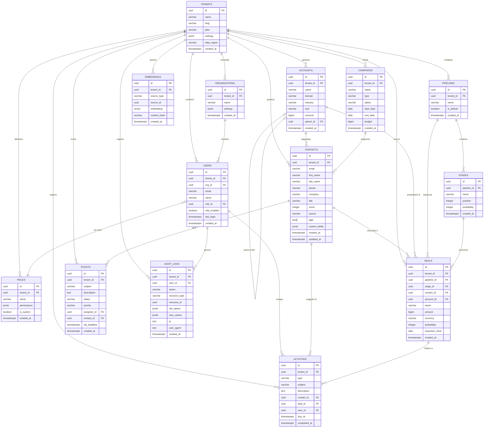

# 08 - Data Architecture

Architettura dati completa per CRM Pro 360: modello relazionale multi-tenant con sharding Citus, caching distribuito Redis, indicizzazione Elasticsearch, event streaming Kafka e storage vettoriale pgvector.

---

## 1. Data Model Overview

Diagramma entita-relazione delle entita core del sistema. Ogni entita include `tenant_id` come partition key per garantire isolamento multi-tenant a livello di riga.



### Cardinalita delle Relazioni

| Relazione | Cardinalita | Descrizione |
|---|---|---|
| Tenant → Organization | 1:N | Un tenant puo avere piu organizzazioni (business unit) |
| Tenant → User | 1:N | Ogni utente appartiene a un singolo tenant |
| Organization → User | 1:N | Gli utenti sono assegnati a un'organizzazione |
| User → Role | N:1 | Ogni utente ha esattamente un ruolo |
| Contact → Deal | 1:N | Un contatto puo avere piu deal aperti |
| Account → Deal | 1:N | Un account puo avere piu deal |
| Account → Account | 1:N (self) | Gerarchia parent-child per gruppi aziendali |
| Pipeline → Stage | 1:N (ordered) | Ogni pipeline ha stadi ordinati per posizione |
| Pipeline → Deal | 1:N | I deal vivono in una singola pipeline |
| Stage → Deal | 1:N | Ogni deal e in uno stadio alla volta |
| Contact → Activity | 1:N | Attivita legate a un contatto |
| Deal → Activity | 1:N | Attivita legate a un deal |
| User → Activity | 1:N | L'utente che ha eseguito l'attivita |
| Contact → Ticket | 1:N | Ticket aperti da un contatto |
| User → Ticket | 1:N | Ticket assegnati a un utente |
| Campaign → Contact | N:M | Contatti targetizzati da campagne (via tabella ponte) |

### Multi-tenancy

Ogni tabella tenant-scoped include `tenant_id UUID NOT NULL` come prima colonna dopo `id`. Il campo `tenant_id` e usato come:

- **Distribution column** in Citus per lo sharding
- **Row-Level Security (RLS)** policy filter
- **Partition key** per garantire co-locazione dei dati correlati

---

## 2. Core Entity Schemas

### 2.1 tenants

Tabella root del sistema. Non sharded (reference table replicata su tutti i nodi).

```sql
CREATE TABLE tenants (
    id              UUID PRIMARY KEY DEFAULT gen_random_uuid(),
    name            VARCHAR(255) NOT NULL,
    slug            VARCHAR(100) NOT NULL UNIQUE,
    plan            VARCHAR(50) NOT NULL DEFAULT 'trial'
                    CHECK (plan IN ('trial','starter','professional','enterprise')),
    settings        JSONB NOT NULL DEFAULT '{}',
    data_region     VARCHAR(10) NOT NULL DEFAULT 'eu-west'
                    CHECK (data_region IN ('eu-west','eu-central','us-east')),
    created_at      TIMESTAMPTZ NOT NULL DEFAULT now()
);

CREATE UNIQUE INDEX idx_tenants_slug ON tenants (slug);
```

| Colonna | Tipo | Nullable | Default | Descrizione |
|---|---|---|---|---|
| id | UUID | NO | gen_random_uuid() | Identificativo univoco del tenant |
| name | VARCHAR(255) | NO | - | Nome visualizzato dell'azienda |
| slug | VARCHAR(100) | NO | - | Slug URL-safe univoco per il tenant |
| plan | VARCHAR(50) | NO | 'trial' | Piano tariffario attivo |
| settings | JSONB | NO | '{}' | Configurazioni tenant (lingua, timezone, feature flags) |
| data_region | VARCHAR(10) | NO | 'eu-west' | Regione di residenza dati (GDPR) |
| created_at | TIMESTAMPTZ | NO | now() | Data creazione |

### 2.2 organizations

Divisioni interne al tenant. Distribuite per `tenant_id`.

```sql
CREATE TABLE organizations (
    id              UUID NOT NULL DEFAULT gen_random_uuid(),
    tenant_id       UUID NOT NULL REFERENCES tenants(id) ON DELETE CASCADE,
    name            VARCHAR(255) NOT NULL,
    settings        JSONB NOT NULL DEFAULT '{}',
    created_at      TIMESTAMPTZ NOT NULL DEFAULT now(),
    PRIMARY KEY (tenant_id, id)
);

CREATE INDEX idx_organizations_tenant ON organizations (tenant_id);
```

| Colonna | Tipo | Nullable | Default | Descrizione |
|---|---|---|---|---|
| id | UUID | NO | gen_random_uuid() | ID organizzazione |
| tenant_id | UUID | NO | - | FK al tenant proprietario |
| name | VARCHAR(255) | NO | - | Nome dell'organizzazione/business unit |
| settings | JSONB | NO | '{}' | Configurazioni specifiche |
| created_at | TIMESTAMPTZ | NO | now() | Data creazione |

### 2.3 users

Utenti del sistema. Ogni utente appartiene a un tenant e opzionalmente a un'organizzazione.

```sql
CREATE TABLE users (
    id              UUID NOT NULL DEFAULT gen_random_uuid(),
    tenant_id       UUID NOT NULL REFERENCES tenants(id) ON DELETE CASCADE,
    org_id          UUID,
    email           VARCHAR(320) NOT NULL,
    name            VARCHAR(255) NOT NULL,
    role_id         UUID NOT NULL,
    mfa_enabled     BOOLEAN NOT NULL DEFAULT false,
    last_login      TIMESTAMPTZ,
    created_at      TIMESTAMPTZ NOT NULL DEFAULT now(),
    PRIMARY KEY (tenant_id, id),
    UNIQUE (tenant_id, email),
    FOREIGN KEY (tenant_id, org_id) REFERENCES organizations(tenant_id, id),
    FOREIGN KEY (tenant_id, role_id) REFERENCES roles(tenant_id, id)
);

CREATE INDEX idx_users_tenant_email ON users (tenant_id, email);
CREATE INDEX idx_users_tenant_role ON users (tenant_id, role_id);
CREATE INDEX idx_users_last_login ON users (tenant_id, last_login DESC);
```

| Colonna | Tipo | Nullable | Default | Descrizione |
|---|---|---|---|---|
| id | UUID | NO | gen_random_uuid() | ID utente |
| tenant_id | UUID | NO | - | FK tenant |
| org_id | UUID | SI | NULL | FK organizzazione (opzionale) |
| email | VARCHAR(320) | NO | - | Email univoca per tenant |
| name | VARCHAR(255) | NO | - | Nome completo |
| role_id | UUID | NO | - | FK ruolo assegnato |
| mfa_enabled | BOOLEAN | NO | false | MFA attivato |
| last_login | TIMESTAMPTZ | SI | NULL | Ultimo accesso |
| created_at | TIMESTAMPTZ | NO | now() | Data registrazione |

### 2.4 roles

Ruoli con permessi granulari. Distribuiti per `tenant_id`.

```sql
CREATE TABLE roles (
    id              UUID NOT NULL DEFAULT gen_random_uuid(),
    tenant_id       UUID NOT NULL REFERENCES tenants(id) ON DELETE CASCADE,
    name            VARCHAR(100) NOT NULL,
    permissions     JSONB NOT NULL DEFAULT '[]',
    is_system       BOOLEAN NOT NULL DEFAULT false,
    created_at      TIMESTAMPTZ NOT NULL DEFAULT now(),
    PRIMARY KEY (tenant_id, id),
    UNIQUE (tenant_id, name)
);

CREATE INDEX idx_roles_tenant ON roles (tenant_id);
```

| Colonna | Tipo | Nullable | Default | Descrizione |
|---|---|---|---|---|
| id | UUID | NO | gen_random_uuid() | ID ruolo |
| tenant_id | UUID | NO | - | FK tenant |
| name | VARCHAR(100) | NO | - | Nome ruolo (es. "Admin", "Sales Rep") |
| permissions | JSONB | NO | '[]' | Array di stringhe permission (es. ["contacts:read","deals:write"]) |
| is_system | BOOLEAN | NO | false | Se true, non eliminabile/modificabile dall'utente |
| created_at | TIMESTAMPTZ | NO | now() | Data creazione |

### 2.5 contacts

Entita centrale del CRM. Contatti con scoring, tagging e custom fields.

```sql
CREATE TABLE contacts (
    id              UUID NOT NULL DEFAULT gen_random_uuid(),
    tenant_id       UUID NOT NULL REFERENCES tenants(id) ON DELETE CASCADE,
    email           VARCHAR(320),
    first_name      VARCHAR(150) NOT NULL,
    last_name       VARCHAR(150) NOT NULL,
    phone           VARCHAR(50),
    company         VARCHAR(255),
    title           VARCHAR(255),
    score           INTEGER NOT NULL DEFAULT 0 CHECK (score >= 0 AND score <= 100),
    source          VARCHAR(100),
    tags            TEXT[] NOT NULL DEFAULT '{}',
    custom_fields   JSONB NOT NULL DEFAULT '{}',
    created_at      TIMESTAMPTZ NOT NULL DEFAULT now(),
    updated_at      TIMESTAMPTZ NOT NULL DEFAULT now(),
    deleted_at      TIMESTAMPTZ,
    PRIMARY KEY (tenant_id, id)
);

CREATE INDEX idx_contacts_tenant_email ON contacts (tenant_id, email);
CREATE INDEX idx_contacts_tenant_company ON contacts (tenant_id, company);
CREATE INDEX idx_contacts_tenant_score ON contacts (tenant_id, score DESC);
CREATE INDEX idx_contacts_tags ON contacts USING GIN (tags);
CREATE INDEX idx_contacts_custom_fields ON contacts USING GIN (custom_fields jsonb_path_ops);
CREATE INDEX idx_contacts_search ON contacts USING GIN (
    to_tsvector('simple', coalesce(first_name,'') || ' ' || coalesce(last_name,'') || ' ' || coalesce(email,'') || ' ' || coalesce(company,''))
);
CREATE INDEX idx_contacts_active ON contacts (tenant_id, created_at DESC) WHERE deleted_at IS NULL;
```

| Colonna | Tipo | Nullable | Default | Descrizione |
|---|---|---|---|---|
| id | UUID | NO | gen_random_uuid() | ID contatto |
| tenant_id | UUID | NO | - | FK tenant |
| email | VARCHAR(320) | SI | NULL | Email del contatto |
| first_name | VARCHAR(150) | NO | - | Nome |
| last_name | VARCHAR(150) | NO | - | Cognome |
| phone | VARCHAR(50) | SI | NULL | Numero di telefono |
| company | VARCHAR(255) | SI | NULL | Azienda di appartenenza |
| title | VARCHAR(255) | SI | NULL | Titolo/posizione lavorativa |
| score | INTEGER | NO | 0 | Punteggio lead (0-100), calcolato da AI |
| source | VARCHAR(100) | SI | NULL | Fonte acquisizione (web, import, referral, etc.) |
| tags | TEXT[] | NO | '{}' | Tag categorizzazione |
| custom_fields | JSONB | NO | '{}' | Campi personalizzati definiti dal tenant |
| created_at | TIMESTAMPTZ | NO | now() | Data creazione |
| updated_at | TIMESTAMPTZ | NO | now() | Ultimo aggiornamento |
| deleted_at | TIMESTAMPTZ | SI | NULL | Soft delete timestamp |

### 2.6 accounts

Aziende clienti. Supportano gerarchia parent-child per gruppi aziendali.

```sql
CREATE TABLE accounts (
    id              UUID NOT NULL DEFAULT gen_random_uuid(),
    tenant_id       UUID NOT NULL REFERENCES tenants(id) ON DELETE CASCADE,
    name            VARCHAR(255) NOT NULL,
    domain          VARCHAR(255),
    industry        VARCHAR(100),
    size            VARCHAR(50) CHECK (size IN ('1-10','11-50','51-200','201-1000','1000+')),
    revenue         BIGINT CHECK (revenue >= 0),
    parent_id       UUID,
    created_at      TIMESTAMPTZ NOT NULL DEFAULT now(),
    deleted_at      TIMESTAMPTZ,
    PRIMARY KEY (tenant_id, id),
    FOREIGN KEY (tenant_id, parent_id) REFERENCES accounts(tenant_id, id)
);

CREATE INDEX idx_accounts_tenant_name ON accounts (tenant_id, name);
CREATE INDEX idx_accounts_tenant_domain ON accounts (tenant_id, domain);
CREATE INDEX idx_accounts_tenant_industry ON accounts (tenant_id, industry);
CREATE INDEX idx_accounts_parent ON accounts (tenant_id, parent_id) WHERE parent_id IS NOT NULL;
CREATE INDEX idx_accounts_active ON accounts (tenant_id) WHERE deleted_at IS NULL;
```

| Colonna | Tipo | Nullable | Default | Descrizione |
|---|---|---|---|---|
| id | UUID | NO | gen_random_uuid() | ID account |
| tenant_id | UUID | NO | - | FK tenant |
| name | VARCHAR(255) | NO | - | Ragione sociale |
| domain | VARCHAR(255) | SI | NULL | Dominio web aziendale |
| industry | VARCHAR(100) | SI | NULL | Settore industriale |
| size | VARCHAR(50) | SI | NULL | Fascia dimensionale dipendenti |
| revenue | BIGINT | SI | NULL | Fatturato annuo in centesimi (evita floating point) |
| parent_id | UUID | SI | NULL | FK account padre per gerarchia |
| created_at | TIMESTAMPTZ | NO | now() | Data creazione |
| deleted_at | TIMESTAMPTZ | SI | NULL | Soft delete |

### 2.7 pipelines

Pipeline di vendita configurabili per tenant.

```sql
CREATE TABLE pipelines (
    id              UUID NOT NULL DEFAULT gen_random_uuid(),
    tenant_id       UUID NOT NULL REFERENCES tenants(id) ON DELETE CASCADE,
    name            VARCHAR(255) NOT NULL,
    is_default      BOOLEAN NOT NULL DEFAULT false,
    created_at      TIMESTAMPTZ NOT NULL DEFAULT now(),
    PRIMARY KEY (tenant_id, id)
);

CREATE INDEX idx_pipelines_tenant ON pipelines (tenant_id);
CREATE UNIQUE INDEX idx_pipelines_default ON pipelines (tenant_id) WHERE is_default = true;
```

### 2.8 stages

Stadi ordinati all'interno di una pipeline.

```sql
CREATE TABLE stages (
    id              UUID NOT NULL DEFAULT gen_random_uuid(),
    pipeline_id     UUID NOT NULL,
    tenant_id       UUID NOT NULL,
    name            VARCHAR(100) NOT NULL,
    position        INTEGER NOT NULL CHECK (position >= 0),
    probability     INTEGER NOT NULL DEFAULT 0 CHECK (probability >= 0 AND probability <= 100),
    created_at      TIMESTAMPTZ NOT NULL DEFAULT now(),
    PRIMARY KEY (tenant_id, id),
    FOREIGN KEY (tenant_id, pipeline_id) REFERENCES pipelines(tenant_id, id) ON DELETE CASCADE,
    UNIQUE (tenant_id, pipeline_id, position)
);

CREATE INDEX idx_stages_pipeline ON stages (tenant_id, pipeline_id, position);
```

### 2.9 deals

Deal/opportunita di vendita. Entita centrale della pipeline commerciale.

```sql
CREATE TABLE deals (
    id              UUID NOT NULL DEFAULT gen_random_uuid(),
    tenant_id       UUID NOT NULL REFERENCES tenants(id) ON DELETE CASCADE,
    pipeline_id     UUID NOT NULL,
    stage_id        UUID NOT NULL,
    contact_id      UUID,
    account_id      UUID,
    name            VARCHAR(255) NOT NULL,
    amount          BIGINT NOT NULL DEFAULT 0 CHECK (amount >= 0),
    currency        VARCHAR(3) NOT NULL DEFAULT 'EUR' CHECK (currency ~ '^[A-Z]{3}$'),
    probability     INTEGER NOT NULL DEFAULT 0 CHECK (probability >= 0 AND probability <= 100),
    expected_close  DATE,
    created_at      TIMESTAMPTZ NOT NULL DEFAULT now(),
    closed_at       TIMESTAMPTZ,
    deleted_at      TIMESTAMPTZ,
    PRIMARY KEY (tenant_id, id),
    FOREIGN KEY (tenant_id, pipeline_id) REFERENCES pipelines(tenant_id, id),
    FOREIGN KEY (tenant_id, stage_id) REFERENCES stages(tenant_id, id),
    FOREIGN KEY (tenant_id, contact_id) REFERENCES contacts(tenant_id, id),
    FOREIGN KEY (tenant_id, account_id) REFERENCES accounts(tenant_id, id)
);

CREATE INDEX idx_deals_tenant_pipeline ON deals (tenant_id, pipeline_id);
CREATE INDEX idx_deals_tenant_stage ON deals (tenant_id, stage_id);
CREATE INDEX idx_deals_tenant_contact ON deals (tenant_id, contact_id);
CREATE INDEX idx_deals_tenant_account ON deals (tenant_id, account_id);
CREATE INDEX idx_deals_expected_close ON deals (tenant_id, expected_close) WHERE deleted_at IS NULL;
CREATE INDEX idx_deals_amount ON deals (tenant_id, amount DESC) WHERE deleted_at IS NULL;
CREATE INDEX idx_deals_active ON deals (tenant_id, created_at DESC) WHERE deleted_at IS NULL AND closed_at IS NULL;
```

| Colonna | Tipo | Nullable | Default | Descrizione |
|---|---|---|---|---|
| id | UUID | NO | gen_random_uuid() | ID deal |
| tenant_id | UUID | NO | - | FK tenant |
| pipeline_id | UUID | NO | - | FK pipeline di appartenenza |
| stage_id | UUID | NO | - | FK stadio attuale |
| contact_id | UUID | SI | NULL | FK contatto principale |
| account_id | UUID | SI | NULL | FK account associato |
| name | VARCHAR(255) | NO | - | Nome/titolo del deal |
| amount | BIGINT | NO | 0 | Valore in centesimi (es. 150000 = 1500.00 EUR) |
| currency | VARCHAR(3) | NO | 'EUR' | Codice valuta ISO 4217 |
| probability | INTEGER | NO | 0 | Probabilita chiusura (0-100%) |
| expected_close | DATE | SI | NULL | Data prevista di chiusura |
| created_at | TIMESTAMPTZ | NO | now() | Data creazione |
| closed_at | TIMESTAMPTZ | SI | NULL | Data chiusura effettiva |
| deleted_at | TIMESTAMPTZ | SI | NULL | Soft delete |

### 2.10 activities

Log delle attivita (chiamate, email, meeting, note) legate a contatti e deal.

```sql
CREATE TABLE activities (
    id              UUID NOT NULL DEFAULT gen_random_uuid(),
    tenant_id       UUID NOT NULL REFERENCES tenants(id) ON DELETE CASCADE,
    type            VARCHAR(50) NOT NULL CHECK (type IN ('call','email','meeting','task','note','sms')),
    subject         VARCHAR(500) NOT NULL,
    description     TEXT,
    contact_id      UUID,
    deal_id         UUID,
    user_id         UUID NOT NULL,
    due_at          TIMESTAMPTZ,
    completed_at    TIMESTAMPTZ,
    created_at      TIMESTAMPTZ NOT NULL DEFAULT now(),
    PRIMARY KEY (tenant_id, id),
    FOREIGN KEY (tenant_id, contact_id) REFERENCES contacts(tenant_id, id),
    FOREIGN KEY (tenant_id, deal_id) REFERENCES deals(tenant_id, id),
    FOREIGN KEY (tenant_id, user_id) REFERENCES users(tenant_id, id)
);

CREATE INDEX idx_activities_tenant_contact ON activities (tenant_id, contact_id);
CREATE INDEX idx_activities_tenant_deal ON activities (tenant_id, deal_id);
CREATE INDEX idx_activities_tenant_user ON activities (tenant_id, user_id);
CREATE INDEX idx_activities_tenant_type ON activities (tenant_id, type);
CREATE INDEX idx_activities_due ON activities (tenant_id, due_at) WHERE completed_at IS NULL;
CREATE INDEX idx_activities_search ON activities USING GIN (
    to_tsvector('simple', coalesce(subject,'') || ' ' || coalesce(description,''))
);
```

### 2.11 tickets

Ticket di supporto con SLA tracking.

```sql
CREATE TABLE tickets (
    id              UUID NOT NULL DEFAULT gen_random_uuid(),
    tenant_id       UUID NOT NULL REFERENCES tenants(id) ON DELETE CASCADE,
    subject         VARCHAR(500) NOT NULL,
    description     TEXT,
    status          VARCHAR(30) NOT NULL DEFAULT 'open'
                    CHECK (status IN ('open','in_progress','waiting','resolved','closed')),
    priority        VARCHAR(20) NOT NULL DEFAULT 'medium'
                    CHECK (priority IN ('low','medium','high','urgent')),
    assignee_id     UUID,
    contact_id      UUID,
    sla_deadline    TIMESTAMPTZ,
    created_at      TIMESTAMPTZ NOT NULL DEFAULT now(),
    resolved_at     TIMESTAMPTZ,
    PRIMARY KEY (tenant_id, id),
    FOREIGN KEY (tenant_id, assignee_id) REFERENCES users(tenant_id, id),
    FOREIGN KEY (tenant_id, contact_id) REFERENCES contacts(tenant_id, id)
);

CREATE INDEX idx_tickets_tenant_status ON tickets (tenant_id, status);
CREATE INDEX idx_tickets_tenant_priority ON tickets (tenant_id, priority);
CREATE INDEX idx_tickets_tenant_assignee ON tickets (tenant_id, assignee_id);
CREATE INDEX idx_tickets_sla ON tickets (tenant_id, sla_deadline) WHERE status NOT IN ('resolved','closed');
CREATE INDEX idx_tickets_search ON tickets USING GIN (
    to_tsvector('simple', coalesce(subject,'') || ' ' || coalesce(description,''))
);
```

### 2.12 campaigns

Campagne marketing con tracking budget e date.

```sql
CREATE TABLE campaigns (
    id              UUID NOT NULL DEFAULT gen_random_uuid(),
    tenant_id       UUID NOT NULL REFERENCES tenants(id) ON DELETE CASCADE,
    name            VARCHAR(255) NOT NULL,
    type            VARCHAR(50) NOT NULL CHECK (type IN ('email','sms','social','event','webinar','ads')),
    status          VARCHAR(30) NOT NULL DEFAULT 'draft'
                    CHECK (status IN ('draft','scheduled','active','paused','completed','cancelled')),
    start_date      DATE,
    end_date        DATE,
    budget          BIGINT CHECK (budget >= 0),
    created_at      TIMESTAMPTZ NOT NULL DEFAULT now(),
    PRIMARY KEY (tenant_id, id)
);

CREATE INDEX idx_campaigns_tenant_status ON campaigns (tenant_id, status);
CREATE INDEX idx_campaigns_tenant_dates ON campaigns (tenant_id, start_date, end_date);
```

### 2.13 audit_logs

Log di audit immutabile per compliance GDPR. Append-only, mai aggiornato o cancellato.

```sql
CREATE TABLE audit_logs (
    id              UUID NOT NULL DEFAULT gen_random_uuid(),
    tenant_id       UUID NOT NULL,
    user_id         UUID,
    action          VARCHAR(50) NOT NULL CHECK (action IN ('create','read','update','delete','login','logout','export','import')),
    resource_type   VARCHAR(100) NOT NULL,
    resource_id     UUID,
    old_values      JSONB,
    new_values      JSONB,
    ip              INET,
    user_agent      TEXT,
    created_at      TIMESTAMPTZ NOT NULL DEFAULT now(),
    PRIMARY KEY (tenant_id, id)
);

CREATE INDEX idx_audit_tenant_resource ON audit_logs (tenant_id, resource_type, resource_id);
CREATE INDEX idx_audit_tenant_user ON audit_logs (tenant_id, user_id);
CREATE INDEX idx_audit_tenant_action ON audit_logs (tenant_id, action);
CREATE INDEX idx_audit_tenant_created ON audit_logs (tenant_id, created_at DESC);
```

### 2.14 embeddings

Vettori di embedding per ricerca semantica AI. Indicizzati con HNSW per nearest-neighbor search.

```sql
CREATE TABLE embeddings (
    id              UUID NOT NULL DEFAULT gen_random_uuid(),
    tenant_id       UUID NOT NULL REFERENCES tenants(id) ON DELETE CASCADE,
    source_type     VARCHAR(50) NOT NULL CHECK (source_type IN ('contact','deal','ticket','activity','email','note')),
    source_id       UUID NOT NULL,
    embedding       VECTOR(1024) NOT NULL,
    content_hash    VARCHAR(64) NOT NULL,
    created_at      TIMESTAMPTZ NOT NULL DEFAULT now(),
    PRIMARY KEY (tenant_id, id),
    UNIQUE (tenant_id, source_type, source_id)
);

CREATE INDEX idx_embeddings_source ON embeddings (tenant_id, source_type, source_id);
CREATE INDEX idx_embeddings_hash ON embeddings (tenant_id, content_hash);
CREATE INDEX idx_embeddings_vector ON embeddings USING hnsw (embedding vector_cosine_ops)
    WITH (m = 16, ef_construction = 200);
```

---

## 3. Sharding Strategy (Citus)

### Distribution Column

Tutte le tabelle tenant-scoped usano `tenant_id` come distribution column. Questo garantisce che tutti i dati di un singolo tenant risiedano sugli stessi shard, abilitando join locali efficienti.

```sql
-- Distribuzione tabelle principali
SELECT create_distributed_table('organizations', 'tenant_id');
SELECT create_distributed_table('users', 'tenant_id');
SELECT create_distributed_table('roles', 'tenant_id');
SELECT create_distributed_table('contacts', 'tenant_id');
SELECT create_distributed_table('accounts', 'tenant_id');
SELECT create_distributed_table('pipelines', 'tenant_id');
SELECT create_distributed_table('stages', 'tenant_id');
SELECT create_distributed_table('deals', 'tenant_id');
SELECT create_distributed_table('activities', 'tenant_id');
SELECT create_distributed_table('tickets', 'tenant_id');
SELECT create_distributed_table('campaigns', 'tenant_id');
SELECT create_distributed_table('audit_logs', 'tenant_id');
SELECT create_distributed_table('embeddings', 'tenant_id');
```

### Reference Tables

Tabelle piccole e a lettura frequente replicate su tutti i nodi worker:

```sql
SELECT create_reference_table('tenants');
SELECT create_reference_table('system_settings');
SELECT create_reference_table('permission_definitions');
SELECT create_reference_table('countries');
SELECT create_reference_table('currencies');
```

Le reference table possono essere join-ate con qualsiasi tabella distribuita senza cross-shard overhead.

### Shard Count e Rebalancing

| Parametro | Valore | Motivazione |
|---|---|---|
| Shard count iniziale | 128 | Bilancio tra parallelismo e overhead di gestione |
| Shard count massimo | 512 | Limite superiore prima di considerare resharding |
| Rebalance trigger | Skew > 20% | Quando un nodo ha 20% piu dati della media |
| Rebalance strategy | `by_disk_size` | Bilancia per dimensione disco, non per conteggio shard |

```sql
-- Rebalance manuale quando necessario
SELECT citus_rebalance_start('by_disk_size');

-- Monitoraggio distribuzione
SELECT nodename, count(*) as shard_count,
       pg_size_pretty(sum(shard_size)) as total_size
FROM citus_shards
GROUP BY nodename
ORDER BY total_size DESC;
```

### Co-location

Tabelle correlate sono co-locate per tenant_id, permettendo join locali senza network round-trip:

```sql
-- Verifica co-locazione
SELECT create_distributed_table('deals', 'tenant_id', colocate_with => 'contacts');
SELECT create_distributed_table('activities', 'tenant_id', colocate_with => 'contacts');
SELECT create_distributed_table('tickets', 'tenant_id', colocate_with => 'contacts');
```

Un join tra `deals` e `contacts` filtrato per `tenant_id` viene eseguito interamente sul nodo locale, senza scatter-gather.

### Cross-shard Query: Limitazioni

| Operazione | Supportata | Note |
|---|---|---|
| Join tra tabelle co-locate (stesso tenant_id) | SI | Eseguito localmente sul nodo |
| Join con reference table | SI | Reference table replicata ovunque |
| Join cross-tenant | NO | Richiede `SET citus.enable_repartition_joins = ON` (lento) |
| Subquery senza tenant_id nel WHERE | PARZIALE | Scatter-gather su tutti i nodi, evitare |
| INSERT ... SELECT cross-shard | SI | Ma richiede repartitioning |
| UPSERT (ON CONFLICT) | SI | Solo se distribution column nel CONFLICT target |

### Schema Migration con Citus

Le migrazioni DDL vengono propagate automaticamente dal coordinator ai worker:

```sql
-- Le ALTER TABLE sul coordinator vengono propagate
ALTER TABLE contacts ADD COLUMN linkedin_url VARCHAR(500);
-- Citus propaga automaticamente a tutti gli shard

-- Per migrazioni che richiedono lock esclusivo, usare la modalita sequenziale
SET citus.multi_shard_modify_mode = 'sequential';
ALTER TABLE deals ALTER COLUMN amount SET NOT NULL;
RESET citus.multi_shard_modify_mode;
```

Strategia di migrazione:
1. Eseguire DDL non-blocking prima (ADD COLUMN, CREATE INDEX CONCURRENTLY)
2. Backfill dati con UPDATE batch per tenant
3. Aggiungere constraint NOT NULL/CHECK solo dopo backfill completo
4. Mai DROP COLUMN in produzione: marcare come deprecato, rimuovere nel ciclo successivo

---

## 4. Indexing Strategy

### Catalogo Indici Completo

| Tabella | Indice | Tipo | Colonne | Condizione | Motivazione |
|---|---|---|---|---|---|
| tenants | idx_tenants_slug | B-tree UNIQUE | slug | - | Lookup per slug URL |
| contacts | idx_contacts_tenant_email | B-tree | tenant_id, email | - | Ricerca per email |
| contacts | idx_contacts_tenant_company | B-tree | tenant_id, company | - | Filtro per azienda |
| contacts | idx_contacts_tenant_score | B-tree | tenant_id, score DESC | - | Ranking lead score |
| contacts | idx_contacts_tags | GIN | tags | - | Ricerca per tag (array) |
| contacts | idx_contacts_custom_fields | GIN | custom_fields jsonb_path_ops | - | Query su campi custom |
| contacts | idx_contacts_search | GIN (tsvector) | first_name, last_name, email, company | - | Full-text search |
| contacts | idx_contacts_active | B-tree | tenant_id, created_at DESC | deleted_at IS NULL | Lista contatti attivi |
| accounts | idx_accounts_tenant_name | B-tree | tenant_id, name | - | Ricerca per nome |
| accounts | idx_accounts_tenant_domain | B-tree | tenant_id, domain | - | Lookup per dominio |
| accounts | idx_accounts_tenant_industry | B-tree | tenant_id, industry | - | Filtro settore |
| accounts | idx_accounts_parent | B-tree | tenant_id, parent_id | parent_id IS NOT NULL | Navigazione gerarchia |
| deals | idx_deals_tenant_pipeline | B-tree | tenant_id, pipeline_id | - | Filtro per pipeline |
| deals | idx_deals_tenant_stage | B-tree | tenant_id, stage_id | - | Filtro per stadio |
| deals | idx_deals_expected_close | B-tree | tenant_id, expected_close | deleted_at IS NULL | Forecast |
| deals | idx_deals_amount | B-tree | tenant_id, amount DESC | deleted_at IS NULL | Top deal per valore |
| deals | idx_deals_active | B-tree | tenant_id, created_at DESC | deleted_at IS NULL AND closed_at IS NULL | Deal attivi |
| activities | idx_activities_tenant_contact | B-tree | tenant_id, contact_id | - | Timeline contatto |
| activities | idx_activities_tenant_deal | B-tree | tenant_id, deal_id | - | Timeline deal |
| activities | idx_activities_due | B-tree | tenant_id, due_at | completed_at IS NULL | Attivita pendenti |
| activities | idx_activities_search | GIN (tsvector) | subject, description | - | Full-text search |
| tickets | idx_tickets_tenant_status | B-tree | tenant_id, status | - | Filtro stato |
| tickets | idx_tickets_sla | B-tree | tenant_id, sla_deadline | status NOT IN (resolved, closed) | SLA monitoring |
| tickets | idx_tickets_search | GIN (tsvector) | subject, description | - | Full-text search |
| audit_logs | idx_audit_tenant_resource | B-tree | tenant_id, resource_type, resource_id | - | Lookup per risorsa |
| audit_logs | idx_audit_tenant_created | B-tree | tenant_id, created_at DESC | - | Timeline audit |
| embeddings | idx_embeddings_source | B-tree | tenant_id, source_type, source_id | - | Lookup embedding per sorgente |
| embeddings | idx_embeddings_vector | HNSW | embedding vector_cosine_ops | - | Nearest-neighbor search |

### HNSW Index per pgvector

Parametri scelti per bilanciare qualita recall e velocita:

| Parametro | Valore | Effetto |
|---|---|---|
| m | 16 | Connessioni per nodo nel grafo. 16 e un buon default per 1024 dimensioni |
| ef_construction | 200 | Qualita costruzione indice. Valori alti = recall migliore, build piu lento |
| ef_search (runtime) | 100 | Configurato a query-time con `SET hnsw.ef_search = 100` |

### Manutenzione Indici

| Attivita | Frequenza | Comando |
|---|---|---|
| REINDEX tabelle ad alto write | Settimanale (domenica 03:00 UTC) | `REINDEX TABLE CONCURRENTLY contacts` |
| Analisi bloat indici | Giornaliera | Query su `pg_stat_user_indexes` con rapporto size/tuples |
| VACUUM ANALYZE | Continuo (autovacuum) | Threshold: 20% dead tuples |
| Rebuild HNSW | Mensile | `REINDEX INDEX CONCURRENTLY idx_embeddings_vector` |
| Statistiche aggiornamento | Post-bulk-import | `ANALYZE contacts` |

---

## 5. Elasticsearch Architecture

### Index Mapping

Un indice ES per ogni tipo di entita, con prefisso tenant e routing per tenant_id:

```
crm-contacts-{YYYY.MM}
crm-deals-{YYYY.MM}
crm-tickets-{YYYY.MM}
crm-activities-{YYYY.MM}
```

Esempio mapping per contacts:

```json
{
  "mappings": {
    "_routing": { "required": true },
    "properties": {
      "tenant_id":    { "type": "keyword" },
      "email":        { "type": "keyword", "copy_to": "searchable" },
      "first_name":   { "type": "text", "fields": { "keyword": { "type": "keyword" } } },
      "last_name":    { "type": "text", "fields": { "keyword": { "type": "keyword" } } },
      "company":      { "type": "text", "fields": { "keyword": { "type": "keyword" } } },
      "phone":        { "type": "keyword" },
      "title":        { "type": "text" },
      "score":        { "type": "integer" },
      "source":       { "type": "keyword" },
      "tags":         { "type": "keyword" },
      "custom_fields": { "type": "flattened" },
      "created_at":   { "type": "date" },
      "updated_at":   { "type": "date" },
      "searchable":   { "type": "text", "analyzer": "crm_analyzer" },
      "suggest":      { "type": "completion", "analyzer": "simple" }
    }
  },
  "settings": {
    "number_of_shards": 3,
    "number_of_replicas": 1,
    "analysis": {
      "analyzer": {
        "crm_analyzer": {
          "type": "custom",
          "tokenizer": "standard",
          "filter": ["lowercase", "asciifolding", "edge_ngram_filter"]
        }
      },
      "filter": {
        "edge_ngram_filter": {
          "type": "edge_ngram",
          "min_gram": 2,
          "max_gram": 15
        }
      }
    }
  }
}
```

### Index Lifecycle Management (ILM)

| Fase | Eta | Azione | Replicas | Shard Size |
|---|---|---|---|---|
| Hot | 0-30 giorni | Scrittura attiva, allocazione su nodi SSD | 1 | Max 50GB |
| Warm | 30-180 giorni | Read-only, force merge a 1 segmento | 1 | Merged |
| Cold | 180-365 giorni | Spostamento su storage economico, shrink a 1 shard | 0 | Shrunk |
| Delete | >365 giorni | Eliminazione indice | - | - |

Policy ILM:

```json
{
  "policy": {
    "phases": {
      "hot":    { "min_age": "0ms",  "actions": { "rollover": { "max_size": "50gb", "max_age": "30d" } } },
      "warm":   { "min_age": "30d",  "actions": { "readonly": {}, "forcemerge": { "max_num_segments": 1 } } },
      "cold":   { "min_age": "180d", "actions": { "allocate": { "number_of_replicas": 0 } } },
      "delete": { "min_age": "365d", "actions": { "delete": {} } }
    }
  }
}
```

### Sync Strategy: Kafka CDC

Il flusso di sincronizzazione PostgreSQL → Elasticsearch avviene tramite Debezium CDC:

```
PostgreSQL (WAL) → Debezium Connector → Kafka (crm.cdc.*) → ES Sink Connector → Elasticsearch
```

1. Debezium cattura ogni INSERT/UPDATE/DELETE dal WAL di PostgreSQL
2. Gli eventi vengono pubblicati su topic Kafka dedicati (`crm.cdc.contacts`, `crm.cdc.deals`, etc.)
3. Un Kafka Connect Elasticsearch Sink consumer trasforma e indicizza i documenti
4. Latenza tipica: < 2 secondi dal commit PostgreSQL all'indicizzazione ES

### Esempi Query DSL

**Ricerca fuzzy su contatti:**

```json
{
  "query": {
    "bool": {
      "filter": [{ "term": { "tenant_id": "tenant-uuid" } }],
      "must": [{
        "multi_match": {
          "query": "mario rossi",
          "fields": ["first_name^2", "last_name^2", "email", "company"],
          "fuzziness": "AUTO",
          "type": "best_fields"
        }
      }]
    }
  }
}
```

**Autocomplete:**

```json
{
  "suggest": {
    "contact-suggest": {
      "prefix": "mar",
      "completion": {
        "field": "suggest",
        "size": 10,
        "contexts": { "tenant_id": "tenant-uuid" }
      }
    }
  }
}
```

**Aggregazione deal per stadio pipeline:**

```json
{
  "size": 0,
  "query": { "bool": { "filter": [{ "term": { "tenant_id": "tenant-uuid" } }] } },
  "aggs": {
    "by_stage": {
      "terms": { "field": "stage_name.keyword", "size": 20 },
      "aggs": {
        "total_amount": { "sum": { "field": "amount" } },
        "avg_probability": { "avg": { "field": "probability" } }
      }
    }
  }
}
```

---

## 6. Caching Architecture (Redis)

### Architettura a Due Livelli

| Layer | Tecnologia | Capacita | Latenza | Uso |
|---|---|---|---|---|
| L1 | In-process LRU (Node.js Map) | 1000 entry per processo | < 1ms | Hot data per istanza applicativa |
| L2 | Redis Cluster (6 nodi) | 32GB per nodo | < 5ms | Cache condivisa tra tutte le istanze |

Flusso di lettura: L1 hit → return. L1 miss → L2 hit → populate L1 → return. L2 miss → DB query → populate L2 + L1 → return.

### Naming Convention

```
crm:{tenant_id}:{entity}:{id}                    → Singola entita
crm:{tenant_id}:{entity}:list:{query_hash}        → Lista filtrata
crm:{tenant_id}:{entity}:count:{query_hash}       → Conteggio
crm:{tenant_id}:user:{user_id}:session            → Sessione utente
crm:{tenant_id}:ratelimit:{user_id}:{endpoint}    → Rate limiting
crm:global:config:{key}                            → Configurazioni globali
```

### TTL Matrix

| Entita | TTL L1 | TTL L2 | Invalidazione | Motivazione |
|---|---|---|---|---|
| Tenant settings | 5 min | 30 min | Event-driven | Cambiamenti rari, lettura frequente |
| User profile | 2 min | 15 min | Event-driven | Aggiornamenti poco frequenti |
| User session | - | 24 ore | Explicit (logout) | Durata sessione |
| Role/permissions | 5 min | 60 min | Event-driven | Cambiano quasi mai |
| Contact (singolo) | 1 min | 10 min | Event-driven | Aggiornamenti moderati |
| Contact list | 30 sec | 5 min | TTL only | Liste cambiano spesso |
| Deal (singolo) | 1 min | 10 min | Event-driven | Movimenti pipeline frequenti |
| Deal list / board | 30 sec | 3 min | TTL only | Vista board real-time |
| Pipeline config | 5 min | 60 min | Event-driven | Configurazione statica |
| Activity feed | - | 2 min | TTL only | Feed cronologico, TTL sufficiente |
| Ticket | 1 min | 5 min | Event-driven | SLA-sensitive, serve freschezza |
| Dashboard aggregates | - | 5 min | TTL only | Dati aggregati, tolleranza ritardo |
| Elasticsearch results | - | 1 min | TTL only | Risultati ricerca, breve TTL |
| Rate limit counters | - | Window-based | Sliding window | Scadono con la finestra temporale |

### Cache Invalidation Strategy

Invalidazione event-driven tramite consumer Kafka dedicato:

```
crm.contacts.updated → Kafka → Cache Invalidation Consumer → DEL crm:{tenant_id}:contact:{id}
                                                            → DEL crm:{tenant_id}:contact:list:*
```

Pattern di invalidazione:
1. **Write-through**: scrive in DB e invalida cache nello stesso flusso
2. **Event-driven**: il consumer Kafka ascolta eventi di modifica e invalida le chiavi correlate
3. **TTL fallback**: anche senza invalidazione esplicita, il TTL garantisce freshness entro il limite

### Cache Warming

Al provisioning di un nuovo tenant o al deploy di una nuova istanza:

```typescript
async function warmTenantCache(tenantId: string): Promise<void> {
  await Promise.all([
    cacheService.warm(`crm:${tenantId}:pipelines`, () => pipelineRepo.findAll(tenantId)),
    cacheService.warm(`crm:${tenantId}:roles`, () => roleRepo.findAll(tenantId)),
    cacheService.warm(`crm:${tenantId}:stages`, () => stageRepo.findAll(tenantId)),
    cacheService.warm(`crm:${tenantId}:settings`, () => tenantRepo.getSettings(tenantId)),
  ]);
}
```

### Session Storage

Sessioni utente salvate in Redis con struttura hash:

```
HSET crm:{tenant_id}:user:{user_id}:session
     "token"       "jwt-token-value"
     "ip"          "192.168.1.1"
     "user_agent"  "Mozilla/5.0..."
     "created_at"  "2026-03-24T10:00:00Z"
     "last_active" "2026-03-24T14:30:00Z"
EXPIRE crm:{tenant_id}:user:{user_id}:session 86400
```

### Rate Limiting

Sliding window counter per endpoint, implementato con sorted set Redis:

```
ZADD crm:{tenant_id}:ratelimit:{user_id}:api {timestamp} {request_id}
ZREMRANGEBYSCORE crm:{tenant_id}:ratelimit:{user_id}:api 0 {now - window}
ZCARD crm:{tenant_id}:ratelimit:{user_id}:api
EXPIRE crm:{tenant_id}:ratelimit:{user_id}:api {window_seconds}
```

---

## 7. Event Architecture (Kafka)

### Topic Naming Convention

Formato: `crm.{domain}.{event_type}`

- `domain`: bounded context (contacts, deals, tickets, campaigns, auth, system)
- `event_type`: azione passata (created, updated, deleted, stage_changed, etc.)

### Topic Catalog

| Topic | Partizioni | Retention | Consumer Groups | Descrizione |
|---|---|---|---|---|
| `crm.contacts.created` | 12 | 7 giorni | es-sync, analytics, notifications | Nuovo contatto creato |
| `crm.contacts.updated` | 12 | 7 giorni | es-sync, cache-invalidator, analytics | Contatto aggiornato |
| `crm.contacts.deleted` | 6 | 7 giorni | es-sync, cache-invalidator, gdpr-cleanup | Contatto eliminato |
| `crm.contacts.merged` | 6 | 30 giorni | es-sync, analytics, audit | Contatti unificati (dedup) |
| `crm.deals.created` | 12 | 7 giorni | es-sync, analytics, notifications | Nuovo deal |
| `crm.deals.updated` | 12 | 7 giorni | es-sync, cache-invalidator, analytics | Deal aggiornato |
| `crm.deals.stage_changed` | 12 | 30 giorni | es-sync, analytics, notifications, ai-scoring | Cambio stadio pipeline |
| `crm.deals.closed` | 6 | 90 giorni | analytics, reporting, ai-training | Deal chiuso (vinto/perso) |
| `crm.tickets.created` | 8 | 7 giorni | es-sync, sla-monitor, notifications | Nuovo ticket |
| `crm.tickets.updated` | 8 | 7 giorni | es-sync, sla-monitor, cache-invalidator | Ticket aggiornato |
| `crm.tickets.sla_breached` | 4 | 30 giorni | notifications, escalation, analytics | SLA superato |
| `crm.activities.created` | 12 | 7 giorni | es-sync, analytics, ai-scoring | Nuova attivita registrata |
| `crm.campaigns.status_changed` | 4 | 30 giorni | analytics, notifications | Cambio stato campagna |
| `crm.campaigns.contact_added` | 8 | 7 giorni | analytics, campaign-engine | Contatto aggiunto a campagna |
| `crm.auth.login` | 4 | 30 giorni | audit, security-monitor | Login utente |
| `crm.auth.logout` | 4 | 7 giorni | audit, session-cleanup | Logout utente |
| `crm.auth.mfa_enabled` | 2 | 90 giorni | audit | MFA attivato |
| `crm.system.tenant_provisioned` | 2 | 90 giorni | setup-worker, cache-warmer | Nuovo tenant creato |
| `crm.system.tenant_plan_changed` | 2 | 90 giorni | billing, feature-flags | Cambio piano tenant |
| `crm.audit.log` | 16 | 365 giorni | audit-writer, compliance | Log audit centralizzato |
| `crm.cdc.contacts` | 12 | 3 giorni | es-sink-connector | CDC Debezium - contacts |
| `crm.cdc.deals` | 12 | 3 giorni | es-sink-connector | CDC Debezium - deals |
| `crm.cdc.tickets` | 8 | 3 giorni | es-sink-connector | CDC Debezium - tickets |
| `crm.ai.embedding_requested` | 8 | 7 giorni | embedding-worker | Richiesta generazione embedding |
| `crm.ai.scoring_requested` | 8 | 7 giorni | scoring-worker | Richiesta ricalcolo lead score |

### Event Envelope

Ogni evento segue uno schema envelope standardizzato:

```json
{
  "id": "evt_01HQXK5N7P3KZWM4JRTV8YCE9D",
  "type": "crm.contacts.updated",
  "source": "crm-api",
  "tenant_id": "tnt_01HQXK5N7P3KZWM4JRTV8YCE9D",
  "timestamp": "2026-03-24T14:30:00.000Z",
  "version": "1.0",
  "correlation_id": "req_01HQXK5N7P3KZWM4JRTV8YCE9D",
  "data": {
    "contact_id": "cnt_01HQXK5N7P3KZWM4JRTV8YCE9D",
    "changes": {
      "score": { "old": 45, "new": 72 },
      "tags": { "old": ["lead"], "new": ["lead", "qualified"] }
    }
  },
  "metadata": {
    "user_id": "usr_01HQXK5N7P3KZWM4JRTV8YCE9D",
    "ip": "192.168.1.1",
    "user_agent": "CRM-Pro-360/1.0"
  }
}
```

### Schema Registry

Tutti gli schemi eventi sono registrati in Confluent Schema Registry con compatibilita `BACKWARD`:

- Formato: JSON Schema (non Avro, per compatibilita con l'ecosistema Node.js)
- Evoluzione: nuovi campi opzionali consentiti, rimozione campi vietata
- Validazione: il producer valida contro lo schema prima della pubblicazione

### Dead Letter Queue

Messaggi non processabili dopo 3 tentativi vengono inviati alla DLQ:

```
crm.{domain}.{event}.dlq
```

| Configurazione | Valore |
|---|---|
| Max retries | 3 |
| Backoff iniziale | 1 secondo |
| Backoff massimo | 30 secondi |
| Backoff strategy | Esponenziale con jitter |
| DLQ retention | 30 giorni |
| Alert threshold | > 10 messaggi in DLQ in 1 ora |

### Event Replay

Capacita di replay per ricostruire read model (ES, cache, aggregati):

1. I topic principali hanno retention sufficiente per replay completo (7-90 giorni)
2. Per replay storici oltre la retention, gli eventi vengono archiviati su S3/MinIO in formato Parquet
3. Tool di replay: consumer dedicato che legge da offset specifico o da archivio S3
4. Flag `is_replay: true` nell'header per evitare side-effect (notifiche, webhook)

### CDC Integration (Debezium)

```json
{
  "name": "crm-postgres-cdc",
  "config": {
    "connector.class": "io.debezium.connector.postgresql.PostgresConnector",
    "database.hostname": "pg-coordinator",
    "database.port": "5432",
    "database.dbname": "crm_pro_360",
    "database.user": "debezium_replication",
    "plugin.name": "pgoutput",
    "slot.name": "crm_cdc_slot",
    "publication.name": "crm_cdc_publication",
    "table.include.list": "public.contacts,public.deals,public.tickets,public.activities",
    "transforms": "route",
    "transforms.route.type": "io.debezium.transforms.ByLogicalTableRouter",
    "transforms.route.topic.regex": "(.*)\\.(.*)\\.(.*)$",
    "transforms.route.topic.replacement": "crm.cdc.$3"
  }
}
```

---

## 8. Data Migration & ETL

### Migration Framework

Migrazioni SQL versionati gestite con file numerati sequenziali:

```
migrations/
  0001_initial_schema.sql
  0002_add_contacts_linkedin.sql
  0003_add_deals_closed_at.sql
  ...
```

Ogni migrazione include sia `up` che `down` per rollback. Le migrazioni vengono eseguite dal coordinator Citus e propagate automaticamente ai worker.

### Zero-Downtime Migration (Expand-Contract)

Strategia in 4 fasi per evitare downtime durante migrazioni breaking:

| Fase | Azione | Durata | Rischio |
|---|---|---|---|
| 1. Expand | Aggiungere nuova colonna/tabella senza constraint | Deploy rapido | Nessuno |
| 2. Migrate | Backfill dati nella nuova struttura (batch per tenant) | Ore/giorni | Basso |
| 3. Switch | Aggiornare applicazione per usare nuova struttura | Deploy rapido | Medio |
| 4. Contract | Rimuovere vecchia colonna/tabella | Deploy rapido | Nessuno (reversibile al passo 3) |

Esempio pratico - rinominare `contacts.company` in `contacts.company_name`:

```sql
-- Fase 1: Expand
ALTER TABLE contacts ADD COLUMN company_name VARCHAR(255);

-- Fase 2: Migrate (batch per tenant, non blocca)
UPDATE contacts SET company_name = company
WHERE tenant_id = $1 AND company_name IS NULL
LIMIT 10000;

-- Fase 3: Switch (deploy applicativo che legge/scrive company_name)
-- Trigger per transizione: sincronizza entrambe le colonne
CREATE OR REPLACE FUNCTION sync_company_name() RETURNS trigger AS $$
BEGIN
  IF NEW.company_name IS NULL THEN NEW.company_name := NEW.company; END IF;
  IF NEW.company IS NULL THEN NEW.company := NEW.company_name; END IF;
  RETURN NEW;
END;
$$ LANGUAGE plpgsql;

-- Fase 4: Contract (dopo verifica completa)
ALTER TABLE contacts DROP COLUMN company;
```

### Data Import Pipeline

Flusso per importazione massiva di dati (CSV, Excel):

```
Upload File → Validazione Schema → Parsing → Deduplicazione → Trasformazione → Bulk Insert → Report
     ↓              ↓                  ↓            ↓                ↓              ↓           ↓
   S3/MinIO    JSON Schema       csv-parse      Fuzzy match    Field mapping    COPY FROM    Email
               validation        + xlsx          su email       + type cast      via Kafka    notifica
```

Vincoli:
- Max 100.000 righe per import
- Validazione asincrona via worker BullMQ/Kafka
- Report errori riga per riga con suggerimenti di correzione
- Deduplicazione basata su email + nome (fuzzy match Levenshtein)

### Data Export (GDPR-Compliant)

Export completo dei dati di un contatto su richiesta GDPR Article 15:

```typescript
interface GdprExportPayload {
  contact: ContactRecord;
  deals: DealRecord[];
  activities: ActivityRecord[];
  tickets: TicketRecord[];
  campaigns: CampaignMembership[];
  audit_trail: AuditLogEntry[];
  embeddings: { source_type: string; created_at: string }[]; // no vettori raw
  export_metadata: {
    requested_at: string;
    generated_at: string;
    format: 'json' | 'csv';
    hash: string; // SHA-256 per integrita
  };
}
```

Formati disponibili: JSON (strutturato) e CSV (flat per entita). Generato come archivio ZIP firmato, disponibile per download per 48 ore.

### ETL per Analytics

```
PostgreSQL → Debezium CDC → Kafka → Kafka Connect (JDBC Sink) → PostgreSQL Analytics Schema
                                  → Kafka Connect (S3 Sink)   → S3 Parquet → Data Warehouse
```

Lo schema analytics e separato dallo schema operazionale:
- Tabelle denormalizzate per query analitiche
- Materializzate con refresh periodico (ogni 15 minuti)
- Partitioned per mese su `created_at`

---

## 9. Backup & Recovery

### Strategia di Backup

| Componente | Metodo | Frequenza | Retention | Storage |
|---|---|---|---|---|
| PostgreSQL (WAL) | Continuous WAL archiving (pgBackRest) | Continuo | 30 giorni | S3 cross-region |
| PostgreSQL (base) | Full backup pgBackRest | Giornaliero (02:00 UTC) | 30 giorni | S3 cross-region |
| PostgreSQL (diff) | Differential backup | Ogni 6 ore | 7 giorni | S3 same-region |
| Redis | RDB snapshot + AOF | RDB ogni 1 ora, AOF continuo | 7 giorni | S3 same-region |
| Elasticsearch | Snapshot API | Giornaliero (04:00 UTC) | 14 giorni | S3 same-region |
| Kafka | Topic mirroring (MirrorMaker 2) | Continuo | Uguale a retention topic | Cluster DR |
| S3/MinIO (allegati) | Cross-region replication | Continuo | Lifecycle policy | S3 altra region |

### Point-in-Time Recovery (PITR)

PostgreSQL con pgBackRest consente restore a qualsiasi punto nel tempo entro la retention WAL:

```bash
# Restore al minuto esatto
pgbackrest restore --stanza=crm --type=time --target="2026-03-24 14:30:00+00"

# Restore a un transaction ID specifico
pgbackrest restore --stanza=crm --type=xid --target="12345678"
```

### Obiettivi RPO/RTO

| Scenario | RPO | RTO | Strategia |
|---|---|---|---|
| Singola tabella corrotta | 1 minuto | 30 minuti | PITR + restore selettivo |
| Database completo perso | 1 minuto | 30 minuti | PITR da ultimo base backup + WAL replay |
| Nodo Citus worker perso | 0 (replica sincrona) | 10 minuti | Failover automatico a replica |
| Intera region down | 5 minuti | 2 ore | Cross-region restore + DNS failover |
| Errore logico (DELETE errato) | 1 minuto | 1 ora | PITR a punto precedente l'errore |

### Cross-Region Replication

I backup sono replicati automaticamente su una seconda region AWS/GCP:
- Region primaria: `eu-west-1` (Irlanda)
- Region secondaria: `eu-central-1` (Francoforte)
- Trasferimento crittografato AES-256 in transit e at rest
- Verifica integrita con checksum SHA-256

### Backup Testing

| Test | Frequenza | Procedura | Responsabile |
|---|---|---|---|
| Restore completo in ambiente staging | Mensile | Restore full backup + WAL replay, verifica integrita dati | DevOps |
| Restore singola tabella | Settimanale (automatico) | Script automatico: restore tabella contacts, confronto row count | CI/CD pipeline |
| Failover nodo Citus | Trimestrale | Shutdown forzato worker, verifica failover automatico | DevOps + DBA |
| DR drill cross-region | Semestrale | Restore completo in region secondaria, smoke test applicativo | Intero team |

### Data Retention Policy

| Tipo Dato | Retention Attiva | Archiviazione | Eliminazione Definitiva | Base Legale |
|---|---|---|---|---|
| Dati contatto (PII) | Durata contratto | +1 anno dopo cancellazione tenant | Su richiesta GDPR o dopo archiviazione | Consenso / Legittimo interesse |
| Dati deal/opportunita | Durata contratto | +5 anni (obblighi fiscali) | Dopo archiviazione | Obbligo legale |
| Audit logs | 2 anni online | +5 anni su cold storage | Dopo archiviazione | Obbligo legale / Compliance |
| Session data | 24 ore | Non archiviata | Scadenza TTL Redis | Legittimo interesse |
| Email content | 1 anno online | +2 anni su S3 Glacier | Dopo archiviazione | Consenso |
| Embeddings | Vita del source record | Non archiviati | Eliminati con il source record | Legittimo interesse |
| Analytics aggregati | Indefinita | - | Mai (dati anonimizzati) | Legittimo interesse |
| Backup | 30 giorni | - | Rotazione automatica | Legittimo interesse |

---

## 10. Data Governance

### Schema di Classificazione Dati

| Livello | Etichetta | Esempi | Trattamento | Accesso |
|---|---|---|---|---|
| C4 - Restricted | PII Sensibile | Email personale, telefono, IP, dati bancari | Crittografia at rest + in transit, audit completo | Solo ruoli autorizzati + MFA |
| C3 - Confidential | PII Standard | Nome, cognome, azienda, titolo | Crittografia at rest, audit su write | Utenti tenant con permesso |
| C2 - Internal | Dati Business | Deal amount, pipeline stage, ticket status | Crittografia in transit | Tutti gli utenti del tenant |
| C1 - Public | Dati Non Sensibili | Slug tenant, nomi pipeline, nomi stadi | Nessuna restrizione aggiuntiva | API pubblica (dove applicabile) |

### PII Inventory

| Campo | Tabella | Classificazione | Crittografia | Mascheramento | Retention | Diritto all'Oblio |
|---|---|---|---|---|---|---|
| email | contacts | C4 | AES-256 at rest | `m***@domain.com` nei log | Contratto + 1 anno | SI - eliminazione |
| first_name | contacts | C3 | At rest | Non mascherato | Contratto + 1 anno | SI - anonimizzazione |
| last_name | contacts | C3 | At rest | Non mascherato | Contratto + 1 anno | SI - anonimizzazione |
| phone | contacts | C4 | AES-256 at rest | `+39 ***` nei log | Contratto + 1 anno | SI - eliminazione |
| email | users | C4 | AES-256 at rest | `u***@domain.com` nei log | Durata account | SI - anonimizzazione |
| ip | audit_logs | C4 | At rest | Hash in analytics | 2 anni | SI - anonimizzazione |
| user_agent | audit_logs | C3 | At rest | Non mascherato | 2 anni | NO - obbligo legale |
| custom_fields | contacts | C3-C4 | AES-256 at rest | Dipende dal campo | Contratto + 1 anno | SI - eliminazione |

### Data Lineage Tracking

Ogni trasformazione dati viene tracciata nell'audit log con il campo `source`:

```
Origine → Ingestione → Trasformazione → Storage → Distribuzione → Consumo

CSV Upload → Import Worker → Dedup + Normalize → PostgreSQL → CDC Kafka → Elasticsearch
                                                             → Cache Redis
                                                             → Analytics Schema
```

Strumenti di lineage:
- **Audit logs**: tracciamento granulare di ogni modifica con `old_values`/`new_values`
- **Kafka headers**: `correlation_id` per tracciare il flusso di un evento attraverso i sistemi
- **CDC metadata**: Debezium include `source.ts_ms`, `source.table`, `op` per tracciare l'origine

### Data Quality Monitoring

| Metrica | Soglia | Controllo | Azione |
|---|---|---|---|
| Completeness - email contatti | > 90% non null | Query giornaliera | Alert se sotto soglia |
| Completeness - deal amount | > 95% > 0 | Query giornaliera | Alert + report |
| Accuracy - email format | 100% valida | Validazione a insert | Reject con errore |
| Accuracy - phone format | > 85% E.164 | Batch settimanale | Report + suggerimento correzione |
| Freshness - contacts updated_at | < 30 giorni per 70% | Query settimanale | Alert per contatti stale |
| Freshness - ES sync lag | < 5 secondi | Monitoring continuo | Alert + auto-heal |
| Uniqueness - email per tenant | 100% unica | Constraint DB | Errore a insert |
| Consistency - deal stage valido | 100% FK valida | Constraint DB | Errore a insert |
| Consistency - cache vs DB | > 99.5% match | Sampling orario | Cache invalidation forzata |

### GDPR Data Map

| Dato | Dove Archiviato | Perche Raccolto | Durata Conservazione | Chi Accede | Base Legale |
|---|---|---|---|---|---|
| Nome/cognome contatto | PostgreSQL, Elasticsearch, Redis (cache) | Gestione relazione commerciale | Durata contratto + 1 anno | Sales team, Support, Admin | Legittimo interesse (Art. 6.1.f) |
| Email contatto | PostgreSQL, Elasticsearch, Redis (cache) | Comunicazioni commerciali | Durata contratto + 1 anno | Sales team, Marketing, Admin | Consenso (Art. 6.1.a) |
| Telefono contatto | PostgreSQL, Redis (cache) | Contatto diretto | Durata contratto + 1 anno | Sales team, Admin | Consenso (Art. 6.1.a) |
| IP utente | Audit logs (PostgreSQL) | Sicurezza e compliance | 2 anni | Security team, Admin | Legittimo interesse (Art. 6.1.f) |
| Dati deal | PostgreSQL, Elasticsearch | Gestione pipeline vendita | Durata contratto + 5 anni | Sales team, Management, Admin | Esecuzione contratto (Art. 6.1.b) |
| Contenuto ticket | PostgreSQL, Elasticsearch | Supporto cliente | Durata contratto + 2 anni | Support team, Admin | Esecuzione contratto (Art. 6.1.b) |
| Dati campagna | PostgreSQL | Marketing diretto | Durata contratto + 1 anno | Marketing team, Admin | Consenso (Art. 6.1.a) |
| Embedding vettoriali | PostgreSQL (pgvector) | Ricerca semantica AI | Vita del record sorgente | Sistema AI (nessun accesso diretto) | Legittimo interesse (Art. 6.1.f) |
| Session data | Redis | Autenticazione | 24 ore | Sistema (nessun accesso diretto) | Legittimo interesse (Art. 6.1.f) |
| Backup completi | S3 (eu-west-1, eu-central-1) | Disaster recovery | 30 giorni | DevOps (accesso ristretto) | Obbligo legale (Art. 6.1.c) |

### Procedure GDPR

**Diritto di accesso (Art. 15):** Export completo generato in < 72 ore, formato JSON + CSV.

**Diritto alla cancellazione (Art. 17):** Procedura di anonimizzazione in 4 passi:
1. Anonimizzazione dati in PostgreSQL (sostituzione PII con hash)
2. Rimozione da Elasticsearch
3. Invalidazione cache Redis
4. I backup non vengono modificati ma i dati anonimizzati rendono i backup contenenti i dati originali irrecuperabili dopo la rotazione (30 giorni)

**Diritto alla portabilita (Art. 20):** Export in formato JSON strutturato, compatibile con import in altri CRM.

**Data Protection Impact Assessment:** Necessario per nuove feature che trattano PII su larga scala. Documentato in `docs/dpia/` prima dell'implementazione.
