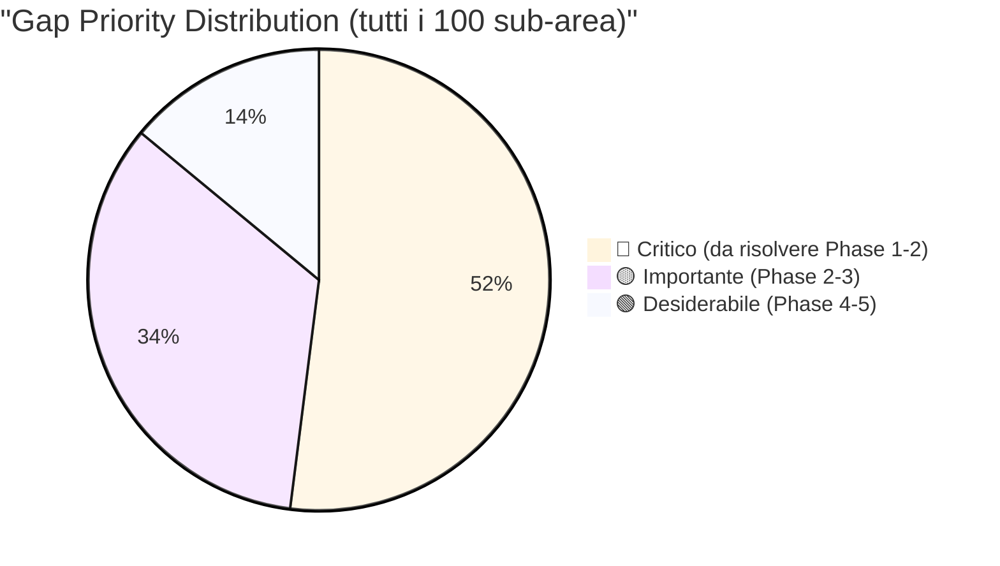

# 09 - Enterprise Gap Analysis

> **CRM Pro 360** — AI-Powered Enterprise CRM per mid-enterprise europee
> Analisi completa dei gap tra stato attuale (Day 0, greenfield) e stato target.

---

## 1. Enterprise CRM Platform Completeness

Valutazione della completezza funzionale della piattaforma CRM rispetto ai requisiti enterprise.

| Sub-area | Current State (Day 0) | Target State | Gap Size | Priority | Target Phase | Specific Actions Required |
|---|---|---|---|---|---|---|
| Contact management | Nessun modulo contatti. Zero data model. | CRUD completo con merge duplicati, timeline attivita, campi custom, import/export CSV/vCard, contact scoring | XL | 🔴 | Phase 1 | Definire schema Prisma `Contact`, API REST CRUD, pagina lista/dettaglio, deduplication engine con fuzzy matching, bulk import worker |
| Account hierarchy | Nessuna struttura account. | Gerarchia parent/child illimitata, account tree view, rollup metriche, territory assignment, account scoring | XL | 🔴 | Phase 1 | Schema `Account` con self-referential FK, recursive CTE per tree query, UI tree component, rollup aggregation job |
| Pipeline/deals | Nessun modulo commerciale. | Pipeline multi-stage configurabile, weighted forecasting, drag-and-drop Kanban, deal rotting alerts, win/loss analysis | XL | 🔴 | Phase 1 | Schema `Deal` + `Pipeline` + `Stage`, Kanban board con DnD, probability engine, pipeline analytics dashboard |
| Marketing automation | Nessun modulo marketing. | Email campaigns, drip sequences, landing page builder, A/B test, segmentazione dinamica, lead nurturing workflows | XL | 🟡 | Phase 3 | Integrazione SendGrid/Mailgun, campaign builder UI, segment engine con query builder, template editor WYSIWYG |
| Ticketing/service | Nessun sistema di ticketing. | Multi-channel ticket intake (email, form, chat), SLA tracking, escalation rules, satisfaction survey, macro/template | XL | 🟡 | Phase 2 | Schema `Ticket` + `SLA` + `EscalationRule`, inbox UI, SLA timer con BullMQ cron, CSAT widget post-risoluzione |
| Knowledge base | Nessuna base di conoscenza. | Articoli categorizzati con versioning, ricerca full-text, suggerimenti AI, feedback loop, multi-lingua IT/EN/DE/FR | L | 🟡 | Phase 3 | Schema `Article` + `Category`, editor Markdown, pgvector per semantic search, widget suggerimento contestuale |
| Workflow engine | Nessun motore workflow. | Visual workflow builder, trigger su eventi CRM, condizioni/azioni/branch, delay timer, webhook action, audit log | XL | 🔴 | Phase 2 | Workflow DSL con JSON schema, visual builder React Flow, BullMQ per esecuzione asincrona, execution history |
| Custom objects | Nessun supporto oggetti custom. | Schema builder no-code, relazioni tra oggetti, layout custom, validazione regole, API automatica per custom objects | L | 🟡 | Phase 4 | Dynamic schema management con Prisma, metadata-driven UI rendering, auto-generated REST endpoints |
| Reporting | Nessun modulo reportistica. | Dashboard builder drag-and-drop, report schedulati, export PDF/Excel, cross-object reporting, drill-down interattivo | XL | 🔴 | Phase 2 | Charting library (Recharts/Nivo), query builder per aggregazioni, report scheduler con BullMQ, export worker |
| Mobile app | Nessuna app mobile. | PWA responsive con offline-first, push notification, quick actions (log call, create deal), barcode scanner per eventi | L | 🟢 | Phase 5 | PWA manifest + service worker, offline sync con IndexedDB, push via Web Push API, responsive MUI layout |

---

## 2. AI-Powered Automation Maturity

Maturita delle funzionalita AI per automazione intelligente dei processi CRM.

| Sub-area | Current State (Day 0) | Target State | Gap Size | Priority | Target Phase | Specific Actions Required |
|---|---|---|---|---|---|---|
| Lead scoring | Nessun modello di scoring. | ML model per lead scoring predittivo, scoring multi-dimensionale (fit + engagement), auto-retrain settimanale, threshold configurabili | XL | 🔴 | Phase 2 | Feature engineering su dati contatto/attivita, modello gradient boosting, pipeline MLflow, UI configurazione pesi |
| Churn prediction | Nessun modello churn. | Predizione churn a 30/60/90 giorni, early warning alerts, churn reason analysis, recommended retention actions | XL | 🟡 | Phase 3 | Survival analysis model, feature store con engagement metrics, alert system, dashboard churn risk |
| Next best action | Nessun sistema NBA. | Suggerimenti contestuali per sales rep (chi chiamare, cosa proporre), ranking per probabilita successo, feedback loop | XL | 🟡 | Phase 3 | Recommendation engine, contextual bandit per ottimizzazione, widget sidebar in deal view, A/B test framework |
| Forecasting | Nessuna previsione vendite. | Forecast multi-metodo (weighted pipeline, AI-driven, bottom-up), scenario analysis, accuracy tracking, quarterly rollup | L | 🔴 | Phase 2 | Time series model (Prophet/ARIMA), pipeline aggregation engine, forecast vs actual dashboard, confidence intervals |
| Email intelligence | Nessuna analisi email. | Sentiment analysis su email, intent detection, auto-categorization, response time analytics, writing assistant | L | 🟡 | Phase 3 | NLP pipeline con Mistral, sentiment classifier fine-tuned, intent taxonomy, analytics aggregation job |
| Conversation AI | Nessun chatbot o assistente. | Chatbot customer-facing, AI assistant per sales rep, meeting summary, action item extraction, knowledge-grounded responses | XL | 🔴 | Phase 2 | RAG pipeline con pgvector, streaming chat UI, tool-calling per azioni CRM, conversation memory management |
| Data enrichment | Nessun arricchimento dati. | Auto-enrichment da fonti pubbliche (LinkedIn, company data), deduplication AI, data quality scoring, enrichment audit trail | L | 🟡 | Phase 3 | Integrazione API clearbit/apollo, enrichment worker BullMQ, data quality score calculator, enrichment log |
| Model management | Nessuna infrastruttura ML. | Model registry, versioning, A/B deployment, performance monitoring, automatic rollback, drift detection | L | 🟡 | Phase 4 | MLflow o custom registry, model serving via API, monitoring dashboard, drift detection con KS-test |
| A/B testing | Nessun framework A/B. | A/B test su email subject, workflow paths, AI model versions, statistical significance calculator, auto-winner selection | M | 🟢 | Phase 4 | Feature flag system, experiment tracking, Bayesian significance engine, results dashboard |
| AI governance | Nessun framework governance AI. | Explainability per ogni decisione AI, bias audit, human-in-the-loop per azioni critiche, AI decision log, compliance reporting | L | 🔴 | Phase 2 | SHAP/LIME per explainability, bias detection pipeline, HITL approval flow, audit log immutabile, report generator |

---

## 3. Governance & Compliance Readiness

Preparazione alla conformita normativa europea e certificazioni enterprise.

| Sub-area | Current State (Day 0) | Target State | Gap Size | Priority | Target Phase | Specific Actions Required |
|---|---|---|---|---|---|---|
| GDPR implementation | Nessuna implementazione GDPR. | Registro trattamenti, DPIA automatizzata, diritti soggetto (accesso, cancellazione, portabilita), cookie consent granulare, lawful basis tracking | XL | 🔴 | Phase 1 | Schema `DataProcessingRecord`, API diritti soggetto, consent management UI, data export/deletion worker, lawful basis per campo |
| AI Act compliance | Nessuna conformita AI Act. | Classificazione rischio per ogni sistema AI, documentazione tecnica per high-risk, human oversight, transparency notices, conformity assessment | XL | 🔴 | Phase 2 | Risk classification matrix, technical documentation generator, human oversight dashboard, transparency UI notices |
| SOC 2 readiness | Nessun controllo SOC 2. | Trust Service Criteria coperti (security, availability, processing integrity, confidentiality, privacy), evidence collection automatica | XL | 🟡 | Phase 3 | Policy framework, automated evidence collection, access review workflow, change management process, vendor assessment |
| ISO 27001 alignment | Nessun ISMS. | Statement of Applicability completo, risk assessment process, controlli Annex A implementati, internal audit program | XL | 🟡 | Phase 3 | ISMS documentation, risk register, control implementation per 93 controlli Annex A, audit schedule |
| Data residency | Nessuna strategia residency. | Dati EU in datacenter EU (Frankfurt/Amsterdam), geo-routing per tenant, data sovereignty controls, cross-border transfer assessment | L | 🔴 | Phase 1 | Deployment su cloud EU region, tenant-level region config, DTIA per trasferimenti extra-EU, Binding Corporate Rules |
| Consent management | Nessun consent management. | Consent granulare per finalita, preference center, consent versioning, withdrawal tracking, proof of consent, cookie banner A/B | L | 🔴 | Phase 1 | Schema `Consent` + `ConsentRecord`, preference center UI, consent API, proof-of-consent storage, banner component |
| Audit trail | Nessun audit trail. | Log immutabile di ogni azione utente/sistema, retention 7 anni, ricerca full-text, export per auditor, tamper-proof hashing | L | 🔴 | Phase 1 | Schema `AuditLog` con hash chain, middleware NestJS per auto-logging, audit viewer UI, export CSV/JSON |
| Privacy by design | Nessun PbD framework. | Data minimization enforcement, pseudonymization, encryption at rest/transit, privacy impact assessment per feature, default privacy settings | M | 🔴 | Phase 1 | Field-level encryption, data minimization checklist in CI, PIA template, pseudonymization service, default opt-out |
| DPO processes | Nessun processo DPO. | DPO dashboard, DSAR workflow automatizzato, breach notification workflow, training tracking, regulatory update feed | M | 🟡 | Phase 2 | DPO dashboard con KPI, DSAR ticketing integrato, breach notification timer (72h), training log |
| Breach response | Nessun piano breach response. | Incident response plan documentato, notification workflow automatico (72h GDPR), affected data analysis, communication templates | M | 🔴 | Phase 1 | Incident response playbook, automated notification workflow, affected records scanner, template email notifica |

---

## 4. Operational Maturity (SRE)

Maturita operativa per garantire affidabilita e resilienza del servizio.

| Sub-area | Current State (Day 0) | Target State | Gap Size | Priority | Target Phase | Specific Actions Required |
|---|---|---|---|---|---|---|
| Monitoring | Nessun monitoraggio. | Metrics (Prometheus), logs (Loki/ELK), traces (Jaeger), dashboards Grafana, custom business metrics, uptime monitoring esterno | XL | 🔴 | Phase 1 | Deploy Prometheus + Grafana, instrumentazione NestJS con prom-client, structured logging con Pino, Jaeger tracing |
| Alerting | Nessun sistema alerting. | Alert multi-canale (Slack, PagerDuty, email), severity levels, escalation automatica, alert grouping, silencing, runbook link | L | 🔴 | Phase 1 | Alertmanager config, alert rules per SLI (latency, error rate, saturation), PagerDuty integration, alert playbook |
| Incident response | Nessun processo incident. | Incident commander rotation, severity classification, communication template, war room automatico, timeline tracking | L | 🔴 | Phase 2 | Incident response framework, severity matrix (SEV1-4), Slack bot per incident management, post-incident review |
| On-call rotation | Nessuna rotazione on-call. | Rotazione settimanale, primary + secondary, escalation path, compensation tracking, handoff checklist, coverage calendar | M | 🟡 | Phase 2 | PagerDuty schedule, escalation policy, on-call handbook, coverage dashboard |
| Runbooks | Nessun runbook. | Runbook per ogni alert, step-by-step troubleshooting, automated remediation dove possibile, versioning, review quarterly | M | 🟡 | Phase 2 | Template runbook, runbook per top-20 alert, automazione con scripts, review cycle trimestrale |
| Capacity planning | Nessuna pianificazione capacita. | Forecast risorse basato su growth rate, auto-scaling policies, cost optimization, capacity review mensile | M | 🟡 | Phase 3 | Baseline metriche risorse, growth projection model, auto-scaling HPA/VPA Kubernetes, cost dashboard |
| Change management | Nessun change management formale. | Change advisory board, risk assessment per deploy, rollback plan obbligatorio, change calendar, post-deploy verification | M | 🟡 | Phase 2 | Change request template, risk matrix, automated rollback con health check, deploy calendar |
| Post-mortems | Nessun processo post-mortem. | Blameless post-mortem per ogni SEV1/2, action item tracking, trend analysis, knowledge sharing, template standardizzato | S | 🟡 | Phase 2 | Post-mortem template, action item tracker, quarterly trend review, sharing meeting mensile |
| SLA management | Nessun SLA definito. | SLA 99.9% uptime, SLO per latency (p99 < 500ms), error budget tracking, SLA dashboard cliente, penalty calculation | L | 🔴 | Phase 2 | SLI/SLO definition, error budget policy, SLA monitoring dashboard, automated SLA report, contractual SLA template |
| Chaos engineering | Nessun chaos engineering. | Game day trimestrali, failure injection automatica, blast radius limiting, steady state verification, chaos experiment library | S | 🟢 | Phase 5 | Litmus/Chaos Mesh setup, experiment catalog, game day playbook, blast radius policy |

---

## 5. Scalability to 50K Concurrent Users

Capacita di scalare l'infrastruttura per supportare 50.000 utenti concorrenti.

| Sub-area | Current State (Day 0) | Target State | Gap Size | Priority | Target Phase | Specific Actions Required |
|---|---|---|---|---|---|---|
| Application layer | Nessun deployment. | Kubernetes con HPA, min 6 pod NestJS, auto-scale fino a 50 pod, graceful shutdown, health check liveness/readiness | XL | 🔴 | Phase 1 | Dockerfile multi-stage, Helm chart, HPA basato su CPU/custom metrics, readiness/liveness probe, rolling update strategy |
| Database layer | Nessun database. | PostgreSQL con read replica (2+), connection pooling PgBouncer (500+ conn), query timeout, slow query log, automated failover | XL | 🔴 | Phase 1 | PostgreSQL HA (Patroni/CloudNativePG), PgBouncer pool, pg_stat_statements, automated failover con witness |
| Cache layer | Nessuna cache. | Redis Cluster 6 nodi, cache-aside pattern, TTL policy per tipo dato, cache invalidation event-driven, cache hit rate > 90% | L | 🔴 | Phase 1 | Redis Cluster deployment, NestJS cache interceptor, invalidation via pub/sub, cache warming job, monitoring hit rate |
| Search layer | Nessun motore ricerca. | Elasticsearch/OpenSearch cluster 3 nodi, index per entity CRM, near-real-time sync, suggerimenti fuzzy, faceted search | L | 🟡 | Phase 2 | OpenSearch cluster, index mapping per Contact/Account/Deal, CDC sync con Debezium, search API con filtri |
| Message queue | Nessuna coda messaggi. | BullMQ su Redis con 3+ worker, dead letter queue, retry policy, priority queue, job monitoring dashboard | L | 🔴 | Phase 1 | BullMQ setup, worker pool per job type, DLQ handler, Bull Board dashboard, retry con exponential backoff |
| API gateway | Nessun API gateway. | Kong/APISIX con rate limiting, auth validation, request transformation, circuit breaker, API versioning, analytics | L | 🟡 | Phase 2 | Kong deployment, plugin rate limiting + JWT validation + circuit breaker, API versioning strategy, traffic analytics |
| CDN/static assets | Nessun CDN. | CloudFront/Bunny CDN, asset fingerprinting, Brotli compression, edge caching, purge API, multi-region PoP | M | 🟡 | Phase 2 | CDN setup, Next.js asset prefix config, cache headers policy, Brotli encoding, purge webhook su deploy |
| WebSocket | Nessuna infrastruttura WS. | Socket.IO con Redis adapter, sticky sessions, heartbeat monitoring, graceful reconnect, room-based broadcasting, 50K conn | L | 🔴 | Phase 2 | Socket.IO + Redis adapter, Kubernetes sticky session (cookie), connection pool monitoring, load test 50K conn |
| Background jobs | Nessun job processing. | BullMQ con queue dedicate (email, enrichment, report, AI), concurrency tuning, rate limiting, job prioritization | L | 🔴 | Phase 1 | Queue per dominio, concurrency config, rate limiter per queue, priority levels, job retention policy |
| File storage | Nessun file storage. | S3-compatible (MinIO/AWS), presigned URL, virus scanning, thumbnail generation, retention policy, multi-tenant isolation | M | 🟡 | Phase 2 | MinIO/S3 setup, presigned URL API, ClamAV scanning worker, Sharp thumbnail generator, tenant-scoped buckets |

---

## 6. Scalability to 1B Records

Capacita di gestire un miliardo di record mantenendo performance accettabili.

| Sub-area | Current State (Day 0) | Target State | Gap Size | Priority | Target Phase | Specific Actions Required |
|---|---|---|---|---|---|---|
| Primary database | Nessun database. | PostgreSQL 16+ con partitioning nativo, tablespace management, connection pooling, vacuum tuning, WAL archiving | XL | 🔴 | Phase 1 | PostgreSQL 16 deployment, table partitioning strategy, autovacuum tuning, WAL-G per archiving, tablespace SSD/HDD |
| Sharding | Nessun sharding. | Sharding per tenant_id (Citus o application-level), cross-shard query support, shard rebalancing, tenant migration tra shard | XL | 🟡 | Phase 3 | Citus extension o custom sharding layer, shard routing middleware, rebalance tool, tenant migration script |
| Indexing | Nessun indice. | Indici composti per query pattern, partial indexes, BRIN per timestamp, GIN per JSONB/full-text, index monitoring, bloat detection | L | 🔴 | Phase 1 | Index design per top-20 query, pg_stat_user_indexes monitoring, BRIN su created_at, reindex job schedulato |
| Search indexing | Nessun indice di ricerca. | OpenSearch con 1B+ documenti, index lifecycle management, rollover automatico, alias routing, shard allocation awareness | L | 🟡 | Phase 3 | ILM policy (hot-warm-cold), rollover su 50GB/30 giorni, shard allocation su node tiers, force merge su cold |
| Archival strategy | Nessuna strategia archiviazione. | Archiviazione automatica record > 2 anni, cold storage S3, query su archivio on-demand, restore selettivo, compliance retention | L | 🟡 | Phase 3 | Archive table + S3 Glacier, archival job BullMQ, restore API, retention policy engine, compliance audit |
| Query optimization | Nessuna ottimizzazione. | Query plan monitoring, slow query alerting (> 100ms), prepared statement caching, materialized view per report, query timeout 30s | M | 🔴 | Phase 1 | pg_stat_statements dashboard, slow query alert, materialized view per dashboard, auto_explain per query > 100ms |
| Data partitioning | Nessun partizionamento. | Range partitioning su created_at per tabelle grandi, list partitioning su tenant_id, partition pruning verification | L | 🔴 | Phase 2 | Partition strategy document, DDL partitioning, partition maintenance job (create future, detach old), pruning test |
| Backup/restore time | Nessun backup. | Backup incrementale ogni ora, full backup giornaliero, PITR con WAL, RTO < 1h, RPO < 5min, restore test mensile | L | 🔴 | Phase 1 | WAL-G continuous archiving, base backup giornaliero, PITR config, restore drill mensile, backup monitoring |
| Migration speed | Nessuna strategia migrazione. | Zero-downtime migration con expand/contract, ghost table migration per tabelle grandi, migration rollback automatico | M | 🟡 | Phase 2 | gh-ost o pg-osc per online DDL, expand/contract pattern, migration CI/CD gate, rollback script per ogni migration |
| Analytics queries | Nessun layer analytics. | Replica dedicata analytics, columnar store (TimescaleDB/ClickHouse) per aggregazioni, pre-computed metrics, query queue | L | 🟡 | Phase 3 | Read replica dedicata, ClickHouse per analytics pesanti, ETL pipeline, pre-aggregation job, query concurrency limiter |

---

## 7. Security Posture

Postura di sicurezza dell'applicazione e dell'infrastruttura.

| Sub-area | Current State (Day 0) | Target State | Gap Size | Priority | Target Phase | Specific Actions Required |
|---|---|---|---|---|---|---|
| Authentication | Nessuna autenticazione. | MFA obbligatorio, SSO SAML/OIDC, password policy OWASP, brute force protection, session management, device trust | XL | 🔴 | Phase 1 | better-auth setup con MFA TOTP/WebAuthn, SSO SAML integration, bcrypt + zxcvbn password policy, rate limiter login |
| Authorization | Nessuna autorizzazione. | RBAC granulare con permessi per oggetto/campo, team-based access, row-level security, API scope, delegation | XL | 🔴 | Phase 1 | Permission schema, RBAC middleware NestJS, Prisma RLS policies, field-level access control, role hierarchy |
| Encryption (rest) | Nessuna crittografia at rest. | AES-256 per database (TDE), field-level encryption per PII, key rotation automatica, HSM per master key | L | 🔴 | Phase 1 | PostgreSQL TDE o disk encryption, field-level encryption service, AWS KMS/Vault per key management, rotation policy |
| Encryption (transit) | Nessun TLS configurato. | TLS 1.3 ovunque, certificate auto-renewal, HSTS, certificate pinning per mobile, mTLS per service-to-service | M | 🔴 | Phase 1 | Let's Encrypt + cert-manager, HSTS header, mTLS per comunicazione inter-service, TLS termination su ingress |
| Network security | Nessuna rete configurata. | Network segmentation, private subnet per DB/cache, WAF, DDoS protection, egress filtering, VPN per admin | L | 🔴 | Phase 1 | VPC design, security group rules, WAF rules (OWASP Top 10), Cloudflare DDoS, egress whitelist |
| Container security | Nessun container. | Image scanning in CI, distroless base images, non-root user, read-only filesystem, resource limits, Pod Security Standards | M | 🔴 | Phase 1 | Trivy scanning in CI, distroless Node.js image, SecurityContext non-root + readOnlyRootFilesystem, PSS restricted |
| Dependency scanning | Nessun scanning dipendenze. | npm audit in CI, Snyk/Dependabot per vulnerabilita, license compliance check, SBOM generation, auto-PR per fix | M | 🔴 | Phase 1 | npm audit --audit-level=high in CI gate, Dependabot config, license-checker, SBOM con syft, weekly scan |
| Penetration testing | Nessun pentest. | Pentest annuale da terza parte, bug bounty program, automated DAST (OWASP ZAP) in CI, remediation SLA | M | 🟡 | Phase 3 | OWASP ZAP in CI pipeline, pentest annuale (certificato), remediation SLA (critical 24h, high 7d), report tracking |
| Security training | Nessun programma training. | Security awareness training annuale, secure coding training per dev, phishing simulation trimestrale, OWASP Top 10 workshop | S | 🟡 | Phase 3 | Training platform setup, contenuti OWASP Top 10, phishing simulation tool, training completion tracking |
| Bug bounty | Nessun programma bug bounty. | Bug bounty privato su HackerOne/Intigriti, scope definito, reward table, triage SLA < 24h, hall of fame | S | 🟢 | Phase 5 | Programma HackerOne privato, scope document, reward table (critical EUR 5000, high EUR 2000), triage process |

---

## 8. Developer Experience (API/SDK)

Esperienza sviluppatore per integrazioni e ecosistema di terze parti.

| Sub-area | Current State (Day 0) | Target State | Gap Size | Priority | Target Phase | Specific Actions Required |
|---|---|---|---|---|---|---|
| API documentation | Nessuna documentazione API. | OpenAPI 3.1 spec auto-generata, Swagger UI interattivo, changelog versionato, esempi per ogni endpoint, error catalog | L | 🔴 | Phase 1 | NestJS Swagger decorators su ogni controller, OpenAPI 3.1 export, versioned changelog, error code enum documentato |
| SDKs | Nessun SDK. | SDK ufficiali TypeScript, Python, Go; type-safe, auto-generati da OpenAPI, pubblicati su npm/PyPI, versioning semver | L | 🟡 | Phase 3 | openapi-generator per TS/Python/Go, CI per pubblicazione, test suite per SDK, README con quick start |
| Developer portal | Nessun portale developer. | Portale con getting started, guide, API reference interattivo, community forum, status page, feedback form | M | 🟡 | Phase 3 | Portal web app (Next.js), API explorer integrato, guide interattive, community Discourse/GitHub Discussions |
| Sandbox environment | Nessun sandbox. | Ambiente sandbox per sviluppatori, dati fake realistici, reset automatico, rate limit separato, API key self-service | M | 🟡 | Phase 3 | Sandbox environment isolato, seed data generator, reset cron giornaliero, self-service API key management |
| Webhooks | Nessun sistema webhook. | Webhook configurabili per evento CRM, retry con exponential backoff, signature verification HMAC, delivery log, test endpoint | L | 🔴 | Phase 2 | Schema `Webhook` + `WebhookDelivery`, event emitter, delivery worker con retry, HMAC-SHA256 signature, delivery dashboard |
| Rate limiting | Nessun rate limiting. | Rate limiting per API key (1000 req/min default), burst allowance, tier-based limits, rate limit headers, 429 response | M | 🔴 | Phase 1 | Redis-based sliding window rate limiter, tier configuration, X-RateLimit-* headers, throttle decorator NestJS |
| Error messages | Nessuna standardizzazione errori. | Error format RFC 7807 (Problem Details), error codes univoci, localizzazione messaggi IT/EN, stack trace solo in dev | S | 🔴 | Phase 1 | Global exception filter NestJS, RFC 7807 response format, error code registry, i18n error messages |
| Code samples | Nessun codice esempio. | Esempi per ogni endpoint in 3+ linguaggi, repo GitHub con progetti starter, tutorial step-by-step, video walkthrough | M | 🟡 | Phase 4 | Repository esempi, snippet per endpoint nella doc Swagger, starter template per integrazioni comuni |
| Postman collection | Nessuna collection Postman. | Collection Postman/Bruno auto-generata, environment variables, pre-request auth scripts, test assertions | S | 🟡 | Phase 2 | Export OpenAPI to Postman, environment templates (dev/staging/prod), auth pre-request script, CI sync |
| CLI tool | Nessun CLI. | CLI per operazioni CRUD, bulk import/export, config management, scripting support, auto-completamento, plugin system | M | 🟢 | Phase 4 | CLI con oclif/commander, comandi CRUD + bulk + config, auto-completamento bash/zsh, plugin loader |

---

## 9. Partner/Marketplace Ecosystem

Ecosistema partner e marketplace per estensioni di terze parti.

| Sub-area | Current State (Day 0) | Target State | Gap Size | Priority | Target Phase | Specific Actions Required |
|---|---|---|---|---|---|---|
| Plugin architecture | Nessuna architettura plugin. | Plugin system con lifecycle hooks, sandboxed execution, resource limits, versioning, dependency resolution, hot-reload | XL | 🟡 | Phase 3 | Plugin runtime (iframe/WebAssembly sandbox), hook system per eventi CRM, manifest schema, resource quota per plugin |
| App certification | Nessun processo certificazione. | Review automatica sicurezza, performance benchmark, UX review, compliance check, certification badge, annual renewal | M | 🟡 | Phase 4 | Automated security scanner per plugin, performance test suite, review checklist, certification workflow |
| Developer docs | Nessuna documentazione partner. | Plugin development guide, API reference, UI extension points, best practices, migration guide tra versioni | M | 🟡 | Phase 3 | Documentation site dedicata, tutorial plugin development, sample plugins, versioning guide |
| Revenue sharing | Nessun modello revenue share. | Revenue share 70/30 (partner/platform), billing integration, payout automatico mensile, analytics vendite per partner | M | 🟢 | Phase 4 | Billing system integration (Stripe Connect), revenue split engine, partner payout dashboard, tax handling |
| Sandbox testing | Nessun sandbox per partner. | Ambiente test isolato per sviluppo plugin, mock data, simulated events, automated test runner per plugin | M | 🟡 | Phase 3 | Sandbox environment per partner, event simulator, test framework per plugin, CI/CD per plugin |
| App discovery | Nessun marketplace. | Marketplace UI con categorie, ricerca, rating, installazione one-click, screenshot/video, featured apps | L | 🟡 | Phase 4 | Marketplace frontend, app listing schema, search/filter, one-click install flow, review system |
| App analytics | Nessuna analytics per app. | Dashboard per partner: installazioni, usage, revenue, retention, crash report, user feedback aggregato | M | 🟢 | Phase 4 | Analytics pipeline per plugin usage, partner dashboard, crash reporting integration, feedback aggregation |
| Partner program | Nessun programma partner. | Tier system (Silver/Gold/Platinum), co-marketing, lead sharing, partner portal, certification training, partner directory | M | 🟢 | Phase 5 | Partner portal web app, tier management, co-marketing toolkit, partner directory pubblico |
| Integration templates | Nessun template integrazione. | Template preconfigurati per ERP (SAP, Oracle), comunicazione (Teams, Slack), pagamento (Stripe), e-commerce (Shopify) | L | 🟡 | Phase 3 | Integration template engine, connettori prebuilt per top-10 piattaforme, wizard di configurazione, sync monitoring |
| Community | Nessuna community. | Forum sviluppatori, GitHub Discussions, Discord server, hackathon annuale, contributor program, community showcase | S | 🟢 | Phase 5 | Discord server setup, GitHub Discussions, community guidelines, hackathon planning, contributor recognition |

---

## 10. Documentation & Training

Documentazione e programmi di formazione per utenti, amministratori e sviluppatori.

| Sub-area | Current State (Day 0) | Target State | Gap Size | Priority | Target Phase | Specific Actions Required |
|---|---|---|---|---|---|---|
| User documentation | Nessuna documentazione utente. | Help center multi-lingua (IT/EN/DE/FR), ricerca full-text, screenshot annotati, contextual help in-app, feedback per articolo | L | 🔴 | Phase 2 | Help center con Docusaurus/GitBook, contenuti per ogni feature, screenshot automation con Playwright, in-app help widget |
| Admin documentation | Nessuna doc admin. | Guida amministrazione completa: configurazione, permessi, integrazioni, troubleshooting, best practices, security hardening | L | 🔴 | Phase 2 | Admin guide strutturata, configuration reference, troubleshooting decision tree, security checklist |
| API documentation | Nessuna doc API. | OpenAPI spec interattiva, guide concettuali (auth, pagination, filtering), error reference, rate limit guide, migration guide | L | 🔴 | Phase 1 | Swagger UI deployment, guide concettuali, error code reference, postman collection, changelog |
| Architecture docs | Nessuna doc architettura. | C4 diagrams (context, container, component), ADR repository, data flow diagrams, deployment architecture, DR plan | M | 🔴 | Phase 1 | C4 model con Structurizr, ADR template + repository, data flow per GDPR, deployment diagram, DR plan |
| Onboarding guides | Nessuna guida onboarding. | Wizard onboarding in-app, checklist primo setup, quick start video, sample data import, guided tour interattivo | M | 🟡 | Phase 2 | Onboarding wizard component, checklist state machine, intro.js guided tour, sample data pack |
| Video tutorials | Nessun video tutorial. | Video library per feature principale, max 5 min ciascuno, sottotitoli IT/EN, embed in help center, YouTube channel | M | 🟡 | Phase 3 | Video production pipeline, script per feature, recording + editing, sottotitoli, hosting YouTube/Vimeo |
| Knowledge base | Nessuna knowledge base interna. | KB interna per team: runbook, decisioni architetturali, post-mortem, pattern library, FAQ tecniche | M | 🟡 | Phase 2 | Notion/Confluence workspace, template per ogni tipo contenuto, review cycle mensile, search ottimizzata |
| Release notes | Nessun processo release notes. | Release notes per ogni versione, changelog pubblico, breaking change alerts, migration instructions, feature highlights | S | 🔴 | Phase 1 | Conventional commits, changelog auto-generato, release notes template, breaking change policy, notification email |
| Migration guides | Nessuna guida migrazione. | Guide migrazione da Salesforce, HubSpot, Dynamics 365, Pipedrive; mapping campi, import tool, validation report | L | 🟡 | Phase 3 | Migration tool con field mapper UI, import validator, guide per piattaforma sorgente, data transformation engine |
| Training programs | Nessun programma formazione. | Training certificato per admin e power user, e-learning platform, exam e certificazione, partner training | M | 🟢 | Phase 4 | LMS integration (Teachable/Thinkific), curriculum design, exam engine, certificate generator, partner training track |

---

## Summary Dashboard

### Punteggio di Readiness Day 0 (scala 0-100)

| Categoria | Day 0 Score | Phase 1 Target | Phase 2 Target | Phase 3 Target | Phase 4 Target | Phase 5 Target |
|---|---|---|---|---|---|---|
| 1. CRM Platform Completeness | 0 | 25 | 50 | 70 | 85 | 95 |
| 2. AI-Powered Automation | 0 | 10 | 35 | 60 | 80 | 90 |
| 3. Governance & Compliance | 0 | 40 | 60 | 80 | 90 | 95 |
| 4. Operational Maturity (SRE) | 0 | 30 | 55 | 70 | 80 | 90 |
| 5. Scalability 50K Users | 0 | 35 | 60 | 75 | 85 | 95 |
| 6. Scalability 1B Records | 0 | 25 | 45 | 70 | 80 | 90 |
| 7. Security Posture | 0 | 45 | 60 | 80 | 85 | 95 |
| 8. Developer Experience | 0 | 20 | 40 | 65 | 80 | 90 |
| 9. Partner/Marketplace | 0 | 5 | 10 | 40 | 65 | 85 |
| 10. Documentation & Training | 0 | 25 | 50 | 70 | 80 | 90 |
| **Media complessiva** | **0** | **26** | **47** | **68** | **81** | **92** |

### Gap Size Distribution (Mermaid)

```mermaid
xychart-beta
    title "Gap Size Distribution per Categoria"
    x-axis ["CRM Platform", "AI Automation", "Governance", "SRE", "Scale 50K", "Scale 1B", "Security", "Dev Experience", "Marketplace", "Docs/Training"]
    y-axis "Numero di gap per dimensione" 0 --> 10
    bar [4, 3, 4, 1, 1, 2, 2, 0, 1, 0]
    bar [3, 3, 2, 3, 4, 4, 3, 4, 4, 4]
    bar [2, 3, 3, 5, 4, 3, 3, 4, 4, 5]
    bar [1, 1, 1, 1, 1, 1, 2, 2, 1, 1]
```



> Legenda barre: XL | L | M | S

### Readiness Radar per Phase



---

## Priority Actions

### Top 20 Gap Critici con Owner e Target Sprint

| # | Gap | Categoria | Gap Size | Owner | Target Sprint | Bloccante per |
|---|---|---|---|---|---|---|
| 1 | Contact management | CRM Platform | XL | Backend Lead | Sprint 1-3 | Account hierarchy, Pipeline, Lead scoring |
| 2 | Account hierarchy | CRM Platform | XL | Backend Lead | Sprint 2-4 | Pipeline, Territory management |
| 3 | Pipeline/deals | CRM Platform | XL | Full Stack | Sprint 3-6 | Forecasting, Win/loss analysis |
| 4 | GDPR implementation | Governance | XL | Security Lead | Sprint 1-4 | Tutte le funzionalita customer-facing |
| 5 | Authentication | Security | XL | Backend Lead | Sprint 1-2 | Ogni funzionalita autenticata |
| 6 | Authorization | Security | XL | Backend Lead | Sprint 1-3 | Multi-tenancy, Data isolation |
| 7 | Monitoring | SRE | XL | DevOps Lead | Sprint 1-2 | Alerting, SLA management, Incident response |
| 8 | Application layer (K8s) | Scalability | XL | DevOps Lead | Sprint 1-2 | Ogni deployment |
| 9 | Database layer | Scalability | XL | DBA/Backend | Sprint 1-2 | Ogni funzionalita con persistenza |
| 10 | Primary database (1B) | Scalability | XL | DBA | Sprint 1-2 | Sharding, Partitioning, Backup |
| 11 | Workflow engine | CRM Platform | XL | Backend Lead | Sprint 5-8 | Marketing automation, SLA tracking |
| 12 | Reporting | CRM Platform | XL | Full Stack | Sprint 5-8 | Forecasting, Analytics |
| 13 | Audit trail | Governance | L | Backend Lead | Sprint 1-3 | SOC 2, GDPR compliance |
| 14 | Consent management | Governance | L | Full Stack | Sprint 2-4 | GDPR compliance, Marketing |
| 15 | Data residency | Governance | L | DevOps Lead | Sprint 1-2 | GDPR, Contratti enterprise EU |
| 16 | Conversation AI | AI Automation | XL | AI Lead | Sprint 6-10 | Next best action, Knowledge base |
| 17 | Lead scoring | AI Automation | XL | AI Lead | Sprint 8-12 | Churn prediction, NBA |
| 18 | Encryption (rest) | Security | L | Security Lead | Sprint 1-3 | SOC 2, ISO 27001, GDPR |
| 19 | Network security | Security | L | DevOps Lead | Sprint 1-3 | Penetration testing, Production deploy |
| 20 | API documentation | Dev Experience | L | Backend Lead | Sprint 1-4 | SDK generation, Developer portal |

### Critical Path (dipendenze tra gap)

```
Authentication ──► Authorization ──► Multi-tenant isolation ──► Tutte le funzionalita CRM
       │
       ▼
Database layer ──► Contact management ──► Account hierarchy ──► Pipeline/deals
       │                    │
       ▼                    ▼
Monitoring ──► Alerting ──► SLA management    Lead scoring ──► Churn prediction
       │                                              │
       ▼                                              ▼
Application layer (K8s) ──► Auto-scaling        Next best action
       │
       ▼
GDPR implementation ──► Consent management ──► Marketing automation
       │
       ▼
Audit trail ──► SOC 2 readiness ──► ISO 27001
       │
       ▼
Encryption ──► Data residency ──► Contratti enterprise
```

**Percorso critico principale:** Authentication > Authorization > Database > Contact Management > Account > Pipeline > Reporting > Forecasting

Ogni ritardo su Authentication o Database blocca l'intera catena di sviluppo.

---

## Investment Allocation

### Effort Stimato per Categoria (person-weeks)

| Categoria | Phase 1 | Phase 2 | Phase 3 | Phase 4 | Phase 5 | Totale | % Budget |
|---|---|---|---|---|---|---|---|
| 1. CRM Platform Completeness | 24 | 32 | 20 | 12 | 8 | 96 | 19.4% |
| 2. AI-Powered Automation | 4 | 20 | 28 | 16 | 4 | 72 | 14.5% |
| 3. Governance & Compliance | 20 | 12 | 16 | 4 | 2 | 54 | 10.9% |
| 4. Operational Maturity (SRE) | 8 | 20 | 8 | 4 | 4 | 44 | 8.9% |
| 5. Scalability 50K Users | 16 | 20 | 8 | 4 | 2 | 50 | 10.1% |
| 6. Scalability 1B Records | 12 | 16 | 16 | 4 | 2 | 50 | 10.1% |
| 7. Security Posture | 20 | 8 | 8 | 4 | 4 | 44 | 8.9% |
| 8. Developer Experience | 8 | 12 | 16 | 12 | 2 | 50 | 10.1% |
| 9. Partner/Marketplace | 2 | 4 | 16 | 12 | 6 | 40 | 8.1% |
| 10. Documentation & Training | 6 | 12 | 10 | 6 | 2 | 36 | 7.3% |
| **Totale** | **120** | **156** | **146** | **78** | **36** | **536** | **100%** |

### Raccomandazione Allocazione Budget

| Voce | Allocazione | Note |
|---|---|---|
| Engineering (sviluppo + DevOps) | 65% | Core platform, infrastruttura, sicurezza |
| AI/ML Engineering | 15% | Modelli, training pipeline, MLOps |
| Design + UX Research | 8% | UI/UX, usability testing, design system |
| QA + Security Testing | 7% | Test automation, pentest, compliance audit |
| Documentation + Training | 5% | Help center, video, programmi formazione |

### Team Minimo Raccomandato per Phase

| Phase | Durata | Team Size | Composizione |
|---|---|---|---|
| Phase 1 (Foundation) | 12 settimane | 8 persone | 3 backend, 2 frontend, 1 DevOps, 1 security, 1 PM |
| Phase 2 (Core Features) | 16 settimane | 12 persone | 4 backend, 3 frontend, 1 DevOps, 1 AI/ML, 1 QA, 1 security, 1 PM |
| Phase 3 (Advanced) | 16 settimane | 14 persone | 4 backend, 3 frontend, 2 AI/ML, 1 DevOps, 2 QA, 1 DBA, 1 PM |
| Phase 4 (Ecosystem) | 10 settimane | 10 persone | 3 backend, 2 frontend, 1 AI/ML, 1 DevOps, 1 QA, 1 tech writer, 1 PM |
| Phase 5 (Polish) | 6 settimane | 6 persone | 2 backend, 1 frontend, 1 DevOps, 1 QA, 1 PM |

### Costo Stimato Totale

Assumendo un costo medio di EUR 1.200/person-week (contractor mid-senior, mercato EU):

| Voce | Calcolo | Importo |
|---|---|---|
| Engineering effort | 536 person-weeks x EUR 1.200 | EUR 643.200 |
| Infrastruttura cloud (12 mesi) | Kubernetes + PostgreSQL HA + Redis + monitoring | EUR 48.000 |
| Licenze software | Tooling, monitoring, security scanning | EUR 24.000 |
| Pentest + certificazioni | SOC 2 audit + pentest annuale | EUR 35.000 |
| Contingency (15%) | Buffer per imprevisti | EUR 112.530 |
| **Totale stimato** | | **EUR 862.730** |

> **Nota:** Stima conservativa per MVP enterprise-ready (Phase 1-3). Le Phase 4-5 possono essere finanziate dal revenue generato nelle fasi precedenti.
