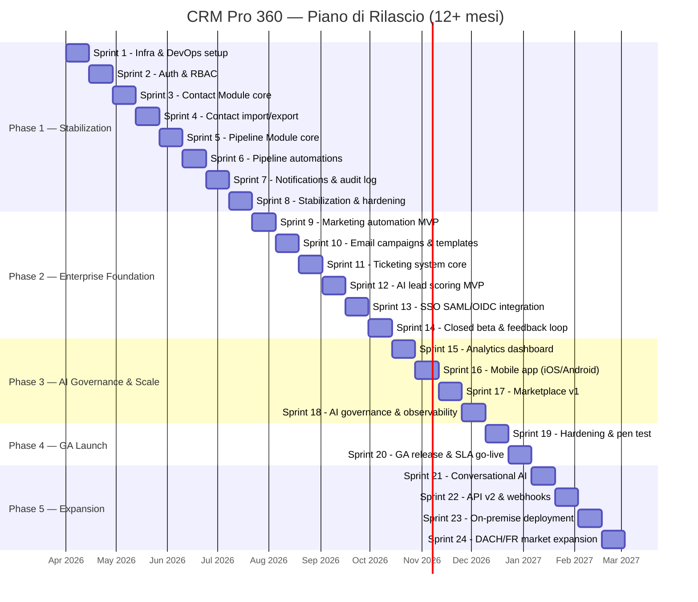
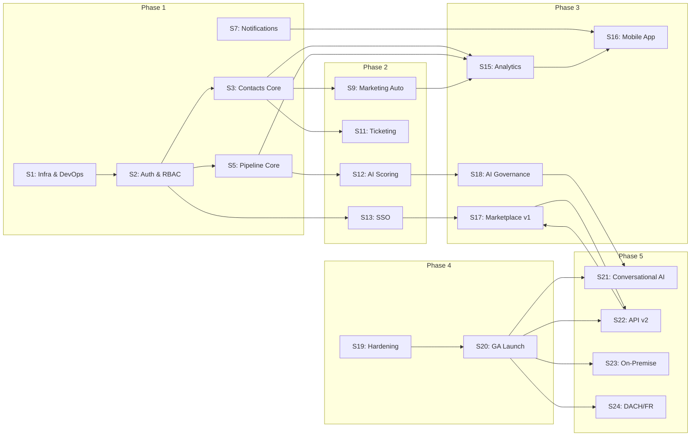

# CRM Pro 360 — Roadmap Completo

> **AI-powered Enterprise CRM** per aziende mid-enterprise europee.
> Team: 36 FTE | Sprint: 2 settimane | Velocity: 80–100 SP/sprint | Budget Anno 1: €4.2M

---

## Gantt Chart di Progetto

---

## Phase 1 — Stabilization & Foundation (M1–M4, Sprint 1–8)

**Obiettivo:** costruire le fondamenta infrastrutturali, il sistema di autenticazione multi-tenant e i moduli core (Contacts, Pipeline). Al termine di questa fase il prodotto deve essere utilizzabile internamente come dogfooding.

### Milestones

| Milestone | Sprint | Criteri di Accettazione | Owner |
|---|---|---|---|
| Infra cloud operativa | S1 | Kubernetes cluster attivo, CI/CD green su main, IaC al 100% | DevOps Lead |
| Auth multi-tenant funzionante | S2 | Login/logout, RBAC 3 ruoli, tenant isolation verificata con test e2e | Backend Lead |
| Modulo Contacts v1 | S3–S4 | CRUD completo, import CSV fino a 50k righe, ricerca full-text < 200ms | Product Owner |
| Modulo Pipeline v1 | S5–S6 | Drag-and-drop Kanban, automazioni trigger-based, calcolo forecast | Frontend Lead |
| Notifiche real-time | S7 | WebSocket push, email digest, audit log queryable | Backend Lead |
| Phase 1 sign-off | S8 | Zero P0/P1 bugs, copertura test > 70%, performance baseline rispettata | Engineering Manager |

### Deliverable per Sprint

| Sprint | Complessità | Deliverable |
|---|---|---|
| S1 | XL | Setup Kubernetes (EKS), Terraform modules, CI/CD con GitHub Actions, ambienti dev/staging/prod |
| S2 | L | Autenticazione JWT + refresh token, RBAC (admin/manager/agent), tenant isolation a livello DB |
| S3 | L | CRUD Contacts con validazione, modello dati relazionale, API REST + OpenAPI spec |
| S4 | M | Import/export CSV e Excel, deduplicazione fuzzy, merge contatti duplicati |
| S5 | XL | Pipeline Kanban con drag-and-drop, stage personalizzabili, calcolo probabilità e valore deal |
| S6 | L | Automazioni pipeline (cambio stage → email, assegnazione automatica), regole condizionali |
| S7 | M | Sistema notifiche WebSocket + fallback polling, email digest giornaliero, audit trail queryable |
| S8 | M | Bug fixing, performance profiling, load test (1000 utenti concorrenti), documentazione API v1 |

### Risk Assessment

| Rischio | Probabilità (1-5) | Impatto (1-5) | Score | Mitigazione |
|---|---|---|---|---|
| Ritardo setup infrastruttura cloud per approvazioni account AWS | 3 | 5 | 15 | Pre-approvare account AWS in settimana -2, avere fallback su GCP |
| Complessità tenant isolation sottostimata | 4 | 5 | 20 | PoC tenant isolation in settimana 1, row-level security PostgreSQL come piano B |
| Turnover sviluppatori nei primi 2 mesi | 2 | 4 | 8 | Contratti con periodo di preavviso lungo, knowledge sharing obbligatorio |
| Performance import CSV su dataset grandi (>100k righe) | 3 | 3 | 9 | Streaming parser, batch insert con COPY, job asincrono con progress bar |
| Requisiti GDPR non chiari su data residency | 3 | 4 | 12 | Consulenza legale in settimana 1, default EU-only data storage |
| Schema DB instabile con migrazioni frequenti | 2 | 4 | 8 | Prisma migration plan, review obbligatoria su ogni migration |

### Dipendenze Esterne

| Dipendenza | Necessaria entro | Stato | Responsabile |
|---|---|---|---|
| Account AWS con billing attivo | Sprint 1, giorno 1 | Da richiedere | CTO |
| Licenza GitHub Enterprise | Sprint 1, giorno 1 | Da acquistare | Engineering Manager |
| Contratto SendGrid/SES per email transazionali | Sprint 2 | Da negoziare | DevOps Lead |
| Licenza Figma per design system | Sprint 1 | Attiva | Design Lead |
| Contratto consulenza GDPR | Sprint 3 | Da stipulare | Legal |
| Licenza DataDog/Grafana Cloud per observability | Sprint 7 | Da valutare | DevOps Lead |

### Go/No-Go per Phase 2

- [ ] Zero bug P0, massimo 5 bug P1 aperti
- [ ] Test coverage backend > 70%, frontend > 60%
- [ ] Load test superato: 1000 utenti concorrenti, p95 < 500ms
- [ ] Tenant isolation verificata con penetration test interno
- [ ] API v1 documentata su Swagger e validata dal team QA
- [ ] Dogfooding interno completato (team usa il CRM per 2 settimane)

---

## Phase 2 — Enterprise Foundation (M5–M7, Sprint 9–14)

**Obiettivo:** aggiungere i moduli enterprise (marketing automation, ticketing, AI scoring), integrare SSO e raggiungere 10 clienti pilota in closed beta. Il focus si sposta dalla stabilità alla completezza funzionale.

### Milestones

| Milestone | Sprint | Criteri di Accettazione | Owner |
|---|---|---|---|
| Marketing automation MVP | S9–S10 | Creazione campagna, template editor WYSIWYG, invio schedulato, tracking open/click | Product Owner |
| Ticketing system operativo | S11 | Creazione ticket da email/form, assegnazione automatica, SLA tracking | Backend Lead |
| AI lead scoring funzionante | S12 | Modello ML addestrato su dati sintetici, scoring visibile in pipeline, accuracy > 70% | AI/ML Lead |
| SSO enterprise integrato | S13 | SAML 2.0 + OIDC, testato con Okta e Azure AD, provisioning automatico utenti | Security Lead |
| 10 clienti pilota attivi | S14 | Onboarding completato, feedback raccolto, NPS > 30 | Customer Success Lead |
| Closed beta sign-off | S14 | Tutti i moduli funzionanti end-to-end, documentazione utente v1 pronta | Engineering Manager |

### Deliverable per Sprint

| Sprint | Complessità | Deliverable |
|---|---|---|
| S9 | XL | Marketing automation engine: workflow builder, segmentazione audience, scheduling |
| S10 | L | Template editor drag-and-drop, tracking pixel, dashboard metriche campagna (open rate, CTR) |
| S11 | XL | Ticketing module: creazione da email inbound, routing rules, SLA timer, dashboard agente |
| S12 | XL | AI lead scoring: feature engineering, training pipeline, scoring API, integrazione UI pipeline |
| S13 | L | SSO SAML 2.0 + OIDC, configurazione self-service per tenant admin, JIT user provisioning |
| S14 | M | Onboarding 10 pilot customers, raccolta feedback strutturato, bug triage, minor fixes |

### Risk Assessment

| Rischio | Probabilità (1-5) | Impatto (1-5) | Score | Mitigazione |
|---|---|---|---|---|
| Accuracy modello AI insufficiente su dati reali | 4 | 4 | 16 | Preparare dataset sintetici realistici, fallback a scoring rule-based |
| Feedback clienti pilota richiede rework significativo | 3 | 4 | 12 | Selezionare clienti pilota con aspettative allineate, scope fisso per beta |
| Complessità SSO con IdP aziendali non standard | 3 | 3 | 9 | Limitare il supporto iniziale a Okta, Azure AD, Google Workspace |
| Email deliverability bassa per marketing campaigns | 3 | 4 | 12 | Domain warmup graduale, SPF/DKIM/DMARC, dedicare IP separato |
| Overload team per supporto clienti pilota + sviluppo | 4 | 3 | 12 | Dedicare 2 FTE a customer success, non sottrarre dal dev team |
| GDPR consent management incompleto per marketing | 3 | 5 | 15 | Double opt-in obbligatorio, audit trail consensi, consulenza legal |

### Go/No-Go per Phase 3

- [ ] 10 clienti pilota attivi con feedback documentato
- [ ] AI scoring accuracy > 70% su dataset di validazione
- [ ] SSO testato con almeno 3 identity provider diversi
- [ ] Zero bug P0, massimo 3 P1 aperti
- [ ] Marketing automation: almeno 100 campagne inviate con successo
- [ ] NPS clienti pilota > 30

---

## Phase 3 — AI Governance & Scale (M8–M9, Sprint 15–18)

**Obiettivo:** scalare la piattaforma per 50 aziende beta, lanciare la mobile app, il marketplace v1 e implementare governance AI completa con observability. Prepararsi per il lancio GA.

### Milestones

| Milestone | Sprint | Criteri di Accettazione | Owner |
|---|---|---|---|
| Analytics dashboard live | S15 | 15+ widget configurabili, export PDF/CSV, drill-down per tenant | Frontend Lead |
| Mobile app negli store | S16 | iOS App Store + Google Play, feature parity 80% con web, offline mode per contatti | Mobile Lead |
| Marketplace v1 operativo | S17 | SDK plugin, 5+ integrazioni native (Slack, Zapier, HubSpot, Mailchimp, Stripe), review process | Platform Lead |
| AI governance stack completo | S18 | Model registry, A/B testing, bias detection, audit trail decisioni AI, dashboard monitoring | AI/ML Lead |
| 50 aziende in beta | S18 | Onboarding automatizzato, documentazione self-service, support tier 1 operativo | Customer Success Lead |

### Deliverable per Sprint

| Sprint | Complessità | Deliverable |
|---|---|---|
| S15 | XL | Analytics engine: aggregazione dati cross-module, 15 widget predefiniti, custom dashboard builder |
| S16 | XL | Mobile app React Native: contacts, pipeline, notifications push, biometric auth, offline sync |
| S17 | L | Marketplace: plugin SDK, webhook system, OAuth2 per app terze, 5 integrazioni native |
| S18 | XL | AI governance: model versioning, A/B test framework, bias monitoring, explainability (SHAP), alerting |

### Risk Assessment

| Rischio | Probabilità (1-5) | Impatto (1-5) | Score | Mitigazione |
|---|---|---|---|---|
| Performance degradata con 50 tenant concorrenti | 3 | 5 | 15 | Load test progressivi (10→25→50), connection pooling, read replicas |
| Mobile UX non al livello della versione web | 4 | 3 | 12 | Design system condiviso, prioritizzare i 5 flussi più usati, beta TestFlight |
| Adozione marketplace lenta, pochi plugin di terze parti | 4 | 3 | 12 | Sviluppare 5 integrazioni native in-house, incentivi per early adopter |
| AI bias detection produce troppi falsi positivi | 3 | 4 | 12 | Threshold configurabili per tenant, human-in-the-loop review |
| App store rejection per privacy policy | 2 | 5 | 10 | Review legale pre-submission, privacy policy EU-compliant, ATT framework |

### Go/No-Go per Phase 4

- [ ] 50 aziende beta attive con churn < 10%
- [ ] Mobile app pubblicata su entrambi gli store con rating > 4.0
- [ ] Marketplace con almeno 5 integrazioni funzionanti
- [ ] Load test superato: 5000 utenti concorrenti, p95 < 800ms
- [ ] AI governance dashboard operativa, zero decisioni AI non tracciate
- [ ] Observability stack (metrics, logs, traces) al 100%

---

## Phase 4 — GA Launch (M10, Sprint 19–20)

**Obiettivo:** hardening finale, penetration test professionale, definizione SLA enterprise, documentazione completa e lancio pubblico (General Availability). Al termine di questa fase il prodotto è vendibile.

### Milestones

| Milestone | Sprint | Criteri di Accettazione | Owner |
|---|---|---|---|
| Penetration test superato | S19 | Zero vulnerabilità critiche/alte, report firmato da vendor esterno | Security Lead |
| Documentazione completa | S19 | User guide, admin guide, API reference, runbook operativo | Technical Writer |
| SLA enterprise definito e operativo | S20 | 99.9% uptime SLA, incident response process, escalation matrix | Engineering Manager |
| GA release | S20 | Prodotto pubblicamente disponibile, pricing live, onboarding self-service | Product Owner |
| Zero P0 bugs | S20 | Nessun bug critico aperto, backlog P1 < 3 | QA Lead |

### Deliverable per Sprint

| Sprint | Complessità | Deliverable |
|---|---|---|
| S19 | L | Penetration test esterno (OWASP Top 10), remediation vulnerabilità, chaos engineering test, documentazione completa |
| S20 | M | SLA monitoring (Statuspage), runbook operativo, onboarding self-service, pricing page, comunicato stampa, launch event |

### Risk Assessment

| Rischio | Probabilità (1-5) | Impatto (1-5) | Score | Mitigazione |
|---|---|---|---|---|
| Penetration test rivela vulnerabilità critiche non previste | 3 | 5 | 15 | Pre-scan con tool automatici (Snyk, OWASP ZAP), fix window di 2 settimane |
| Supporto non pronto per volume post-lancio | 4 | 4 | 16 | Assumere 3 support engineer pre-GA, knowledge base self-service, chatbot FAQ |
| Instabilità produzione nelle prime 48h post-launch | 3 | 5 | 15 | War room 48h, rollback plan testato, feature flags su tutte le feature nuove |
| Documentazione incompleta o non tradotta | 3 | 3 | 9 | Freeze feature in S19, dedicare 2 FTE a documentazione, review esterna |
| Pricing non competitivo rispetto a HubSpot/Salesforce | 3 | 4 | 12 | Analisi competitiva in S18, pricing test con 10 prospect, modello freemium |

### Go/No-Go per Phase 5

- [ ] GA release completata con successo
- [ ] Zero P0, zero P1 aperti
- [ ] SLA 99.9% rispettato per almeno 30 giorni
- [ ] 25+ clienti paganti attivi
- [ ] Support team operativo con tempo di risposta < 4h (business hours)
- [ ] Revenue run rate allineato con business plan

---

## Phase 5 — Marketplace & Expansion (M11–M18, Sprint 21–24+)

**Obiettivo:** espansione verso nuovi mercati (DACH, Francia), evoluzione AI conversazionale, API v2, opzione on-premise per clienti enterprise e raggiungimento di 150 clienti con marketplace maturo.

### Milestones

| Milestone | Sprint | Criteri di Accettazione | Owner |
|---|---|---|---|
| Conversational AI operativa | S21 | Chatbot integrato nel CRM, NLU per query contatti/pipeline, multi-lingua (IT/EN/DE/FR) | AI/ML Lead |
| API v2 + webhooks | S22 | REST + GraphQL, rate limiting, API key management, webhook retry con dead letter queue | Backend Lead |
| Deployment on-premise disponibile | S23 | Helm chart validato, air-gapped install testato, documentazione ops completa | DevOps Lead |
| Espansione DACH/FR | S24 | Localizzazione DE/FR completa, compliance locale, 3+ partner di canale per regione | Business Dev Lead |
| 150 clienti attivi | S24+ | Mix geografico IT/DACH/FR, ARR > €2M, churn < 5% annuo | VP Sales |
| Marketplace maturo | S24+ | 20+ plugin, revenue sharing operativo, developer portal con sandbox | Platform Lead |
| Rilascio v2.0 | S24+ | Tutte le feature enterprise, SOC 2 Type II, ISO 27001 in corso | CTO |

### Deliverable per Sprint

| Sprint | Complessità | Deliverable |
|---|---|---|
| S21 | XL | Conversational AI: NLU engine, intent detection, entity extraction, dialog manager, integrazione CRM context |
| S22 | XL | API v2: GraphQL layer, rate limiting tiered, API key lifecycle, webhook system con retry e DLQ |
| S23 | XL | On-premise: Helm chart, operator Kubernetes, installer offline, licencing server, migration tool cloud→on-prem |
| S24 | L | Localizzazione DE/FR, adattamento fiscale/legale, partnership canale, materiale marketing localizzato |

### Risk Assessment

| Rischio | Probabilità (1-5) | Impatto (1-5) | Score | Mitigazione |
|---|---|---|---|---|
| Product-market fit diverso in DACH/FR rispetto a Italia | 4 | 4 | 16 | Ricerca di mercato locale pre-entry, MVP localizzato, pivot rapido se NPS < 20 |
| Domanda on-premise richiede supporto ops dedicato costoso | 3 | 4 | 12 | Pricing on-premise 3x cloud, contratto support obbligatorio, limite clienti on-prem |
| Conversational AI: allucinazioni su dati CRM sensibili | 3 | 5 | 15 | RAG con retrieval verificato, guardrails output, human review su azioni mutative |
| Complessità API v2 retrocompatibilità con v1 | 3 | 3 | 9 | Versioning URL-based, deprecation policy 12 mesi, migration guide automatica |
| Marketplace: plugin di bassa qualità danneggiano brand | 3 | 4 | 12 | Review process obbligatorio, sandbox testing, rating system, revocation policy |

---

## Cross-Phase Dependencies

### Diagramma delle Dipendenze

### Analisi del Critical Path

Il percorso critico attraversa le seguenti dipendenze sequenziali, dove un ritardo in uno qualsiasi di questi elementi ritarda il GA launch:

| Step | Elemento | Motivo di Criticità |
|---|---|---|
| 1 | S1 — Infra setup | Tutto dipende dall'infrastruttura cloud |
| 2 | S2 — Auth & RBAC | Nessun modulo funziona senza autenticazione |
| 3 | S5 — Pipeline core | Il modulo pipeline è prerequisito per AI scoring |
| 4 | S12 — AI lead scoring | Funzionalità differenziante, richiede dati pipeline |
| 5 | S18 — AI governance | Non si può andare in GA con AI non governata |
| 6 | S19 — Hardening | Penetration test obbligatorio per enterprise |
| 7 | S20 — GA launch | Rilascio pubblico |

**Durata critical path:** 14 sprint (28 settimane) — nessun margine di buffer.

### Workstream Paralleli

| Workstream | Sprint | Dipendenze |
|---|---|---|
| **Contacts + Import** | S3–S4 | Dipende solo da Auth (S2) |
| **Pipeline + Automations** | S5–S6 | Dipende solo da Auth (S2), parallelizzabile con Contacts |
| **Marketing + Ticketing** | S9–S11 | Parallelizzabili dopo Contacts (S3) |
| **Mobile + Marketplace** | S16–S17 | Parallelizzabili dopo Analytics (S15) |
| **API v2 + On-Premise** | S22–S23 | Parallelizzabili dopo GA (S20) |

---

## Resource Allocation

### Allocazione Team per Fase (FTE)

| Ruolo | Phase 1 (S1–S8) | Phase 2 (S9–S14) | Phase 3 (S15–S18) | Phase 4 (S19–S20) | Phase 5 (S21–S24) |
|---|---|---|---|---|---|
| Backend Engineer | 8 | 8 | 6 | 4 | 6 |
| Frontend Engineer | 6 | 6 | 5 | 3 | 4 |
| Mobile Engineer | 0 | 0 | 4 | 2 | 2 |
| AI/ML Engineer | 0 | 3 | 4 | 2 | 4 |
| DevOps/SRE | 4 | 3 | 3 | 3 | 3 |
| QA Engineer | 4 | 4 | 4 | 4 | 3 |
| Security Engineer | 1 | 1 | 1 | 3 | 1 |
| UX/UI Designer | 3 | 3 | 3 | 1 | 2 |
| Product Owner | 2 | 2 | 2 | 2 | 2 |
| Technical Writer | 0 | 1 | 1 | 3 | 2 |
| Engineering Manager | 2 | 2 | 2 | 2 | 2 |
| Scrum Master | 2 | 2 | 2 | 2 | 2 |
| **Totale** | **32** | **35** | **37** | **31** | **33** |

### Piano di Assunzione

| Ruolo | Quando | Motivo |
|---|---|---|
| 3 AI/ML Engineer | Inizio Phase 2 (M5) | AI lead scoring, NLP, governance richiede competenze specialistiche |
| 4 Mobile Engineer | Inizio Phase 3 (M8) | Sviluppo app React Native iOS/Android |
| 2 Technical Writer | Metà Phase 2 (M6) | Documentazione utente e API pre-beta |
| 1 Security Engineer aggiuntivo | Inizio Phase 4 (M10) | Penetration test e hardening pre-GA |
| 3 Support Engineer | Fine Phase 3 (M9) | Preparazione supporto clienti post-GA |

### Budget Burn Rate per Fase

| Fase | Durata | FTE medio | Costo personale | Infra & licenze | Totale | Cumulativo |
|---|---|---|---|---|---|---|
| Phase 1 | 4 mesi | 32 | €640K | €120K | €760K | €760K |
| Phase 2 | 3 mesi | 35 | €525K | €150K | €675K | €1,435K |
| Phase 3 | 2 mesi | 37 | €370K | €180K | €550K | €1,985K |
| Phase 4 | 1 mese | 31 | €155K | €100K | €255K | €2,240K |
| Phase 5 | 4+ mesi | 33 | €660K | €200K | €860K | €3,100K |
| **Contingency (15%)** | — | — | — | — | **€465K** | **€3,565K** |
| **Marketing & Sales** | — | — | — | — | **€635K** | **€4,200K** |

> **Nota:** il budget di €4.2M include contingency del 15% e €635K per attività marketing/sales (launch event, materiale, primi sales hire).

---

## Decision Log Template

Decisioni architetturali chiave da prendere prima di ogni fase. Ogni decisione va documentata con owner, deadline, opzioni valutate e raccomandazione.

### Decisioni Pre-Phase 1

| ID | Decisione | Owner | Deadline | Opzioni | Raccomandazione |
|---|---|---|---|---|---|
| D-001 | Cloud provider primario | CTO | S1, giorno 1 | AWS, GCP, Azure | AWS — ecosistema più maturo per enterprise EU, region eu-south-1 (Milano) |
| D-002 | Database primario | Backend Lead | S1, giorno 3 | PostgreSQL, CockroachDB, Aurora | Aurora PostgreSQL — managed, auto-scaling, compatibile Prisma |
| D-003 | Framework frontend | Frontend Lead | S1, giorno 3 | Next.js, Remix, Nuxt | Next.js 15 — SSR, ecosistema React, team già competente |
| D-004 | Strategia multi-tenant | Backend Lead | S1, giorno 5 | Schema-per-tenant, row-level security, database-per-tenant | Row-level security — bilanciamento costi/isolamento per mid-enterprise |
| D-005 | Message broker | DevOps Lead | S1, giorno 5 | Redis/BullMQ, RabbitMQ, Amazon SQS | BullMQ — già noto al team, sufficiente per volumi Phase 1-3 |
| D-006 | Observability stack | DevOps Lead | S1, giorno 7 | DataDog, Grafana Cloud, self-hosted | Grafana Cloud — costo inferiore a DataDog, nessun lock-in |

### Decisioni Pre-Phase 2

| ID | Decisione | Owner | Deadline | Opzioni | Raccomandazione |
|---|---|---|---|---|---|
| D-007 | ML framework per scoring | AI/ML Lead | S9, giorno 1 | scikit-learn + FastAPI, SageMaker, Vertex AI | SageMaker — integrazione AWS, managed training, endpoint hosting |
| D-008 | Email service provider per marketing | Product Owner | S9, giorno 1 | SendGrid, Amazon SES, Mailgun | Amazon SES — costo basso per volumi alti, integrazione AWS nativa |
| D-009 | SSO library/service | Security Lead | S12, giorno 1 | Auth0, WorkOS, custom SAML | WorkOS — SSO enterprise out-of-box, pricing per-connection |
| D-010 | Strategia feedback collection | Product Owner | S14, giorno 1 | In-app survey, Typeform, Intercom | In-app NPS widget custom — nessuna dipendenza esterna, dati first-party |

### Decisioni Pre-Phase 3

| ID | Decisione | Owner | Deadline | Opzioni | Raccomandazione |
|---|---|---|---|---|---|
| D-011 | Framework mobile | Mobile Lead | S15, giorno 1 | React Native, Flutter, nativo | React Native — code sharing con web, team JavaScript-first |
| D-012 | Plugin SDK architecture | Platform Lead | S16, giorno 1 | iframe sandbox, Web Components, server-side | iframe sandbox — isolamento sicuro, API postMessage |
| D-013 | AI model registry | AI/ML Lead | S17, giorno 1 | MLflow, custom, SageMaker Model Registry | MLflow — open source, standard de facto, self-hosted |
| D-014 | Bias detection approach | AI/ML Lead | S17, giorno 5 | Fairlearn, custom metrics, AI Fairness 360 | Fairlearn — integrazione Python, metriche standard, community attiva |

### Decisioni Pre-Phase 4

| ID | Decisione | Owner | Deadline | Opzioni | Raccomandazione |
|---|---|---|---|---|---|
| D-015 | Vendor penetration test | Security Lead | S18, giorno 1 | Cure53, HackerOne, Bishop Fox | Cure53 — esperienza EU enterprise, report compliance-ready |
| D-016 | Status page service | DevOps Lead | S19, giorno 1 | Statuspage (Atlassian), Instatus, custom | Instatus — costo inferiore, API completa, branding custom |
| D-017 | Pricing model finale | Product Owner | S19, giorno 5 | Per-seat, per-module, usage-based, hybrid | Hybrid per-seat + moduli — prevedibilità per clienti, upsell per noi |

### Decisioni Pre-Phase 5

| ID | Decisione | Owner | Deadline | Opzioni | Raccomandazione |
|---|---|---|---|---|---|
| D-018 | LLM provider per Conversational AI | AI/ML Lead | S20, giorno 1 | OpenAI, Anthropic, Mistral, self-hosted | Mistral — EU data residency nativa, costi competitivi, API compatibile |
| D-019 | GraphQL engine | Backend Lead | S21, giorno 1 | Apollo Server, Mercurius, Pothos | Pothos — type-safe con Prisma, NestJS integration |
| D-020 | On-premise packaging | DevOps Lead | S22, giorno 1 | Helm + operator, Docker Compose, Replicated | Helm + custom operator — standard Kubernetes, controllo totale |
| D-021 | Strategia certificazioni | CTO | S22, giorno 1 | SOC 2 first, ISO 27001 first, entrambe in parallelo | SOC 2 Type II prima — richiesta da clienti US/enterprise, ISO 27001 a seguire |

---

## Riepilogo Esecutivo

| Metrica | Target |
|---|---|
| Durata totale Phase 1–4 (MVP → GA) | 10 mesi (20 sprint) |
| Durata totale con Phase 5 | 18 mesi (24+ sprint) |
| Budget Anno 1 | €4.2M |
| Team peak (Phase 3) | 37 FTE |
| Clienti GA launch | 25+ |
| Clienti fine Anno 1 | 150 |
| Uptime SLA | 99.9% |
| Sprint velocity target | 80–100 SP/sprint |
