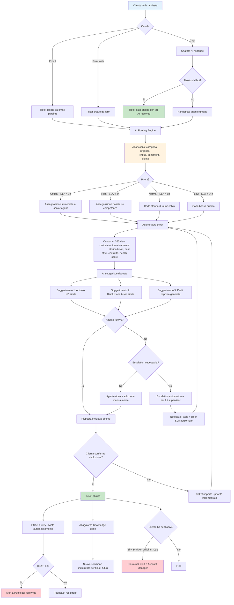
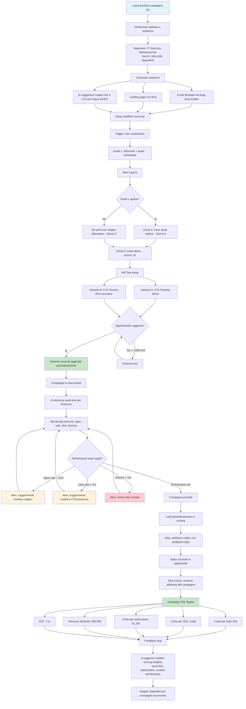

# CRM Pro 360 — Product Requirements Document (PRD)

**Versione:** 1.0
**Data:** 2026-03-24
**Stato:** Draft Approvato
**Owner:** Product Management
**Stakeholders:** Engineering, Sales, Marketing, Customer Success, Legal & Compliance

---

## Indice

1. [Panoramica Prodotto](#1-panoramica-prodotto)
2. [Mercato Target](#2-mercato-target)
3. [Personas](#3-personas)
4. [Requisiti Funzionali](#4-requisiti-funzionali)
5. [Requisiti Non-Funzionali](#5-requisiti-non-funzionali)
6. [User Journeys](#6-user-journeys)
7. [Pricing & Packaging](#7-pricing--packaging)
8. [Success Metrics](#8-success-metrics)
9. [Vincoli e Assunzioni](#9-vincoli-e-assunzioni)
10. [Criteri di Accettazione del Prodotto](#10-criteri-di-accettazione-del-prodotto)

---

## 1. Panoramica Prodotto

### Vision Statement

Diventare la piattaforma CRM di riferimento per le mid-enterprise europee, combinando intelligenza artificiale, conformità normativa nativa e un'esperienza utente che elimina la complessità operativa tipica delle soluzioni enterprise americane sovradimensionate.

### Mission

Fornire alle aziende europee di medie dimensioni uno strumento CRM completo, conforme al GDPR e all'AI Act, che unifichi vendite, marketing e customer service in una piattaforma alimentata da AI contestuale — riducendo il time-to-value da mesi a giorni.

### Proposta di Valore Unica

CRM Pro 360 è l'unico CRM enterprise progettato nativamente per il mercato europeo mid-enterprise: compliance GDPR/AI Act by design, AI che parla la lingua del business europeo (multilingua, multi-valuta, multi-fiscalità), e un TCO inferiore del 40% rispetto a Salesforce per aziende tra 100 e 2000 dipendenti.

### Problema Risolto

| # | Pain Point | Impatto sul Business |
|---|-----------|---------------------|
| 1 | **Soluzioni enterprise sovradimensionate e costose.** Salesforce e Dynamics richiedono consulenti dedicati, mesi di implementazione e costi di licenza sproporzionati per aziende sotto i 2000 dipendenti. | TCO medio di €150K-500K/anno, ROI negativo nei primi 18 mesi. |
| 2 | **GDPR compliance come afterthought.** I CRM americani trattano la conformità europea come un add-on, costringendo le aziende a integrazioni terze per data residency, consenso granulare e diritto all'oblio. | Rischio sanzioni fino al 4% del fatturato globale, costi legali ricorrenti. |
| 3 | **Silos tra Sales, Marketing e Customer Service.** Le PMI europee usano 3-5 strumenti separati (CRM + email marketing + helpdesk + analytics + BI), con dati frammentati e nessuna visione unificata del cliente. | 20-30% del tempo dei team speso in riconciliazione dati, opportunità di cross-sell perse. |
| 4 | **AI generica e non contestuale.** Le funzionalità AI dei CRM esistenti sono addestrate su pattern americani, ignorano le specificità del mercato europeo (cicli di vendita più lunghi, relazioni B2B multi-stakeholder, stagionalità diversa). | Previsioni di vendita inaccurate, lead scoring inutilizzabile, adozione AI sotto il 15%. |
| 5 | **Localizzazione superficiale.** Interfacce tradotte ma non localizzate: formati data/valuta errati, mancanza di integrazioni con sistemi fiscali europei (SDI, ZUGFeRD), nessun supporto per le specificità contrattuali B2B europee. | Workaround manuali, errori di fatturazione, frizione nell'adozione. |

### Soluzione

| Pain Point | Come CRM Pro 360 lo risolve |
|-----------|---------------------------|
| Soluzioni sovradimensionate | Architettura modulare: attivi solo i moduli che servono. Onboarding guidato da AI in 48 ore. Pricing trasparente senza costi nascosti di implementazione. |
| GDPR come afterthought | Privacy by design: data residency EU nativa (Frankfurt, Amsterdam, Milano), consenso granulare integrato nel contact management, DSAR automation, audit trail completo, AI Act compliance con explainability layer. |
| Silos tra dipartimenti | Piattaforma unificata con customer 360 view: ogni interazione (email, call, ticket, campagna, deal) visibile in un unico profilo. Event bus in real-time tra moduli. |
| AI generica | AI Engine addestrato su dataset europei, con modelli specifici per vertical (manufacturing, professional services). Supporto multilingua nativo (IT, DE, FR, ES, EN). Forecasting calibrato su cicli di vendita B2B europei. |
| Localizzazione superficiale | Multi-valuta con tassi BCE in tempo reale, integrazione SDI per fatturazione elettronica italiana, ZUGFeRD per DACH, formati fiscali per paese, template contrattuali per giurisdizione. |

---

## 2. Mercato Target

### Segmento Primario

**Mid-enterprise europee** con 100-2000 dipendenti, fatturato annuo €10M-€500M, con team commerciali strutturati (5-50 venditori) e necessità di digitalizzazione dei processi CRM.

### Vertical Target

| Priorità | Verticale | Dimensione Media | Caratteristiche CRM |
|----------|-----------|------------------|-------------------|
| 1 | **Manufacturing** | 200-1000 dip. | Cicli vendita lunghi (6-18 mesi), configuratore prodotto, gestione distributori, forecasting produzione-vendite |
| 2 | **Professional Services** | 100-500 dip. | Time tracking, project-based selling, resource allocation, proposal management |
| 3 | **Technology (B2B SaaS/IT)** | 100-800 dip. | Product-led growth + sales-assisted, usage tracking, renewal management, partner channel |
| 4 | **Financial Services** | 150-1000 dip. | Compliance KYC/AML, portfolio management, advisor productivity, regulatory reporting |
| 5 | **Healthcare** | 200-2000 dip. | HCP engagement, medical affairs, sample management, pharmacovigilance integration |

### Geografie e Fasi di Espansione

| Fase | Mercato | Timeline | Lingua UI | Lingua AI | Fiscalità |
|------|---------|----------|-----------|-----------|-----------|
| 1 | Italia (primario) | Q1 2027 | IT, EN | IT, EN | SDI, F24 |
| 2 | DACH (secondario) | Q3 2027 | DE, EN | DE, EN | ZUGFeRD, DATEV |
| 3 | Francia (terziario) | Q1 2028 | FR, EN | FR, EN | Factur-X, DGFiP |
| 4 | Spagna, UK (espansione) | Q3 2028 | ES, EN | ES, EN | SII, MTD |

### TAM / SAM / SOM Analysis

**Total Addressable Market (TAM):**
- Aziende europee 100-2000 dipendenti: ~320.000 imprese (Eurostat 2025)
- Spesa media CRM/anno per segmento: €35.000
- **TAM = €11.2B**

**Serviceable Addressable Market (SAM):**
- Mercati target (IT, DACH, FR, ES, UK): ~145.000 imprese
- Vertical target (5 settori): ~58.000 imprese
- Spesa media CRM/anno: €42.000 (segmento più digitalizzato)
- **SAM = €2.4B**

**Serviceable Obtainable Market (SOM):**
- Obiettivo 3 anni: 1.5% market share nel SAM
- ~870 clienti con ARPA €28.000/anno
- **SOM = €24.4M ARR** (Year 3)

### Competitor Landscape

| Dimensione | CRM Pro 360 | Salesforce | HubSpot | Dynamics 365 | Pipedrive | Zoho CRM |
|-----------|-------------|-----------|---------|-------------|-----------|----------|
| **Target** | Mid-enterprise EU | Enterprise globale | SMB-Mid | Enterprise | SMB | SMB-Mid |
| **Pricing /user/mese** | €49-€89+ | €150-€330 | €45-€150 | €65-€210 | €49-€99 | €14-€52 |
| **GDPR nativo** | By design | Add-on | Parziale | Add-on | Basico | Parziale |
| **AI Act compliance** | Nativo | Roadmap | No | Roadmap | No | No |
| **Data residency EU** | Nativo (3 region) | Extra cost | Solo DE | Azure EU | AWS EU | Limitato |
| **Localizzazione fiscale** | SDI, ZUGFeRD, Factur-X | Via partner | No | Via partner | No | Parziale |
| **AI contestuale EU** | Multilingua nativo | Einstein (EN-first) | AI basica | Copilot (EN-first) | AI basica | Zia (limitata) |
| **Time-to-value** | 2-5 giorni | 3-12 mesi | 1-4 settimane | 2-6 mesi | 1-2 giorni | 1-2 settimane |
| **Moduli integrati** | Sales+Mkt+CS+AI | Modulare costoso | Mkt+Sales+CS | Modulare | Solo Sales | Tutto ma basico |

**Posizionamento competitivo:** CRM Pro 360 si posiziona nel quadrante "Enterprise capability, Mid-market simplicity" — funzionalità comparabili a Salesforce/Dynamics senza la complessità e il costo, superiore a HubSpot/Pipedrive per compliance e AI, più profondo di Zoho per vertical europei.

---

## 3. Personas

### Marco — Sales Director (45 anni)

**Profilo:** Direttore commerciale di un'azienda manifatturiera di 400 dipendenti a Brescia. Gestisce un team di 15 venditori distribuiti tra Italia e DACH. Fatturato sotto responsabilità: €35M/anno.

**Obiettivi:**
- Raggiungere il target di vendita trimestrale con previsioni affidabili
- Ridurre il ciclo di vendita medio da 9 a 6 mesi
- Aumentare il win rate dal 22% al 30%
- Avere visibilità real-time sulla pipeline senza dipendere da report manuali

**Frustrazioni:**
- I venditori aggiornano il CRM attuale (Salesforce) solo a fine settimana, i dati sono sempre stale
- Le previsioni di vendita sono basate su "gut feeling" mascherato da percentuali inventate
- Non riesce a identificare quali deal sono realmente a rischio finché non è troppo tardi
- Paga €180K/anno di licenze Salesforce per funzionalità che usa al 30%

**Needs:**
- Dashboard pipeline aggiornata in tempo reale con deal health scoring
- AI che analizzi pattern storici per prevedere close probability reale
- Mobile app che permetta ai venditori di aggiornare deal in 30 secondi dopo ogni meeting
- Alert proattivi su deal stagnanti o a rischio

**Giornata Tipo:**
- 08:00 — Controlla dashboard pipeline sul telefono durante il caffè
- 09:00 — Weekly pipeline review con il team: guarda forecast e deal a rischio
- 10:00-12:00 — Call con clienti enterprise, aggiorna note direttamente da mobile
- 14:00 — Meeting con marketing per allineamento lead quality
- 15:00 — Coaching 1:1 con venditori junior, analisi win/loss
- 17:00 — Review previsioni per il board meeting del giorno dopo

**Feature principali:** Pipeline management, AI deal scoring, Forecast engine, Mobile app, Activity tracking, Win/loss analysis

> **Quote:** *"Ho bisogno di visibilità in tempo reale sulla pipeline senza dover chiedere report. Quando arrivo al board meeting, voglio numeri di cui mi fido."*

---

### Laura — Marketing Manager (35 anni)

**Profilo:** Marketing Manager in un'azienda SaaS B2B di 200 dipendenti a Milano. Gestisce un team di 5 persone con budget annuo di €400K. Responsabile di lead generation e brand awareness per il mercato italiano e francese.

**Obiettivi:**
- Generare 500 MQL/mese con costo per lead sotto €80
- Dimostrare il contributo del marketing al revenue (marketing-attributed revenue)
- Ridurre il tempo di creazione campagne da 2 settimane a 3 giorni
- Migliorare il conversion rate MQL-to-SQL dal 15% al 25%

**Frustrazioni:**
- Usa 4 strumenti separati (HubSpot marketing, Salesforce CRM, Google Analytics, Mailchimp) con dati mai allineati
- Non riesce a tracciare l'attribuzione revenue end-to-end: sa quanti click genera ma non quanti deal chiude
- Il team sales si lamenta della qualità dei lead ma non c'è un feedback loop strutturato
- Ogni campagna multilingua (IT/FR) richiede duplicazione manuale di contenuti e workflow

**Needs:**
- Piattaforma unica per campaign management, lead nurturing e analytics
- Attribution model multi-touch che colleghi campagne a revenue chiuso
- AI che suggerisca contenuti e ottimizzi delivery time per lingua/mercato
- A/B testing nativo con significatività statistica automatica

**Giornata Tipo:**
- 08:30 — Review performance campagne attive, check anomalie
- 09:30 — Briefing con il team: pianificazione contenuti settimanali
- 10:30 — Creazione campagna email nurturing per segmento enterprise IT
- 12:00 — Call con agenzia per campagna paid (LinkedIn Ads)
- 14:00 — Analisi funnel MQL-SQL con il team sales
- 15:30 — Setup A/B test su landing page
- 17:00 — Report mensile per il CEO: ROI marketing

**Feature principali:** Campaign builder drag-drop, Marketing analytics, Lead nurturing workflows, A/B testing, Multi-channel attribution, AI content suggestions

> **Quote:** *"Voglio sapere quali campagne generano davvero revenue, non solo click. E voglio saperlo senza dover incrociare 4 fogli Excel."*

---

### Paolo — Customer Service Lead (38 anni)

**Profilo:** Responsabile Customer Service di un'azienda di servizi finanziari con 600 dipendenti a Roma. Gestisce 12 agenti di supporto che coprono clienti in Italia e Spagna. Volume: ~2000 ticket/mese.

**Obiettivi:**
- Mantenere il first response time sotto i 2 minuti per ticket prioritari
- Raggiungere CSAT > 4.5/5 costantemente
- Ridurre il tempo medio di risoluzione da 4 ore a 90 minuti
- Diminuire il volume di ticket ripetitivi del 40% con self-service

**Frustrazioni:**
- Gli agenti impiegano 20-30 minuti per ricostruire la storia di ogni cliente (dati sparsi tra CRM, email, ticketing)
- Non c'è collegamento tra ticket di supporto e opportunità commerciali: un cliente che apre 5 ticket critici potrebbe essere in fase di rinnovo
- La knowledge base attuale è un wiki non mantenuto dove nessuno trova nulla
- Mancano metriche SLA per cliente/contratto: ogni escalation è gestita "a sensazione"

**Needs:**
- Vista unificata del cliente con storico completo (ticket, deal, interazioni, contratto)
- AI che suggerisca risposte basate sulla knowledge base e ticket simili risolti
- SLA monitoring automatico con alert prima della violazione, non dopo
- Collegamento bidirezionale tra ticket e opportunità commerciali (churn risk)

**Giornata Tipo:**
- 08:00 — Check ticket overnight: prioritizzazione e assegnazione
- 09:00 — Standup con gli agenti: review ticket critici e SLA a rischio
- 10:00-12:00 — Gestione escalation dirette, call con clienti premium
- 13:30 — Aggiornamento knowledge base con soluzioni nuove
- 14:30 — Analisi CSAT e trend ticket per categoria
- 16:00 — Meeting con Product per feedback ricorrenti dei clienti
- 17:00 — Review SLA compliance settimanale

**Feature principali:** Ticketing system, Knowledge base AI-powered, SLA monitoring, CSAT surveys, Customer 360 view, Churn risk alerts

> **Quote:** *"I miei agenti perdono 30 minuti a cercare informazioni su ogni cliente. Se avessi tutto in un'unica schermata, potrei risolvere i ticket in metà del tempo."*

---

### Chiara — CTO / IT Director (42 anni)

**Profilo:** CTO di un'azienda tecnologica di 350 dipendenti a Torino. Responsabile dell'infrastruttura IT, della sicurezza e della scelta delle piattaforme aziendali. Budget IT: €1.2M/anno.

**Obiettivi:**
- Consolidare lo stack applicativo da 12 a 6 strumenti entro 18 mesi
- Garantire GDPR compliance al 100% su tutti i sistemi che trattano dati personali
- Ridurre il tempo di onboarding nuovi strumenti da 3 mesi a 2 settimane
- Mantenere uptime > 99.9% per tutti i sistemi business-critical

**Frustrazioni:**
- Ogni nuovo strumento SaaS richiede mesi di security review, legal review e integrazione SSO
- I vendor americani trattano la data residency europea come feature premium con costi aggiuntivi
- Le API dei CRM esistenti sono mal documentate e cambiano senza preavviso (breaking changes Salesforce)
- Il DPO la tartassa ogni trimestre con richieste di audit trail che nessuno strumento genera nativamente

**Needs:**
- API RESTful ben documentata con versioning stabile e webhook
- SSO (SAML 2.0, OIDC) e SCIM provisioning nativi senza costi aggiuntivi
- Data residency EU garantita contrattualmente con audit trail esportabile
- Admin console per gestire permessi, data retention policy e compliance settings

**Giornata Tipo:**
- 08:00 — Review alert di sicurezza e uptime dashboard
- 09:00 — Meeting con il team infrastruttura: pianificazione sprint
- 10:30 — Security review di un nuovo vendor SaaS
- 12:00 — Call con il DPO: revisione trimestrale GDPR
- 14:00 — Architettura integrazione nuovo CRM con ERP aziendale
- 15:30 — Review API documentation e test di integrazione
- 17:00 — Budget review: analisi TCO piattaforme

**Feature principali:** Admin console, REST API, SSO/SCIM, Security & compliance dashboard, Audit logs, Data retention policies, Webhook management, Integration marketplace

> **Quote:** *"Devo garantire GDPR compliance senza sacrificare l'agilità del team. Non voglio un altro Salesforce che richiede un admin dedicato full-time."*

---

## 4. Requisiti Funzionali

### 4.1 Contacts & Accounts

| ID | Requisito | Priorità | Persona | Fase |
|----|-----------|----------|---------|------|
| CA-01 | Gestione contatti con campi standard (nome, email, telefono, azienda, ruolo) e custom fields illimitati | Must | Tutti | 1 |
| CA-02 | Gestione account/azienda con gerarchia (parent-child) per gruppi aziendali | Must | Marco | 1 |
| CA-03 | Deduplicazione automatica contatti basata su AI fuzzy matching (nome, email, telefono) | Must | Laura | 1 |
| CA-04 | Import/export CSV, Excel con mapping campi intelligente | Must | Tutti | 1 |
| CA-05 | Timeline attività unificata per contatto: email, call, meeting, ticket, deal, campagna | Must | Paolo | 1 |
| CA-06 | Tagging e segmentazione dinamica con filtri combinati (AND/OR/NOT) | Must | Laura | 1 |
| CA-07 | GDPR consent management: tracciamento consenso per finalità con audit trail | Must | Chiara | 1 |
| CA-08 | Diritto all'oblio automatizzato (DSAR): anonimizzazione dati con preservazione aggregati | Must | Chiara | 1 |
| CA-09 | Arricchimento contatti automatico da fonti pubbliche (LinkedIn, registri camerali) | Should | Laura | 2 |
| CA-10 | Relationship mapping: visualizzazione grafo relazioni tra contatti e account | Should | Marco | 2 |
| CA-11 | Smart lists con aggiornamento automatico basato su criteri dinamici | Should | Laura | 2 |
| CA-12 | Activity scoring: punteggio automatico basato su engagement (email aperte, pagine visitate, meeting) | Must | Laura | 1 |
| CA-13 | Merge contatti con preservazione storico completo e scelta campo-per-campo | Must | Tutti | 1 |
| CA-14 | Contact ownership e territory management con regole di assegnazione automatica | Should | Marco | 2 |
| CA-15 | Vista Kanban per contatti con drag-drop tra segmenti lifecycle (Lead, MQL, SQL, Customer, Churned) | Could | Laura | 3 |
| CA-16 | Integrazione rubrica telefonica mobile con sync bidirezionale | Should | Marco | 2 |

### 4.2 Pipeline & Deals

| ID | Requisito | Priorità | Persona | Fase |
|----|-----------|----------|---------|------|
| PD-01 | Pipeline personalizzabili multiple con stage configurabili e probabilità per stage | Must | Marco | 1 |
| PD-02 | Deal card con campi standard (valore, close date, stage, owner) e custom fields | Must | Marco | 1 |
| PD-03 | Vista Kanban pipeline con drag-drop tra stage e aggiornamento automatico probabilità | Must | Marco | 1 |
| PD-04 | AI deal scoring: probabilità di chiusura basata su pattern storici (attività, engagement, timing) | Must | Marco | 1 |
| PD-05 | Forecast engine: previsione revenue per periodo con intervalli di confidenza e scenario analysis | Must | Marco | 1 |
| PD-06 | Alert automatici su deal stagnanti (nessuna attività per N giorni configurabili) | Must | Marco | 1 |
| PD-07 | Weighted pipeline view: valore pipeline pesato per probabilità di chiusura | Must | Marco | 1 |
| PD-08 | Multi-valuta con conversione automatica ai tassi BCE aggiornati quotidianamente | Must | Marco | 1 |
| PD-09 | Proposal/quote generation con template personalizzabili e firma elettronica integrata | Should | Marco | 2 |
| PD-10 | Win/loss analysis con categorizzazione motivi e trend reporting | Should | Marco | 2 |
| PD-11 | Sales playbook: checklist attività suggerite per stage con best practice | Should | Marco | 2 |
| PD-12 | Competitor tracking per deal con matrice comparativa | Could | Marco | 3 |
| PD-13 | Revenue recognition rules configurabili per tipo di deal (one-time, recurring, usage-based) | Should | Marco | 2 |
| PD-14 | Deal cloning per rinnovi e upsell con pre-compilazione dati | Should | Marco | 2 |

### 4.3 Marketing Automation

| ID | Requisito | Priorità | Persona | Fase |
|----|-----------|----------|---------|------|
| MA-01 | Campaign builder drag-drop per email, con template responsive e contenuti dinamici | Must | Laura | 1 |
| MA-02 | Lead nurturing workflow visuali: trigger, condizioni, azioni, delay, branching | Must | Laura | 1 |
| MA-03 | Lead scoring configurabile con pesi per attributi demografici e comportamentali | Must | Laura | 1 |
| MA-04 | A/B testing nativo su subject, contenuto, send time con calcolo significatività statistica | Must | Laura | 2 |
| MA-05 | Multi-channel attribution model (first touch, last touch, linear, time decay, custom) | Must | Laura | 2 |
| MA-06 | Landing page builder con form integrati e tracking UTM automatico | Should | Laura | 2 |
| MA-07 | Email deliverability monitoring: bounce rate, spam score, domain reputation | Must | Laura | 1 |
| MA-08 | Segmentazione audience dinamica basata su comportamento real-time (pagine visitate, email aperte) | Must | Laura | 1 |
| MA-09 | AI send time optimization: invio automatico nel momento ottimale per timezone e comportamento storico | Should | Laura | 2 |
| MA-10 | Campaign ROI reporting con calcolo costo per lead, costo per opportunità, costo per deal chiuso | Must | Laura | 2 |
| MA-11 | Consent-aware marketing: blocco automatico invio a contatti senza consenso marketing attivo | Must | Chiara | 1 |
| MA-12 | AI content suggestions: generazione subject line, body copy e CTA ottimizzati per lingua e segmento | Could | Laura | 3 |

### 4.4 Customer Service

| ID | Requisito | Priorità | Persona | Fase |
|----|-----------|----------|---------|------|
| CS-01 | Ticketing system multi-canale: email, form web, chat, telefono (log manuale) | Must | Paolo | 1 |
| CS-02 | SLA management: definizione SLA per cliente/contratto/priorità con timer e alert automatici | Must | Paolo | 1 |
| CS-03 | Knowledge base con ricerca full-text, categorizzazione e versioning articoli | Must | Paolo | 1 |
| CS-04 | AI suggested responses: suggerimenti risposta basati su knowledge base e ticket simili risolti | Must | Paolo | 2 |
| CS-05 | CSAT survey automatiche post-risoluzione con NPS tracking | Must | Paolo | 1 |
| CS-06 | Routing automatico ticket basato su categoria, lingua, competenze agente e carico di lavoro | Must | Paolo | 1 |
| CS-07 | Escalation rules configurabili con notifica automatica a supervisori | Must | Paolo | 1 |
| CS-08 | Customer 360 view nel ticket: storico completo interazioni, deal attivi, contratto, health score | Must | Paolo | 1 |
| CS-09 | Churn risk alert: notifica automatica quando pattern di ticket indicano rischio abbandono | Should | Paolo | 2 |
| CS-10 | Self-service portal per clienti: creazione ticket, consultazione knowledge base, tracking status | Should | Paolo | 2 |
| CS-11 | Chatbot AI per first-level support con handoff ad agente umano | Could | Paolo | 3 |

### 4.5 Analytics & BI

| ID | Requisito | Priorità | Persona | Fase |
|----|-----------|----------|---------|------|
| AB-01 | Dashboard personalizzabili con widget drag-drop (chart, KPI, table, funnel) | Must | Tutti | 1 |
| AB-02 | Report builder con filtri, grouping, aggregazioni e export PDF/Excel | Must | Tutti | 1 |
| AB-03 | Sales analytics: pipeline velocity, conversion rates per stage, win/loss rate, quota attainment | Must | Marco | 1 |
| AB-04 | Marketing analytics: campaign performance, funnel MQL-SQL-Close, attribution, ROI | Must | Laura | 2 |
| AB-05 | Service analytics: SLA compliance, CSAT trend, ticket volume by category, resolution time distribution | Must | Paolo | 1 |
| AB-06 | AI-powered insights: anomaly detection, trend prediction, automatic recommendations | Should | Tutti | 2 |
| AB-07 | Scheduled report delivery via email con frequenza configurabile | Should | Tutti | 2 |
| AB-08 | Embedded analytics: widget CRM Pro 360 incorporabili in applicazioni terze via iframe/SDK | Could | Chiara | 3 |
| AB-09 | Data export API per alimentare data warehouse / BI tool esterni (PowerBI, Tableau, Looker) | Should | Chiara | 2 |

### 4.6 AI Engine

| ID | Requisito | Priorità | Persona | Fase |
|----|-----------|----------|---------|------|
| AI-01 | Lead scoring predittivo basato su modello ML addestrato su dati storici del tenant | Must | Laura | 1 |
| AI-02 | Deal scoring: probabilità di chiusura con explainability (fattori che influenzano il punteggio) | Must | Marco | 1 |
| AI-03 | Churn prediction: modello che identifica clienti a rischio basato su engagement e sentiment | Must | Paolo | 2 |
| AI-04 | AI forecasting: previsione revenue con intervalli di confidenza, scenario best/worst/likely | Must | Marco | 1 |
| AI-05 | Natural language query: interrogazione dati CRM in linguaggio naturale ("Mostrami i deal sopra €50K in fase negoziazione aperti da più di 30 giorni") | Should | Marco | 2 |
| AI-06 | Email drafting assistant: generazione email contestualizzate basate su storico interazioni e tono aziendale | Should | Marco | 2 |
| AI-07 | Meeting summarization: trascrizione e riassunto automatico meeting con action items estratti | Could | Marco | 3 |
| AI-08 | Sentiment analysis su comunicazioni (email, ticket, chat) con alert su sentiment negativo | Should | Paolo | 2 |
| AI-09 | AI data enrichment: arricchimento automatico profili contatto da fonti pubbliche | Should | Laura | 2 |
| AI-10 | AI explainability layer: ogni predizione AI accompagnata da spiegazione leggibile e fattori contribuenti (AI Act compliance) | Must | Chiara | 1 |
| AI-11 | Model performance monitoring: dashboard accuracy, drift detection, retrain scheduling | Must | Chiara | 2 |
| AI-12 | Multi-language AI: tutti i modelli supportano IT, DE, FR, ES, EN senza degradazione performance | Must | Tutti | 1 |

### 4.7 Integrations

| ID | Requisito | Priorità | Persona | Fase |
|----|-----------|----------|---------|------|
| IN-01 | Email sync bidirezionale: Gmail, Outlook 365 con tracking aperture e click | Must | Marco | 1 |
| IN-02 | Calendar sync: Google Calendar, Outlook Calendar con scheduling assistant | Must | Marco | 1 |
| IN-03 | SSO: SAML 2.0 e OIDC per identity provider aziendali (Azure AD, Okta, Google Workspace) | Must | Chiara | 1 |
| IN-04 | SCIM user provisioning per sync automatico utenti da identity provider | Should | Chiara | 2 |
| IN-05 | Webhook in uscita configurabili per eventi CRM (deal won, ticket created, contact updated) | Must | Chiara | 1 |
| IN-06 | Integrazione ERP: SAP, Oracle, Microsoft Dynamics (connector pre-built) | Should | Chiara | 2 |
| IN-07 | Zapier / Make connector per integrazioni no-code con 1000+ applicazioni | Should | Laura | 2 |
| IN-08 | Slack / Microsoft Teams: notifiche, creazione deal/ticket da chat, bot interattivo | Should | Tutti | 2 |
| IN-09 | Integrazione fatturazione elettronica SDI (Italia) con generazione XML FatturaPA | Must | Marco | 1 |

### 4.8 Mobile

| ID | Requisito | Priorità | Persona | Fase |
|----|-----------|----------|---------|------|
| MO-01 | App nativa iOS e Android con feature parity al 80% rispetto a web | Must | Marco | 1 |
| MO-02 | Offline mode: consultazione e modifica contatti/deal con sync automatica al ritorno online | Must | Marco | 1 |
| MO-03 | Push notification per alert (deal update, ticket assegnato, SLA a rischio, mention) | Must | Tutti | 1 |
| MO-04 | Quick actions: log call, aggiorna deal stage, crea nota vocale con trascrizione AI | Must | Marco | 1 |
| MO-05 | Business card scanner con OCR e creazione automatica contatto | Should | Marco | 2 |
| MO-06 | Geolocalizzazione: visualizzazione clienti/prospect su mappa con routing visite | Should | Marco | 2 |
| MO-07 | Widget home screen per KPI principali (pipeline, ticket aperti, attività oggi) | Could | Tutti | 3 |
| MO-08 | Biometric authentication (Face ID, fingerprint) e MDM compatibility | Must | Chiara | 1 |

### 4.9 Admin & Settings

| ID | Requisito | Priorità | Persona | Fase |
|----|-----------|----------|---------|------|
| AS-01 | Role-based access control (RBAC) con ruoli predefiniti e custom | Must | Chiara | 1 |
| AS-02 | Field-level security: visibilità e editabilità campi per ruolo | Must | Chiara | 1 |
| AS-03 | Audit log completo: chi, cosa, quando per ogni modifica con export e retention configurabile | Must | Chiara | 1 |
| AS-04 | Data retention policy configurabile per tipo di dato con cancellazione/anonimizzazione automatica | Must | Chiara | 1 |
| AS-05 | Custom objects: creazione entità custom con relazioni, workflow e UI auto-generata | Should | Chiara | 2 |
| AS-06 | Workflow automation engine: trigger su eventi CRM, condizioni, azioni (email, update, webhook, assign) | Must | Chiara | 1 |
| AS-07 | Sandbox environment per test configurazioni e customizzazioni senza impatto su produzione | Should | Chiara | 2 |
| AS-08 | IP whitelisting e session management (timeout, concurrent session limit) | Must | Chiara | 1 |
| AS-09 | Branding: logo, colori, dominio custom per white-label partner | Could | Chiara | 3 |
| AS-10 | Usage analytics: monitoraggio adozione per utente/team con raccomandazioni | Should | Chiara | 2 |
| AS-11 | Data export completo (GDPR portabilità) in formato standard (JSON, CSV) | Must | Chiara | 1 |

### 4.10 Marketplace

| ID | Requisito | Priorità | Persona | Fase |
|----|-----------|----------|---------|------|
| MP-01 | App marketplace: catalogo integrazioni e estensioni installabili con 1-click | Should | Chiara | 3 |
| MP-02 | SDK per sviluppatori: framework per creare app custom con UI components e API access | Should | Chiara | 3 |
| MP-03 | Template marketplace: template email, workflow, dashboard condivisibili tra tenant | Could | Laura | 3 |
| MP-04 | Partner program: onboarding partner, revenue sharing, co-branding | Could | Tutti | 4 |
| MP-05 | Vertical solution packs: configurazioni pre-built per settore (manufacturing, services, tech) | Should | Tutti | 2 |
| MP-06 | App review e security scanning automatico per app terze prima della pubblicazione | Must | Chiara | 3 |

---

## 5. Requisiti Non-Funzionali

### 5.1 Performance

| Metrica | Target | Misurazione |
|---------|--------|-------------|
| API response time (p50) | < 100ms | Monitoraggio continuo (Datadog/Grafana) |
| API response time (p95) | < 300ms | Monitoraggio continuo |
| API response time (p99) | < 1s | Monitoraggio continuo |
| Page load time (first contentful paint) | < 1.5s | Lighthouse CI in pipeline |
| Time to interactive | < 3s | Lighthouse CI |
| Search response time (full-text) | < 200ms fino a 1M record | Load test trimestrale |
| AI inference time (scoring) | < 2s per predizione | Monitoring modello |
| Concurrent users supportati | 5.000 per tenant, 50.000 totali | Load test pre-release |
| Throughput API | > 1.000 req/s per tenant | Load test |
| Report generation (complessi) | < 10s per dataset fino a 500K record | Benchmark |

### 5.2 Scalabilità

| Dimensione | Target | Strategia |
|-----------|--------|-----------|
| Utenti per tenant | Fino a 5.000 | Horizontal scaling stateless services |
| Contatti per tenant | Fino a 10M | Database sharding per tenant, indici ottimizzati |
| Deal per tenant | Fino a 2M | Partitioning per data, archivio automatico |
| Email inviate/mese | Fino a 5M per tenant | Queue-based processing (BullMQ), rate limiting intelligente |
| Allegati storage | Fino a 5TB per tenant | Object storage (S3-compatible), CDN |
| Horizontal scaling | Auto-scaling 2-20 istanze per servizio | Kubernetes HPA basato su CPU/memory/custom metrics |
| Database scaling | Read replicas + connection pooling | PgBouncer, replica automatica cross-region |

### 5.3 Availability

| Metrica | Target | Implementazione |
|---------|--------|----------------|
| Uptime SLA (Business) | 99.9% (8.7h downtime/anno) | Multi-AZ deployment, health checks |
| Uptime SLA (Enterprise) | 99.95% (4.4h downtime/anno) | Multi-region active-passive |
| RTO (Recovery Time Objective) | < 1 ora (Business), < 15 min (Enterprise) | Automated failover, runbook |
| RPO (Recovery Point Objective) | < 5 min | WAL shipping continuo, point-in-time recovery |
| Backup frequency | Ogni 6 ore (full) + continuo (WAL) | Automated backup con retention 90 giorni |
| DR test frequency | Trimestrale | Documented DR drill con report |
| Maintenance window | Zero-downtime deploys | Blue-green deployment, rolling updates |
| Incident response | Severity 1: < 15 min acknowledge, < 1h mitigation | PagerDuty, on-call rotation |

### 5.4 Security

| Requisito | Implementazione |
|-----------|----------------|
| Encryption at rest | AES-256 per database e object storage |
| Encryption in transit | TLS 1.3 per tutte le comunicazioni |
| Authentication | SSO (SAML 2.0, OIDC), MFA obbligatorio per admin, session management |
| Authorization | RBAC con field-level security, row-level security per tenant isolation |
| Tenant isolation | Schema separation per tenant, connection-level isolation |
| Penetration testing | Annuale da vendor terzo certificato (CREST/OSCP) |
| Vulnerability scanning | Settimanale automatico (Snyk/Trivy), SLA fix: Critical < 24h, High < 7 giorni |
| SOC 2 Type II | Certificazione entro Phase 3 |
| ISO 27001 | Certificazione entro Phase 4 |
| GDPR compliance | DPA standard, data residency EU, DSAR automation, privacy impact assessment |
| AI Act compliance | Risk classification, explainability, human oversight, bias monitoring |
| Secret management | HashiCorp Vault / AWS Secrets Manager, zero secrets in code |
| API security | Rate limiting, API key rotation, OAuth 2.0 per integrazioni, request signing |

### 5.5 Usabilità

| Requisito | Target |
|-----------|--------|
| Accessibility | WCAG 2.1 Level AA compliance |
| Internazionalizzazione | 5 lingue UI (IT, EN, DE, FR, ES), RTL-ready per espansione futura |
| Responsive design | Desktop (1280px+), tablet (768px+), mobile (375px+) |
| Onboarding | Guided tour interattivo, time-to-first-value < 30 minuti |
| Documentation | In-app contextual help, knowledge base pubblica, API reference (OpenAPI 3.1) |
| Browser support | Chrome, Firefox, Safari, Edge (ultime 2 versioni) |
| User satisfaction | SUS score > 75 (benchmark "Good") |

### 5.6 Manutenibilità

| Requisito | Target |
|-----------|--------|
| Code coverage (unit test) | > 80% su business logic |
| Code coverage (integration test) | > 60% su API endpoints |
| CI/CD pipeline | Build + test + deploy in < 15 minuti |
| Deployment frequency | Multipli deploy/giorno (trunk-based development) |
| Feature flags | LaunchDarkly / Unleash per progressive rollout |
| Monitoring | Structured logging (JSON), distributed tracing (OpenTelemetry), metrics (Prometheus) |
| Alerting | PagerDuty integration con severity-based routing |
| Documentation | ADR per decisioni architetturali, changelog automatico |

### 5.7 Compatibilità

| Piattaforma | Versioni Supportate |
|-------------|-------------------|
| Chrome | Ultime 2 major versions |
| Firefox | Ultime 2 major versions |
| Safari | Ultime 2 major versions |
| Edge | Ultime 2 major versions |
| iOS | 16+ |
| Android | 12+ |
| API | REST (OpenAPI 3.1), webhook (CloudEvents 1.0) |
| SSO | SAML 2.0, OIDC 1.0 |
| Email | IMAP/SMTP, Gmail API, Microsoft Graph API |
| Calendar | CalDAV, Google Calendar API, Microsoft Graph API |
| Import/Export | CSV, Excel (.xlsx), JSON, vCard, iCal |

---

## 6. User Journeys

### Journey 1: Lead-to-Close

**Attori:** Laura (Marketing), Marco (Sales), AI Engine
**Durata tipica:** 3-9 mesi (B2B mid-enterprise)
**Obiettivo:** Trasformare un visitatore anonimo in un cliente pagante con attribuzione completa.

```mermaid
flowchart TD
    A[Visitatore scarica whitepaper] --> B[Form submission: Lead creato]
    B --> C{AI Lead Scoring}
    C -->|Score < 40| D[Nurturing Workflow automatico]
    C -->|Score 40-70| E[MQL: Alert a Marketing]
    C -->|Score > 70| F[SQL: Assegnazione automatica a Sales]

    D --> D1[Email educativa #1 - Giorno 3]
    D1 --> D2[Email case study - Giorno 7]
    D2 --> D3[Email invito webinar - Giorno 14]
    D3 --> D4{Engagement check}
    D4 -->|Engagement alto| E
    D4 -->|Engagement basso| D5[Nurturing lento - 1 email/mese]

    E --> E1[Marketing qualifica: verifica fit aziendale]
    E1 --> E2{Fit confermato?}
    E2 -->|No| D5
    E2 -->|Si| F

    F --> G[Sales riceve notifica + brief AI]
    G --> G1[Brief contiene: azienda, ruolo, contenuti scaricati,
             score breakdown, aziende simili chiuse]
    G1 --> H[Primo contatto: call/email personalizzata]
    H --> I[Discovery meeting]
    I --> J[Deal creato in Pipeline]
    J --> K{AI Deal Scoring}

    K --> K1[Stage: Qualificazione]
    K1 --> K2[Stage: Presentazione soluzione]
    K2 --> K3[Stage: Proposta economica]
    K3 --> K4[Stage: Negoziazione]

    K4 --> L{Deal stagnante?}
    L -->|Si > 15 gg| L1[Alert AI: suggerimenti riattivazione]
    L1 --> K4
    L -->|No| M{Esito}

    M -->|Won| N[Deal chiuso - Revenue attribuita]
    M -->|Lost| O[Win/Loss analysis]

    N --> N1[Handoff automatico a Customer Service]
    N1 --> N2[Creazione account, contratto, SLA]
    N2 --> N3[Welcome email automatica]
    N3 --> P[Customer onboarding]

    O --> O1[Motivo perdita categorizzato]
    O1 --> O2[Feedback loop a Marketing per scoring refinement]

    style A fill:#e3f2fd
    style F fill:#e8f5e9
    style N fill:#c8e6c9
    style O fill:#ffcdd2
    style C fill:#fff3e0
    style K fill:#fff3e0
```



**Metriche tracciate lungo il journey:**
- Lead-to-MQL conversion rate e tempo medio
- MQL-to-SQL conversion rate e tempo medio
- SQL-to-Close conversion rate e tempo medio
- Revenue attribuita per canale/campagna (multi-touch)
- AI scoring accuracy (predicted vs actual outcome)

---

### Journey 2: Support Ticket Resolution

**Attori:** Cliente, Paolo (CS Lead), Agente CS, AI Engine
**Durata target:** < 90 minuti (media), < 2 ore (p95)
**Obiettivo:** Risolvere il problema del cliente al primo contatto con massima soddisfazione.



**Metriche tracciate lungo il journey:**
- First response time per priorità
- Resolution time per categoria
- First contact resolution rate
- AI deflection rate (ticket risolti dal bot)
- CSAT per agente, categoria, canale
- SLA compliance rate
- Knowledge base article usage rate

---

### Journey 3: Campaign Creation & Analysis

**Attori:** Laura (Marketing), AI Engine, Marco (Sales — per feedback loop)
**Durata:** Creazione 2-3 giorni, Esecuzione 2-4 settimane, Analisi continua
**Obiettivo:** Creare, lanciare e ottimizzare una campagna multi-canale con attribuzione revenue completa.



**Metriche tracciate lungo il journey:**
- Email delivery rate, open rate, click rate per segmento e lingua
- Landing page conversion rate
- A/B test lift e significatività
- Lead volume e qualità (score distribution)
- MQL-to-SQL conversion da campagna
- Revenue attribuita (first touch, multi-touch)
- Campaign ROI e payback period
- AI optimization impact (before/after send time optimization)

---

## 7. Pricing & Packaging

### Struttura Pricing

| | **Professional** | **Business** | **Enterprise** |
|---|---|---|---|
| **Prezzo** | €49/utente/mese | €89/utente/mese | Custom (da €129/utente/mese) |
| **Billing** | Annuale (€39 se pagato annuale) | Annuale (€69 se pagato annuale) | Annuale, contratto personalizzato |
| **Utenti minimi** | 5 | 10 | 25 |
| **Target** | Team commerciali in crescita | Aziende con sales + marketing + CS | Mid-enterprise con esigenze avanzate |

### Feature Matrix

| Feature | Professional (€49) | Business (€89) | Enterprise (Custom) |
|---------|:--:|:--:|:--:|
| **CONTACTS & ACCOUNTS** | | | |
| Contatti illimitati | 50.000 | 500.000 | Illimitati |
| Custom fields | 20 | 100 | Illimitati |
| Deduplicazione AI | Basica | Avanzata | Avanzata + bulk |
| GDPR consent management | Incluso | Incluso | Incluso |
| DSAR automation | Manuale | Semi-automatico | Completamente automatico |
| Relationship mapping | — | Incluso | Incluso |
| Contact enrichment | — | 500/mese | 5.000/mese |
| **PIPELINE & DEALS** | | | |
| Pipeline personalizzabili | 2 | 10 | Illimitate |
| AI deal scoring | — | Incluso | Incluso + custom model |
| Forecast engine | Basico (weighted) | AI-powered | AI + scenario analysis |
| Multi-valuta | — | Incluso | Incluso |
| Proposal generation | — | Template base | Template + firma elettronica |
| Win/loss analysis | — | Incluso | Incluso |
| **MARKETING AUTOMATION** | | | |
| Campaign builder | — | Incluso | Incluso |
| Email inviate/mese | — | 50.000 | 500.000 |
| Lead nurturing workflows | — | 10 workflow | Illimitati |
| A/B testing | — | Incluso | Incluso + multivariato |
| Attribution model | — | First/last touch | Multi-touch + custom |
| Landing page builder | — | 5 pagine | Illimitate |
| AI send time optimization | — | — | Incluso |
| AI content suggestions | — | — | Incluso |
| **CUSTOMER SERVICE** | | | |
| Ticketing | Basico (email only) | Multi-canale | Multi-canale + chat |
| SLA management | — | Incluso | Incluso + per-cliente |
| Knowledge base | — | Incluso | Incluso + AI suggest |
| CSAT surveys | — | Incluso | Incluso + NPS |
| AI suggested responses | — | — | Incluso |
| Chatbot AI | — | — | Incluso |
| Self-service portal | — | — | Incluso |
| **ANALYTICS & BI** | | | |
| Dashboard personalizzabili | 5 | 20 | Illimitate |
| Report builder | Basico | Avanzato | Avanzato + scheduled |
| AI insights | — | — | Incluso |
| Data export API | — | Incluso | Incluso |
| Embedded analytics | — | — | Incluso |
| **AI ENGINE** | | | |
| Lead scoring | Basico (rule-based) | AI predittivo | AI + custom training |
| Natural language query | — | — | Incluso |
| Email drafting assistant | — | Incluso | Incluso |
| Sentiment analysis | — | — | Incluso |
| AI explainability | — | Incluso | Incluso |
| **INTEGRATIONS** | | | |
| Email sync (Gmail/Outlook) | Incluso | Incluso | Incluso |
| Calendar sync | Incluso | Incluso | Incluso |
| SSO (SAML/OIDC) | — | Incluso | Incluso |
| SCIM provisioning | — | — | Incluso |
| Zapier/Make connector | — | Incluso | Incluso |
| ERP connectors | — | — | Incluso |
| Custom webhook | 5 | 25 | Illimitati |
| SDI fatturazione | — | Incluso | Incluso |
| **MOBILE** | | | |
| App iOS/Android | Incluso | Incluso | Incluso |
| Offline mode | — | Incluso | Incluso |
| Business card scanner | — | Incluso | Incluso |
| **ADMIN & SECURITY** | | | |
| Ruoli custom | 3 | 10 | Illimitati |
| Audit log | 90 giorni | 1 anno | Illimitato |
| IP whitelisting | — | Incluso | Incluso |
| Sandbox | — | — | Incluso |
| Data retention policies | — | Incluso | Incluso + custom |
| Custom objects | — | — | Incluso |
| **SUPPORTO** | | | |
| Email support | Incluso | Incluso | Incluso |
| Chat support | — | Business hours | 24/7 |
| Phone support | — | — | Incluso |
| Dedicated CSM | — | — | Incluso |
| SLA uptime | 99.5% | 99.9% | 99.95% |
| Onboarding | Self-service | Guided (4h) | White-glove (40h) |

### Add-on Disponibili

| Add-on | Prezzo | Disponibile per |
|--------|--------|----------------|
| Contatti aggiuntivi (blocchi da 50K) | €99/mese | Professional |
| Email aggiuntive (blocchi da 50K) | €49/mese | Business |
| AI credits aggiuntivi | €29/mese (5.000 credits) | Tutti |
| Data enrichment aggiuntivo | €79/mese (2.000 enrichment) | Business, Enterprise |
| Sandbox aggiuntivo | €199/mese | Business |
| Premium support (24/7 + phone) | €499/mese | Professional, Business |

---

## 8. Success Metrics

### 8.1 Business Metrics

| Metrica | Year 1 | Year 2 | Year 3 | Fonte |
|---------|--------|--------|--------|-------|
| ARR | €1.2M | €6.5M | €24.4M | Billing system |
| Clienti paganti | 80 | 320 | 870 | CRM interno |
| ARPA (Average Revenue Per Account) | €15K | €20K | €28K | Billing/CRM |
| Net Revenue Retention | > 100% | > 110% | > 120% | Billing |
| Gross churn (annuale) | < 15% | < 10% | < 7% | Billing |
| Logo churn (annuale) | < 20% | < 12% | < 8% | CRM |
| NPS | > 30 | > 40 | > 50 | Survey trimestrale |
| CAC Payback Period | < 18 mesi | < 14 mesi | < 12 mesi | Finance |
| LTV/CAC ratio | > 3x | > 4x | > 5x | Finance |

*Riferimento dettagliato: `docs/11-KPIs-METRICS.md`*

### 8.2 Product Metrics

| Metrica | Target | Misurazione |
|---------|--------|-------------|
| Time-to-first-value | < 48 ore dal signup alla prima azione significativa | Product analytics |
| Weekly active users (WAU) | > 80% degli utenti licenziati | Product analytics |
| Daily active users (DAU) | > 50% degli utenti licenziati | Product analytics |
| Feature adoption (core) | > 70% utenti usano almeno 3 moduli entro 30 giorni | Product analytics |
| AI feature adoption | > 40% utenti interagiscono con AI settimanalmente | Product analytics |
| Mobile DAU/WAU | > 30% degli utenti attivi | Mobile analytics |
| Session duration media | 25-45 minuti/giorno | Product analytics |
| Support ticket per utente/mese | < 0.3 | Ticketing |
| Onboarding completion rate | > 85% | Product analytics |
| Data import success rate | > 95% al primo tentativo | Backend logs |

### 8.3 Technical Metrics

| Metrica | Target | SLA |
|---------|--------|-----|
| Uptime | > 99.9% | Contrattuale |
| API latency (p95) | < 300ms | Monitoring |
| Error rate (5xx) | < 0.1% | Monitoring |
| Deploy frequency | > 5/settimana | CI/CD |
| MTTR (Mean Time To Recovery) | < 30 minuti | Incident management |
| Security vulnerabilities (critical) | 0 open > 24h | Security scanning |
| Test coverage (business logic) | > 80% | CI pipeline |
| AI model accuracy (scoring) | > 75% precision | Model monitoring |
| Data backup success rate | 100% | Backup monitoring |
| GDPR DSAR response time | < 72 ore (target 24h) | Compliance tracking |

---

## 9. Vincoli e Assunzioni

### 9.1 Vincoli Tecnici

| Vincolo | Impatto | Mitigazione |
|---------|---------|-------------|
| Team engineering iniziale: 12-15 persone | Scope Phase 1 limitato ai moduli core (Contacts, Pipeline, basic CS) | Architettura modulare che permetta espansione incrementale |
| Timeline Phase 1: 6 mesi (MVP) | Feature set ridotto rispetto a competitor maturi | Focus su differenziatori (GDPR nativo, AI scoring, UX) |
| Budget infrastruttura Year 1: €150K | Limita multi-region a 2 zone iniziali | Frankfurt primario, Amsterdam DR; Milano aggiunta in Phase 2 |
| AI model training data | Cold start su nuovi tenant con pochi dati storici | Modelli pre-trained su dati sintetici europei + transfer learning |
| Mobile development | Budget per un solo team mobile | React Native per iOS + Android da codebase unica |

### 9.2 Assunzioni di Business

| Assunzione | Rischio se falsa | Validation plan |
|-----------|-----------------|----------------|
| Il mercato mid-enterprise EU è underserved dai CRM esistenti | Il prodotto non trova product-market fit | 50 interviste prospect pre-lancio, beta privata con 20 aziende |
| Le aziende pagheranno un premium (vs HubSpot) per GDPR nativo e AI contestuale | ARPA troppo basso per sostenere il business | Pricing test con 30 prospect, analisi willingness-to-pay |
| Sales cycle B2B mid-enterprise: 3-6 mesi | Cash flow negativo più a lungo del previsto | Pipeline building 6 mesi prima del lancio, funding runway 24 mesi |
| Partner channel genera 30% dei clienti entro Year 2 | Crescita più lenta, CAC più alto | Programma partner early con 5-10 system integrator italiani |
| AI Act non impone requisiti proibitivi per CRM AI features | Necessità di redesign AI engine | Monitoring regolatorio continuo, explainability by design fin da Phase 1 |

### 9.3 Vincoli Regolamentari

| Regolamento | Requisiti Chiave | Impatto sul Prodotto |
|-------------|-----------------|---------------------|
| **GDPR** (Reg. EU 2016/679) | Consenso esplicito, diritto all'oblio, portabilità, DPO, DPIA, breach notification 72h | Consent management nativo, DSAR automation, audit trail, data residency EU obbligatoria |
| **AI Act** (Reg. EU 2024/1689) | Classificazione rischio AI, trasparenza, human oversight, documentazione tecnica | Explainability layer per ogni predizione AI, bias monitoring, human-in-the-loop per decisioni critiche |
| **ePrivacy** (Direttiva 2002/58/CE) | Consenso per comunicazioni marketing elettroniche, cookie consent | Consent-aware marketing automation, double opt-in per email marketing |
| **NIS2** (Direttiva EU 2022/2555) | Cybersecurity per fornitori di servizi digitali, incident reporting | Security monitoring, incident response procedure, supply chain security assessment |
| **Data residency** per settore | Financial Services: dati in EU; Healthcare: dati nel paese di origine | Multi-region deployment, per-tenant data residency configuration |

### 9.4 Dipendenze Esterne

| Dipendenza | Tipo | Rischio | Alternativa |
|-----------|------|---------|-------------|
| AWS / GCP (cloud hosting) | Infrastruttura | Vendor lock-in, pricing changes | Architettura cloud-agnostic (Kubernetes), multi-cloud ready |
| Mistral AI / OpenAI (LLM) | AI Engine | API pricing changes, availability, GDPR compliance | Abstraction layer per swap provider, modelli open-source self-hosted come fallback |
| SendGrid / AWS SES (email delivery) | Marketing Automation | Deliverability issues, pricing | Multi-provider con failover automatico |
| Stripe (billing) | Pagamenti | Commissioni, compliance PSD2 | Abstraction layer, valutazione Adyen come alternativa EU |
| Aruba / InfoCert (SDI) | Fatturazione elettronica IT | API stability, costi | Multi-provider SDI, buffer XML locale |
| Google / Microsoft (OAuth, Calendar, Email) | Integrazioni | API breaking changes, rate limits | Versioning API, caching aggressivo, polling fallback |

---

## 10. Criteri di Accettazione del Prodotto

### 10.1 Definition of Done per Fase

#### Phase 1 — Foundation (Mese 1-6)

**Scope:** Contacts & Accounts, Pipeline & Deals, Basic CS Ticketing, Core Admin, Mobile MVP

| Criterio | Misurazione | Soglia |
|---------|-------------|--------|
| Tutti i requisiti "Must" Phase 1 implementati | Requirements traceability matrix | 100% |
| Test coverage business logic | SonarQube / Jest coverage | > 80% |
| Zero vulnerabilità critiche/alte | Snyk / Trivy scan | 0 Critical, 0 High |
| Performance: API p95 < 300ms | Load test (k6) con 1.000 utenti concorrenti | Pass |
| GDPR compliance audit | Checklist DPO + legal review | Pass |
| Mobile app pubblicata su App Store e Play Store | Store review approval | Approvata |
| Onboarding flow completato da 10+ beta tester con success rate > 80% | Beta test report | > 80% |
| Documentazione API (OpenAPI 3.1) completa | API doc review | 100% endpoint documentati |
| Import dati da CSV/Excel funzionante con > 95% success rate | Test con 10 dataset reali | > 95% |
| SSO (SAML 2.0) funzionante con Azure AD e Google Workspace | Integration test | Pass |

#### Phase 2 — Growth (Mese 7-12)

**Scope:** Marketing Automation, Advanced CS, AI Engine completo, Integrations, Analytics avanzati

| Criterio | Misurazione | Soglia |
|---------|-------------|--------|
| Tutti i requisiti "Must" Phase 2 + 80% "Should" Phase 2 | Requirements traceability matrix | 100% Must, 80% Should |
| AI scoring accuracy su dataset di test | Precision/Recall su holdout set | Precision > 70%, Recall > 65% |
| Email deliverability | Test con 10.000 email su domini reali | Inbox rate > 95% |
| Marketing workflow engine: 50 workflow concorrenti senza degradazione | Load test | Latency < 500ms |
| Multi-valuta: conversione corretta per 10 valute EU | Test automatizzati con tassi BCE | 100% accuratezza |
| Knowledge base search: risultati rilevanti | Test con 50 query reali | Top-3 precision > 80% |
| Integrazione ERP (SAP) funzionante end-to-end | Integration test con SAP sandbox | Pass |
| 20+ clienti paganti attivi con NPS > 30 | Survey | > 30 |

#### Phase 3 — Scale (Mese 13-18)

**Scope:** Marketplace, Advanced AI, Chatbot, Self-service portal, SOC 2, Performance optimization

| Criterio | Misurazione | Soglia |
|---------|-------------|--------|
| Tutti i requisiti "Should" completati + 50% "Could" | Requirements traceability matrix | 100% Should, 50% Could |
| 5.000 utenti concorrenti senza degradazione | Load test | p95 < 300ms, 0 errors |
| SOC 2 Type II audit superato | Auditor report | Pass |
| Marketplace: 10+ app di terze parti pubblicate | Marketplace catalog | > 10 |
| Chatbot: first-level resolution rate | Test con 200 query reali | > 40% |
| Multi-region DR test | DR drill documentato | RTO < 1h, RPO < 5min |
| 100+ clienti paganti, ARR > €3M | Billing system | Target raggiunto |

#### Phase 4 — Expansion (Mese 19-24)

**Scope:** DACH market launch, ISO 27001, Advanced analytics, Partner program, Vertical solutions

| Criterio | Misurazione | Soglia |
|---------|-------------|--------|
| UI/AI localizzazione DE completa | Linguistic QA (madrelingua) | < 5 errori |
| ZUGFeRD integration funzionante | Test con 100 fatture reali | 100% compliance |
| ISO 27001 certificazione ottenuta | Certificatore accreditato | Pass |
| Partner program: 10+ partner attivi | Partner portal | > 10 |
| Vertical solution pack Manufacturing funzionante | Pilot con 5 clienti manufacturing | Adoption > 60% |
| 250+ clienti, ARR > €8M | Billing system | Target raggiunto |

#### Phase 5 — Maturity (Mese 25-36)

**Scope:** Francia market launch, Advanced AI, Enterprise features, Scale to 1000 clienti

| Criterio | Misurazione | Soglia |
|---------|-------------|--------|
| UI/AI localizzazione FR completa | Linguistic QA | < 5 errori |
| Factur-X integration | Test con fatture reali | 100% compliance |
| AI Natural Language Query funzionante in 5 lingue | Test con 100 query per lingua | Accuracy > 80% |
| 50.000 utenti concorrenti | Load test | p95 < 300ms |
| 500+ clienti, ARR > €15M | Billing system | Target raggiunto |
| Net Revenue Retention > 110% | Billing system | > 110% |

### 10.2 Launch Readiness Checklist

Ogni item deve essere verificato e approvato prima del go-live di ciascuna fase.

| # | Area | Checklist Item | Owner | Stato |
|---|------|---------------|-------|-------|
| 1 | **Security** | Penetration test completato, zero finding critici | CTO | Pending |
| 2 | **Security** | Vulnerability scan completo, zero CVE critiche/alte | CTO | Pending |
| 3 | **Security** | Secret rotation procedure testata | DevOps | Pending |
| 4 | **Compliance** | GDPR DPIA completata e approvata dal DPO | Legal | Pending |
| 5 | **Compliance** | DPA (Data Processing Agreement) template pronto | Legal | Pending |
| 6 | **Compliance** | AI Act risk assessment completato | Legal + CTO | Pending |
| 7 | **Compliance** | Cookie policy e privacy policy pubblicate | Legal | Pending |
| 8 | **Infrastructure** | DR test superato con RTO/RPO nei target | DevOps | Pending |
| 9 | **Infrastructure** | Monitoring e alerting configurati e testati | DevOps | Pending |
| 10 | **Infrastructure** | Backup e restore testati con successo | DevOps | Pending |
| 11 | **Infrastructure** | Auto-scaling testato sotto carico | DevOps | Pending |
| 12 | **Performance** | Load test superato (target utenti concorrenti) | QA | Pending |
| 13 | **Performance** | Lighthouse score > 90 su tutte le pagine core | Frontend | Pending |
| 14 | **Quality** | Zero bug critici/bloccanti aperti | QA | Pending |
| 15 | **Quality** | Test coverage > 80% su business logic | QA | Pending |
| 16 | **Quality** | UAT (User Acceptance Testing) completato con 10+ utenti | Product | Pending |
| 17 | **Documentation** | API documentation completa e pubblicata | Engineering | Pending |
| 18 | **Documentation** | User guide / help center pubblicato | Product | Pending |
| 19 | **Documentation** | Runbook operativo per incident response | DevOps | Pending |
| 20 | **Support** | Team support formato e knowledge base interna pronta | CS | Pending |
| 21 | **Support** | Canali supporto attivi (email, chat se previsto) | CS | Pending |
| 22 | **Commercial** | Pricing configurato su billing system (Stripe) | Finance | Pending |
| 23 | **Commercial** | Contratti e T&C approvati da legal | Legal | Pending |
| 24 | **Commercial** | Sales playbook e demo environment pronti | Sales | Pending |
| 25 | **Marketing** | Landing page, messaging e materiali lancio pronti | Marketing | Pending |
| 26 | **Mobile** | App approvata su App Store e Play Store | Mobile | Pending |

### 10.3 Quality Gates tra Fasi

Ogni transizione tra fasi richiede l'approvazione formale di un quality gate.

```
Phase 1 ──→ Quality Gate 1 ──→ Phase 2 ──→ Quality Gate 2 ──→ Phase 3 ──→ ...
```

**Quality Gate 1 (Phase 1 → Phase 2):**
- Tutti i criteri Phase 1 soddisfatti
- 10+ clienti beta con feedback positivo (NPS > 20)
- Zero incidenti severity 1 negli ultimi 30 giorni
- Revenue pipeline > €500K per Phase 2
- Team engineering scalato a 20+ persone
- Approvazione: CTO + CPO + CEO

**Quality Gate 2 (Phase 2 → Phase 3):**
- Tutti i criteri Phase 2 soddisfatti
- 50+ clienti paganti con NPS > 30
- AI scoring accuracy > 70%
- SOC 2 Type II audit in corso
- ARR run rate > €3M
- Approvazione: CTO + CPO + CEO + Board

**Quality Gate 3 (Phase 3 → Phase 4):**
- Tutti i criteri Phase 3 soddisfatti
- SOC 2 Type II ottenuto
- 100+ clienti paganti con NPS > 40
- Marketplace funzionante con 10+ app
- Team DACH (sales + CS) assunto e formato
- ARR run rate > €6M
- Approvazione: CTO + CPO + CEO + Board

**Quality Gate 4 (Phase 4 → Phase 5):**
- Tutti i criteri Phase 4 soddisfatti
- ISO 27001 ottenuto
- 250+ clienti con penetrazione DACH > 20% del totale
- Partner channel genera > 20% nuovi clienti
- ARR run rate > €12M
- Approvazione: CTO + CPO + CEO + Board

---

*Documento generato il 2026-03-24. Prossima revisione prevista: inizio di ogni Phase.*
*Riferimenti: `docs/11-KPIs-METRICS.md` per metriche dettagliate, `docs/02-ARCHITECTURE.md` per architettura tecnica.*
