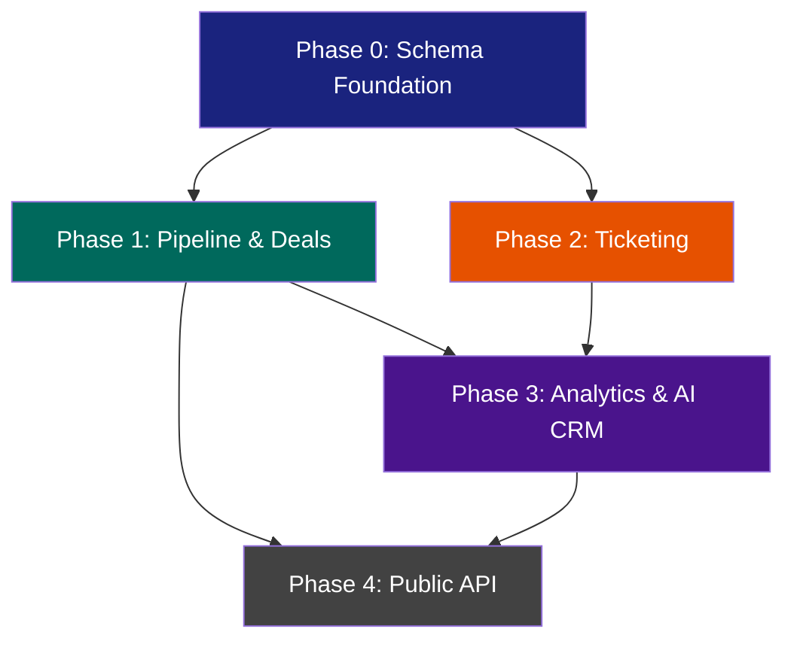

# Bridge Document: PMSync -> CRM Pro 360

> Mappatura delle capacita esistenti di PMSync rispetto ai requisiti CRM Pro 360.
> CRM Pro 360 si costruisce SOPRA PMSync, non lo sostituisce.

---

## 1. Mappatura Capacita Esistenti

Confronto tra le epic CRM Pro 360 e i moduli PMSync gia implementati.

| CRM Pro 360 Epic | PMSync Module | Stato | Copertura % | Gap Specifici |
|---|---|---|---|---|
| **EP-01 Infrastructure** | backend infra (NestJS 11, Prisma 7, PostgreSQL 17, Redis, BullMQ, Docker, CI/CD) | ✅ Completo | 95% | Manca Kafka (usa BullMQ), manca Elasticsearch (usa pgvector). BullMQ sufficiente per volume solo-dev. |
| **EP-02 Auth/RBAC** | `users/`, `tenants/`, `compliance/`, better-auth + JWT dual-stack, TOTP, passkeys | ✅ Completo | 90% | SSO SAML non implementato. Field-level security parziale (encryption esiste ma non row-level policies). ABAC non presente (solo RBAC coarse). |
| **EP-03 Contacts** | `contacts/` (CRUD, sync, dedup, relationship scoring, Google/Microsoft sync) | 🟡 Parziale | 60% | Manca: account/company hierarchy, segmentazione UI avanzata, bulk import/export CSV, campi custom configurabili da utente, timeline attivita unificata. |
| **EP-04 Pipeline & Deals** | -- | ❌ Non esiste | 0% | Tutto da costruire: Deal, Pipeline, Stage, Activity, Forecast. Nessun modello Prisma, nessun controller, nessun frontend. |
| **EP-05 Marketing Automation** | -- | ❌ Non esiste | 0% | Rimandato post-MVP. Campagne, sequence, A/B test, landing page non previsti nella prima release. |
| **EP-06 Ticketing/Support** | `email/` (engine completo: fetch, send, search, folders, templates, sync-back) | 🟡 Riutilizzabile | 20% | Email engine riutilizzabile come base per ticket inbound. Manca: modello Ticket, SLA engine, routing automatico, knowledge base, customer portal. |
| **EP-07 Analytics/Reporting** | `frontend/lib/api/analytics.ts` (skeleton), pagina analytics base | 🟡 Parziale | 15% | Skeleton API esiste. Manca: dashboard builder, report engine, widget configurabili, export PDF/Excel, scheduled reports. |
| **EP-08 AI/ML** | `ai-chat/` (15 tool services, SSE streaming, HITL, RAG, PII tokenization, pgvector) | 🟡 Parziale | 40% | Chat + tools + RAG funzionanti. Manca: lead scoring ML, churn prediction, deal forecasting, sentiment analysis su ticket, auto-categorization pipeline. |
| **EP-09 Integrations** | `providers/` (Google/Microsoft OAuth, factory pattern, multi-provider sync) | 🟡 Parziale | 30% | OAuth Google/Microsoft funzionante. Manca: public REST API documentata, webhook system outbound, SDK client, Zapier/n8n connector, import/export API. |
| **EP-10 Mobile** | PWA con offline (`offline-action-queue.ts`, service worker, push notifications) | 🟡 Alternativa | 35% | PWA con offline-first esiste e funziona. Niente React Native. Per MVP, PWA e sufficiente. React Native solo se il mercato lo richiede. |
| **EP-11 Marketplace/Plugins** | -- | ❌ Non esiste | 0% | Rimandato post-MVP. Plugin system, app store, developer portal non previsti. |
| **EP-12 Observability** | `health/`, `audit/`, Prometheus metrics, correlation IDs, audit interceptor | ✅ Completo | 85% | Prometheus endpoint, audit log con interceptor, health checks. Manca: distributed tracing (Jaeger), log aggregation centralizzato (usa console). |

---

## 2. Asset Riutilizzabili

Per ogni modulo PMSync che CRM Pro 360 estendera, dettaglio di cosa riutilizzare, cosa modificare, cosa creare ex novo.

### 2.1 Database Layer (Prisma)

**File chiave:**
- `backend/prisma/schema.prisma` (1652 righe, 40+ modelli)

**Riutilizzabile as-is:**
- Schema multi-tenant (ogni modello ha `tenantId`)
- Modelli `User`, `Tenant`, `Contact`, `Email`, `CalendarEvent`, `Label`
- Relazioni Contact <-> Email, Contact <-> CalendarEvent
- Pattern di soft-delete e timestamp (`createdAt`, `updatedAt`, `deletedAt`)
- Indici su `tenantId` + FK compositi

**Da modificare:**
- Modello `Contact`: aggiungere `accountId` (FK verso nuovo modello `Account`), `lifecycleStage`, `leadSource`
- Modello `Label`: estendere per supportare label su Deal/Ticket oltre che Email

**Nuovi modelli da creare:**
```
Account          -- Azienda/organizzazione (parent di Contact)
Deal             -- Opportunita commerciale
Pipeline         -- Definizione pipeline (es. Sales, Onboarding)
Stage            -- Fasi del pipeline (ordinate)
DealActivity     -- Log attivita su deal (call, email, note, meeting)
Ticket           -- Richiesta supporto
TicketComment    -- Commenti su ticket
SlaPolicy        -- Definizione SLA (response time, resolution time)
DashboardWidget  -- Widget personalizzati per analytics
Report           -- Report salvati
```

**Strategia migrazione:**
- Aggiungere modelli CRM nello stesso `schema.prisma`
- Migrazioni incrementali (`npx prisma migrate dev --name add_crm_pipeline`)
- Mai modificare migrazioni esistenti. Solo nuove migrazioni.
- Tutti i nuovi modelli DEVONO avere `tenantId` -- regola inviolabile

### 2.2 API Layer (Backend NestJS)

**File chiave:**
- `backend/src/modules/contacts/services/contact-crud.service.ts` -- pattern CRUD
- `backend/src/modules/contacts/services/relationship-score.service.ts` -- scoring
- `backend/src/modules/email/services/email-crud.service.ts` -- pattern CRUD email
- `backend/src/modules/email/services/email-search.service.ts` -- pattern ricerca
- `backend/src/modules/tenants/services/` -- tenant context propagation
- `backend/src/modules/users/services/` -- user management
- `backend/src/modules/compliance/guards/` -- GDPR guards
- `backend/src/modules/audit/interceptors/` -- audit trail automatico
- `backend/src/modules/subscription/guards/` -- feature gating per piano

**Riutilizzabile as-is:**
- Pattern controller -> service -> Prisma con `tenantId` filter
- DTO validation con `class-validator` + `class-transformer`
- Audit interceptor (logga automaticamente ogni mutation)
- Tenant guard e tenant context decorator
- Auth guard (better-auth session check)
- Subscription guard per feature-gating
- Error handling pattern (`HttpException` factory)
- Pagination helper (cursor-based e offset)

**Da modificare:**
- `contacts.service.ts`: aggiungere metodi per linking Contact <-> Account, Contact <-> Deal
- `relationship-score.service.ts`: estendere scoring con dati CRM (deal value, ticket history)

**Nuovi moduli da creare:**
```
backend/src/modules/crm/
  pipeline/
    pipeline.module.ts
    controllers/pipeline.controller.ts
    services/pipeline.service.ts
    services/deal.service.ts
    services/stage.service.ts
    services/deal-activity.service.ts
    dto/create-deal.dto.ts
    dto/update-deal.dto.ts
    dto/create-pipeline.dto.ts
    dto/move-deal.dto.ts
  tickets/
    tickets.module.ts
    controllers/ticket.controller.ts
    services/ticket.service.ts
    services/sla.service.ts
    services/ticket-routing.service.ts
    dto/create-ticket.dto.ts
    dto/update-ticket.dto.ts
  analytics/
    analytics.module.ts
    controllers/dashboard.controller.ts
    services/dashboard.service.ts
    services/report-engine.service.ts
    dto/create-widget.dto.ts
```

### 2.3 Frontend

**File chiave:**
- `frontend/lib/api/crm.ts` -- gia esiste (stale contacts endpoint)
- `frontend/lib/api/contacts.ts` -- API contacts
- `frontend/lib/api/analytics.ts` -- skeleton analytics
- `frontend/lib/api-client.ts` -- HTTP client configurato
- `frontend/lib/hooks/use-translations.ts` -- i18n
- `frontend/locales/en.ts`, `frontend/locales/it.ts` -- stringhe
- `frontend/lib/query-client.tsx` -- TanStack Query config (staleTime 5min, gcTime 30min)
- `frontend/lib/context/` -- React context providers

**Riutilizzabile as-is:**
- `apiClient` con interceptor auth (cookie-based, `credentials: 'include'`)
- TanStack Query setup con `queryOptions()` pattern
- MUI theme con colori semantici (primary teal, secondary purple)
- Layout dashboard esistente (sidebar, topbar, content area)
- Pattern loading -> error -> empty -> data nei componenti
- i18n system (aggiungi stringhe in `en.ts`/`it.ts`, usa `t.section.key`)
- Offline action queue per operazioni offline-first

**Da modificare:**
- `frontend/lib/api/crm.ts`: estendere con endpoint pipeline, deals, tickets
- `frontend/locales/en.ts` e `it.ts`: aggiungere sezioni `crm`, `pipeline`, `tickets`, `analytics`
- Sidebar navigation: aggiungere voci CRM

**Nuove pagine da creare:**
```
frontend/src/app/dashboard/crm/
  pipeline/page.tsx          -- Kanban board pipeline
  deals/page.tsx             -- Lista deals
  deals/[id]/page.tsx        -- Dettaglio deal
  tickets/page.tsx           -- Lista ticket
  tickets/[id]/page.tsx      -- Dettaglio ticket
  analytics/page.tsx         -- Dashboard analytics CRM
  settings/page.tsx          -- Configurazione pipeline/SLA
```

**Nuovi componenti:**
```
frontend/src/components/crm/
  PipelineKanban.tsx         -- Board Kanban drag-and-drop
  DealCard.tsx               -- Card deal nel Kanban
  DealDetailPanel.tsx        -- Pannello laterale dettaglio
  TicketList.tsx             -- Lista ticket con filtri
  TicketDetail.tsx           -- Dettaglio ticket
  ActivityTimeline.tsx       -- Timeline attivita su deal/contact
  DealForecastChart.tsx      -- Grafico forecast
  WidgetGrid.tsx             -- Grid dashboard personalizzabile
```

### 2.4 AI Layer

**File chiave:**
- `backend/src/modules/ai-chat/tools/` -- 15 tool services registrati
  - `email-tools.service.ts` -- operazioni email
  - `contact-tools.service.ts` -- operazioni contatti
  - `calendar-tools.service.ts` -- operazioni calendario
  - `folder-tools.service.ts` -- gestione cartelle
  - `follow-up-tools.service.ts` -- follow-up automatici
  - `reminder-tools.service.ts` -- promemoria
  - `rag-tools.service.ts` -- retrieval augmented generation
  - `conversation-tools.service.ts` -- gestione conversazioni
  - `email-productivity-tools.service.ts` -- produttivita email
  - `sandbox-tools.service.ts` -- esecuzione sicura
- `backend/src/modules/ai-chat/tools/index.ts` -- registry esportazioni
- `backend/src/modules/ai/tools/rag.tool.ts` -- RAG con pgvector
- `backend/src/modules/ai/services/` -- AI service layer

**Riutilizzabile as-is:**
- Tool registry pattern (registra tool -> AI li invoca automaticamente)
- SSE streaming pipeline (model -> stream -> frontend)
- HITL approval flow (azioni mutanti richiedono conferma utente)
- PII tokenization (dati sensibili mascherati prima di invio a LLM)
- RAG con pgvector (embedding + similarity search)
- Prompt engineering patterns (system prompt + tool descriptions)

**Nuovi tool da creare:**
```
backend/src/modules/ai-chat/tools/
  deal-tools.service.ts      -- Cerca deal, crea deal, sposta stage, aggiorna valore
  pipeline-tools.service.ts  -- Info pipeline, statistiche stage, forecast
  ticket-tools.service.ts    -- Crea ticket da email, assegna, cambia priorita
  crm-analytics-tools.service.ts -- Query analytics, genera report
```

### 2.5 Auth e Tenant Layer

**File chiave:**
- `backend/src/modules/tenants/services/` -- tenant CRUD e context
- `backend/src/modules/users/services/` -- user CRUD, ruoli
- `backend/src/modules/compliance/guards/` -- GDPR consent check
- `backend/src/modules/compliance/services/` -- data export, erasure
- `backend/src/modules/subscription/guards/` -- piano subscription check

**Riutilizzabile as-is al 100%. Nessuna modifica necessaria.**
- `@TenantContext()` decorator propaga `tenantId` in ogni request
- Auth guard verifica sessione better-auth
- RBAC guard verifica ruolo utente
- Subscription guard verifica piano attivo
- Compliance guard verifica consenso GDPR

I nuovi moduli CRM usano gli stessi guard decorando i controller:
```typescript
@UseGuards(AuthGuard, TenantGuard, RbacGuard)
@Controller('crm/deals')
export class DealController { ... }
```

### 2.6 Real-time Layer

**File chiave:**
- `backend/src/modules/realtime/gateways/realtime.gateway.ts` -- Socket.IO gateway
- `backend/src/modules/realtime/services/realtime-events.service.ts` -- event emitter
- `backend/src/modules/realtime/services/realtime-auth-token.service.ts` -- auth per WebSocket
- `backend/src/modules/realtime/services/realtime-handshake.service.ts` -- handshake validation

**Riutilizzabile as-is:**
- Gateway Socket.IO con autenticazione
- Room pattern per tenant isolation
- Event emitter per notifiche real-time

**Da estendere (non modificare):**
- Aggiungere nuovi event types: `deal:moved`, `deal:won`, `deal:lost`, `ticket:created`, `ticket:assigned`, `ticket:resolved`
- Aggiungere room per pipeline view: `pipeline:{pipelineId}` (tutti gli utenti che guardano lo stesso pipeline ricevono aggiornamenti live del Kanban)
- Aggiungere room per ticket board: `tickets:{tenantId}`

---

## 3. Strategia di Integrazione Tecnica

### 3.1 Prisma Schema

Aggiungere modelli CRM allo stesso `backend/prisma/schema.prisma`. Non creare schema separati.

```
schema.prisma (attuale: 1652 righe, ~40 modelli)
  +  Account (~30 righe)
  +  Deal (~40 righe)
  +  Pipeline (~20 righe)
  +  Stage (~25 righe)
  +  DealActivity (~30 righe)
  +  Ticket (~35 righe)
  +  TicketComment (~20 righe)
  +  SlaPolicy (~20 righe)
  +  DashboardWidget (~25 righe)
  +  Report (~20 righe)
  = ~1920 righe totali (sotto soglia critica)
```

Tutte le FK verso modelli esistenti (`Contact`, `User`, `Tenant`) usano relazioni Prisma standard. Nessun JSONB per relazioni strutturate.

### 3.2 Organizzazione Moduli Backend

```
backend/src/modules/
  crm/                          <-- NUOVO namespace
    crm.module.ts               <-- Modulo root che importa sotto-moduli
    pipeline/
      pipeline.module.ts
      controllers/
      services/
      dto/
    tickets/
      tickets.module.ts
      controllers/
      services/
      dto/
    analytics/
      analytics.module.ts
      controllers/
      services/
      dto/
  ai-chat/tools/                <-- ESTENSIONE (nuovi file, non modifiche)
    deal-tools.service.ts
    pipeline-tools.service.ts
    ticket-tools.service.ts
```

Il `CrmModule` viene importato in `AppModule` come tutti gli altri moduli. Nessun lazy loading backend -- NestJS carica tutto all'avvio.

### 3.3 Frontend Pages

```
frontend/src/app/dashboard/
  crm/                          <-- NUOVA sezione
    layout.tsx                  <-- Layout CRM con sub-navigation
    pipeline/page.tsx
    deals/page.tsx
    deals/[id]/page.tsx
    tickets/page.tsx
    tickets/[id]/page.tsx
    analytics/page.tsx
    settings/page.tsx
```

Lazy-load via `React.lazy()` + `Suspense` con skeleton fallback, come da pattern esistente. Route CRM non impattano il bundle delle pagine email/calendar.

### 3.4 API Routes

Nuovi controller sotto struttura API esistente:
```
/api/v1/crm/pipelines          -- CRUD pipeline
/api/v1/crm/pipelines/:id/stages  -- Gestione stage
/api/v1/crm/deals              -- CRUD deal
/api/v1/crm/deals/:id/activities   -- Attivita deal
/api/v1/crm/deals/:id/move     -- Sposta deal tra stage
/api/v1/crm/tickets            -- CRUD ticket
/api/v1/crm/tickets/:id/comments  -- Commenti ticket
/api/v1/crm/analytics/widgets  -- CRUD widget dashboard
/api/v1/crm/analytics/reports  -- CRUD report
```

Stessi auth guard, stessa struttura DTO, stessa documentazione Swagger automatica.

### 3.5 Servizi Condivisi

Servizi PMSync riutilizzati senza modifica:
- **Cache**: `CacheService` (Redis) per caching pipeline stats, deal counts
- **Audit**: `AuditInterceptor` logga automaticamente ogni mutation CRM
- **Tenant**: `TenantService` per context propagation
- **Crypto**: `CryptoService` per encryption campi sensibili (deal value, notes confidenziali)
- **Push**: `PushService` per notifiche browser su deal won/lost, ticket assigned
- **Email**: `EmailSendService` per notifiche email su SLA breach, deal reminder
- **BullMQ**: Job queue per SLA check periodico, report generation, deal reminder scheduling

### 3.6 AI Tool Registration

Nuovi tool registrati nello stesso `ai-chat/tools/index.ts`. Il tool registry e un array di servizi -- basta aggiungere i nuovi:

```typescript
// backend/src/modules/ai-chat/tools/index.ts
export const AI_TOOL_SERVICES = [
  // ... existing tools ...
  DealToolsService,
  PipelineToolsService,
  TicketToolsService,
  CrmAnalyticsToolsService,
];
```

L'AI avra automaticamente accesso a comandi come:
- "Crea un deal per Acme Corp da 50k"
- "Sposta il deal #123 in fase Negoziazione"
- "Crea un ticket dalla email selezionata"
- "Mostrami il forecast del Q2"

---

## 4. Decisioni Architetturali

### 4.1 No Kafka -- BullMQ basta

**Razionale:** Volume previsto per solo-dev e primo go-to-market non giustifica Kafka. BullMQ su Redis gestisce job queue, retry, delayed jobs, rate limiting. Kafka aggiunge complessita operativa (ZooKeeper, partizioni, consumer groups) senza beneficio reale sotto 10k eventi/giorno.

**Migrazione futura:** Se il volume supera 50k eventi/giorno o servono event sourcing / replay, migrare a Kafka. L'interfaccia job-producer e gia astratta.

### 4.2 No Elasticsearch -- pgvector + FTS PostgreSQL

**Razionale:** PostgreSQL 17 con `tsvector` + `ts_query` copre full-text search per deal, ticket, contact. pgvector copre similarity search per RAG. Elasticsearch aggiunge un servizio da mantenere, sincronizzare, monitorare.

**Limite:** Se la ricerca su milioni di documenti diventa lenta (>500ms p95), valutare Elasticsearch o Meilisearch.

### 4.3 No micro-frontends -- Monolith Next.js

**Razionale:** Un solo sviluppatore. Micro-frontends aggiungono complessita di build, deploy, shared state senza beneficio. Lazy-loading routes via `React.lazy()` ottiene lo stesso code-splitting.

### 4.4 No servizio AI separato -- Estendi NestJS

**Razionale:** L'AI e gia integrata in NestJS con tool registry, SSE streaming, HITL. Creare un servizio FastAPI separato duplica l'auth, il tenant context, le connessioni DB. Estendere il modulo esistente e piu semplice e mantiene un singolo deploy.

**Limite:** Se i tool AI diventano >30 e il tempo di startup supera 15s, valutare estrazione in micro-servizio.

### 4.5 MUI unico framework UI

**Razionale:** PMSync usa MUI ovunque. Zero Tailwind nei componenti `.tsx`. Kanban board, ticket list, deal cards usano `Box`, `Card`, `Chip`, `DataGrid`, `sx` props. Nessun componente Radix/shadcn.

### 4.6 Single Prisma schema, no schema-per-tenant

**Razionale:** Multi-tenancy via `tenantId` column (row-level). Schema-per-tenant (schema PostgreSQL separato per tenant) aggiunge complessita enorme a migrazioni e connection pooling. Non giustificato per volume atteso (<100 tenant in fase iniziale).

---

## 5. Rischi della Strategia "Build on Top"

### 5.1 Accoppiamento stretto PMSync <-> CRM

**Rischio:** Modelli CRM dipendono da `Contact`, `User`, `Tenant` di PMSync. Se PMSync cambia schema, CRM si rompe.

**Mitigazione:** I modelli CRM usano FK standard con `onDelete: SetNull` dove possibile. Test di integrazione verificano che le relazioni cross-module funzionino. Mai modificare modelli PMSync esistenti per esigenze CRM -- estendere con nuovi campi opzionali.

### 5.2 Complessita schema Prisma

**Rischio:** Schema unico che cresce oltre 2500 righe diventa difficile da navigare e le migrazioni diventano rischiose.

**Mitigazione:** Commenti di sezione nel schema (`// === CRM MODELS ===`). File di migrazione atomici (una feature per migrazione). Backup DB prima di ogni migrazione in produzione. `prisma migrate diff` per preview prima di applicare.

### 5.3 Solo-dev burnout

**Rischio:** Un singolo sviluppatore che mantiene email client + calendar + contacts + CRM pipeline + ticketing + analytics + AI. Il carico di manutenzione cresce linearmente con ogni feature.

**Mitigazione:** MVP aggressivo: solo Pipeline + Deal nella Phase 1. Ticketing nella Phase 2. Analytics nella Phase 3. Marketing rimandato indefinitamente. Ogni fase deve essere completamente funzionale e stabile prima di iniziare la successiva. Nessun parallelismo tra fasi.

### 5.4 Scope creep

**Rischio:** CRM "completo" richiede centinaia di feature (automation rules, workflow builder, custom fields engine, reporting engine, API pubblica). La tentazione di aggiungere "solo una feature in piu" e costante.

**Mitigazione:** Documento di scope per ogni fase con lista esplicita di feature IN e feature OUT. Review dello scope a fine sprint. Se una feature non e nella lista, non si implementa. Punto.

### 5.5 Conflitti di upgrade PMSync

**Rischio:** Aggiornamenti a NestJS, Prisma, Next.js, MUI possono rompere sia PMSync che CRM. Due codebase da aggiornare contemporaneamente.

**Mitigazione:** E la stessa codebase (monorepo). Un aggiornamento copre tutto. Il rischio e solo se PMSync e CRM divergono in branch separati -- evitare a tutti i costi. Tutto su `main`.

### 5.6 Performance con dati CRM

**Rischio:** Query che joinano Contact + Deal + Email + Activity su dataset grandi (>100k deal) possono diventare lente.

**Mitigazione:** Indici composti su `(tenantId, pipelineId, stageId)` per query pipeline. Materialized view per statistiche aggregate (deal count per stage, revenue per mese). Cache Redis per dashboard widgets con TTL 5 minuti.

### 5.7 Sicurezza multi-tenant

**Rischio:** Bug nel codice CRM che dimentica il filtro `tenantId` espone dati cross-tenant. Gia mitigato in PMSync ma ogni nuovo modulo riintroduce il rischio.

**Mitigazione:** Middleware Prisma che logga warning se una query su modelli CRM non include `tenantId`. Test automatici che verificano tenant isolation su ogni endpoint. Code review checklist: "c'e il tenantId?"

---

## 6. Sequenza di Implementazione Raccomandata

### Diagramma Dipendenze



### Phase 0: Schema Foundation (1 settimana)

**Obiettivo:** Preparare le fondamenta senza rompere nulla.

**Deliverable:**
- Modelli Prisma: `Account`, `Pipeline`, `Stage`, `Deal`, `DealActivity`
- Migrazione DB
- `CrmModule` vuoto registrato in `AppModule`
- Relazione `Contact.accountId` (opzionale, nullable)
- Seed data: pipeline "Sales" con 5 stage default

**Dipendenze:** Nessuna. PMSync funziona identico prima e dopo.

### Phase 1: Pipeline & Deals (3-4 settimane)

**Obiettivo:** CRUD pipeline completo con Kanban board funzionante.

**Deliverable Backend:**
- `PipelineController` + `PipelineService` -- CRUD pipeline e stage
- `DealController` + `DealService` -- CRUD deal, move tra stage, win/lose
- `DealActivityService` -- log automatico attivita (email inviata, meeting, nota)
- AI tools: `deal-tools.service.ts`, `pipeline-tools.service.ts`
- Socket.IO events: `deal:moved`, `deal:won`, `deal:lost`
- BullMQ job: deal reminder, stale deal detection

**Deliverable Frontend:**
- Pagina Pipeline con Kanban board (drag-and-drop MUI)
- Pagina Deal detail con timeline attivita
- Pagina Deal list con filtri e ricerca
- Sidebar: voce "CRM" con sotto-voci Pipeline, Deals
- Traduzioni `en.ts` / `it.ts` sezione `crm.pipeline`, `crm.deals`
- API module: estensione `frontend/lib/api/crm.ts`

**Dipendenze:** Phase 0 completata.

### Phase 2: Ticketing (2-3 settimane)

**Obiettivo:** Sistema ticket base con creazione da email e SLA tracking.

**Deliverable Backend:**
- Modelli Prisma: `Ticket`, `TicketComment`, `SlaPolicy`
- `TicketController` + `TicketService` -- CRUD ticket
- `SlaService` -- calcolo SLA, breach detection
- `TicketRoutingService` -- assegnazione automatica round-robin
- AI tool: `ticket-tools.service.ts` (crea ticket da email)
- BullMQ job: SLA check ogni 5 minuti, notifica breach
- Link Email -> Ticket (una email puo generare un ticket)

**Deliverable Frontend:**
- Pagina Ticket list con filtri stato/priorita/assegnatario
- Pagina Ticket detail con thread commenti
- Azione "Crea ticket da email" nel email viewer
- Traduzioni sezione `crm.tickets`

**Dipendenze:** Phase 0 completata. Indipendente da Phase 1 (ma meglio dopo per evitare sovraccarico).

### Phase 3: Analytics & AI CRM (2-3 settimane)

**Obiettivo:** Dashboard analytics CRM e AI tools avanzati.

**Deliverable Backend:**
- Modelli Prisma: `DashboardWidget`, `Report`
- `DashboardController` + `DashboardService` -- CRUD widget
- `ReportEngineService` -- generazione report (aggregazioni SQL)
- AI tool: `crm-analytics-tools.service.ts` (query naturale su dati CRM)
- Materialized views: deal count per stage, revenue per mese, conversion rate

**Deliverable Frontend:**
- Dashboard CRM con widget configurabili (grafici, KPI, tabelle)
- Pipeline funnel chart
- Revenue forecast chart (basato su deal value * probability)
- Win/loss rate over time
- Componenti: `WidgetGrid.tsx`, `DealForecastChart.tsx`

**Dipendenze:** Phase 1 e Phase 2 completate (servono dati deal e ticket per analytics).

### Phase 4: Public API (post-MVP, opzionale)

**Obiettivo:** API REST pubblica documentata per integrazioni esterne.

**Deliverable:**
- API key management (generazione, revoca, rate limiting)
- Swagger/OpenAPI spec pubblica
- Webhook system outbound (notifica eventi CRM a URL esterne)
- Rate limiting per API key
- Documentazione developer

**Dipendenze:** Phase 1-3 stabili e in produzione.

---

## Appendice: Checklist Pre-Implementazione

Prima di iniziare Phase 0, verificare:

- [ ] PostgreSQL 17 supporta tutti i tipi necessari (gia verificato)
- [ ] Redis ha memoria sufficiente per BullMQ jobs aggiuntivi
- [ ] Prisma 7 supporta i pattern relazionali necessari (self-referencing Account hierarchy)
- [ ] MUI DataGrid Pro licenza copre uso CRM (o usare versione community)
- [ ] Drag-and-drop library scelta per Kanban (`@dnd-kit` o `react-beautiful-dnd`)
- [ ] Charting library scelta per analytics (`recharts` o `nivo` -- entrambe compatibili MUI)
- [ ] Swagger doc endpoint funzionante su `localhost:3000/api/docs-json`
