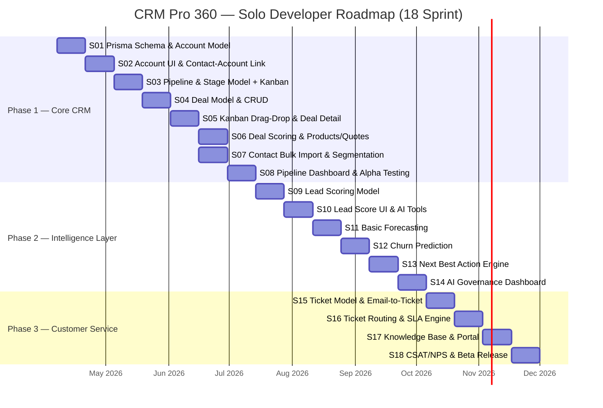

# CRM Pro 360 — Roadmap Solo Developer

> Roadmap rivisto per un singolo sviluppatore che costruisce il modulo CRM sopra PMSync.
> Ultimo aggiornamento: 2026-03-24

---

## 1. Panoramica Progetto Rivisto

### Vision

Trasformare PMSync da piattaforma di gestione email/calendario in un **CRM completo** con pipeline di vendita, intelligence layer e customer service — il tutto mantenuto da un solo sviluppatore.

### Parametri di Progetto

| Parametro | Valore |
|---|---|
| Sviluppatore | 1 persona |
| Sprint | 2 settimane, 15-20 SP/sprint |
| Sprint totali | 18 (~9 mesi) |
| Fasi | 3 (Core CRM, Intelligence, Customer Service) |
| Stack | NestJS 11 + Next.js 16 + MUI + Prisma + PostgreSQL + Redis + BullMQ |
| Backend path | `backend/src/modules/crm/` |
| Frontend path | `frontend/src/pages/dashboard/crm/` |

### Cosa PMSync Fornisce Gia

Non si parte da zero. PMSync copre gia:

- **Auth & multi-tenancy** — better-auth sessions, RBAC, tenant isolation
- **Email** — invio/ricezione, thread, label, AI triage
- **Calendario** — eventi, sincronizzazione Google
- **Contatti** — CRUD base, import, custom fields parziale
- **AI Chat** — streaming, tool calling, HITL approval
- **GDPR** — consenso, data export, audit trail
- **Observability** — logging strutturato, health checks

### Cosa e Stato Tagliato (Out of Scope MVP)

Funzionalita eliminate per rendere il progetto fattibile da una persona:

- Marketing automation (campagne, drip email, A/B testing)
- App mobile nativa (React Native) — PWA sufficiente
- Marketplace e plugin di terze parti
- Piattaforma API pubblica con SDK
- Multi-region deployment
- On-premise option

### Cosa e Stato Differito (Post-MVP)

Funzionalita rimandate a dopo il rilascio beta:

- Advanced analytics e dashboard builder personalizzabile
- On-premise deployment option
- Multi-region con replica PostgreSQL
- Integrations marketplace (Slack, Zapier, ecc.)

---

## 2. Gantt di Progetto

> **Nota:** S07 (Contact improvements) puo procedere in parallelo con S06 perche non ha dipendenze da Deal Scoring. Il Gantt mostra la dipendenza da S05 per sicurezza.

---

## 3. Dettaglio Per Fase

---

### Phase 1 — Core CRM (Sprint 1-8, ~4 mesi)

#### Sprint Breakdown

| Sprint | Titolo | Complessita | SP Stimati | Deliverable Chiave |
|---|---|---|---|---|
| S01 | Prisma Schema CRM + Account Model | L | 18 | Schema migrato, Account CRUD API, hierarchy tree |
| S02 | Account UI + Contact-Account Linking | M | 16 | Account list/detail pages, associazione contatti |
| S03 | Pipeline & Stage Model + Kanban Base | L | 20 | Pipeline CRUD, Stage ordering, Kanban skeleton |
| S04 | Deal Model & CRUD | M | 17 | Deal create/edit/delete, associazioni Deal-Contact-Account |
| S05 | Kanban Drag-Drop + Deal Detail View | L | 19 | DnD funzionante, deal detail con timeline |
| S06 | Deal Scoring + Products/Price Lists | M | 16 | Scoring rule-based, catalogo prodotti, quote base |
| S07 | Contact Bulk Import & Segmentation | M | 15 | CSV/XLSX import, filtri avanzati, custom fields |
| S08 | Pipeline Dashboard + Alpha Testing | M | 17 | Grafici conversione/velocity, saved views, bug fix round |

#### Milestones

| Milestone | Sprint | Acceptance Criteria |
|---|---|---|
| Schema CRM operativo | S01 | Migration eseguita, seed data inseriti, `npx prisma generate` senza errori. Account CRUD API risponde 200 su tutti gli endpoint. Test e2e per hierarchy passano. |
| Account management completo | S02 | UI lista account con ricerca/filtro. Detail page con tab info/contatti/attivita. Linking bidirezionale contact-account funzionante. |
| Pipeline visualizzabile | S03 | Almeno 1 pipeline con 5+ stage creabile da UI. Kanban mostra colonne ordinate. API supporta reorder stage via drag. |
| Deal lifecycle funzionante | S04 | Deal creabile con associazione a account + contatti. Cambio stage via API aggiorna `updatedAt`. History log registra ogni cambio. |
| Kanban production-ready | S05 | Drag-and-drop tra stage aggiorna DB in <200ms. Deal detail mostra timeline completa. Optimistic update senza flicker. |
| Pipeline con valore economico | S06 | Ogni deal ha valore calcolato da prodotti * quantita. Score rule-based visibile su card. Quote generabile in PDF. |
| Contatti potenziati | S07 | Import 10k contatti CSV in <30s. Segmenti salvabili e riusabili. Custom fields definibili per tenant. |
| Alpha release | S08 | Dashboard con metriche: conversion rate, avg deal velocity, pipeline value. 3+ saved views. Zero P0 bug. |

#### Rischi Phase 1

| # | Rischio | Prob. | Impatto | P x I | Mitigazione |
|---|---|---|---|---|---|
| R1 | Schema CRM troppo complesso, migration lente | Media | Alto | 6 | Partire con schema minimale, aggiungere campi solo quando servono. Evitare over-engineering relazionale. |
| R2 | Kanban drag-drop instabile con molte deal | Media | Alto | 6 | Usare `@dnd-kit/sortable` gia testato. Virtualizzare la lista se >100 deal per stage. Optimistic updates con rollback. |
| R3 | Contact-Account linking genera N+1 queries | Alta | Medio | 6 | Prisma `include` con depth massimo 2. Aggiungere indici composti su FK. Query monitoring dal primo sprint. |
| R4 | Custom fields schema explosion | Bassa | Alto | 4 | JSONB column con validazione Zod lato API. Indici GIN solo su campi filtrabili. Max 50 custom fields per tenant. |
| R5 | Scope creep su quote/PDF generation | Media | Medio | 4 | Quote v1 = HTML template semplice. Niente editor WYSIWYG. PDF via `@react-pdf/renderer` server-side. |
| R6 | Alpha testing rivela UX problemi gravi | Media | Alto | 6 | Rilascio alpha a 2-3 utenti fidati. Feedback loop settimanale. Budget 20% S08 per fix UX critici. |

#### Go/No-Go Criteria per Phase 2

- [ ] Tutti i milestone Phase 1 soddisfatti
- [ ] Zero bug P0/P1 aperti
- [ ] Pipeline dashboard mostra dati reali (non solo mock)
- [ ] Performance: lista deal <500ms, Kanban render <1s con 50+ deal
- [ ] Almeno 2 utenti alpha hanno usato il sistema per 1 settimana
- [ ] Copertura test backend CRM modules >70%

---

### Phase 2 — Intelligence Layer (Sprint 9-14, ~3 mesi)

#### Sprint Breakdown

| Sprint | Titolo | Complessita | SP Stimati | Deliverable Chiave |
|---|---|---|---|---|
| S09 | Lead Scoring Model | L | 20 | Feature engineering, training pipeline XGBoost, score batch job |
| S10 | Lead Score UI + AI Tool Extensions | M | 16 | Score badge su contatti, AI tool `deal_lookup`, sorted views |
| S11 | Basic Forecasting | L | 19 | ARIMA/Prophet pipeline, forecast dashboard, revenue projection |
| S12 | Churn Prediction | L | 18 | Churn model training, early warning alerts, risk indicators UI |
| S13 | Next Best Action Engine | M | 17 | Recommendation engine, suggestion cards in deal view, action queue |
| S14 | AI Governance Dashboard | M | 15 | Costo per modello, accuracy tracking, model versioning UI |

#### Milestones

| Milestone | Sprint | Acceptance Criteria |
|---|---|---|
| Lead scoring operativo | S09 | Pipeline di training eseguibile via BullMQ job. Score calcolato per tutti i contatti con `is_lead=true`. Accuracy >65% su dataset storico. |
| Score visibile in UI | S10 | Badge score colorato (hot/warm/cold) su contact list e deal cards. AI chat tool `crm_deal_lookup` risponde correttamente. Filtro per score range funzionante. |
| Forecasting base | S11 | Forecast mensile revenue generato automaticamente. Dashboard mostra actual vs predicted. Errore medio <25% su dati ultimi 3 mesi. |
| Early warning attivo | S12 | Churn score calcolato settimanalmente. Alert automatico quando score >0.7. UI mostra lista account a rischio ordinata per urgenza. |
| Suggerimenti azionabili | S13 | Almeno 5 tipi di azione suggerita (follow-up, upsell, meeting, ecc.). Card cliccabile che pre-compila azione. Feedback loop (utile/non utile). |
| Governance completa | S14 | Dashboard mostra costo AI per tenant/mese. Accuracy storica per modello. Possibilita di disabilitare modelli per tenant. |

#### Rischi Phase 2

| # | Rischio | Prob. | Impatto | P x I | Mitigazione |
|---|---|---|---|---|---|
| R7 | Dati insufficienti per training ML | Alta | Alto | 9 | Generare dataset sintetico per bootstrap. Usare modelli rule-based come fallback fino a N>1000 record. |
| R8 | XGBoost/Prophet troppo pesanti per server condiviso | Media | Alto | 6 | Training asincrono via BullMQ con concurrency=1. Limite memoria worker 512MB. Scheduling notturno. |
| R9 | Forecast inaccurato erode fiducia utente | Alta | Medio | 6 | Mostrare sempre confidence interval. Label chiaro "previsione sperimentale". Permettere override manuale. |
| R10 | AI tool extensions rompono chat esistente | Bassa | Alto | 4 | Test di regressione su tutti i tool esistenti prima di deploy. Feature flag per nuovi tool. |
| R11 | Costi AI imprevedibili con molti tenant | Media | Alto | 6 | Rate limiting per tenant su inference. Cache embedding con TTL 24h. Budget alert a 80% threshold. |
| R12 | Complessita modelli rallenta sprint velocity | Alta | Medio | 6 | Usare librerie pre-built (scikit-learn, prophet). Niente custom neural networks. Se il modello non converge in 2 giorni, passare a rule-based. |

#### Go/No-Go Criteria per Phase 3

- [ ] Lead scoring e churn prediction attivi in produzione da almeno 2 sprint
- [ ] Forecast accuracy <30% errore medio
- [ ] AI governance dashboard mostra costi reali
- [ ] Nessun impatto performance su funzionalita core CRM (P95 latency invariata)
- [ ] Costo AI per tenant controllato e sotto budget
- [ ] Zero regressioni su AI chat esistente

---

### Phase 3 — Customer Service (Sprint 15-18, ~2 mesi)

#### Sprint Breakdown

| Sprint | Titolo | Complessita | SP Stimati | Deliverable Chiave |
|---|---|---|---|---|
| S15 | Ticket Model + Email-to-Ticket | L | 19 | Schema ticket, servizio conversione email, ticket CRUD API |
| S16 | Ticket Routing + SLA Engine | L | 18 | Regole di routing, SLA timer, agent dashboard |
| S17 | Knowledge Base + Customer Portal | M | 16 | Articoli CRUD, ricerca full-text, portale pubblico leggero |
| S18 | CSAT/NPS + Service Analytics + Beta | M | 15 | Survey post-risoluzione, metriche SLA, beta release |

#### Milestones

| Milestone | Sprint | Acceptance Criteria |
|---|---|---|
| Ticketing operativo | S15 | Email in arrivo con subject `[SUPPORT]` genera ticket automaticamente. CRUD ticket completo. Stato: open/in_progress/waiting/resolved/closed. Link ticket-contact-account funzionante. |
| SLA enforced | S16 | SLA policy definibile per priority (P0=1h, P1=4h, P2=24h, P3=72h). Timer visibile su ogni ticket. Escalation automatica a 80% SLA. Dashboard agente con coda ordinata per urgenza. |
| Self-service attivo | S17 | Almeno 10 articoli KB creabili. Ricerca full-text con `tsvector` PostgreSQL. Portale pubblico con layout minimale, no auth richiesta per lettura. |
| Beta release | S18 | Survey CSAT inviata 24h dopo risoluzione ticket. NPS trimestrale schedulabile. Dashboard service: MTTR, first response time, CSAT medio. Zero P0 bug. |

#### Rischi Phase 3

| # | Rischio | Prob. | Impatto | P x I | Mitigazione |
|---|---|---|---|---|---|
| R13 | Email-to-ticket parsing fragile | Media | Alto | 6 | Riusare il motore email PMSync esistente. Regole di matching semplici (subject prefix, sender domain). Fallback: creazione manuale. |
| R14 | SLA timer impreciso con timezone diverse | Media | Medio | 4 | Salvare tutto in UTC. SLA calcolato in business hours configurabili per tenant. Usare `luxon` per timezone handling. |
| R15 | Customer portal espone dati sensibili | Bassa | Alto | 4 | Portale read-only per KB. Nessun dato cliente esposto. Rate limiting aggressivo. CSP headers restrittivi. |
| R16 | Scope creep sul portale (login, ticket tracking) | Alta | Medio | 6 | v1 = solo KB pubblica. Ticket tracking via email notification, non via portale. Login portale differito a post-MVP. |
| R17 | Burnout a fine progetto (sprint 15-18) | Alta | Alto | 9 | Ridurre SP target a 15/sprint in Phase 3. Nessun feature creep. Prioritizzare bug fix su nuove feature. Weekend liberi. |

#### Go/No-Go Criteria per Beta Release

- [ ] Tutti i milestone Phase 1-3 soddisfatti
- [ ] Zero bug P0, max 3 bug P1 aperti
- [ ] Performance: tutte le pagine CRM <1s load time
- [ ] SLA engine testato con scenario realistici (100+ ticket)
- [ ] CSAT survey funzionante end-to-end
- [ ] Backup e recovery testato
- [ ] Documentazione utente base completata

---

## 4. Sprint Velocity & Burndown

### Proiezione Velocity

| Sprint | SP Pianificati | SP Buffer (10%) | SP Netti | Cumulativo |
|---|---|---|---|---|
| S01 | 18 | 2 | 16 | 16 |
| S02 | 16 | 2 | 14 | 30 |
| S03 | 20 | 2 | 18 | 48 |
| S04 | 17 | 2 | 15 | 63 |
| S05 | 19 | 2 | 17 | 80 |
| S06 | 16 | 2 | 14 | 94 |
| S07 | 15 | 2 | 13 | 107 |
| S08 | 17 | 2 | 15 | 122 |
| S09 | 20 | 2 | 18 | 140 |
| S10 | 16 | 2 | 14 | 154 |
| S11 | 19 | 2 | 17 | 171 |
| S12 | 18 | 2 | 16 | 187 |
| S13 | 17 | 2 | 15 | 202 |
| S14 | 15 | 2 | 13 | 215 |
| S15 | 19 | 2 | 17 | 232 |
| S16 | 18 | 2 | 16 | 248 |
| S17 | 16 | 2 | 14 | 262 |
| S18 | 15 | 2 | 13 | 275 |

**Totale: 312 SP pianificati, 275 SP netti dopo buffer.**

### Buffer Strategy

- **10% per sprint** riservato a bug fix, tech debt, e imprevisti
- Se il buffer non viene usato, i SP rimangono "in banca" per sprint futuri
- Se un singolo sprint sfora del 20%+, il sprint successivo viene ridotto compensativamente
- **Mai accumulare debito tecnico** per piu di 2 sprint consecutivi

### Sustainable Pace

- **6-8 ore/giorno** di lavoro effettivo (coding + review + design)
- **Niente weekend** salvo emergenze di produzione
- **1 giorno/sprint** dedicato a refactoring e documentazione
- **Retrospettiva personale** a fine sprint: cosa ha funzionato, cosa no, cosa cambiare
- Se velocity scende sotto 12 SP per 2 sprint consecutivi: pausa di riflessione obbligatoria

---

## 5. Dipendenze Critiche

### Diagramma Dipendenze

```mermaid
graph LR
    S01[S01: Schema & Account] --> S02[S02: Account UI]
    S02 --> S03[S03: Pipeline & Stage]
    S03 --> S04[S04: Deal Model]
    S04 --> S05[S05: Kanban DnD]
    S05 --> S06[S06: Scoring & Products]
    S05 --> S07[S07: Contact Import]
    S06 --> S08[S08: Dashboard & Alpha]
    S07 -.-> S08

    S08 --> S09[S09: Lead Scoring]
    S09 --> S10[S10: Score UI & AI Tools]
    S10 --> S11[S11: Forecasting]
    S11 --> S12[S12: Churn Prediction]
    S12 --> S13[S13: Next Best Action]
    S13 --> S14[S14: AI Governance]

    S14 --> S15[S15: Ticket Model]
    S15 --> S16[S16: Routing & SLA]
    S16 --> S17[S17: Knowledge Base]
    S17 --> S18[S18: CSAT & Beta]

    style S01 fill:#e8f5e9
    style S03 fill:#fff3e0
    style S04 fill:#fff3e0
    style S05 fill:#fff3e0
    style S08 fill:#ffebee
    style S18 fill:#ffebee
```

> Linea tratteggiata = dipendenza debole (parallelizzabile).

### Critical Path

Il percorso critico e:

**S01 → S02 → S03 → S04 → S05 → S06 → S08 → S09 → ... → S18**

La pipeline di vendita (S03-S05) e la catena critica. Qualsiasi ritardo su questi sprint si propaga direttamente alla data di rilascio beta.

### Opportunita di Parallelismo

| Sprint Parallelo | Dipende da | Puo essere parallelo a |
|---|---|---|
| S07 (Contact Import) | S05 | S06 (Deal Scoring) |

S07 non richiede Deal Scoring ne Products, quindi puo essere sviluppato in contemporanea con S06. In pratica, dato che siamo un solo sviluppatore, il parallelismo significa **poter scegliere l'ordine** senza blocchi. Se S06 si rivela piu difficile del previsto, si puo fare S07 prima per mantenere momentum.

---

## 6. Cosa NON Fare (Scope Control)

Questa lista esiste per proteggere il progetto dallo scope creep. Ogni voce e una decisione consapevole, non una dimenticanza.

### Escluso dal MVP

| # | Funzionalita | Motivo Esclusione |
|---|---|---|
| X01 | Marketing automation (campagne, drip, A/B) | Richiede 4+ sprint dedicati. Problema diverso dal CRM core. |
| X02 | App mobile nativa (React Native) | PWA con MUI gia responsive. ROI nativo troppo basso per 1 dev. |
| X03 | Marketplace e plugin di terze parti | Richiede API pubblica stabile, sandboxing, review process. Anni di lavoro. |
| X04 | Public API con SDK (REST + client libraries) | API interna stabile prima. SDK richiede documentazione, versioning, supporto. |
| X05 | Multi-region deployment | Un solo PostgreSQL e sufficiente fino a migliaia di utenti. |
| X06 | On-premise deployment option | Richiede installer, air-gapped support, licensing. Non fattibile da soli. |
| X07 | GraphQL API | REST funziona. GraphQL aggiunge complessita senza valore per un CRM. |
| X08 | Visual workflow builder (drag-drop) | Automazioni gestite via config YAML/JSON. Editor visuale e un progetto a se. |
| X09 | White-label / tenant branding | Tema unico per tutti. Branding custom richiede asset pipeline, preview, testing. |

### Regola d'Oro

> Se una feature non e nella lista sprint S01-S18, **non esiste**. Se qualcuno la chiede (incluso te stesso), la risposta e: "Post-MVP, forse."

---

## 7. Evoluzione Post-MVP

Dopo i 18 sprint, il backlog prioritizzato per le fasi successive. L'ordine dipende dal feedback utenti beta.

### Backlog Prioritizzato

| Priorita | Feature | Effort Stimato | Trigger per Implementazione |
|---|---|---|---|
| 1 | Marketing automation (campagne email, template) | 4-6 sprint | 5+ utenti beta chiedono email marketing integrato |
| 2 | Advanced analytics & dashboard builder | 3-4 sprint | Utenti necessitano report custom oltre quelli built-in |
| 3 | Public API + webhooks | 2-3 sprint | Richieste di integrazione da parte di utenti con tool esterni |
| 4 | Integrations (Slack, Zapier, Make) | 2-3 sprint | Volume richieste integrazione > 30% user base |
| 5 | Customer portal con login e ticket tracking | 2 sprint | Utenti service desk richiedono self-service completo |
| 6 | Mobile native app (React Native) | 6-8 sprint | PWA insufficiente per use case specifici (notifiche push, offline) |
| 7 | Visual workflow builder | 4-5 sprint | Automazioni YAML troppo complesse per utenti non-tecnici |
| 8 | Multi-language UI (oltre IT/EN) | 1-2 sprint | Espansione a mercati non-italofoni |

### Principio Guida Post-MVP

Non aggiungere funzionalita perche "sarebbe bello". Aggiungere funzionalita perche **utenti reali le chiedono ripetutamente** e il business case e chiaro. Ogni feature aggiunta e una feature da mantenere per sempre.

---

## Appendice: Riepilogo Date Stimate

| Fase | Inizio | Fine | Durata |
|---|---|---|---|
| Phase 1 — Core CRM | 2026-04-07 | 2026-07-27 | ~4 mesi |
| Phase 2 — Intelligence Layer | 2026-07-27 | 2026-10-19 | ~3 mesi |
| Phase 3 — Customer Service | 2026-10-19 | 2026-12-14 | ~2 mesi |
| **Beta Release** | **2026-12-14** | | |

> Le date assumono zero interruzioni. Aggiungere 2-4 settimane di buffer realistico per malattia, imprevisti, e cali di motivazione.
