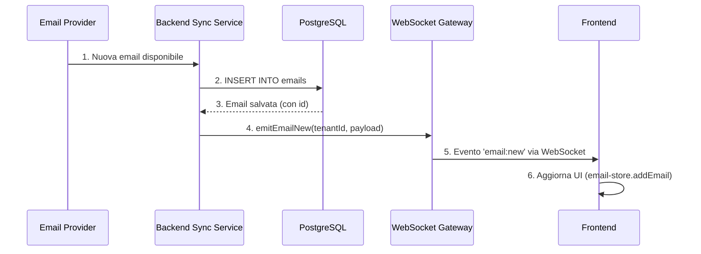
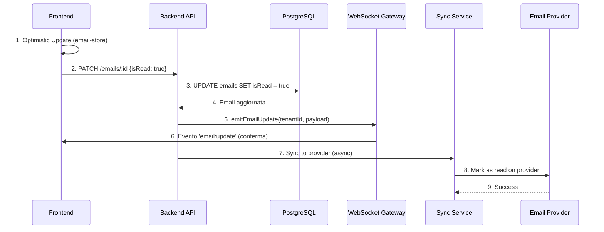
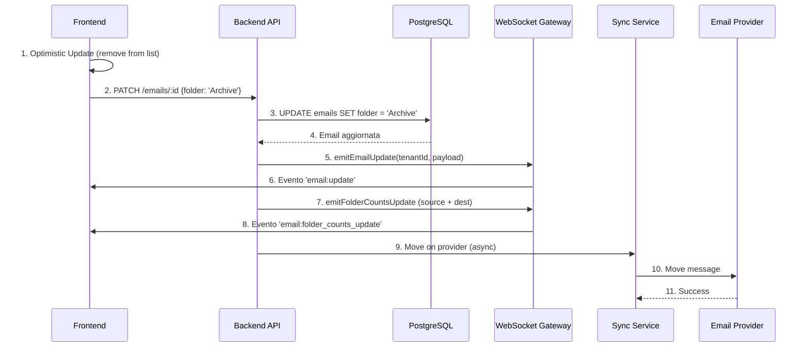
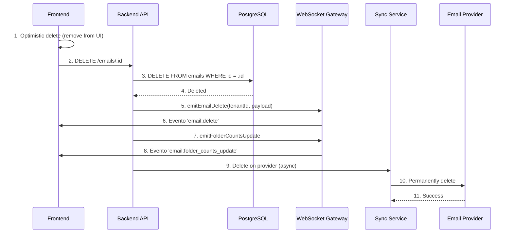

# WebSocket Bidirectional Email Flow - Test Plan

**Data**: 2025-11-23
**Scope**: Test completo della bidirezionalità email realtime
**Focus**: Server ↔ Backend ↔ Postgres ↔ Frontend

---

## Executive Summary

Questo documento descrive il piano di test per verificare la bidirezionalità completa del sistema email realtime, coprendo entrambi i flussi:

1. **INBOUND**: Email Provider → Backend → Postgres → WebSocket → Frontend
2. **OUTBOUND**: Frontend → API → Postgres → WebSocket → Provider

---

## Architettura del Sistema

```
┌──────────────────┐
│  Email Provider  │ (Gmail/Outlook/IMAP)
│  (Server)        │
└────────┬─────────┘
         │ ↕ Sync
         │
┌────────▼─────────┐
│   Backend        │
│   Email Sync     │ ← Riceve nuove email
│   Services       │ → Invia modifiche
└────────┬─────────┘
         │ ↕ R/W
         │
┌────────▼─────────┐
│   PostgreSQL     │
│   Database       │
└────────┬─────────┘
         │ ↕ Eventi
         │
┌────────▼─────────┐
│   WebSocket      │
│   Gateway        │
└────────┬─────────┘
         │ ↕ Realtime
         │
┌────────▼─────────┐
│   Frontend       │
│   React App      │
└──────────────────┘
```

---

## Flusso 1: INBOUND (Provider → Frontend)

### 📥 Scenario: Nuova Email Ricevuta

**Descrizione**: Un'email arriva nel provider esterno e deve apparire in realtime nel frontend

#### Step-by-Step Flow



#### Implementazione Attuale

**Backend**:
- 📍 [base-email-sync.service.ts](backend/src/modules/email-sync/services/base-email-sync.service.ts)
- 📍 [google-sync.service.ts](backend/src/modules/email-sync/services/gmail/google-sync.service.ts)
- 📍 [microsoft-sync.service.ts](backend/src/modules/email-sync/services/microsoft/microsoft-sync.service.ts)
- 📍 [imap-sync.service.ts](backend/src/modules/email-sync/services/imap/imap-sync.service.ts)

**WebSocket Event**:
```typescript
realtimeEvents.emitEmailNew(tenantId, {
  emailId: savedEmail.id,
  externalId: savedEmail.externalId,
  providerId: savedEmail.providerId,
  folder: savedEmail.folder,
  reason: 'message-processed',
  email: savedEmail, // ✅ Complete email object
  timestamp: new Date().toISOString()
});
```

**Frontend**:
- 📍 [use-websocket.ts:120-125](frontend/hooks/use-websocket.ts#L120-L125)

```typescript
const unsubEmailNew = websocketClient.onEmailNew((data) => {
  console.log('[WS] Email new:', data);
  if (data.email) {
    addEmail(data.email);
  }
});
```

#### Test Cases

**TC-INBOUND-001: Nuova Email in INBOX**
- ✅ **Given**: Utente connesso al WebSocket, provider configurato
- ✅ **When**: Arriva nuova email nel provider
- ✅ **Then**: Email appare automaticamente nella UI senza refresh

**TC-INBOUND-002: Nuova Email con Allegati**
- ✅ **Given**: Utente connesso al WebSocket
- ✅ **When**: Arriva email con 2 allegati
- ✅ **Then**: Email mostra icona allegati correttamente

**TC-INBOUND-003: Aggiornamento Contatori**
- ✅ **Given**: INBOX ha 5 non lette
- ✅ **When**: Arriva nuova email
- ✅ **Then**: Contatore INBOX diventa 6

**TC-INBOUND-004: Multiple Emails (Batch)**
- ✅ **Given**: Sync full in corso
- ✅ **When**: Backend processa 100 email
- ✅ **Then**: Eventi buffered e UI aggiornata progressivamente

---

## Flusso 2: OUTBOUND (Frontend → Provider)

### 📤 Scenario A: Marca Email come Letta

**Descrizione**: Utente clicca "mark as read" e la modifica deve propagarsi al provider

#### Step-by-Step Flow



#### Implementazione Attuale

**Frontend**:
- 📍 [use-email-actions.ts:83-102](frontend/hooks/use-email-actions.ts#L83-L102)

```typescript
const handleMarkAsRead = async (emailIds: string[], isRead: boolean = true) => {
  // 1. Optimistic update
  markAsRead(emailIds);

  // 2. API calls
  await Promise.all(
    emailIds.map((id) => emailApi.updateEmail(id, { isRead }))
  );

  callbacks?.onSuccess?.(`Marked as ${isRead ? 'read' : 'unread'} ✓`);
};
```

**Backend API**:
- 📍 [emails.controller.ts:240-247](backend/src/modules/email/controllers/emails.controller.ts#L240-L247)

```typescript
@Patch(':id')
async updateEmail(
  @Req() req: any,
  @Param('id') id: string,
  @Body() data: { isRead?: boolean; isStarred?: boolean; folder?: string },
) {
  const tenantId = req.user.tenantId;
  return this.emailsService.updateEmail(id, tenantId, data);
}
```

**Backend Service**:
- 📍 [emails.service.ts:310-362](backend/src/modules/email/services/emails.service.ts#L310-L362)

```typescript
async updateEmail(id: string, tenantId: string, data: {...}) {
  // 1. Update in database
  const updated = await this.prisma.email.update({ where: { id }, data });

  // 2. Emit realtime event
  this.realtimeEvents.emitEmailUpdate(tenantId, {
    emailId: updated.id,
    providerId: updated.providerId,
    folder: targetFolder,
    updates: data,
    reason: 'message-processed',
  });

  // 3. Update folder counts (async)
  this.updateFolderCounts(...).catch(...);

  // 4. Sync to provider (async)
  this.syncChangesToProvider(email, data).catch(...);

  return updatedEmail;
}
```

**WebSocket Event**:
```typescript
realtimeEvents.emitEmailUpdate(tenantId, {
  emailId: updated.id,
  providerId: updated.providerId,
  folder: targetFolder,
  updates: { isRead: true },
  reason: 'message-processed',
  timestamp: new Date().toISOString()
});
```

**Frontend WebSocket**:
- 📍 [use-websocket.ts:127-135](frontend/hooks/use-websocket.ts#L127-L135)

```typescript
const unsubEmailUpdate = websocketClient.onEmailUpdate((data) => {
  if (data.email) {
    updateEmail(data.emailId || data.email.id, data.email);
  }
});
```

#### Test Cases

**TC-OUTBOUND-001: Mark as Read**
- ✅ **Given**: Email non letta in INBOX
- ✅ **When**: Utente clicca "Mark as read"
- ✅ **Then**:
  - UI aggiorna immediatamente (optimistic)
  - WebSocket conferma l'aggiornamento
  - Provider esterno riflette la modifica

**TC-OUTBOUND-002: Mark as Starred**
- ✅ **Given**: Email non starred
- ✅ **When**: Utente clicca stella
- ✅ **Then**:
  - Stella appare immediatamente
  - Evento WS ricevuto
  - Provider aggiornato

**TC-OUTBOUND-003: Bulk Mark as Read**
- ✅ **Given**: 10 email selezionate
- ✅ **When**: Bulk "Mark as read"
- ✅ **Then**:
  - Tutte 10 aggiornate in UI
  - 10 eventi WS ricevuti (o buffered)
  - Provider sincronizzato

---

### 📤 Scenario B: Sposta Email in Cartella

#### Step-by-Step Flow



#### Test Cases

**TC-OUTBOUND-004: Move to Archive**
- ✅ **Given**: Email in INBOX
- ✅ **When**: Utente sposta in Archive
- ✅ **Then**:
  - Email scompare da INBOX immediatamente
  - Contatore INBOX -1
  - Contatore Archive +1
  - Provider riflette lo spostamento

**TC-OUTBOUND-005: Move to Trash**
- ✅ **Given**: Email in INBOX
- ✅ **When**: Utente clicca delete
- ✅ **Then**:
  - Email va nel Trash
  - INBOX count aggiornato
  - Provider sincronizzato

---

### 📤 Scenario C: Delete Email (Permanente)

#### Step-by-Step Flow



#### Test Cases

**TC-OUTBOUND-006: Permanent Delete**
- ✅ **Given**: Email in Trash
- ✅ **When**: Utente clicca "Delete permanently"
- ✅ **Then**:
  - Email rimossa dalla UI
  - Evento `email:delete` ricevuto
  - Provider elimina definitivamente

---

## Flusso 3: BIDIREZIONALE (Round-trip)

### 🔄 Scenario: Multi-device Sync

**Descrizione**: Modifiche fatte su un client devono apparire su altri client connessi

#### Test Cases

**TC-BI-001: Mark as Read Multi-device**
- ✅ **Given**:
  - Browser A e Browser B connessi stesso account
  - Email non letta visibile in entrambi
- ✅ **When**: Browser A marca come letta
- ✅ **Then**:
  - Browser A: Update immediato (optimistic)
  - Browser B: Riceve evento WS e aggiorna UI
  - Provider: Sincronizzato

**TC-BI-002: New Email Multi-device**
- ✅ **Given**: Browser A e Browser B connessi
- ✅ **When**: Arriva nuova email dal provider
- ✅ **Then**:
  - Browser A e Browser B ricevono entrambi evento `email:new`
  - Email appare in entrambi contemporaneamente

**TC-BI-003: Folder Counts Multi-device**
- ✅ **Given**: Browser A e Browser B connessi
- ✅ **When**: Browser A sposta 5 email in Archive
- ✅ **Then**:
  - Browser B riceve eventi folder counts
  - Sidebar aggiornata in realtime su Browser B

---

## Verifica Punti Critici

### ✅ 1. Optimistic Updates con Rollback

**Location**: [use-email-actions.ts:107-127](frontend/hooks/use-email-actions.ts#L107-L127)

```typescript
const handleToggleRead = async (emailId: string, currentRead: boolean) => {
  const newRead = !currentRead;
  try {
    updateEmail(emailId, { isRead: newRead }); // Optimistic
    await emailApi.updateEmail(emailId, { isRead: newRead });
  } catch (error) {
    updateEmail(emailId, { isRead: currentRead }); // ⚠️ ROLLBACK
  }
};
```

**Test Cases**:
- **TC-OPT-001**: Network error durante update → Rollback corretto
- **TC-OPT-002**: 403 Forbidden → Rollback + errore mostrato
- **TC-OPT-003**: Update success → Nessun rollback, evento WS conferma

---

### ✅ 2. Event Buffering (Anti-spam)

**Location**: [realtime-events.service.ts:404-442](backend/src/modules/realtime/services/realtime-events.service.ts#L404-L442)

```typescript
// Configurazione buffering
EMAIL_BUFFER_MS = 200ms
EMAIL_BUFFER_MAX = 500 eventi
FOLDER_BUFFER_MS = 250ms
FOLDER_BUFFER_MAX = 200 eventi
```

**Test Cases**:
- **TC-BUFF-001**: 100 email processate in 50ms → Buffered e inviate in batch
- **TC-BUFF-002**: Folder counts update 50 volte → Deduplicated, solo ultimo valore inviato
- **TC-BUFF-003**: Buffer raggiunge MAX → Flush immediato

---

### ✅ 3. Tenant Isolation

**Location**: [realtime.gateway.ts:82-111](backend/src/modules/realtime/gateways/realtime.gateway.ts#L82-L111)

```typescript
async handleConnection(client: AuthenticatedSocket) {
  const authContext = await this.handshakeService.authenticate(client);
  await client.join(authContext.tenantRoom); // tenant:${tenantId}

  this.activeTenantConnections.set(client.tenantId, count + 1);
}
```

**Test Cases**:
- **TC-ISO-001**: Tenant A marca email → Tenant B NON riceve evento
- **TC-ISO-002**: Eventi emessi solo a room corretta
- **TC-ISO-003**: Connection tracking per tenant accurato

---

### ✅ 4. Email Complete Object vs Updates

**Location**: [use-websocket.ts:127-135](frontend/hooks/use-websocket.ts#L127-L135)

```typescript
const unsubEmailUpdate = websocketClient.onEmailUpdate((data) => {
  // ✅ Nuovo formato: email completa
  if (data.email) {
    updateEmail(data.emailId || data.email.id, data.email);
  }
  // ❌ Legacy formato rimosso
});
```

**Test Cases**:
- **TC-FMT-001**: Backend invia `data.email` completo → Frontend aggiorna correttamente
- **TC-FMT-002**: Backend include labels/attachments → Frontend riflette tutto
- **TC-FMT-003**: Nessun formato legacy supportato

---

## Test Automatici

### Script 1: Connessione WebSocket Base

**File**: `tests/e2e/websocket-connection.spec.ts`

```typescript
describe('WebSocket Connection', () => {
  it('should connect successfully with valid JWT', async () => {
    const token = await getAuthToken();
    const client = io('http://localhost:3000/realtime', {
      auth: { token }
    });

    await new Promise((resolve) => {
      client.on('connected', (data) => {
        expect(data.tenantId).toBeDefined();
        resolve();
      });
    });

    client.disconnect();
  });

  it('should reject connection with invalid token', async () => {
    const client = io('http://localhost:3000/realtime', {
      auth: { token: 'invalid' }
    });

    await expect(
      new Promise((resolve, reject) => {
        client.on('connected', resolve);
        client.on('connect_error', reject);
      })
    ).rejects.toThrow();
  });
});
```

---

### Script 2: Email INBOUND Flow

**File**: `tests/e2e/websocket-email-inbound.spec.ts`

```typescript
describe('Email INBOUND Flow', () => {
  let wsClient: Socket;
  let authToken: string;

  beforeEach(async () => {
    authToken = await getAuthToken();
    wsClient = io('http://localhost:3000/realtime', {
      auth: { token: authToken }
    });
    await waitForConnection(wsClient);
  });

  afterEach(() => {
    wsClient.disconnect();
  });

  it('should receive new email event when email arrives', async () => {
    const newEmailPromise = new Promise((resolve) => {
      wsClient.on('email:new', (data) => resolve(data));
    });

    // Simulate email arrival (trigger sync or send test email)
    await triggerTestEmail();

    const event = await newEmailPromise;
    expect(event).toMatchObject({
      emailId: expect.any(String),
      providerId: expect.any(String),
      reason: 'message-processed',
      email: expect.objectContaining({
        subject: expect.any(String),
        from: expect.any(String)
      })
    });
  });

  it('should receive folder counts update', async () => {
    const countsPromise = new Promise((resolve) => {
      wsClient.on('email:folder_counts_update', (data) => resolve(data));
    });

    await triggerTestEmail();

    const counts = await countsPromise;
    expect(counts).toMatchObject({
      providerId: expect.any(String),
      folderId: expect.any(String),
      totalCount: expect.any(Number),
      unreadCount: expect.any(Number)
    });
  });
});
```

---

### Script 3: Email OUTBOUND Flow

**File**: `tests/e2e/websocket-email-outbound.spec.ts`

```typescript
describe('Email OUTBOUND Flow', () => {
  let wsClient: Socket;
  let authToken: string;
  let testEmailId: string;

  beforeEach(async () => {
    authToken = await getAuthToken();
    wsClient = io('http://localhost:3000/realtime', {
      auth: { token: authToken }
    });
    await waitForConnection(wsClient);

    // Create test email
    testEmailId = await createTestEmail();
  });

  it('should receive update event after marking as read', async () => {
    const updatePromise = new Promise((resolve) => {
      wsClient.on('email:update', (data) => {
        if (data.emailId === testEmailId) resolve(data);
      });
    });

    // Call API to mark as read
    await axios.patch(
      `http://localhost:3000/emails/${testEmailId}`,
      { isRead: true },
      { headers: { Authorization: `Bearer ${authToken}` } }
    );

    const event = await updatePromise;
    expect(event).toMatchObject({
      emailId: testEmailId,
      updates: { isRead: true }
    });
  });

  it('should receive delete event after deletion', async () => {
    const deletePromise = new Promise((resolve) => {
      wsClient.on('email:delete', (data) => {
        if (data.emailId === testEmailId) resolve(data);
      });
    });

    await axios.delete(
      `http://localhost:3000/emails/${testEmailId}`,
      { headers: { Authorization: `Bearer ${authToken}` } }
    );

    const event = await deletePromise;
    expect(event).toMatchObject({
      emailId: testEmailId,
      reason: 'message-deleted'
    });
  });
});
```

---

### Script 4: Multi-device Sync

**File**: `tests/e2e/websocket-multi-device.spec.ts`

```typescript
describe('Multi-device Sync', () => {
  let clientA: Socket;
  let clientB: Socket;
  let authToken: string;

  beforeEach(async () => {
    authToken = await getAuthToken();

    clientA = io('http://localhost:3000/realtime', {
      auth: { token: authToken }
    });
    clientB = io('http://localhost:3000/realtime', {
      auth: { token: authToken }
    });

    await Promise.all([
      waitForConnection(clientA),
      waitForConnection(clientB)
    ]);
  });

  it('should sync email update across devices', async () => {
    const testEmailId = await createTestEmail();

    // Client B listens
    const updatePromise = new Promise((resolve) => {
      clientB.on('email:update', (data) => {
        if (data.emailId === testEmailId) resolve(data);
      });
    });

    // Client A triggers update via API
    await axios.patch(
      `http://localhost:3000/emails/${testEmailId}`,
      { isRead: true },
      { headers: { Authorization: `Bearer ${authToken}` } }
    );

    // Client B should receive the event
    const event = await updatePromise;
    expect(event.emailId).toBe(testEmailId);
  });
});
```

---

## Test Manuali

### Setup Ambiente Test

1. **Backend**: `npm run dev`
2. **Frontend**: `npm run dev`
3. **Redis**: Running (per BullMQ)
4. **PostgreSQL**: Running
5. **Provider**: Account email configurato

### Test Checklist

#### ✅ INBOUND Tests
- [ ] **IN-01**: Invia email al tuo account → Verifica arrivo realtime in UI
- [ ] **IN-02**: Verifica contatori aggiornati
- [ ] **IN-03**: Verifica email con allegati mostra icona
- [ ] **IN-04**: Apri 2 browser tabs → Email arriva in entrambi

#### ✅ OUTBOUND Tests
- [ ] **OUT-01**: Marca email come letta → Verifica sync a provider
- [ ] **OUT-02**: Aggiungi stella → Verifica sync
- [ ] **OUT-03**: Sposta in Archive → Verifica spostamento provider
- [ ] **OUT-04**: Delete email → Verifica eliminazione provider
- [ ] **OUT-05**: Bulk mark as read (10 email) → Verifica tutte sincronizzate

#### ✅ BIDIRECTIONAL Tests
- [ ] **BI-01**: Browser A marca letta → Browser B riceve update
- [ ] **BI-02**: Email arriva → Entrambi browser mostrano
- [ ] **BI-03**: Conta email in sidebar → Sync in realtime

#### ✅ ERROR Handling Tests
- [ ] **ERR-01**: Disconnetti rete → UI mostra "disconnected"
- [ ] **ERR-02**: Riconnetti rete → Auto-reconnect funziona
- [ ] **ERR-03**: API failure → Optimistic update rollback
- [ ] **ERR-04**: Token expired → Disconnessione pulita

---

## Metrics & Monitoring

### Eventi da Monitorare

```typescript
// Backend logs
[WS] Client connected: ${clientId} | Tenant: ${tenantId}
[WS] Emitted email:new to room ${room}
[WS] Flushed 50 buffered email event(s)
[WS] Client disconnected: ${clientId}

// Frontend logs (dev mode)
[WebSocket] Connected successfully
[WS] Email new: { emailId, subject }
[WS] Email update: { emailId, updates }
[WS] Folder counts update: { folderId, unreadCount }
```

### Performance Metrics

- **Connection Time**: < 500ms
- **Event Latency**: < 100ms (locale), < 500ms (cross-region)
- **Buffering Delay**: 200-250ms (configurabile)
- **Reconnect Time**: < 2s (con backoff)

---

## Troubleshooting Guide

### Problema: Eventi Non Ricevuti

**Checklist**:
1. ✅ WebSocket connesso? (`connectionStatus === 'connected'`)
2. ✅ Token JWT valido e non scaduto?
3. ✅ Tenant ID corretto nell'auth context?
4. ✅ Backend emette eventi? (check logs)
5. ✅ Frontend listener registrato? (check unsubscribe functions)

### Problema: Optimistic Update Non Revertito

**Checklist**:
1. ✅ Try-catch presente nell'action?
2. ✅ Rollback chiamato nel catch?
3. ✅ Store state correttamente aggiornato?

### Problema: Sync Provider Fallisce

**Checklist**:
1. ✅ Token provider valido?
2. ✅ Permessi corretti (OAuth scopes)?
3. ✅ Rate limiting provider?
4. ✅ Email esiste ancora sul provider?

---

## Conclusioni

Questo piano di test copre **tutti i flussi bidirezionali** del sistema email realtime:

✅ **INBOUND**: Provider → Backend → DB → WS → Frontend
✅ **OUTBOUND**: Frontend → API → DB → WS → Provider
✅ **MULTI-DEVICE**: Browser A ↔ Backend ↔ Browser B

### Next Steps

1. ✅ Implementare test automatici E2E
2. ✅ Setup CI/CD per test realtime
3. ✅ Monitoring Sentry/Datadog per eventi WS
4. ✅ Load testing (1000+ client connessi)

---

**Files Riferimento**:
- [WEBSOCKET_REVIEW.md](WEBSOCKET_REVIEW.md)
- [WEBSOCKET_REFACTOR_SUMMARY.md](WEBSOCKET_REFACTOR_SUMMARY.md)
- [WEBSOCKET_ALIGNMENT.md](WEBSOCKET_ALIGNMENT.md)

