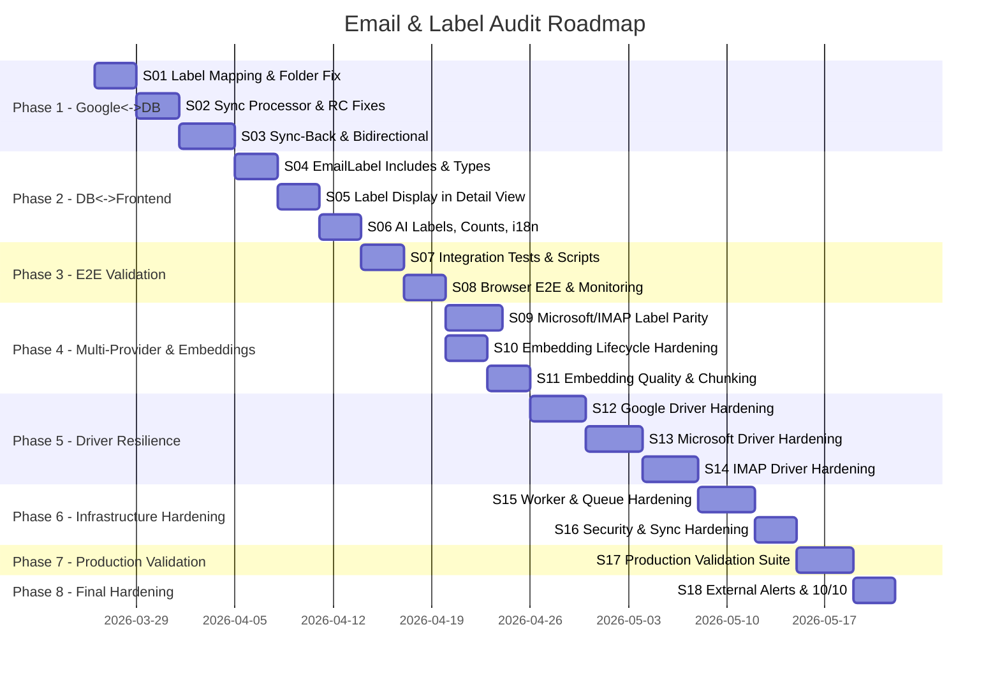

# Email & Label Audit - Roadmap

## Timeline



## Sprint Breakdown

| Sprint | Title | Phase | SP | Addresses |
|--------|-------|-------|-----|-----------|
| S01 | Label Mapping & Folder Determination | 1 | 13 | C1, C2, M1, M7 |
| S02 | Sync Processor & Race Conditions | 1 | 11 | C3, H5, M6 |
| S03 | Sync-Back & Bidirectional Consistency | 1 | 13 | C6, M8 |
| S04 | EmailLabel Includes & Type Safety | 2 | 10 | C4, H4, M3 |
| S05 | Label Display in Detail View | 2 | 10 | H1, H2, L5 |
| S06 | AI Labels, Counts, Translations | 2 | 10 | H3, M4, M5, L2, L3 |
| S07 | Integration Tests & Data Scripts | 3 | 10 | Cross-layer validation |
| S08 | Browser E2E & Monitoring | 3 | 8 | E2E proof, regression suite |
| S09 | Microsoft/IMAP Label Parity | 4 | 13 | MP1, MP2, MP3, MP4 |
| S10 | Embedding Lifecycle Hardening | 4 | 10 | E1, E2, E3, E4 |
| S11 | Embedding Quality & Chunking | 4 | 8 | E5, E6, E7 |
| S12 | Google Driver Hardening | 5 | 13 | G-C1, G-C2, G-C3, G-C4, G-H1, G-H2, G-H3 |
| S13 | Microsoft Driver Hardening | 5 | 13 | MS-C1, MS-C2, MS-C3, MS-C4, MS-H1, MS-H2, MS-H3, MS-H4 |
| S14 | IMAP Driver Hardening | 5 | 15 | IM-C1 to IM-C9, IM-H1, IM-H2 |
| S15 | Worker & Queue Hardening | 6 | 13 | IF-C1, IF-C2, IF-C6, IF-H4, IF-H5, IF-H6 |
| S16 | Security & Sync Hardening | 6 | 12 | IF-C3, IF-C4, IF-C5, IF-H1, IF-H2, IF-H3 |
| S17 | Production Validation Suite | 7 | 13 | All — validation layer |
| S18 | External Alerts & 10/10 Scorecard | 8 | 8 | Monitoring gap, G-H6 hardening, IM-H2 tests |
| **Total** | | | **203** | |

## Audit Scores (Pre-Fix Baseline)

| Component | Score | Critical | High | Medium |
|-----------|-------|----------|------|--------|
| Google Driver | 7.5/10 | 4 | 6 | 9 |
| Microsoft Driver | 6.5/10 | 4 | 6 | — |
| IMAP Driver | 6.8/10 | 9 | 7 | — |
| Shared Infrastructure | 7.2/10 | 6 | 6 | — |
| **Overall** | **7.0/10** | **23** | **25** | **9+** |

## Milestones

### M1: Google <-> DB Sync Correct (after S03)
- [ ] Folder determination handles all Gmail label combinations correctly
- [ ] `Email.labels[]` refreshed during folder sync (no stale IDs)
- [ ] `Email.folder` always matches folder derivation from `Email.labels[]`
- [ ] GIN index on `Email.labels[]` for query performance
- [ ] Sync-back queue processes label changes to Gmail
- [ ] RC-2 label merge (not atomic overwrite)

### M2: DB <-> Frontend Consistent (after S06)
- [ ] Email list query includes emailLabels with label details
- [ ] Email detail view shows all labels with remove capability
- [ ] AI labels displayed as secondary chips
- [ ] Sidebar label counts accurate after bulk operations
- [ ] No hardcoded strings — all translations in en.ts/it.ts
- [ ] Color validation on label chips

### M3: E2E Proven (after S08)
- [ ] Integration tests cover all 3 layers for label operations
- [ ] Data validation script can be run on demand
- [ ] Browser E2E tests for label CRUD workflow
- [ ] Monitoring alert for label count discrepancies

### M4: Multi-Provider & Embedding Integrity (after S11)
- [ ] Microsoft categories sync bidirectionally (Outlook <-> DB <-> Frontend)
- [ ] IMAP folder operations robust across server implementations
- [ ] All email deletion paths clean up embeddings (no orphans)
- [ ] Bulk soft-delete triggers immediate embedding cleanup (not 30-min delay)
- [ ] Embedding text includes sender/recipient/date metadata
- [ ] Chunk overlap prevents context loss at boundaries
- [ ] Embedding model gets English prefixes (not hardcoded Italian)

### M5: All Drivers Production-Hardened (after S14)
- [ ] Google: token refresh, batch failures, rate limits — all handled
- [ ] Microsoft: tenant-isolated caches, delta token validation, active rate limiting
- [ ] IMAP: classified errors, SMTP pooling, reconnection, UTF-7 support
- [ ] All drivers: typed error hierarchy (recoverable vs fatal)
- [ ] Input validation on all external IDs (messageId, labelId, folderId, pageToken)

### M6: Infrastructure Battle-Tested (after S16)
- [ ] Worker crash isolation — one worker down, others continue
- [ ] Queue backpressure — bounded depth per tenant
- [ ] Webhook replay prevention — idempotency + timestamp validation
- [ ] OAuth token refresh race condition eliminated
- [ ] Scheduler locks atomic and self-renewing
- [ ] Sync tokens auto-recover on invalidation
- [ ] Webhook subscriptions auto-renewed before expiration

### M7: Production 10/10 (after S17)
- [ ] Driver integration tests cover all error paths
- [ ] Worker/queue tests verify isolation and recovery
- [ ] Health endpoint reports all components
- [ ] Data consistency validation script passes clean
- [ ] Production scorecard >= 9.5/10 across all 10 categories
- [ ] E2E: email lifecycle (create/modify/delete) works on all 3 providers with embedding cleanup

## Go/No-Go Criteria

### Phase 1 -> Phase 2
- [ ] All C1-C6 findings addressed or explicitly deferred with rationale
- [ ] `npx tsc --noEmit` passes in backend
- [ ] Existing email sync tests pass
- [ ] Manual verification: Gmail labels match DB labels for 10 sample emails

### Phase 2 -> Phase 3
- [ ] All H1-H5 findings addressed
- [ ] `npx tsc --noEmit` passes in frontend
- [ ] Label display works in both list and detail views
- [ ] Translations complete for en.ts and it.ts

### Phase 3 -> Phase 4
- [ ] S07-S08 complete, validation scripts show 0 inconsistencies
- [ ] Monitoring health check deployed
- [ ] No regressions in Google label sync

### Phase 4 -> Phase 5
- [ ] S09-S11 complete
- [ ] Embedding lifecycle proven clean (no orphans after 24h)
- [ ] Multi-provider label operations work per design (Google: sync-back, MS: categories, IMAP: local-only)

### Phase 5 -> Phase 6
- [ ] All 3 drivers pass error injection tests
- [ ] Token refresh works under concurrent load
- [ ] No cross-tenant data leaks in Microsoft folder cache
- [ ] IMAP reconnects automatically after network drop

### Phase 6 -> Phase 7
- [ ] Worker isolation proven (kill one, others survive)
- [ ] Queue backpressure returns 429 at limit
- [ ] Webhook idempotency prevents duplicate processing
- [ ] All security checks pass

## Dependency Diagram

```
S01 (Label Mapping) ──> S02 (Sync Processor) ──> S03 (Sync-Back)
                                                      │
S04 (EmailLabel Includes) <───────────────────────────┘
    │
    ├──> S05 (Detail View)
    └──> S06 (AI Labels, i18n)
              │
              └──> S07 (Integration Tests) ──> S08 (E2E)
                                                    │
                          ┌─────────────────────────┤
                          │                         │
                    S09 (MS/IMAP Parity)      S10 (Embed Lifecycle)
                                                    │
                                              S11 (Embed Quality)
                                                    │
                    S12 (Google Hardening) <─────────┘
                          │
                    S13 (Microsoft Hardening)
                          │
                    S14 (IMAP Hardening)
                          │
                    S15 (Worker/Queue Hardening)
                          │
                    S16 (Security/Sync Hardening)
                          │
                    S17 (Production Validation)
```

S01-S03 are strictly sequential.
S05 and S06 can run in parallel after S04.
S07-S08 are strictly sequential.
S09 and S10 can run in parallel after S08.
S11 depends on S10.
S12-S14 are sequential (error patterns cascade from Google -> MS -> IMAP).
S15-S16 are sequential (worker patterns before security layer).
S17 depends on all previous sprints.

## Critical Path

**S01 -> S02 -> S03 -> S04 -> S05/S06 -> S07 -> S08 -> S10 -> S11 -> S12 -> S13 -> S14 -> S15 -> S16 -> S17**

Longest path: ~55 working days.

## Velocity Assumptions

- Solo developer
- 8-15 SP per sprint (3-4 day sprints)
- Buffer: 20% contingency per phase
- Total: ~14 weeks including buffer

## Phase 5 Findings - Driver Deep Audit

### Google Driver Gaps (7.5/10)

| # | Finding | Severity | Impact |
|---|---------|----------|--------|
| G-C1 | Token refresh fails mid-operation — no retry with fresh token after 401 | CRITICAL | Stalled sync, lost operations |
| G-C2 | Batch API partial failures silently ignored — entire batch treated as pass/fail | CRITICAL | Missing emails after batch fetch |
| G-C3 | Rate limit 429 retries use fixed delay — amplifies load during throttling windows | CRITICAL | Account-level rate ban from Google |
| G-C4 | `pageToken` from pagination passed without format validation | CRITICAL | Potential injection in API request |
| G-H1 | Attachment size validated after download starts — wasted bandwidth | HIGH | Slow sync, resource waste |
| G-H2 | Error responses not categorized — all treated as transient | HIGH | Fatal errors retried pointlessly |
| G-H3 | `createDraft()` accepts unvalidated `threadId` — no existence check | HIGH | Orphaned drafts |
| G-H4 | Archive label logic: custom-label-only → INBOX (already C2 in Phase 1) | HIGH | Already addressed in S01 |
| G-H5 | Batch partial failure count not logged | HIGH | No visibility into data loss |
| G-H6 | Search query allows Gmail operator injection from user input | HIGH | Unintended search scope |

### Microsoft Driver Gaps (6.5/10)

| # | Finding | Severity | Impact |
|---|---------|----------|--------|
| MS-C1 | No active token refresh — relies on MSAL auto-refresh that can fail silently | CRITICAL | Silent auth failure, stalled sync |
| MS-C2 | `folderIdCache` and `folderPathCache` shared across all tenants | CRITICAL | Cross-tenant data leak (security) |
| MS-C3 | Batch requests don't handle per-request 401 — only check overall batch status | CRITICAL | Auth failures masked in batch |
| MS-C4 | Delta tokens stored without timestamp — old tokens cause 410 Gone with no recovery | CRITICAL | Sync stops silently |
| MS-H1 | Rate limiter defined but not wired to API calls | HIGH | Throttling not enforced |
| MS-H2 | Batch errors not distinguished by type (auth vs not-found vs server) | HIGH | Wrong retry strategy |
| MS-H3 | No attachment size limit before download | HIGH | Memory pressure on large files |
| MS-H4 | Inline images not distinguished from attachments | HIGH | Incorrect embedding content |

### IMAP Driver Gaps (6.8/10)

| # | Finding | Severity | Impact |
|---|---------|----------|--------|
| IM-C1 | No IMAP connection error classification — all errors generic `Error` | CRITICAL | Auth errors retried, network errors not |
| IM-C2 | SMTP operations have no error handling — raw nodemailer errors | CRITICAL | Send failures with no recovery |
| IM-C3 | No tenant isolation in IMAP service state | CRITICAL | Potential cross-tenant access |
| IM-C4 | Connection pool race condition — concurrent ops can grab same connection | CRITICAL | Corrupted IMAP state |
| IM-C5 | No reconnection logic after connection drop | CRITICAL | Account goes offline permanently until restart |
| IM-C6 | Message IDs not validated for path traversal characters | CRITICAL | Potential security vulnerability |
| IM-C7 | No SMTP connection pooling — new connection per send | CRITICAL | Resource waste, SMTP server rejection |
| IM-C8 | IDLE max attempts exhaustion — silent failure with no fallback | CRITICAL | Push notifications stop silently |
| IM-C9 | No UTF-7 folder name decoding — non-ASCII names garbled | CRITICAL | Non-Latin folder names unusable |
| IM-H1 | No connection timeout for initial IMAP connect | HIGH | Thread hangs indefinitely |
| IM-H2 | No SMTP rate limiting — can flood server | HIGH | IP-level SMTP ban |

### Shared Infrastructure Gaps (7.2/10)

| # | Finding | Severity | Impact |
|---|---------|----------|--------|
| IF-C1 | BullMQ workers share process — one unhandled error crashes all | CRITICAL | Full sync outage |
| IF-C2 | `RedisLockService` scope unclear — possible injection issues | CRITICAL | Lock failures, duplicate processing |
| IF-C3 | Webhooks have no replay protection | CRITICAL | Replay attacks cause duplicate syncs |
| IF-C4 | Scheduler lock not atomic with execution — race window | CRITICAL | Concurrent scheduled jobs |
| IF-C5 | Folder operations have no recursion depth limit | CRITICAL | Stack overflow on deeply nested folders |
| IF-C6 | Queue backpressure not enforced — unlimited queue depth | CRITICAL | Memory exhaustion |
| IF-H1 | OAuth token refresh race across concurrent requests | HIGH | "Token already used" errors |
| IF-H2 | Sync token invalidation not handled (404/410) | HIGH | Sync stops silently |
| IF-H3 | Webhook subscriptions expire with no auto-renewal | HIGH | Silent fallback to polling |
| IF-H4 | Stalled BullMQ jobs not recovered (maxStalledCount = 1) | HIGH | Jobs lost after single stall |
| IF-H5 | Bulk operations don't validate tenant boundary | HIGH | Cross-tenant operations possible |
| IF-H6 | IMAP IDLE can run multiple concurrent per account | HIGH | RFC 2177 violation |

## Explicit Exclusions

- Google Calendar sync (separate concern)
- Email threading model redesign (threadId field is out of scope)
- UserLabel access control (RBAC/ABAC — separate security audit)
- Email search full-text index optimization (separate performance audit)
- Embedding model migration (stays on Mistral mistral-embed)
- Frontend UI redesign (only functional fixes in scope)
- Mobile app (web-only)
